# 01 — NVision Platform Architecture

**Product:** NTech NVision  
**Document Type:** Software Architecture Baseline  
**Status:** Foundation Architecture  
**Version:** 1.0  
**Date:** 2026-08-18  
**Parent Document:** `NVISION_PLATFORM_FOUNDATION.md`

---

# 1. Purpose

This document defines the software architecture of **NTech NVision**.

It converts the high-level product vision from `NVISION_PLATFORM_FOUNDATION.md` into an implementable platform architecture covering:

- Process boundaries
- Module boundaries
- Dependency direction
- Runtime execution
- Studio engineering environment
- Device abstraction
- Workflow execution
- AI integration
- PLC/Robot/MES integration
- Plugin architecture
- Data flow
- API boundaries
- Windows deployment
- Jetson/Edge deployment
- Fault isolation
- Observability
- Security boundaries
- Versioning compatibility
- Testing strategy
- Repository mapping

This document is intended to be the primary architecture reference for engineers implementing the first production-capable version of NVision.

---

# 2. Architecture Goals

NVision must satisfy the following architecture goals.

## 2.1 Reusable Platform

A customer project must be expressed primarily through:

```text
Project
Job
Workflow
Recipe
Device Configuration
Model
Calibration
Plugin
```

rather than through a new application codebase.

---

## 2.2 Runtime Independence

Production execution must not depend on the NVision Studio UI.

Required relationship:

```text
NVision Studio
    │
    │ Build / Validate / Publish
    ▼
Deployment Package
    │
    ▼
NVision Runtime
```

Studio may crash or be absent while Runtime continues inspection.

---

## 2.3 Headless Execution

The execution layer must be capable of running without a desktop UI.

This is required for:

- Jetson
- Industrial PC
- Linux Edge deployment
- Remote-controlled Runtime
- Future embedded appliances

---

## 2.4 Hardware Abstraction

NVision Core must not directly depend on:

- Basler SDK
- Hikrobot SDK
- Mitsubishi libraries
- Siemens libraries
- TensorRT APIs
- OpenVINO APIs
- Vendor-specific Robot APIs

Vendor-specific dependencies must remain behind adapters or plugins.

---

## 2.5 Deterministic Production Behavior

The Runtime architecture must prioritize:

- Predictable execution
- Explicit errors
- Controlled concurrency
- Resource ownership
- Timeouts
- Cancellation
- Device recovery
- Result traceability

---

## 2.6 AI Backend Independence

Workflow nodes should request an AI task.

They should not care whether inference is performed by:

```text
ONNX Runtime
TensorRT
OpenVINO
DirectML
CUDA
```

---

## 2.7 Platform Extensibility

New capabilities should be addable without modifying core architecture.

Examples:

- New camera vendor
- New PLC protocol
- New AI backend
- New workflow node
- New storage backend
- New robot adapter

---

# 3. Architecture Style

NVision should use a **modular layered architecture with plugin-based adapters and a service-capable execution core**.

The architecture combines ideas from:

- Clean Architecture
- Hexagonal Architecture
- Modular Monolith
- Plugin Architecture
- Headless Runtime Service
- Event-driven internal messaging

NVision should **not** begin as a distributed microservice system.

For the MVP:

> Prefer a modular monolith with strict boundaries.

Later, selected modules may become separate services.

---

# 4. Architecture Overview

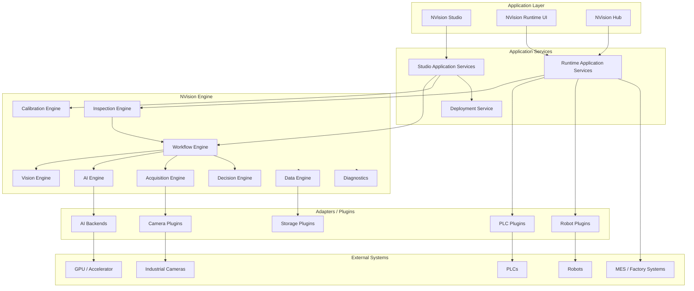

---

# 5. Primary Architecture Layers

NVision is divided into six primary layers.

```text
┌───────────────────────────────┐
│  1. Presentation             │
├───────────────────────────────┤
│  2. Application              │
├───────────────────────────────┤
│  3. Domain                   │
├───────────────────────────────┤
│  4. Engine                   │
├───────────────────────────────┤
│  5. Infrastructure / Plugins │
├───────────────────────────────┤
│  6. External Systems         │
└───────────────────────────────┘
```

---

# 6. Presentation Layer

Presentation contains user-facing applications.

Initial applications:

```text
NVision Studio
NVision Runtime UI
```

Future:

```text
NVision Trainer
NVision Hub
NVision Service Console
```

The Presentation Layer must not directly:

- Access camera SDKs
- Execute AI models
- Write PLC registers
- Execute workflow nodes
- Write directly into production database tables

Instead:

```text
UI
 ↓
Application Service
 ↓
Engine / Domain
```

---

# 7. Application Layer

The Application Layer coordinates use cases.

Examples:

```text
Create Project
Open Project
Validate Job
Run Test Inspection
Publish Package
Start Runtime
Stop Runtime
Select Recipe
Acknowledge Alarm
Capture Calibration Image
Deploy Model
```

Example interfaces:

```text
IProjectApplicationService
IInspectionApplicationService
IDeploymentApplicationService
IDeviceApplicationService
ICalibrationApplicationService
IRecipeApplicationService
IAlarmApplicationService
```

Application services orchestrate domain and engine components but should contain minimal image-processing logic.

---

# 8. Domain Layer

The Domain Layer defines NVision business concepts independently from UI and infrastructure.

Main domain entities:

```text
Project
Job
Recipe
WorkflowGraph
WorkflowNode
DeviceConfiguration
AIModelDescriptor
Calibration
Inspection
InspectionResult
Alarm
DeploymentPackage
Station
```

Important value objects:

```text
ProjectId
JobId
RecipeId
NodeId
DeviceId
InspectionId
ModelVersion
RecipeVersion
ProjectVersion
Timestamp
Measurement
BoundingBox
Confidence
```

The Domain Layer should be framework-light.

It should avoid dependencies on:

- WPF
- OpenCV
- TensorRT
- Camera SDKs
- SQL libraries
- PLC libraries

---

# 9. Engine Layer

The Engine Layer contains reusable runtime capabilities.

```text
NVision Engine
│
├── Core
├── Acquisition
├── Vision
├── AI
├── Workflow
├── Inspection
├── Decision
├── Calibration
├── Devices
├── Communication
├── Data
└── Diagnostics
```

This layer is the strategic core of NVision.

---

# 10. Infrastructure and Plugin Layer

Infrastructure implements technical details.

Examples:

```text
BaslerCameraPlugin
HikrobotCameraPlugin
OpenCvVisionBackend
TensorRtBackend
OnnxRuntimeBackend
MitsubishiMcPlugin
SiemensS7Plugin
SqliteInspectionRepository
FileImageStorage
SerilogLoggingAdapter
```

Dependency direction:

```text
Engine Interfaces
       ▲
       │
Infrastructure Implementations
```

Never reverse this relationship.

---

# 11. External Systems

External systems include:

```text
Industrial Cameras
PLC
Robot
MES
Database Server
GPU
Light Controller
Barcode Reader
Digital I/O
Network Storage
```

NVision must assume that any external system may:

- Disconnect
- Timeout
- Return invalid data
- Reconnect
- Restart independently

---

# 12. Core Dependency Rule

The most important dependency rule is:

```text
Presentation
    ↓
Application
    ↓
Domain / Engine Interfaces
    ↑
Infrastructure / Plugins
```

A core module may define:

```csharp
public interface ICamera
{
    Task<Frame> GrabAsync(...);
}
```

A Basler plugin may implement it.

The core project must never reference:

```text
Basler.Pylon.dll
```

directly.

---

# 13. Recommended Solution Structure

Initial .NET solution:

```text
NVision.sln

src/
├── NTech.NVision.Domain
├── NTech.NVision.Application
│
├── NTech.NVision.Engine.Core
├── NTech.NVision.Engine.Acquisition
├── NTech.NVision.Engine.Vision
├── NTech.NVision.Engine.AI
├── NTech.NVision.Engine.Workflow
├── NTech.NVision.Engine.Inspection
├── NTech.NVision.Engine.Decision
├── NTech.NVision.Engine.Calibration
├── NTech.NVision.Engine.Devices
├── NTech.NVision.Engine.Communication
├── NTech.NVision.Engine.Data
├── NTech.NVision.Engine.Diagnostics
│
├── NTech.NVision.Infrastructure
├── NTech.NVision.Infrastructure.Sqlite
├── NTech.NVision.Infrastructure.Storage
│
├── NTech.NVision.Plugin.Abstractions
├── NTech.NVision.Plugin.Camera.Basler
├── NTech.NVision.Plugin.Camera.Hikrobot
├── NTech.NVision.Plugin.Plc.Modbus
├── NTech.NVision.Plugin.Plc.Mitsubishi
├── NTech.NVision.Plugin.AI.OnnxRuntime
├── NTech.NVision.Plugin.AI.TensorRT
│
├── NTech.NVision.Runtime.Service
├── NTech.NVision.Runtime.UI
└── NTech.NVision.Studio
```

Do not create all projects immediately if they add unnecessary complexity.

Logical boundaries are more important than physical assembly count in Phase 1.

---

# 14. Process Architecture

NVision should evolve toward a multi-process architecture, but the MVP can begin with fewer processes.

Recommended production architecture:

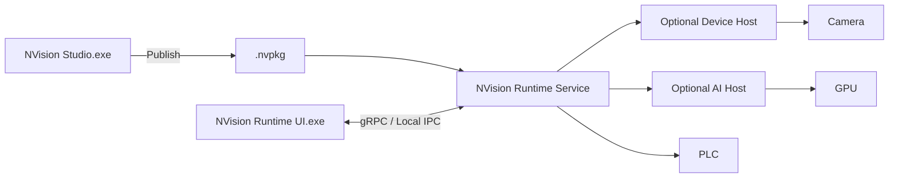

---

# 15. MVP Process Model

For the first implementation:

```text
NVision Studio.exe
    │
    └── In-process NVision Engine

NVision Runtime.exe
    │
    └── In-process NVision Engine
```

This is acceptable provided the architecture separates:

```text
UI
Application
Engine
Plugins
```

Later migration:

```text
NVision Runtime UI
       │
       ▼
NVision Runtime Service
       │
       ▼
NVision Engine
```

should not require rewriting the Engine.

---

# 16. Recommended Runtime Service Model

Long-term Runtime architecture:

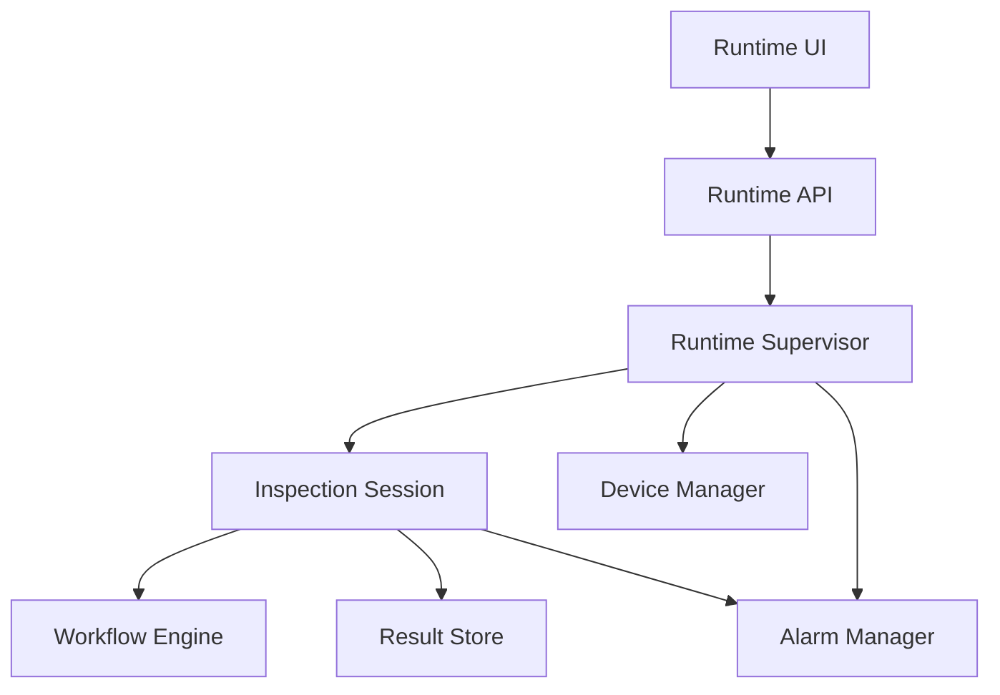

---

# 17. Runtime Supervisor

The Runtime Supervisor is the owner of production lifecycle.

Responsibilities:

- Load deployment package
- Validate compatibility
- Initialize plugins
- Connect required devices
- Load recipe
- Load AI models
- Check calibration
- Start inspection session
- Stop inspection session
- Recover devices
- Manage Runtime state
- Reject invalid start requests

Suggested states:

```text
Starting
Initializing
Ready
Running
Stopping
Stopped
Warning
Fault
Maintenance
```

State transition example:

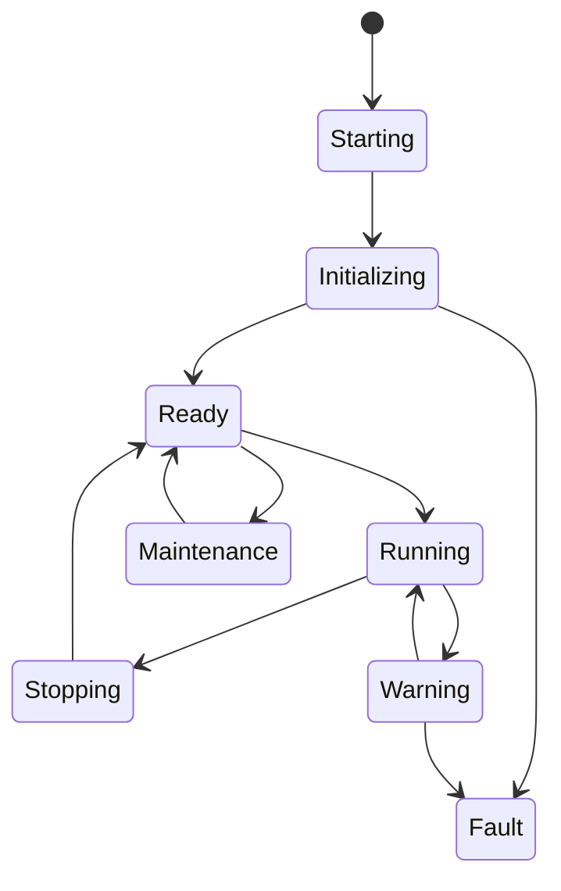

---

# 18. Inspection Session

An Inspection Session represents a production run using a fixed deployment context.

Session owns:

```text
Project Version
Selected Job
Selected Recipe
Device Set
Model Set
Calibration Set
Runtime Configuration
Counters
```

A recipe change should be handled as a controlled transition.

Do not silently modify execution parameters while an inspection is executing.

---

# 19. Inspection Execution Pipeline

Typical inspection:

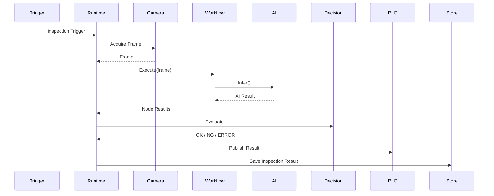

---

# 20. Trigger Architecture

Supported trigger types may include:

```text
Manual
Software
PLC
Digital Input
Encoder
Camera Hardware Trigger
External Sensor
Timer
```

Recommended abstraction:

```text
IInspectionTrigger
```

Trigger event:

```text
TriggerEvent
├── TriggerId
├── Timestamp
├── Source
├── ProductId
└── Metadata
```

The trigger subsystem must handle:

- Debounce
- Duplicate trigger
- Trigger queue
- Busy state
- Trigger timeout
- Overrun

---

# 21. Workflow Architecture

The Workflow Engine executes a directed graph.

Core concepts:

```text
WorkflowGraph
WorkflowNode
InputPort
OutputPort
Connection
ExecutionContext
NodeResult
```

---

# 22. Workflow Validation

Before execution, validate:

- Graph has no illegal cycles
- Required input ports connected
- Parameter types valid
- Referenced recipe parameters exist
- Required plugins exist
- Model references exist
- Device references exist
- Node versions are supported

A workflow that fails validation must not run in Production mode.

---

# 23. Workflow Execution Model

Recommended model:

```text
Validate
   ↓
Compile Execution Plan
   ↓
Allocate Resources
   ↓
Execute Nodes
   ↓
Collect Results
   ↓
Decision
   ↓
Release Temporary Resources
```

The graph may be converted into an internal execution plan.

This avoids repeatedly resolving dependencies for every frame.

---

# 24. Workflow Concurrency

Parallel execution is allowed only where dependencies permit.

Example:

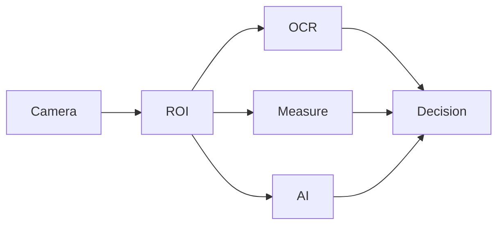

`OCR`, `Measure`, and `AI` may execute concurrently.

The Workflow Engine owns concurrency.

Individual workflow nodes should not create unmanaged background threads.

---

# 25. Workflow Cancellation

Every node must support cooperative cancellation where feasible.

Common causes:

- Runtime stop
- Emergency stop
- Recipe transition
- Inspection timeout
- Application shutdown

Recommended .NET pattern:

```text
CancellationToken
```

Native plugins should expose equivalent cancellation mechanisms.

---

# 26. Node Failure Policy

Each node execution returns one of:

```text
Success
Failed
Skipped
Timeout
Cancelled
InvalidInput
```

A node failure policy may be:

```text
AbortInspection
ReturnNG
Continue
UseFallback
```

Default production behavior for critical nodes:

> Abort inspection and return ERROR.

---

# 27. Node Data Model

Avoid passing arbitrary dynamic dictionaries as the primary contract.

Prefer typed values.

Possible data types:

```text
Image
Mask
Region
Point
Line
Circle
Contour
BoundingBox
Classification
DetectionList
TextResult
Measurement
Boolean
Integer
Float
String
Pose
Transform
InspectionDecision
```

Generic metadata may exist as an extension mechanism.

---

# 28. Image Ownership

Image memory management is critical.

Recommended principles:

- Avoid copying frames unnecessarily
- Use pooled buffers
- Make ownership explicit
- Support CPU and GPU-backed image buffers
- Release temporary buffers deterministically

Concept:

```text
FrameBuffer
├── MemoryType
│   ├── CPU
│   ├── PinnedCPU
│   ├── CUDA
│   └── Shared
├── PixelFormat
├── Dimensions
└── Lifetime
```

---

# 29. Acquisition Architecture

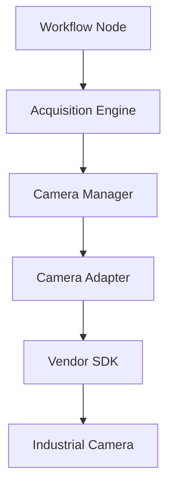

---

# 30. Camera Manager

Camera Manager responsibilities:

- Discover configured cameras
- Create camera adapter
- Connect/disconnect
- Apply configuration
- Start acquisition
- Execute trigger
- Retrieve frames
- Track health
- Reconnect
- Emit camera events

Camera Manager does not contain vendor-specific SDK logic.

---

# 31. Camera Plugin Contract

Conceptual interface:

```csharp
public interface ICameraDevice : IAsyncDisposable
{
    string DeviceId { get; }

    DeviceState State { get; }

    Task ConnectAsync(CancellationToken ct);

    Task DisconnectAsync(CancellationToken ct);

    Task ConfigureAsync(
        CameraConfiguration configuration,
        CancellationToken ct);

    Task<Frame> GrabAsync(
        GrabRequest request,
        CancellationToken ct);

    IAsyncEnumerable<DeviceEvent> Events(
        CancellationToken ct);
}
```

Actual API may differ.

The important point is contract stability.

---

# 32. Lighting Architecture

Lighting should be treated as a device, not as a UI setting.

```text
ILightController
```

Possible capabilities:

```text
SetChannelIntensity
EnableChannel
DisableChannel
Strobe
ReadState
```

Recipe may override light parameters.

---

# 33. Vision Engine Architecture

The Vision Engine owns traditional image-processing primitives.

```text
Vision Engine
│
├── Image Processing
├── Geometry
├── Segmentation
├── Measurement
├── Pattern Matching
├── Feature Extraction
└── Result Visualization
```

Initial implementation can use:

```text
OpenCvSharp
```

while preserving an abstraction boundary for specialized native implementations.

---

# 34. Vision Tool Strategy

Do not expose raw OpenCV calls directly in Project files.

Bad:

```text
cv2.threshold(...)
```

Preferred:

```text
ThresholdNode
Parameters:
- Method
- Lower
- Upper
```

This provides:

- Stable serialization
- Recipe integration
- UI metadata
- Validation
- Version migration

---

# 35. AI Engine Architecture

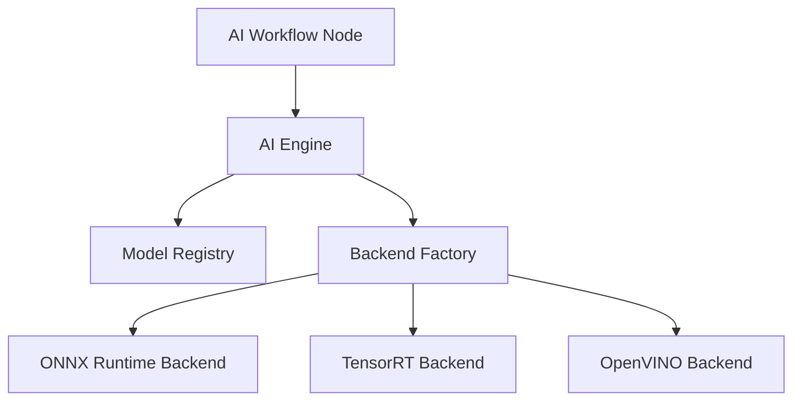

---

# 36. AI Engine Responsibilities

AI Engine owns:

- Model package validation
- Backend selection
- Model loading
- Session caching
- Preprocessing
- Inference
- Postprocessing
- GPU resource management
- Warm-up
- Model health
- Timing

Workflow node should expose task-level parameters.

Example:

```text
DetectionNode
├── Model
├── ConfidenceThreshold
├── IOUThreshold
├── Classes
└── ROI
```

---

# 37. AI Backend Contract

Conceptual interfaces:

```text
IAIBackend
IAIModelSession
IAIModelLoader
```

Model session input/output should use NVision-owned data contracts.

Do not leak TensorRT or ONNX Runtime types into Domain or Workflow layers.

---

# 38. Native Integration Boundary

Some components may require C++.

Potential C++ uses:

- TensorRT
- CUDA kernels
- High-performance image processing
- Camera SDK wrappers
- Vendor C/C++ libraries

Recommended boundary options:

## Option A — P/Invoke

Suitable for:

- Small stable native API
- High performance
- Same process

## Option B — C++/CLI

Windows-only.

Useful when wrapping complex C++ libraries for .NET.

## Option C — Native Service

Suitable for:

- Fault isolation
- Linux/Jetson support
- Different runtime requirements

Communication:

```text
gRPC
shared memory
Unix socket
named pipe
```

Preferred architecture rule:

> Keep the public native boundary small and stable.

---

# 39. Recommended C# / Native Split

For Windows Studio/Runtime:

```text
C#
├── UI
├── Application
├── Domain
├── Workflow
├── Device orchestration
├── Result/Data
└── Most business logic

C++ / Native
├── TensorRT
├── CUDA
├── Selected Vision kernels
└── SDK wrappers when required
```

Do not move orchestration into C++ without a strong reason.

---

# 40. Python Boundary

Python is useful for:

- AI training
- Dataset tools
- Experimentation
- Model conversion
- Offline utilities

Python should generally not be the core production Runtime orchestration layer.

Future architecture:

```text
NVision Trainer
    │
    ├── Python Training Environment
    └── Export
           ↓
       .nvmodel
           ↓
NVision Runtime
```

---

# 41. Decision Engine

Decision logic should be a separate capability.

Inputs:

```text
Vision Result
AI Result
OCR Result
Measurement Result
Recipe Parameters
External Data
```

Output:

```text
OK
NG
ERROR
NO_RESULT
```

---

# 42. Decision Rule Model

Example:

```text
AI.Class == "TYPE_01"
AND
AI.Confidence >= Recipe.MinConfidence
AND
OCR.Text == Recipe.ExpectedText
```

The system should preserve:

- Rule inputs
- Rule outcome
- NG reason
- Failed conditions

This improves traceability.

---

# 43. Device Manager

The Device Manager owns the lifecycle of external devices.

```text
Device Manager
│
├── Cameras
├── PLCs
├── Robots
├── Lights
├── Digital I/O
└── Barcode Devices
```

Functions:

- Instantiate adapter
- Connect
- Configure
- Health check
- Reconnect
- Shutdown
- Event routing

---

# 44. Device Capability Model

Not all devices expose the same features.

Use capabilities.

Example:

```text
CameraCapabilities
├── HardwareTrigger
├── SoftwareTrigger
├── Exposure
├── Gain
├── FrameRate
└── PTP
```

UI should display settings based on capabilities rather than vendor name.

---

# 45. PLC Architecture

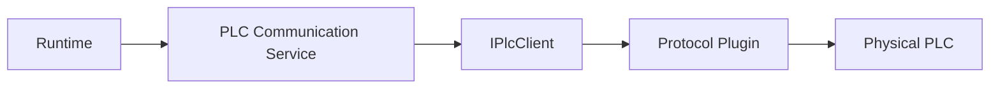

Initial protocol recommendation:

```text
Modbus TCP
Mitsubishi MC Protocol
Siemens S7
```

Do not implement PLC logic inside workflow nodes except through high-level communication actions.

---

# 46. PLC Mapping

Use symbolic mappings.

Example:

```yaml
signals:
  trigger:
    address: D100
    type: bool

  inspectionResult:
    address: D110
    type: int

  busy:
    address: D111
    type: bool

  ready:
    address: D112
    type: bool
```

Workflow should reference:

```text
inspectionResult
```

not:

```text
D110
```

where practical.

This improves portability.

---

# 47. PLC Handshake Model

Recommended generic inspection handshake:

```text
PLC                     NVision

Trigger  ──────────────►

         ◄────────────── Busy = ON

         [Inspection]

         ◄────────────── Result

         ◄────────────── Done = ON

Trigger OFF ───────────►

         ◄────────────── Done = OFF
         ◄────────────── Busy = OFF
```

Exact handshake must be configurable per machine.

---

# 48. Robot Integration

Robot integration belongs in NVision Connect.

Potential use cases:

- Request robot pose
- Send inspection result
- Trigger camera capture
- Receive part-present signal
- Provide detected object pose
- Vision-guided picking

Architecture:

```text
Workflow / Application
        ↓
Robot Service
        ↓
IRobotAdapter
        ↓
Vendor Adapter
        ↓
Robot Controller
```

---

# 49. MES / Factory Integration

Factory integration should be asynchronous where possible.

Example outputs:

```text
Inspection Result
Serial Number
Product Code
Recipe
Image Reference
NG Code
Timestamp
```

Protocols:

```text
REST
MQTT
OPC UA
Database
```

Production inspection must not be unnecessarily blocked by temporary MES unavailability.

Use buffered/outbox patterns for non-critical reporting.

---

# 50. Data Architecture Overview

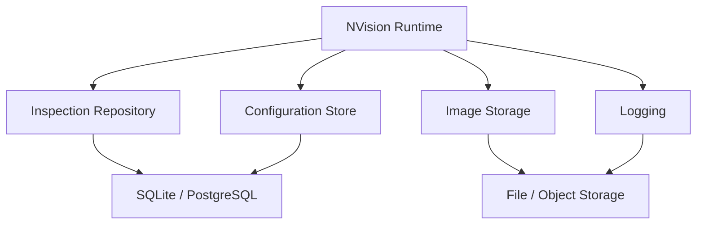

---

# 51. Local MVP Storage

Recommended initial implementation:

```text
SQLite
+
File System
```

SQLite:

- Inspection metadata
- Alarm history
- Recipe metadata
- Production counters
- Runtime state

File System:

- Images
- Models
- Packages
- Calibration files
- Logs

---

# 52. Inspection Persistence

Persist:

```text
InspectionId
Timestamp
ProjectVersion
Job
RecipeVersion
Result
NGReason
CycleTime
ModelVersion
CalibrationVersion
Measurements
Device State Snapshot
Image References
```

Avoid storing large image binaries directly in SQLite unless there is a strong reason.

---

# 53. Result Write Policy

The inspection result should be finalized atomically from the application's perspective.

Concept:

```text
Execute
  ↓
Build InspectionResult
  ↓
Persist Metadata
  ↓
Persist Required Images
  ↓
Publish External Result
```

Exact ordering may differ depending on machine timing requirements.

Critical machine handshake may require publishing PLC result before full image persistence.

In such cases, storage should complete asynchronously but be tracked reliably.

---

# 54. Event Architecture

Internal events are useful for decoupling.

Examples:

```text
InspectionStarted
InspectionCompleted
InspectionFailed
DeviceStateChanged
RecipeChanged
AlarmRaised
AlarmCleared
ModelLoaded
RuntimeStateChanged
```

Use events for notification.

Do not use events to obscure critical request/response control flow.

---

# 55. Logging Architecture

Structured logs should include context.

Example fields:

```text
Timestamp
Level
Component
StationId
InspectionId
Project
Job
Recipe
DeviceId
NodeId
Message
Exception
```

Recommended logging:

```text
Serilog
```

Potential sinks:

```text
Rolling File
Console
Future Central Log
```

---

# 56. Metrics

Key metrics:

```text
Inspection Count
OK Count
NG Count
Error Count
Yield
Cycle Time
Node Execution Time
Camera Frame Time
AI Inference Time
PLC Latency
Memory Usage
CPU Usage
GPU Usage
Disk Usage
Reconnect Count
```

Metrics should be usable by:

- Runtime UI
- Diagnostics
- NVision Hub

---

# 57. Diagnostics Architecture

Diagnostics should be a reusable Engine service.

```text
Diagnostics
│
├── Runtime Health
├── Device Health
├── Performance
├── Resource Usage
├── Plugin Status
├── Model Status
├── Storage Status
└── Network Status
```

Support a future endpoint such as:

```text
GET /health
```

for Runtime Service.

---

# 58. Alarm Architecture

Alarm Manager owns:

- Active alarms
- Alarm history
- Severity
- Acknowledgment
- Source
- Clear condition

Alarms should use stable codes.

Example:

```text
CAM-001 Camera disconnected
CAM-002 Acquisition timeout
PLC-001 PLC communication lost
AI-001 Model load failed
SYS-001 Disk space low
CAL-001 Calibration invalid
```

---

# 59. Configuration Architecture

Configuration layers:

```text
System Configuration
    ↓
Station Configuration
    ↓
Project Configuration
    ↓
Job Configuration
    ↓
Recipe Overrides
```

Resolution rule:

```text
Base Value
  overridden by
Project
  overridden by
Recipe
```

Overrides must be explicit and traceable.

---

# 60. Recipe Application

When switching recipe:

```text
Stop accepting triggers
        ↓
Wait for active inspection
        ↓
Validate recipe
        ↓
Apply camera/light parameters
        ↓
Apply workflow parameters
        ↓
Load required model if changed
        ↓
Confirm devices
        ↓
Activate recipe
        ↓
Resume triggers
```

Do not partially apply recipe changes.

---

# 61. Deployment Architecture

Studio creates immutable deployment packages.

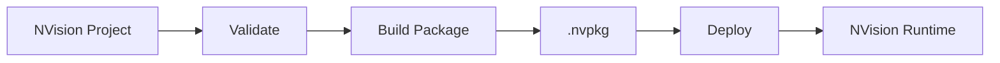

---

# 62. Deployment Package Responsibilities

A deployment package should include enough information for Runtime to execute without Studio.

Potential contents:

```text
manifest.json
project.json
jobs/
recipes/
models/
calibration/
resources/
plugins.lock
```

Package should not contain:

- Developer temp files
- UI layout caches
- Training datasets
- Unused models

---

# 63. Deployment Validation

Runtime validates:

- Package schema
- Package checksum
- Runtime minimum version
- Plugin requirements
- Model integrity
- Recipe validity
- Calibration validity
- Device configuration
- Optional package signature

Invalid packages must be rejected.

---

# 64. Rollback

Runtime should eventually keep:

```text
Current Package
Previous Known-Good Package
```

If deployment fails:

```text
Reject
or
Rollback
```

Do not leave Runtime in an unknown mixed-version state.

---

# 65. Studio Architecture

Studio should be primarily an engineering client around:

```text
Project Model
Workflow Editor
Image Viewer
Device Configuration
Calibration
Debugging
Deployment
```

Recommended UI technology:

```text
.NET
WPF
MVVM
```

for the Windows engineering application.

---

# 66. Studio Major Components

```text
NVision Studio
│
├── Shell
├── Project Explorer
├── Workflow Designer
├── Image Viewer
├── Property Inspector
├── Device Manager UI
├── Recipe Editor
├── Calibration UI
├── AI Model Manager
├── Debug Console
├── Inspection History
└── Deployment Manager
```

---

# 67. Studio Application Boundary

Studio may execute the Engine locally for development/debugging.

However, Studio-only metadata must not leak into execution contracts.

Example:

```text
Node Position on Canvas
```

is Studio metadata.

```text
Node Parameters
```

are Runtime data.

Keep these concepts separable.

---

# 68. Workflow Designer

Workflow Designer stores:

```text
Node definitions
Connections
UI positions
Groups
Comments
Debug breakpoints
```

At publish time, development-only data may be removed.

---

# 69. Debug Execution

Studio debug mode should eventually support:

```text
Run
Pause
Stop
Step Node
Inspect Inputs
Inspect Outputs
Node Timing
Preview Image
Breakpoint
```

Production Runtime should not carry unnecessary debugger overhead when disabled.

---

# 70. Offline Simulation

Studio should support running against:

```text
Single Image
Image Folder
Recorded Dataset
Video
```

This is essential for engineering without live machine hardware.

---

# 71. Runtime UI Architecture

Runtime UI should behave as a client to Runtime Application Services.

Main screen:

```text
Machine State
Current Recipe
Current Image
Inspection Result
Counters
Yield
Cycle Time
Device Health
Alarm
```

No direct low-level hardware access.

---

# 72. Runtime UI Failure

Runtime execution must remain alive if Runtime UI closes.

Long-term architecture:

```text
Runtime UI.exe
      X

Runtime Service
      │
      └── Inspection continues
```

This is a major production reliability goal.

---

# 73. Plugin Architecture

Plugin system categories:

```text
Camera
PLC
Robot
AI Backend
Vision Tool
Storage
Communication
Workflow Node
```

---

# 74. Plugin Discovery

Possible discovery model:

```text
plugins/
├── cameras/
├── plc/
├── ai/
└── vision/
```

Each plugin contains metadata:

```json
{
  "id": "ntech.camera.basler",
  "name": "Basler Camera",
  "version": "1.0.0",
  "apiVersion": "1.0",
  "entryPoint": "..."
}
```

---

# 75. Plugin Compatibility

Distinguish:

```text
Plugin Version
Plugin API Version
NVision Runtime Version
```

A plugin may be upgraded independently if its API contract remains compatible.

---

# 76. Plugin Isolation

MVP:

```text
In-process plugins
```

Future for unstable vendor SDKs:

```text
Out-of-process plugin host
```

Example:

```text
NVision Runtime
      │ gRPC
      ▼
Camera Plugin Host
      │
      ▼
Vendor SDK
```

This can isolate crashes caused by vendor native libraries.

---

# 77. API Architecture

Runtime should expose a stable API for:

- Runtime UI
- Hub
- External clients
- Diagnostics
- Deployment

Recommended protocol:

```text
gRPC
```

for strongly typed internal/control APIs.

Optional:

```text
REST
```

for simple third-party integration.

---

# 78. Runtime API Categories

```text
RuntimeControl
Inspection
Device
Recipe
Alarm
Diagnostics
Deployment
History
```

Examples:

```text
StartRuntime
StopRuntime
GetRuntimeStatus
SelectRecipe
GetDeviceStates
GetActiveAlarms
GetLatestInspection
DeployPackage
```

---

# 79. IPC Strategy

On Windows:

```text
gRPC over localhost
Named Pipe where useful
```

On Linux/Jetson:

```text
gRPC over localhost
Unix Domain Socket where useful
```

Use shared memory only for high-bandwidth frame transport when necessary.

---

# 80. Large Image IPC

Avoid sending full high-resolution frames repeatedly through JSON/REST.

Possible strategies:

```text
Shared memory
Memory-mapped files
Compressed preview stream
Local video stream
gRPC streaming for limited cases
```

Runtime UI generally needs a preview frame, not necessarily the exact processing buffer.

---

# 81. Edge Architecture

NVision Edge should reuse the same Engine contracts.

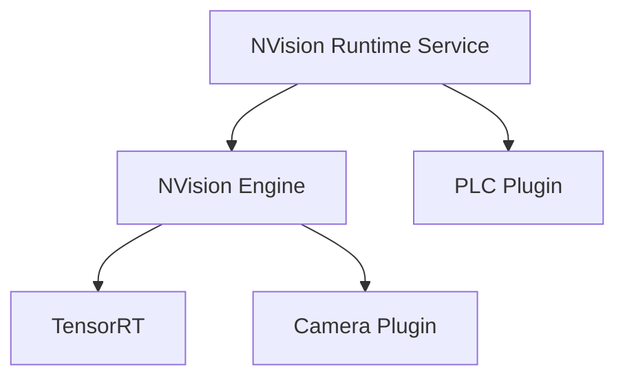

---

# 82. Windows Deployment

Recommended production structure:

```text
C:\Program Files\NTech\NVision\
├── Runtime\
├── Studio\
├── plugins\
└── shared\

C:\ProgramData\NTech\NVision\
├── configuration\
├── packages\
├── models\
├── calibration\
├── data\
├── images\
├── logs\
└── backups\
```

Do not store writable production data inside `Program Files`.

---

# 83. Linux / Jetson Deployment

Example:

```text
/opt/ntech/nvision/
├── runtime/
├── plugins/
└── native/

/var/lib/ntech/nvision/
├── packages/
├── models/
├── calibration/
├── data/
└── images/

/var/log/ntech/nvision/
```

Runtime should operate as a service.

Example:

```text
systemd
```

---

# 84. Platform-Specific Implementations

Use abstractions for:

```text
File paths
Service control
GPU backend
Camera SDK
System metrics
Hardware I/O
```

Do not scatter:

```text
if (OperatingSystem.IsWindows())
```

through core logic.

Use platform adapters.

---

# 85. Runtime Deployment Modes

Potential modes:

## Desktop Mode

```text
Runtime Engine + Runtime UI
```

## Service Mode

```text
Runtime Service
+
Runtime UI Client
```

## Headless Edge Mode

```text
Runtime Service only
```

## Managed Factory Mode

```text
Runtime Service
+
NVision Hub
```

---

# 86. Fault Isolation Strategy

Failures should be contained by boundary.

Examples:

```text
Camera timeout
→ Camera adapter fault
→ Device Manager alarm
→ Inspection ERROR
→ Runtime survives

AI model failure
→ AI session fault
→ Inspection ERROR
→ Runtime survives

Runtime UI crash
→ Runtime service continues

MES unavailable
→ Reporting queued
→ Inspection continues if MES is non-critical
```

---

# 87. Critical vs Non-Critical Dependencies

Classify external dependencies.

## Critical

Inspection must stop if unavailable.

Examples:

```text
Required Camera
Required PLC
Required AI Model
Required Calibration
```

## Non-Critical

Inspection may continue.

Examples:

```text
Remote dashboard
Central analytics
MES reporting
Optional archive server
```

Configuration should declare dependency criticality.

---

# 88. Timeout Architecture

Every external operation must have a timeout.

Examples:

```text
Camera Grab Timeout
PLC Read Timeout
PLC Write Timeout
Robot Response Timeout
AI Inference Timeout
Storage Timeout
```

Avoid infinite waits.

---

# 89. Retry Architecture

Retry only where safe.

Good candidates:

```text
Reconnect camera
Reconnect PLC
Retry MES publish
```

Bad candidates without care:

```text
Repeat physical inspection automatically
Repeat robot movement
Repeat PLC result write when protocol semantics are unknown
```

Retries must understand side effects.

---

# 90. Resource Management

Runtime owns scarce resources:

```text
Camera handles
GPU memory
Native model sessions
Pinned buffers
Threads
Network sockets
Database connections
```

Use deterministic lifetime ownership.

Do not rely on garbage collection alone for native resources.

---

# 91. Threading Model

Avoid creating one thread per node.

Preferred:

```text
.NET Task Parallel Library
bounded worker pools
async I/O
controlled GPU queues
```

Separate:

```text
I/O-bound work
CPU-bound work
GPU work
```

---

# 92. Backpressure

If inspection triggers arrive faster than processing capacity, Runtime must not grow an unlimited queue.

Configurable policies:

```text
Reject Trigger
Drop Oldest
Queue N
Signal Busy
Stop Line
```

Industrial default should favor explicit handshake over uncontrolled buffering.

---

# 93. Real-Time Considerations

NVision is generally a soft real-time application.

Windows/.NET cannot guarantee hard real-time deadlines.

Therefore:

- Measure cycle time
- Avoid unpredictable allocations
- Avoid UI dependency
- Use hardware trigger where required
- Keep PLC handshake deterministic
- Use dedicated MCU/PLC for hard real-time safety

NVision should not be responsible for machine safety functions requiring certified hard real-time behavior.

---

# 94. Security Architecture

Initial security boundaries:

```text
User Authentication
Role Authorization
Package Integrity
API Authentication
Secrets Storage
Audit Log
```

Never store:

```text
PLC passwords
API keys
database passwords
```

as plain values inside portable project files.

---

# 95. Audit Events

Audit examples:

```text
User login
Recipe changed
Project deployed
Model changed
Calibration changed
Runtime started
Runtime stopped
Configuration changed
Alarm acknowledged
```

---

# 96. Package Integrity

Future deployment packages should support:

```text
Hash
Manifest
Signature
```

Runtime verifies before activation.

This is particularly important when deployment is managed remotely.

---

# 97. Compatibility Model

Compatibility axes:

```text
Runtime Version
Project Schema Version
Workflow Schema Version
Plugin API Version
Model Package Version
Recipe Schema Version
```

Runtime should fail with a clear compatibility message.

Never attempt silent unsafe interpretation of unknown schema.

---

# 98. Schema Migration

Studio may migrate old project formats.

Example:

```text
Project Schema 1
      ↓
Migration
      ↓
Project Schema 2
```

Runtime should generally consume already validated deployment packages rather than performing complex project migrations during production startup.

---

# 99. Testing Architecture

Each layer requires different tests.

```text
Domain
→ Unit tests

Workflow
→ Graph execution tests

Vision
→ Golden image tests

AI
→ Model regression tests

Camera
→ Hardware integration tests

PLC
→ Protocol integration tests

Runtime
→ Long-running soak tests

Deployment
→ Compatibility tests
```

---

# 100. Golden Image Regression

For each production vision project maintain:

```text
Golden Input Images
Expected Node Results
Expected Final Decision
```

Example:

```text
tests/golden/wire-marker/
├── type01_ok_001.png
├── type01_ng_001.png
├── type04_ok_001.png
└── expected.json
```

This protects against algorithm regressions.

---

# 101. Hardware-in-the-Loop Tests

Create a test station where possible:

```text
Camera
PLC simulator / PLC
Trigger
GPU
Industrial network
```

Automate:

- Camera disconnect
- PLC disconnect
- Trigger bursts
- Invalid recipe
- Disk full simulation
- Runtime restart
- Model load failure

---

# 102. Soak Testing

Production Runtime should be tested continuously for:

```text
8 hours
24 hours
72 hours
7 days
```

Observe:

- Memory growth
- Handle leaks
- GPU memory leaks
- Camera stability
- PLC reconnect
- Database growth
- Image retention
- Cycle time drift

---

# 103. Performance Architecture

Profiling must exist at node level.

```text
Inspection
├── Acquisition: 8 ms
├── Crop: 1 ms
├── AI: 25 ms
├── OCR: 9 ms
├── Decision: 0.5 ms
└── PLC: 2 ms
```

Persist summary metrics, not necessarily every detailed trace indefinitely.

---

# 104. Initial Technology Baseline

Recommended Windows MVP:

```text
Language        C#
Runtime         .NET 8/10-ready architecture
Desktop UI      WPF
Pattern         MVVM
Vision          OpenCvSharp
AI              ONNX Runtime
GPU             CUDA/TensorRT where needed
Database        SQLite
Logging         Serilog
IPC/API         gRPC
Serialization   System.Text.Json
Testing         xUnit
```

The exact .NET version can evolve independently of domain architecture.

---

# 105. Jetson Technology Baseline

Recommended Edge direction:

```text
OS              Ubuntu
Runtime Service .NET where practical
Native AI       TensorRT / CUDA
Camera SDK      Native/vendor SDK
IPC             gRPC
Service Manager systemd
```

If a device SDK is incompatible with .NET ARM64, wrap it behind:

```text
Native service
or
small P/Invoke ABI
```

---

# 106. Architecture Constraints

The following are explicit constraints.

## Constraint A

Studio must not become the only place capable of running inspection logic.

## Constraint B

Workflow files must not contain arbitrary executable user code in early versions.

## Constraint C

Runtime must not depend on Internet access.

## Constraint D

AI models must be versioned.

## Constraint E

Every production inspection must have a traceable result.

## Constraint F

Vendor SDK types must not cross into core domain contracts.

## Constraint G

UI must not own device connections.

---

# 107. Architecture Anti-Patterns

Avoid:

## 107.1 God Application

```text
MainWindow.xaml.cs
├── Camera SDK
├── PLC SDK
├── OpenCV
├── AI
├── SQL
└── Business Logic
```

Never allow this architecture.

---

## 107.2 One Project Per Customer Fork

Bad:

```text
NVision_WireMarker
NVision_Gear
NVision_Label
```

Preferred:

```text
NVision Platform
+
Project packages
```

---

## 107.3 Vendor Lock-In in Core

Bad:

```text
WorkflowNode -> Basler.Pylon
```

Preferred:

```text
WorkflowNode
    ↓
Acquisition Interface
    ↓
Basler Plugin
```

---

## 107.4 Model Backend Leakage

Bad:

```text
DetectionNode returns TensorRT-specific objects
```

Preferred:

```text
DetectionNode returns NVision DetectionResult
```

---

## 107.5 Silent Recovery

Bad:

```text
Model fails
→ return previous result
```

Preferred:

```text
Model fails
→ ERROR
→ alarm
→ traceable reason
```

---

# 108. MVP Architecture Scope

Phase 1 should implement:

```text
NTech.NVision.Domain
NTech.NVision.Application
NTech.NVision.Engine.Core
NTech.NVision.Engine.Workflow
NTech.NVision.Engine.Acquisition
NTech.NVision.Engine.Vision
NTech.NVision.Engine.AI
NTech.NVision.Engine.Inspection
NTech.NVision.Engine.Decision
NTech.NVision.Engine.Communication
NTech.NVision.Engine.Data
NTech.NVision.Plugin.Abstractions

NVision Studio
NVision Runtime

Camera Plugin: first real camera vendor
PLC Plugin: first required protocol
AI Backend: ONNX Runtime
Storage: SQLite + File System
```

---

# 109. MVP Component Diagram

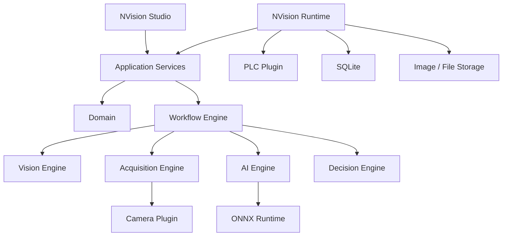

---

# 110. Recommended Implementation Order

## Step 1 — Domain

Implement:

```text
Project
Job
Recipe
Workflow
InspectionResult
DeviceConfiguration
```

No UI dependency.

---

## Step 2 — Plugin Abstractions

Implement:

```text
ICamera
IPlcClient
IAIBackend
```

---

## Step 3 — Workflow Engine

Implement:

```text
Graph
Node
Ports
Validation
Execution
Cancellation
NodeResult
```

Use fake nodes first.

---

## Step 4 — Image Model

Implement:

```text
Frame
ImageBuffer
PixelFormat
ImageMetadata
```

---

## Step 5 — Acquisition

Implement one camera adapter.

Also implement:

```text
ImageFileCamera
```

for offline development.

---

## Step 6 — Vision

Implement initial OpenCV-backed nodes:

```text
Crop
Resize
Rotate
Threshold
Blur
Edge
Contour
```

---

## Step 7 — Inspection Engine

Implement:

```text
Trigger
InspectionContext
Inspection lifecycle
Result
Timing
```

---

## Step 8 — AI

Implement:

```text
ONNX Runtime Backend
Classification Node
Detection Node
```

---

## Step 9 — Decision

Implement:

```text
Compare
AND
OR
Decision
```

---

## Step 10 — Runtime

Build simple production UI:

```text
Start
Stop
Current Recipe
Image
OK/NG
Counters
Device State
Alarm
```

---

## Step 11 — Studio

Build:

```text
Project Explorer
Workflow Designer
Image Viewer
Properties
Run/Test
Save
Publish
```

---

## Step 12 — PLC

Implement the first required PLC protocol and handshake.

---

# 111. Suggested Repository Mapping

```text
nvision/
│
├── src/
│   ├── core/
│   │   ├── NTech.NVision.Domain/
│   │   ├── NTech.NVision.Application/
│   │   └── NTech.NVision.Plugin.Abstractions/
│   │
│   ├── engine/
│   │   ├── NTech.NVision.Engine.Core/
│   │   ├── NTech.NVision.Engine.Workflow/
│   │   ├── NTech.NVision.Engine.Acquisition/
│   │   ├── NTech.NVision.Engine.Vision/
│   │   ├── NTech.NVision.Engine.AI/
│   │   ├── NTech.NVision.Engine.Inspection/
│   │   ├── NTech.NVision.Engine.Decision/
│   │   └── NTech.NVision.Engine.Data/
│   │
│   ├── plugins/
│   │   ├── camera/
│   │   ├── plc/
│   │   └── ai/
│   │
│   └── apps/
│       ├── NVision.Studio/
│       └── NVision.Runtime/
│
├── tests/
├── docs/
├── samples/
├── tools/
└── Directory.Build.props
```

---

# 112. Build Dependency Example

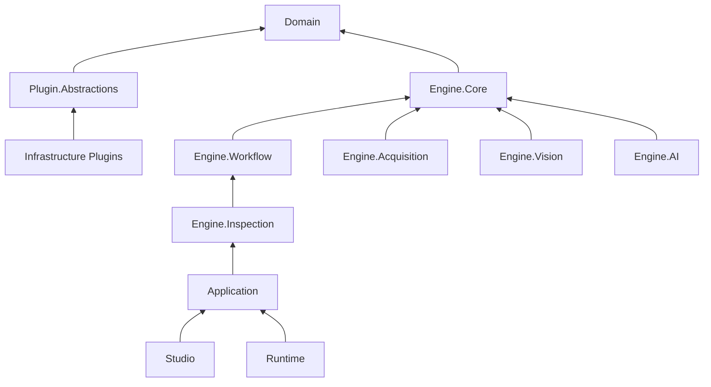

Interpret arrow as:

> A depends on B.

Exact physical project layout can be simplified during implementation.

---

# 113. Architecture Decision: Modular Monolith First

**Decision:** Start with a modular monolith.

Reason:

- Easier debugging
- Lower deployment complexity
- Lower IPC overhead
- Faster MVP development
- Easier camera/GPU integration

Preserve boundaries so selected modules can later move out of process.

---

# 114. Architecture Decision: Runtime Separate from Studio

**Decision:** Studio and Runtime are different products/applications.

Reason:

- Production stability
- Operator simplicity
- Licensing flexibility
- Headless execution
- Deployment discipline

---

# 115. Architecture Decision: Node-Based Workflow

**Decision:** Inspection pipelines are represented by typed node graphs.

Reason:

- Reusability
- Visual engineering
- Recipe integration
- Serialization
- Debugging
- Non-programmer configuration
- Customer project portability

---

# 116. Architecture Decision: Plugins for Vendor Integrations

**Decision:** Vendor-dependent integration is implemented through plugins/adapters.

Reason:

- Prevent vendor lock-in
- Improve testability
- Allow independent release
- Isolate unstable SDKs

---

# 117. Architecture Decision: ONNX as Initial AI Exchange Format

**Decision:** Prefer ONNX-compatible deployment for general model portability.

Possible optimized backend:

```text
ONNX
 ↓
TensorRT
```

where supported.

The architecture must still permit non-ONNX future backends.

---

# 118. Architecture Decision: SQLite + File Storage First

**Decision:** Use local SQLite and filesystem storage for initial stations.

Reason:

- Offline operation
- Simple deployment
- Sufficient for one station
- Easy backup
- No server dependency

NVision Hub may later use PostgreSQL/object storage centrally.

---

# 119. Architecture Decision: gRPC for Runtime Control

**Decision:** Use strongly typed gRPC for future Runtime Service control APIs.

Reason:

- Good .NET support
- Cross-platform
- Streaming support
- Strong contracts
- Suitable for local and remote use

---

# 120. Architecture Decision: WPF for Initial Studio

**Decision:** Use WPF for the initial Windows NVision Studio.

Reason:

- Mature .NET desktop ecosystem
- Strong tooling
- Suitable for industrial desktop software
- Flexible custom controls
- Compatible with MVVM

The Engine remains UI-independent.

---

# 121. Initial Non-Functional Targets

These are initial engineering targets, not contractual guarantees.

## Reliability

```text
Runtime survives UI restart
Explicit device fault states
Automatic camera/PLC reconnect
No silent inspection success on critical error
```

## Performance

```text
Node timing available
No unbounded trigger queue
No unnecessary full-frame copies
AI model warm-up
```

## Maintainability

```text
No vendor SDK references in Domain
No PLC logic in UI
No Runtime logic in code-behind
No customer-specific forks
```

---

# 122. Architecture Review Checklist

Before adding a new feature, verify:

- Does it belong to Platform or Project?
- Is it reusable?
- Is it vendor-specific?
- Does it cross a forbidden dependency boundary?
- Can it be tested without physical hardware?
- Can Runtime operate without Studio?
- Does it introduce an unmanaged thread?
- Does it have timeout/cancellation?
- Does it produce traceable errors?
- Does it require a new schema version?
- Does it affect package compatibility?

---

# 123. Phase 1 Definition of Done

The architecture is validated when NVision can complete the following scenario.

```text
1. Open NVision Studio
2. Create Project
3. Add Camera
4. Create Job
5. Build workflow:
   Camera
   → Crop
   → AI Classify
   → Compare
   → Decision
6. Create Recipe TYPE_01
7. Run offline test
8. Connect real camera
9. Validate
10. Publish .nvpkg
11. Open NVision Runtime
12. Load package
13. Connect PLC
14. Start production
15. Receive trigger
16. Capture image
17. Execute workflow
18. Return OK/NG
19. Save result
20. Save NG image
21. Show counters
22. Recover after camera reconnect
```

If this scenario requires creating a separate customer-specific application, the architecture has failed its core objective.

---

# 124. Architecture Summary

The recommended NVision architecture can be summarized as:

```text
                    NTech NVision

                 ┌─────────────────┐
                 │ NVision Studio  │
                 └────────┬────────┘
                          │
                    Build / Publish
                          │
                          ▼
                   Deployment Package
                          │
                          ▼
                 ┌──────────────────┐
                 │ NVision Runtime  │
                 └────────┬─────────┘
                          │
                 Application Services
                          │
                          ▼
                  ┌───────────────┐
                  │ NVision Engine│
                  ├───────────────┤
                  │ Workflow      │
                  │ Acquisition   │
                  │ Vision        │
                  │ AI            │
                  │ Inspection    │
                  │ Decision      │
                  │ Data          │
                  │ Diagnostics   │
                  └───────┬───────┘
                          │
                   Plugins / Adapters
         ┌────────────────┼────────────────┐
         ▼                ▼                ▼
       Camera             PLC             AI
         │                │                │
         ▼                ▼                ▼
     Hardware          Machine          GPU
```

The central rule remains:

> **The Engine owns reusable inspection capability.**

> **Studio configures it.**

> **Runtime executes it.**

> **Plugins connect it to hardware.**

> **Projects describe customer applications.**

---

# 125. Next Architecture Documents

The next documents should refine this architecture in the following order:

```text
02_DOMAIN_MODEL.md
03_WORKFLOW_ENGINE_ARCHITECTURE.md
04_PLUGIN_ARCHITECTURE.md
05_PROJECT_FILE_FORMAT.md
06_INSPECTION_RESULT_SCHEMA.md
07_CAMERA_ABSTRACTION.md
08_AI_ENGINE_ARCHITECTURE.md
09_RUNTIME_ARCHITECTURE.md
10_STUDIO_UI_ARCHITECTURE.md
11_DESIGN_SYSTEM.md
12_PRODUCT_ROADMAP.md
```

The recommended immediate next document is:

> `02_DOMAIN_MODEL.md`

because the Domain Model defines the stable language and entities that all later modules depend on.

---

**End of Document**
