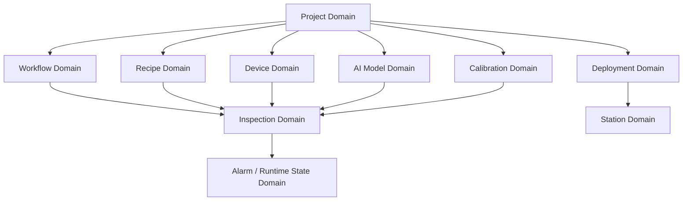
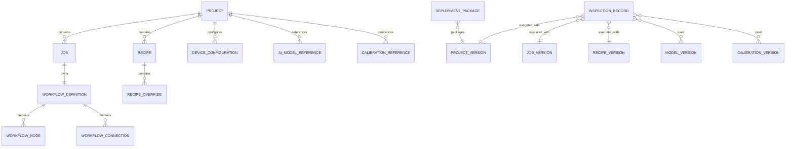
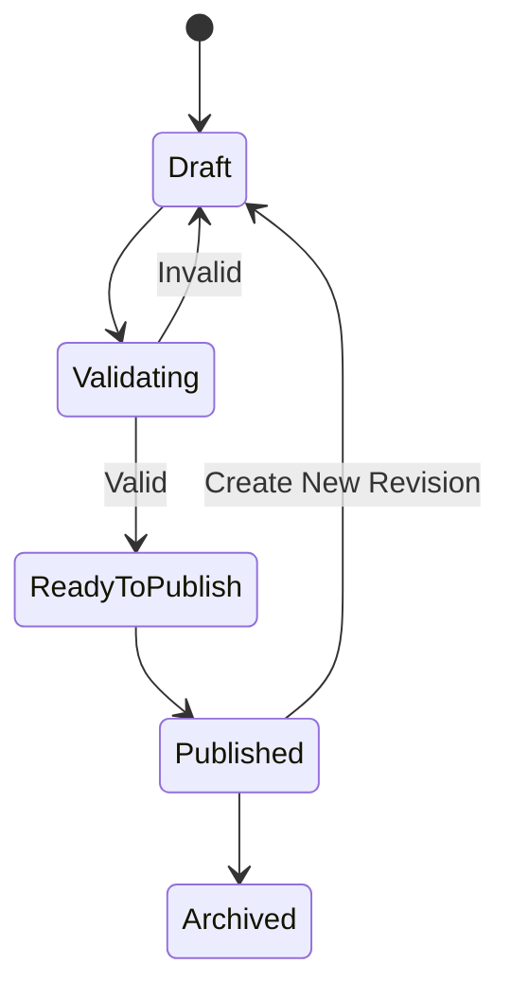
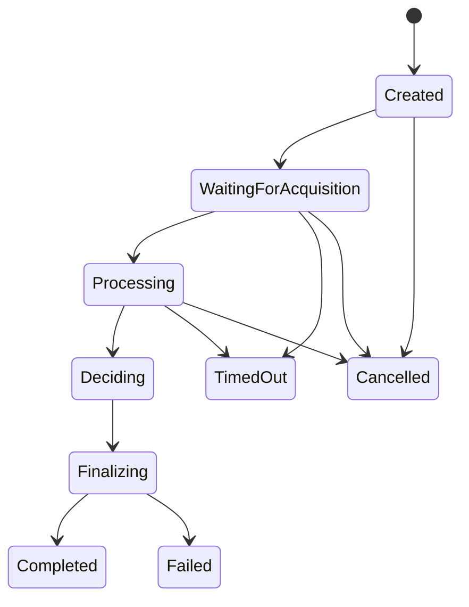
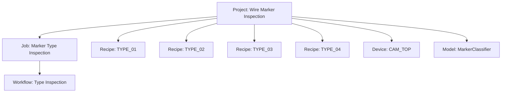

# 02 — NVision Domain Model

**Product:** NTech NVision  
**Document Type:** Domain Model / Domain-Driven Design Baseline  
**Status:** Foundation Domain Contract  
**Version:** 1.0  
**Date:** 2026-08-18  
**Parent Documents:**  
- `NVISION_PLATFORM_FOUNDATION.md`
- `01_PLATFORM_ARCHITECTURE.md`

---

# 1. Purpose

This document defines the core domain model of **NTech NVision**.

Its purpose is to establish a stable language and set of domain contracts for all major NVision components, including:

- NVision Studio
- NVision Runtime
- NVision Engine
- Workflow Engine
- Device subsystem
- AI subsystem
- Calibration subsystem
- Data subsystem
- Plugin subsystem
- NVision Edge
- NVision Hub
- SDKs and external APIs

The Domain Model is intended to answer:

- What is a Project?
- What is a Job?
- What is a Recipe?
- What is a Workflow?
- What is an Inspection?
- What is an Inspection Result?
- Which objects have identity?
- Which objects are immutable?
- Which objects belong to aggregates?
- Which state transitions are valid?
- What must never be allowed?
- Which data belongs to configuration and which belongs to execution?
- How are versions represented?
- How are domain objects serialized and migrated?

The Domain Layer must remain independent from:

- WPF
- OpenCV
- TensorRT
- ONNX Runtime
- Camera SDKs
- PLC SDKs
- SQL implementations
- File system implementations
- HTTP/gRPC transport details

---

# 2. Domain Modeling Principles

NVision uses the following modeling principles.

## 2.1 Ubiquitous Language

The same term must mean the same thing in:

- UI
- Source code
- API
- Database
- Logs
- Documentation
- Support communication

For example:

```text
Recipe
```

must not also be called:

```text
Product Config
SKU Config
Preset
Profile
Variant
```

unless those are explicitly defined as different concepts.

---

## 2.2 Explicit Identity

Objects with lifecycle and history must have explicit identity.

Examples:

```text
ProjectId
JobId
RecipeId
WorkflowId
NodeId
DeviceId
ModelId
CalibrationId
InspectionId
StationId
```

Do not use display names as identity.

---

## 2.3 Value Objects for Domain Meaning

Primitive values should be wrapped when they carry domain meaning.

Instead of:

```text
string
double
int
```

prefer domain concepts such as:

```text
ProjectName
Confidence
CycleTime
MeasurementValue
ModelVersion
RecipeVersion
PixelSize
DeviceAddress
```

where that improves correctness.

---

## 2.4 Aggregate Boundaries

Only aggregate roots should be modified directly from outside an aggregate.

This protects invariants.

Example:

```text
Project
└── Jobs
```

External code should not mutate internal job collections arbitrarily.

---

## 2.5 Immutable Published Configuration

Published deployment artifacts must be treated as immutable.

A running inspection must always be traceable to:

```text
Project Version
Job Version
Recipe Version
Model Version
Calibration Version
```

---

## 2.6 Runtime State Is Not Project Configuration

Do not mix:

```text
Configuration
```

with:

```text
Live execution state
```

Example:

```text
Camera exposure configuration
```

belongs to configuration.

```text
Camera is currently disconnected
```

belongs to runtime state.

---

# 3. Core Domain Areas

The NVision domain is divided into the following conceptual areas.



---

# 4. Bounded Context Direction

For the initial implementation, these areas may live in one physical Domain assembly.

Conceptually, they are separate contexts:

```text
Authoring Context
Runtime Context
Device Context
AI Context
Calibration Context
Deployment Context
Operations Context
```

The MVP does not require physically splitting them into services.

The purpose of defining these boundaries is to prevent accidental coupling.

---

# 5. Aggregate Overview

Recommended aggregate roots:

```text
Project
WorkflowDefinition
Recipe
DeviceConfiguration
AIModelDefinition
CalibrationRecord
DeploymentPackage
RuntimeStation
InspectionRecord
AlarmRecord
```

Not all aggregates need separate databases or repositories.

They define consistency boundaries.

---

# 6. High-Level Domain Relationship



---

# 7. Identity Strategy

All important entities use stable opaque identifiers.

Recommended form:

```text
GUID / UUID
```

Examples:

```text
ProjectId      7f5675d6-...
JobId          0ef67eb5-...
RecipeId       a58f3d12-...
NodeId         9346ce32-...
```

Display names remain editable.

Example:

```text
RecipeId:  a58f3d12...
Name:      TYPE_01
```

Changing `TYPE_01` to `TYPE-A` must not change identity.

---

# 8. Strongly Typed IDs

Recommended C# direction:

```csharp
public readonly record struct ProjectId(Guid Value);
public readonly record struct JobId(Guid Value);
public readonly record struct RecipeId(Guid Value);
public readonly record struct NodeId(Guid Value);
public readonly record struct DeviceId(Guid Value);
public readonly record struct ModelId(Guid Value);
public readonly record struct CalibrationId(Guid Value);
public readonly record struct InspectionId(string Value);
```

Strong IDs reduce accidental assignment errors.

---

# 9. Human-Readable Codes

Some domain objects should also expose human-readable codes.

Example:

```text
DeviceId:   UUID
DeviceCode: CAM_TOP
Name:       Top Camera
```

Recommended examples:

```text
CAM_TOP
CAM_BOTTOM
PLC_MAIN
LIGHT_RING_01
ROBOT_01
```

Rules:

- ID is identity.
- Code is stable within a project.
- Name is display text.

---

# 10. Version Model

NVision uses explicit version values.

Recommended semantic format:

```text
Major.Minor.Patch
```

Examples:

```text
ProjectVersion      1.3.0
RecipeVersion       2.1.4
ModelVersion        1.5.2
CalibrationVersion  1.0.3
```

A version is a value object.

---

# 11. Revision vs Version

Distinguish:

## Revision

Frequent authoring save state.

Example:

```text
Revision 147
```

## Version

Named publishable version.

Example:

```text
Version 1.4.0
```

Studio may save many revisions before publishing a version.

Production traceability uses published versions.

---

# 12. Project Aggregate

## 12.1 Definition

A **Project** is the top-level authoring container for one Machine Vision application.

Examples:

```text
Wire Marker Inspection
Gear Inspection
Label Verification
PCB Inspection
```

A Project is not the NVision platform itself.

---

## 12.2 Project Contains

```text
Project
│
├── Metadata
├── Jobs
├── Recipes
├── Devices
├── Model References
├── Calibration References
├── Resources
├── Variables
├── Project Settings
└── Deployment Settings
```

---

## 12.3 Project Entity

Conceptual model:

```text
Project
├── ProjectId
├── Name
├── Code
├── Description
├── Revision
├── PublishedVersion
├── SchemaVersion
├── Jobs
├── Recipes
├── DeviceConfigurations
├── ModelReferences
├── CalibrationReferences
├── Settings
├── CreatedAt
├── ModifiedAt
└── Metadata
```

---

## 12.4 Project Invariants

A Project must satisfy:

- `ProjectId` is valid.
- Name is not empty.
- Job IDs are unique.
- Recipe IDs are unique.
- Device IDs are unique.
- Device Codes are unique inside the Project.
- A referenced model must exist or be explicitly unresolved in authoring mode.
- A referenced calibration must exist or be explicitly unresolved in authoring mode.
- Production publishing requires all mandatory references to resolve.
- A Project cannot publish an invalid Workflow.

---

# 13. Project Lifecycle



Recommended authoring states:

```text
Draft
Validating
ReadyToPublish
Published
Archived
```

Runtime should only consume `Published` deployment artifacts.

---

# 14. Job Entity

## 14.1 Definition

A **Job** represents one reusable inspection operation within a Project.

Examples:

```text
Marker Type Inspection
Top Inspection
Bottom Inspection
Side Inspection
Label OCR Inspection
```

---

## 14.2 Job Contains

```text
Job
├── JobId
├── Name
├── Code
├── Description
├── WorkflowId
├── Enabled
├── Timeout
├── TriggerPolicy
├── ResultPolicy
└── Metadata
```

---

## 14.3 Relationship to Workflow

A Job owns or references exactly one primary Workflow Definition in the MVP.

```text
Job
  ↓
WorkflowDefinition
```

Future versions may support:

```text
PreWorkflow
MainWorkflow
PostWorkflow
```

but this should not be introduced prematurely.

---

# 15. Job Invariants

- Job must have a valid Workflow.
- Job Code must be unique within a Project.
- Production-enabled Job must be validated.
- Timeout must be positive when configured.
- Required trigger configuration must be valid.
- Disabled Job must not accept production execution.

---

# 16. Workflow Aggregate

## 16.1 Definition

A **WorkflowDefinition** is a directed typed graph describing inspection computation.

It defines:

- Nodes
- Ports
- Connections
- Execution rules
- Decision outputs

It does not store live node execution state.

---

# 17. WorkflowDefinition Model

```text
WorkflowDefinition
├── WorkflowId
├── Name
├── SchemaVersion
├── Nodes
├── Connections
├── Inputs
├── Outputs
├── Variables
├── Metadata
└── AuthoringMetadata
```

---

# 18. Workflow Node

A **WorkflowNode** is an instance of a node type inside a workflow.

Example:

```text
Node Type: Crop
Node ID:   ...
Name:      Marker ROI
```

Conceptual fields:

```text
WorkflowNode
├── NodeId
├── NodeTypeId
├── NodeTypeVersion
├── Name
├── Enabled
├── Parameters
├── InputBindings
├── OutputDefinitions
├── FailurePolicy
└── Metadata
```

---

# 19. Node Type vs Node Instance

Distinguish:

## Node Type

Reusable capability.

Example:

```text
nvision.vision.crop
```

## Node Instance

Specific configured use.

Example:

```text
NodeId: 712...
Name: Marker ROI
X: 120
Y: 80
Width: 400
Height: 120
```

This separation is essential for plugin architecture.

---

# 20. Node Type Identifier

Recommended format:

```text
nvision.category.node-name
```

Examples:

```text
nvision.acquisition.camera
nvision.image.crop
nvision.image.resize
nvision.vision.threshold
nvision.vision.contour
nvision.ai.classify
nvision.ai.detect
nvision.logic.compare
nvision.logic.and
nvision.result.decision
nvision.output.plc-write
```

Plugin-defined nodes may use:

```text
vendor.plugin.node
```

---

# 21. Port Model

Nodes exchange values through typed ports.

```text
Port
├── PortId / Key
├── Name
├── Direction
├── DataType
├── Required
├── MultiConnectionAllowed
└── DefaultValue
```

Directions:

```text
Input
Output
```

---

# 22. Connection Model

```text
WorkflowConnection
├── ConnectionId
├── SourceNodeId
├── SourcePort
├── TargetNodeId
└── TargetPort
```

Invariants:

- Source must exist.
- Target must exist.
- Source port must be output.
- Target port must be input.
- Data types must be compatible.
- Required multiplicity rules must be respected.

---

# 23. Workflow Data Types

Initial built-in domain data types:

```text
Image
Mask
Region
Point2D
Point3D
Line2D
Circle
Contour
BoundingBox
Detection
DetectionList
Classification
TextResult
Measurement
Boolean
Integer
Float
String
Pose
Transform
Decision
AnyMetadata
```

Avoid using raw object/untyped dictionaries as the normal data path.

---

# 24. Node Parameters

Node parameters are configuration.

Examples:

```text
Threshold
Confidence
ROI
ExpectedText
Tolerance
ExposureReference
```

Each parameter definition should include:

```text
Key
DisplayName
DataType
DefaultValue
Required
Min
Max
Unit
RecipeOverridable
ValidationRules
```

---

# 25. Node Parameter Value

A node instance stores parameter values.

Concept:

```text
NodeParameterValue
├── ParameterKey
├── Value
└── Source
```

Possible sources:

```text
NodeDefault
ProjectValue
RecipeOverride
RuntimeInput
```

---

# 26. Parameter Resolution

Recommended resolution order:

```text
Node Default
    ↓ overridden by
Project / Job Configuration
    ↓ overridden by
Recipe
    ↓ overridden by
Explicit Runtime Input
```

Runtime input should only be allowed for parameters explicitly marked runtime-bindable.

---

# 27. Authoring Metadata

Studio-specific information belongs in a separate section.

Example:

```text
AuthoringMetadata
├── CanvasX
├── CanvasY
├── Width
├── Height
├── Group
├── Comment
└── Collapsed
```

Runtime should be able to discard this metadata.

---

# 28. Workflow Validation Result

```text
WorkflowValidationResult
├── IsValid
├── Errors
├── Warnings
└── Diagnostics
```

Validation issue:

```text
ValidationIssue
├── Code
├── Severity
├── NodeId
├── Field
├── Message
└── SuggestedAction
```

---

# 29. Recipe Aggregate

## 29.1 Definition

A **Recipe** is a versioned parameter set that configures a Project/Job for a specific product, SKU, type, or production variant.

Examples:

```text
TYPE_01
TYPE_02
GEAR_A
GEAR_B
LABEL_100ML
```

---

# 30. Recipe Model

```text
Recipe
├── RecipeId
├── Name
├── Code
├── Version
├── ProductCode
├── Description
├── Enabled
├── BaseRecipeId
├── Overrides
├── DeviceOverrides
├── ModelSelections
├── Metadata
└── Audit
```

---

# 31. Recipe Override

A Recipe should override parameters through stable paths.

Concept:

```text
RecipeOverride
├── TargetType
├── TargetId
├── ParameterKey
└── Value
```

Example:

```text
TargetType: Node
TargetId:   AI_CLASSIFY_01
Parameter:  ConfidenceThreshold
Value:      0.92
```

---

# 32. Device Override

Example:

```text
Target: CAM_TOP
ExposureUs: 8000
Gain: 2.0
```

Device override must only target settings declared recipe-overridable.

---

# 33. Recipe Invariants

- Recipe Code unique within Project.
- Recipe version valid.
- All override targets exist.
- Override value type matches target parameter.
- Required model selection resolves.
- Recipe cannot change non-overridable safety/architecture settings.
- Published Recipe is immutable.
- Runtime can activate only validated Recipes.

---

# 34. Recipe Inheritance

Recipe inheritance may be supported cautiously.

Example:

```text
Base_Gear
├── Gear_A
└── Gear_B
```

Limit inheritance to one parent in early versions.

Avoid deep inheritance chains.

Recommended maximum:

```text
1 level
```

or prohibit inheritance in MVP if unnecessary.

---

# 35. Device Configuration Aggregate

## 35.1 Definition

A **DeviceConfiguration** describes how NVision should identify and configure an external device.

It is not the live connection state.

---

# 36. Device Types

Initial types:

```text
Camera
LightController
PLC
Robot
DigitalIO
BarcodeReader
ExternalTrigger
```

Future:

```text
Encoder
Laser
MeasurementController
MotionController
```

---

# 37. DeviceConfiguration Model

```text
DeviceConfiguration
├── DeviceId
├── DeviceCode
├── Name
├── DeviceType
├── DriverId
├── ConnectionSettings
├── Parameters
├── Required
├── Enabled
├── RecipeOverridableParameters
└── Metadata
```

---

# 38. Device Driver Identity

`DriverId` identifies the adapter/plugin.

Examples:

```text
ntech.camera.basler
ntech.camera.hikrobot
ntech.plc.modbus-tcp
ntech.plc.mitsubishi-mc
ntech.light.generic-tcp
```

Domain should treat this as opaque text.

---

# 39. Connection Settings

Connection settings depend on device type and adapter.

Examples:

Camera:

```text
SerialNumber
IPAddress
Interface
```

PLC:

```text
IPAddress
Port
StationNumber
NetworkNumber
```

The Domain Layer can represent these as validated configuration structures without referencing vendor SDK types.

---

# 40. Runtime Device State

Live state is separate:

```text
DeviceRuntimeState
├── DeviceId
├── State
├── LastChangedAt
├── LastError
├── Health
└── Diagnostics
```

States:

```text
Unknown
Offline
Connecting
Online
Ready
Busy
Warning
Fault
Disabled
```

---

# 41. Device Invariants

- DeviceCode unique in Project.
- Required device cannot be disabled in a publishable configuration unless the Job does not reference it.
- DriverId must resolve at publish/runtime validation.
- Secrets must not be serialized as plain portable project values.
- Live device state must never be persisted as if it were configuration.

---

# 42. AI Model Aggregate

## 42.1 Definition

An **AIModelDefinition** represents an AI model available to NVision.

It separates model identity from a specific inference backend.

---

# 43. AI Model Model

```text
AIModelDefinition
├── ModelId
├── Name
├── Code
├── Task
├── Version
├── PackageReference
├── InputSpecification
├── OutputSpecification
├── Classes
├── PreferredBackend
├── Compatibility
├── Checksum
└── Metadata
```

---

# 44. AI Tasks

Initial tasks:

```text
Classification
ObjectDetection
SemanticSegmentation
InstanceSegmentation
OCR
AnomalyDetection
Embedding
Similarity
```

---

# 45. Model Package vs Model Definition

Distinguish:

## AIModelDefinition

Domain metadata and identity.

## Model Package

Physical deployment artifact:

```text
.nvmodel
```

containing:

- ONNX / engine file
- labels
- metadata
- preprocessing configuration
- postprocessing configuration
- checksum

---

# 46. Model Version Invariants

- Published model versions are immutable.
- Checksum must match package content.
- Task must match node expectations.
- Input specification must be valid.
- Model cannot silently change behind same version.
- Runtime records exact model version used.

---

# 47. Model Selection

A Workflow node may reference a logical model slot.

Example:

```text
Node: MarkerClassifier
ModelSlot: marker_classifier
```

Recipe selects:

```text
marker_classifier → MarkerClassifier v1.3.2
```

This allows model changes per Recipe without editing graph structure.

---

# 48. Calibration Aggregate

## 48.1 Definition

A **CalibrationRecord** represents versioned calibration data used to convert or interpret image/physical coordinates.

---

# 49. Calibration Types

```text
CameraIntrinsic
LensDistortion
PixelToMillimeter
Perspective
CameraToRobot
HandEye
Stereo
MultiCamera
```

---

# 50. Calibration Model

```text
CalibrationRecord
├── CalibrationId
├── Name
├── Type
├── Version
├── DeviceIds
├── Parameters
├── QualityMetrics
├── CreatedAt
├── CreatedBy
├── ValidFrom
├── ValidUntil
├── Status
└── Metadata
```

---

# 51. Calibration Status

```text
Draft
Valid
Expired
Invalid
Superseded
```

Runtime must not use:

```text
Invalid
Expired
```

for a calibration declared mandatory unless explicitly configured by engineering policy.

---

# 52. Calibration Quality

Possible metrics:

```text
RMS Error
Reprojection Error
Residual
Scale Error
Validation Sample Count
```

The Domain Layer stores generic named measurements.

Specialized calibration modules interpret them.

---

# 53. Inspection Domain

## 53.1 Definition

An **Inspection** is one execution of an inspection Job in response to a trigger or manual request.

It is a runtime domain object.

---

# 54. Inspection Identity

Inspection IDs should be globally or station-unique and human diagnosable.

Recommended pattern:

```text
{StationCode}-{yyyyMMddHHmmssfff}-{Sequence}
```

Example:

```text
LINE01-20260818150322125-00012345
```

A UUID may also be stored internally.

---

# 55. Inspection Context

An Inspection executes against an immutable context.

```text
InspectionContext
├── InspectionId
├── StationId
├── ProjectId
├── ProjectVersion
├── JobId
├── JobVersion
├── RecipeId
├── RecipeVersion
├── ModelVersions
├── CalibrationVersions
├── Trigger
├── ProductIdentity
├── StartedAt
└── CorrelationId
```

---

# 56. Inspection Lifecycle



States:

```text
Created
WaitingForAcquisition
Processing
Deciding
Finalizing
Completed
Failed
TimedOut
Cancelled
```

---

# 57. Inspection Final Status

Final inspection status:

```text
OK
NG
ERROR
NO_RESULT
TIMEOUT
CANCELLED
BYPASS
INVALID
```

Important invariant:

> `ERROR`, `NO_RESULT`, `TIMEOUT`, `CANCELLED`, and `INVALID` are never equivalent to `OK`.

---

# 58. Inspection Result Aggregate

An `InspectionResult` is the finalized immutable result of an Inspection.

```text
InspectionResult
├── InspectionId
├── Status
├── DecisionCode
├── NGReasons
├── Score
├── Measurements
├── Detections
├── TextResults
├── NodeResults
├── CycleTime
├── Timing
├── ImageReferences
├── DeviceSnapshot
├── Traceability
├── CompletedAt
└── Metadata
```

---

# 59. Decision Code

The binary OK/NG status is not enough.

Use domain decision codes.

Examples:

```text
OK
WRONG_TYPE
MISSING_MARKER
OCR_MISMATCH
DIMENSION_OUT_OF_RANGE
SCRATCH_DETECTED
MODEL_ERROR
CAMERA_TIMEOUT
CALIBRATION_INVALID
```

This improves:

- PLC mapping
- Statistics
- Operator explanation
- Reports
- Debugging

---

# 60. NG Reason

```text
InspectionReason
├── Code
├── Category
├── Message
├── SourceNodeId
├── Severity
└── Details
```

A result can contain multiple reasons.

Example:

```text
OCR_MISMATCH
CONFIDENCE_LOW
```

---

# 61. Measurement Value Object

```text
Measurement
├── Name
├── Value
├── Unit
├── Min
├── Max
├── Passed
├── SourceNodeId
└── Metadata
```

Examples:

```text
Length = 10.24 mm
Diameter = 31.22 mm
Angle = 2.4 deg
```

---

# 62. Confidence Value Object

Confidence is normalized:

```text
0.0 <= confidence <= 1.0
```

Recommended domain invariant.

Display UI may show:

```text
98.2%
```

but domain stores:

```text
0.982
```

---

# 63. Detection Value Object

```text
Detection
├── ClassId
├── ClassName
├── Confidence
├── BoundingBox
├── MaskReference
├── TrackId
└── Attributes
```

---

# 64. Bounding Box

Recommended normalized or pixel-space representation must be explicit.

```text
BoundingBox
├── CoordinateSpace
├── X
├── Y
├── Width
└── Height
```

Coordinate spaces:

```text
Pixel
Normalized
World
```

Do not mix coordinate systems silently.

---

# 65. Text Result

```text
TextResult
├── Text
├── Confidence
├── Region
├── Characters
└── SourceNodeId
```

Useful for:

- OCR
- Barcode
- DataMatrix
- QR
- text recognition

---

# 66. Node Execution Result

Each node can produce diagnostic execution data.

```text
NodeExecutionResult
├── NodeId
├── Status
├── StartedAt
├── Duration
├── Outputs
├── Error
├── Warnings
└── Metrics
```

Node statuses:

```text
Success
Failed
Skipped
Timeout
Cancelled
InvalidInput
```

Detailed node results may be persisted conditionally due to storage size.

---

# 67. Timing Model

```text
InspectionTiming
├── Acquisition
├── Processing
├── AIInference
├── Decision
├── Communication
├── Persistence
└── Total
```

Node-level timing is tracked separately.

---

# 68. Image Reference

InspectionResult should reference images, not embed them directly.

```text
ImageReference
├── ImageId
├── Kind
├── Uri / StorageKey
├── Width
├── Height
├── PixelFormat
├── Checksum
└── Metadata
```

Kinds:

```text
Source
Annotated
NG
Debug
Reference
Thumbnail
```

---

# 69. Product Identity

An inspection may include product traceability.

```text
ProductIdentity
├── SerialNumber
├── ProductCode
├── Lot
├── Batch
├── Barcode
└── ExternalId
```

All fields optional except where Project policy requires them.

---

# 70. Trigger Event

```text
TriggerEvent
├── TriggerId
├── Source
├── Timestamp
├── Sequence
├── ProductIdentity
└── Metadata
```

Sources:

```text
Manual
Software
PLC
DigitalInput
Camera
Sensor
Timer
Robot
```

---

# 71. Inspection Request

Application layer submits:

```text
InspectionRequest
├── JobId
├── RecipeId
├── Trigger
├── ProductIdentity
├── ExternalInputs
└── CorrelationId
```

Domain validates whether the request can become an Inspection.

---

# 72. Inspection Invariants

- Inspection uses one immutable Recipe version.
- Inspection uses one Project version.
- Inspection ID is unique.
- Final result can be set only once.
- Completed inspection result is immutable.
- Runtime cannot reinterpret ERROR as OK.
- All referenced models/calibrations must be recorded.
- StartedAt <= CompletedAt.
- CycleTime cannot be negative.

---

# 73. Station Aggregate

## 73.1 Definition

A **RuntimeStation** represents one deployed NVision execution station.

Examples:

```text
LINE01_VISION
GEAR_STATION_02
WIRE_MARKER_01
```

---

# 74. Station Model

```text
RuntimeStation
├── StationId
├── StationCode
├── Name
├── Description
├── Platform
├── ActiveDeployment
├── RuntimeVersion
├── Capabilities
├── Configuration
└── Metadata
```

---

# 75. Station Runtime State

Separate from Station configuration:

```text
StationRuntimeState
├── RuntimeState
├── ActiveRecipe
├── ActiveJob
├── DeviceStates
├── ActiveAlarms
├── CurrentInspection
├── Counters
└── UpdatedAt
```

---

# 76. Deployment Package Aggregate

## 76.1 Definition

A **DeploymentPackage** is an immutable packaged representation of a published Project ready for Runtime execution.

---

# 77. Deployment Package Model

```text
DeploymentPackage
├── PackageId
├── ProjectId
├── ProjectVersion
├── CreatedAt
├── CreatedBy
├── MinimumRuntimeVersion
├── SchemaVersion
├── RequiredPlugins
├── Jobs
├── Recipes
├── Models
├── Calibrations
├── Resources
├── Hash
└── Signature
```

---

# 78. Deployment Package State

```text
Built
Validated
Signed
Deployed
Rejected
Superseded
```

Runtime treats package contents as immutable.

---

# 79. Deployment Activation

A Station can have:

```text
ActiveDeployment
PreviousKnownGoodDeployment
PendingDeployment
```

Activation is atomic at the Station level.

---

# 80. Required Plugin Reference

```text
PluginRequirement
├── PluginId
├── MinimumVersion
├── MaximumVersion
├── APICompatibility
└── Required
```

This allows Runtime to reject incompatible packages before machine start.

---

# 81. Alarm Domain

## 81.1 Definition

An **Alarm** represents an operational fault/warning requiring visibility and possibly action.

---

# 82. Alarm Model

```text
AlarmRecord
├── AlarmId
├── Code
├── Severity
├── SourceType
├── SourceId
├── Message
├── Details
├── RaisedAt
├── ClearedAt
├── AcknowledgedAt
├── AcknowledgedBy
└── State
```

---

# 83. Alarm Severity

```text
Info
Warning
Error
Critical
```

---

# 84. Alarm State

```text
Active
Acknowledged
Cleared
```

Acknowledgment does not necessarily clear an alarm.

---

# 85. Alarm Invariants

- Alarm code is stable.
- RaisedAt required.
- ClearedAt cannot precede RaisedAt.
- Critical machine-state alarms cannot be silently deleted.
- Acknowledgment is auditable.
- Alarm source must be identifiable where possible.

---

# 86. Runtime Counter Model

Production counters are operational state.

```text
ProductionCounters
├── Total
├── OK
├── NG
├── Error
├── Bypass
└── ResetMetadata
```

Invariant:

```text
Total =
OK + NG + Error + Bypass + other configured final categories
```

Counters are derived operational metrics, not the source of truth.

The inspection history is the source of truth.

---

# 87. Yield

Recommended definition:

```text
Yield = OK / (OK + NG)
```

Do not include:

```text
ERROR
NO_RESULT
TIMEOUT
```

unless product requirements explicitly define otherwise.

UI should document the formula.

---

# 88. Runtime Session

A **RuntimeSession** represents one period of operation after loading a deployment/recipe.

```text
RuntimeSession
├── SessionId
├── StationId
├── DeploymentId
├── JobId
├── RecipeId
├── StartedAt
├── EndedAt
├── Operator
└── Counters
```

Useful for production reporting.

---

# 89. Audit Domain

Audit events record configuration/operational changes by users or systems.

```text
AuditEvent
├── AuditId
├── EventType
├── Actor
├── Timestamp
├── TargetType
├── TargetId
├── Before
├── After
└── Metadata
```

Examples:

```text
RecipeActivated
DeploymentActivated
CalibrationCreated
ModelChanged
RuntimeStarted
RuntimeStopped
AlarmAcknowledged
```

---

# 90. Domain Events

Domain events represent meaningful state changes.

Initial set:

```text
ProjectCreated
ProjectPublished
RecipeCreated
RecipeUpdated
RecipeActivated
WorkflowValidated
DeploymentBuilt
DeploymentActivated
InspectionStarted
InspectionCompleted
InspectionFailed
DeviceStateChanged
AlarmRaised
AlarmCleared
ModelLoaded
CalibrationActivated
RuntimeStateChanged
```

---

# 91. Domain Event Structure

```text
DomainEvent
├── EventId
├── EventType
├── AggregateId
├── OccurredAt
├── CorrelationId
└── Payload
```

Domain events are facts.

Commands are requests.

Do not confuse them.

---

# 92. Command vs Event

Example:

```text
Command:
ActivateRecipe(TYPE_01)

Event:
RecipeActivated(TYPE_01)
```

The command may fail.

The event means the state change already happened.

---

# 93. Error Model

Use explicit domain errors.

```text
DomainError
├── Code
├── Message
├── Category
├── Target
├── Details
└── Recoverable
```

Categories:

```text
Validation
Configuration
Device
Workflow
AI
Calibration
Inspection
Deployment
Security
```

---

# 94. Stable Error Codes

Examples:

```text
PRJ-001 Project name required
WFL-001 Workflow connection invalid
WFL-002 Required node input missing
REC-001 Recipe override target missing
DEV-001 Required device unavailable
AI-001 Model package invalid
CAL-001 Calibration expired
INS-001 Inspection timeout
DEP-001 Runtime version incompatible
```

Error codes should remain stable across UI languages.

---

# 95. Domain Validation Levels

Validation occurs at several levels.

```text
Object Validation
      ↓
Aggregate Validation
      ↓
Project Validation
      ↓
Deployment Validation
      ↓
Runtime Readiness Validation
```

---

# 96. Project Validation

Project validation checks:

- Unique codes
- Workflow validity
- Recipe consistency
- Device references
- Model references
- Calibration references
- Required plugins
- Schema compatibility

---

# 97. Runtime Readiness

Runtime readiness is not identical to Project validity.

A valid Project can still be not ready because:

```text
Camera offline
PLC offline
GPU unavailable
Disk full
Calibration expired
Required plugin missing
```

Use:

```text
RuntimeReadinessResult
```

---

# 98. RuntimeReadinessResult

```text
RuntimeReadinessResult
├── IsReady
├── BlockingIssues
├── Warnings
└── CheckedAt
```

Blocking issue example:

```text
Required Camera CAM_TOP is not ready.
```

---

# 99. Domain Policies

Some rules are policies rather than entity logic.

Examples:

```text
InspectionAcceptancePolicy
RecipeActivationPolicy
DeploymentCompatibilityPolicy
ImageRetentionPolicy
DeviceRecoveryPolicy
```

Policies should be represented explicitly when logic becomes complex.

---

# 100. Inspection Acceptance Policy

Inputs:

```text
Node Results
Measurements
AI Results
Recipe
External Inputs
```

Output:

```text
InspectionDecision
```

This supports separating technical node execution from product acceptance logic.

---

# 101. InspectionDecision

```text
InspectionDecision
├── Status
├── Code
├── Reasons
├── Score
└── Metadata
```

---

# 102. Recipe Activation Policy

Before activation verify:

- Recipe exists.
- Recipe enabled.
- Recipe validated.
- Job compatibility.
- Required models available.
- Required calibrations valid.
- Required device parameter changes supported.
- No active inspection or controlled transition completed.

---

# 103. External Data

Inspection may use external variables.

Examples:

```text
PLC product code
Robot pose
Barcode
MES work order
Operator selection
```

Represent as typed:

```text
ExternalInput
├── Key
├── DataType
├── Value
└── Source
```

---

# 104. Variables

NVision may define project/job variables.

Categories:

```text
Constant
RecipeVariable
RuntimeVariable
InspectionInput
NodeOutput
```

Avoid hidden mutable global variables.

All variable scope should be explicit.

---

# 105. Variable Scope

Recommended scopes:

```text
Project
Job
Recipe
RuntimeSession
Inspection
Node
```

Do not allow a Node to silently mutate Project-level configuration during inspection.

---

# 106. Serialization Boundary

Domain objects should be serializable through DTOs or explicit persistence models.

Do not make serialization format dictate domain class design.

Recommended layers:

```text
Domain Model
    ↕ Mapping
Serialization DTO
    ↕
JSON / Package
```

---

# 107. Project File Schema

The detailed file schema belongs to:

```text
05_PROJECT_FILE_FORMAT.md
```

The Domain Model defines concepts, not final JSON layout.

---

# 108. Example Project JSON — Conceptual Only

```json
{
  "projectId": "7f5675d6-...",
  "name": "Wire Marker Inspection",
  "code": "WIRE_MARKER",
  "schemaVersion": "1.0",
  "revision": 42,
  "jobs": [
    {
      "jobId": "0ef67eb5-...",
      "code": "TYPE_INSPECTION",
      "workflowId": "90f..."
    }
  ],
  "recipes": [
    {
      "recipeId": "a58f3d12-...",
      "code": "TYPE_01",
      "version": "1.0.0"
    }
  ]
}
```

This is illustrative only.

---

# 109. Example Inspection Result JSON — Conceptual

```json
{
  "inspectionId": "WM01-20260818150322125-00012345",
  "station": "WM01",
  "project": {
    "id": "7f5675d6-...",
    "version": "1.4.0"
  },
  "job": {
    "id": "0ef67eb5-...",
    "code": "TYPE_INSPECTION"
  },
  "recipe": {
    "id": "a58f3d12-...",
    "code": "TYPE_01",
    "version": "2.0.0"
  },
  "status": "OK",
  "decisionCode": "OK",
  "score": 0.982,
  "cycleTimeMs": 83,
  "measurements": [],
  "detections": [],
  "modelVersions": {
    "marker_classifier": "1.3.2"
  },
  "timestamp": "2026-08-18T15:03:22.125+07:00"
}
```

---

# 110. Example Wire Marker Domain



---

# 111. Wire Marker Recipe Example

```text
Recipe TYPE_01
│
├── ExpectedType = TYPE_01
├── ConfidenceThreshold = 0.92
├── CameraExposureUs = 8000
├── ExpectedTextOrientation = NORMAL
└── ModelSelection
    └── marker_classifier = v1.3.2
```

---

# 112. Example Gear Inspection Domain

```text
Project: Gear Inspection
│
├── Job: Top Inspection
├── Job: Bottom Inspection
├── Job: Side Inspection
│
├── Recipe: GEAR_A
├── Recipe: GEAR_B
│
├── Device: CAM_TOP
├── Device: CAM_BOTTOM
├── Device: CAM_SIDE
│
├── Model: SurfaceDefectDetector
└── Calibration
    ├── TopPixelToMM
    ├── BottomPixelToMM
    └── SidePixelToMM
```

---

# 113. Aggregate Ownership Recommendation

Recommended ownership:

```text
Project
├── Job references
├── Recipe references
├── DeviceConfiguration references
├── Model references
└── Calibration references
```

Large artifacts such as:

```text
Model package
Calibration data
Images
```

should generally be separate stored resources referenced by identity/version.

Do not embed every binary asset inside one Project aggregate in memory.

---

# 114. Repository Interfaces

Possible Domain/Application repository contracts:

```text
IProjectRepository
IRecipeRepository
IModelRegistry
ICalibrationRepository
IInspectionRepository
IDeploymentRepository
IAlarmRepository
```

Repositories abstract persistence.

Domain should not know:

```text
SQLite
PostgreSQL
File System
```

---

# 115. Project Repository

Conceptual interface:

```csharp
public interface IProjectRepository
{
    Task<Project?> GetAsync(
        ProjectId id,
        CancellationToken ct);

    Task SaveAsync(
        Project project,
        CancellationToken ct);
}
```

Actual API may use separate revision/version models.

---

# 116. Inspection Repository

```csharp
public interface IInspectionRepository
{
    Task AppendAsync(
        InspectionResult result,
        CancellationToken ct);

    Task<InspectionResult?> GetAsync(
        InspectionId id,
        CancellationToken ct);
}
```

Inspection history is append-oriented.

Published inspection results should not normally be edited.

---

# 117. Immutability Rules

Strongly prefer immutable:

```text
InspectionResult
Published Recipe Version
Published Project Version
Published Model Version
Published Calibration Version
DeploymentPackage
Domain Events
```

Mutable during authoring:

```text
Project Draft
Workflow Draft
Recipe Draft
Device Configuration Draft
```

---

# 118. Snapshot Strategy

An Inspection Result should store enough version references to reconstruct execution context.

Potential future addition:

```text
ExecutionContextHash
```

generated from:

```text
Project version
Recipe version
Models
Calibration
Workflow
```

This enables stronger traceability.

---

# 119. Deletion Rules

Avoid hard deleting production traceability records.

Recommended:

```text
Project Draft       → delete allowed
Published Project   → archive
Recipe Draft        → delete allowed
Published Recipe    → archive/supersede
Inspection Result   → retention policy
Calibration         → supersede
Model Version       → archive
```

---

# 120. Soft Delete vs Archive

Prefer domain state:

```text
Archived
Superseded
Disabled
```

over generic `IsDeleted` for meaningful configuration.

Database soft-delete may still be used internally.

---

# 121. Date and Time Rules

Use offset-aware timestamps.

Recommended:

```text
DateTimeOffset
```

or equivalent.

Persist:

```text
ISO 8601
```

Example:

```text
2026-08-18T15:03:22.125+07:00
```

For cross-station central systems, UTC normalization may also be stored.

---

# 122. Units

Physical measurements must carry units.

Examples:

```text
mm
um
deg
ms
us
V
mA
```

Do not store:

```text
10.2
```

without knowing what it means.

---

# 123. Coordinate Systems

Coordinate-bearing objects must specify coordinate space.

Possible spaces:

```text
ImagePixel
ImageNormalized
Camera
RobotBase
RobotTool
World
Fixture
Part
```

Future 3D vision relies heavily on this rule.

---

# 124. Transform Value Object

```text
Transform
├── SourceFrame
├── TargetFrame
├── Translation
├── Rotation
└── Timestamp / CalibrationReference
```

Use explicit frame semantics.

Never rely on comments to explain coordinate frame meaning.

---

# 125. Pose Value Object

```text
Pose
├── Frame
├── Position
├── Orientation
└── Confidence
```

Useful for:

- Robot guidance
- 3D vision
- object localization

---

# 126. Result Metadata

Metadata is allowed for extensibility.

However:

> Important domain data must not be hidden in generic metadata.

Bad:

```text
metadata["status"] = "OK"
```

Preferred:

```text
InspectionResult.Status
```

Metadata should carry optional extensions only.

---

# 127. Plugin-Owned Configuration

Plugin configuration may require extensible objects.

Recommended pattern:

```text
DeviceConfiguration
├── Common Fields
└── DriverConfiguration
```

`DriverConfiguration` may be JSON-like data validated by the plugin's schema.

Core still owns:

```text
DeviceId
DeviceCode
Required
Enabled
DriverId
```

---

# 128. Capability Value Objects

Devices and plugins expose capabilities.

Examples:

```text
CameraCapabilities
AIBackendCapabilities
PLCProtocolCapabilities
```

Capabilities describe supported behavior, not current state.

---

# 129. Feature Flags

Platform-level experimental features may use explicit flags.

Do not store feature behavior as arbitrary string keys across the codebase.

Recommended:

```text
FeatureFlagId
Enabled
Scope
```

Feature flags should not bypass core domain invariants.

---

# 130. Domain Service Examples

Domain services may be appropriate for:

```text
WorkflowValidator
RecipeResolver
InspectionDecisionService
DeploymentCompatibilityChecker
CalibrationValidityService
```

Use a service when behavior does not naturally belong to one entity/value object.

---

# 131. Anti-Pattern: Anemic Everything

Do not reduce Domain to DTO-only classes where all rules live in UI/Application.

Example bad architecture:

```text
Recipe {
    public Dictionary<string, object> Values;
}
```

with no validation.

Domain should enforce meaningful invariants.

---

# 132. Anti-Pattern: God Project

Do not make Project load and own every runtime object.

Bad:

```text
Project
├── live Camera handles
├── TensorRT session
├── PLC socket
└── WPF controls
```

Project is configuration/domain, not runtime infrastructure.

---

# 133. Anti-Pattern: Magic Strings

Avoid:

```text
if (status == "OK")
```

Prefer:

```text
InspectionStatus.OK
```

Avoid:

```text
nodeType = "crop"
```

Prefer stable typed identifiers.

---

# 134. Anti-Pattern: Mutable Published Recipe

Never modify published Recipe version `1.0.0` in place.

Correct:

```text
1.0.0
 ↓ edit
1.0.1
```

or new draft revision before publish.

---

# 135. Anti-Pattern: Camera State in Project File

Bad:

```json
{
  "cameraOnline": true
}
```

This is runtime state, not configuration.

---

# 136. Anti-Pattern: PLC Address as Workflow Business Logic

Avoid hardcoding:

```text
D110
```

throughout workflow graph.

Prefer symbolic:

```text
InspectionResult
```

resolved by PLC mapping.

---

# 137. Anti-Pattern: Backend-Specific Result Types

Domain must not expose:

```text
OrtValue
TensorRT bindings
cv::Mat
BitmapSource
```

as domain contracts.

Use NVision-owned abstractions/value objects.

---

# 138. C# Domain Project Structure

Recommended initial structure:

```text
NTech.NVision.Domain/
│
├── Common/
│   ├── Entity.cs
│   ├── AggregateRoot.cs
│   ├── DomainEvent.cs
│   ├── DomainError.cs
│   └── Result.cs
│
├── Projects/
│   ├── Project.cs
│   ├── ProjectId.cs
│   └── ProjectVersion.cs
│
├── Jobs/
│   ├── Job.cs
│   └── JobId.cs
│
├── Workflows/
│   ├── WorkflowDefinition.cs
│   ├── WorkflowNode.cs
│   ├── WorkflowConnection.cs
│   ├── NodeId.cs
│   └── NodeTypeId.cs
│
├── Recipes/
│   ├── Recipe.cs
│   ├── RecipeId.cs
│   └── RecipeOverride.cs
│
├── Devices/
│   ├── DeviceConfiguration.cs
│   ├── DeviceId.cs
│   └── DeviceState.cs
│
├── AI/
│   ├── AIModelDefinition.cs
│   ├── ModelId.cs
│   └── ModelVersion.cs
│
├── Calibration/
│   ├── CalibrationRecord.cs
│   └── CalibrationId.cs
│
├── Inspections/
│   ├── Inspection.cs
│   ├── InspectionId.cs
│   ├── InspectionResult.cs
│   ├── InspectionDecision.cs
│   └── Measurement.cs
│
├── Deployments/
│   └── DeploymentPackage.cs
│
├── Stations/
│   └── RuntimeStation.cs
│
└── Alarms/
    └── AlarmRecord.cs
```

---

# 139. Base Entity

Conceptual base:

```csharp
public abstract class Entity<TId>
    where TId : notnull
{
    public TId Id { get; protected init; }
}
```

Use base classes sparingly.

Do not force every object into inheritance if composition is clearer.

---

# 140. Aggregate Root

Conceptual:

```csharp
public abstract class AggregateRoot<TId>
    : Entity<TId>
    where TId : notnull
{
    private readonly List<IDomainEvent> _domainEvents = [];

    public IReadOnlyCollection<IDomainEvent> DomainEvents
        => _domainEvents;
}
```

Actual event dispatch belongs outside Domain.

---

# 141. Result Type

Operations that can fail domain validation may use:

```text
Result
Result<T>
```

instead of exceptions for expected invalid requests.

Examples:

```text
ActivateRecipe
AddConnection
PublishProject
```

Exceptions remain appropriate for unexpected programming/infrastructure failures.

---

# 142. Example Recipe Value Object

Conceptual:

```csharp
public sealed record Confidence
{
    public double Value { get; }

    private Confidence(double value)
    {
        Value = value;
    }

    public static Result<Confidence> Create(double value)
    {
        if (value < 0 || value > 1)
            return Result.Fail<Confidence>("Confidence must be 0..1.");

        return Result.Ok(new Confidence(value));
    }
}
```

This is illustrative, not mandatory coding style.

---

# 143. Example Inspection Status

```csharp
public enum InspectionStatus
{
    OK,
    NG,
    Error,
    NoResult,
    Timeout,
    Cancelled,
    Bypass,
    Invalid
}
```

Naming style should be standardized during implementation.

---

# 144. Example Device State

```csharp
public enum DeviceState
{
    Unknown,
    Offline,
    Connecting,
    Online,
    Ready,
    Busy,
    Warning,
    Fault,
    Disabled
}
```

---

# 145. Example Project Aggregate API

Prefer intention-revealing methods:

```text
AddJob(...)
RemoveJob(...)
AddRecipe(...)
AddDevice(...)
Rename(...)
Validate(...)
CreatePublishVersion(...)
```

Avoid exposing mutable collections:

```csharp
public List<Job> Jobs { get; set; }
```

---

# 146. Example Workflow API

Possible domain methods:

```text
AddNode
RemoveNode
Connect
Disconnect
SetNodeParameter
EnableNode
DisableNode
Validate
```

These methods enforce graph invariants.

---

# 147. Example Recipe API

```text
SetOverride
RemoveOverride
SelectModel
SetDeviceOverride
ValidateAgainst(Project)
Publish
```

---

# 148. Inspection Factory

Consider an `InspectionFactory` or Application Service that creates Inspection with complete immutable context.

Inputs:

```text
Station
Active Deployment
Job
Recipe
Trigger
Runtime Snapshot
```

Output:

```text
Inspection
```

This centralizes traceability setup.

---

# 149. Domain Event Example

When inspection completes:

```text
InspectionCompleted
├── InspectionId
├── Status
├── StationId
├── CompletedAt
└── CycleTime
```

Subscribers may:

- update counters
- publish UI update
- send MES event
- collect metrics

Inspection domain itself should not call MES directly.

---

# 150. DTO Boundary Example

API DTO:

```text
InspectionResultDto
```

Domain:

```text
InspectionResult
```

Persistence:

```text
InspectionResultEntity
```

These may initially resemble each other.

They should remain conceptually separate to prevent transport/database constraints from contaminating Domain.

---

# 151. Domain Model for Studio vs Runtime

Studio primarily works with:

```text
Project Draft
Workflow Draft
Recipe Draft
Device Configuration
Model Reference
Calibration
Validation
```

Runtime primarily works with:

```text
Published Deployment
RuntimeStation
RuntimeSession
Inspection
InspectionResult
DeviceRuntimeState
Alarm
```

This separation should guide namespace design.

---

# 152. Authoring vs Published Model

Recommended conceptual lifecycle:

```text
Draft Project
     │
     │ Validate + Publish
     ▼
Published Project Version
     │
     │ Build
     ▼
Deployment Package
     │
     │ Activate
     ▼
Runtime Execution Context
```

Do not let Runtime operate directly on an editable Studio draft.

---

# 153. Domain Snapshot at Runtime Start

When Runtime starts an Inspection Session:

```text
Active Deployment
      +
Active Recipe
      +
Resolved Model Set
      +
Resolved Calibration Set
      +
Resolved Device Configuration
      ↓
RuntimeExecutionContext
```

The context is immutable during an active Inspection.

---

# 154. RuntimeExecutionContext

Conceptual:

```text
RuntimeExecutionContext
├── Station
├── Deployment
├── ProjectVersion
├── Job
├── Recipe
├── ResolvedParameters
├── Models
├── Calibrations
├── Devices
└── ExecutionPlan
```

This object belongs near Runtime/Application/Engine boundary.

It may reference domain snapshots rather than mutable aggregates.

---

# 155. Recipe Resolution Result

```text
ResolvedRecipe
├── RecipeId
├── Version
├── EffectiveNodeParameters
├── EffectiveDeviceParameters
├── SelectedModels
└── ValidationResult
```

This avoids repeated override resolution on every frame.

---

# 156. Workflow Compilation Result

Workflow Domain describes the graph.

Workflow Engine compiles it into:

```text
ExecutionPlan
```

The ExecutionPlan is an Engine concept, not the authoring Domain graph.

Important distinction:

```text
WorkflowDefinition ≠ ExecutionPlan
```

---

# 157. Domain vs Engine Types

Examples:

Domain:

```text
WorkflowDefinition
Recipe
AIModelDefinition
InspectionDecision
```

Engine:

```text
CompiledExecutionPlan
FrameBuffer
InferenceSession
NodeExecutionContext
GPUBuffer
```

Do not push runtime implementation details into Domain.

---

# 158. Domain vs Infrastructure Types

Domain:

```text
DeviceConfiguration
```

Infrastructure:

```text
BaslerCameraDevice
MitsubishiMcClient
SqliteInspectionRepository
```

---

# 159. Domain vs UI Types

Domain:

```text
BoundingBox
```

UI:

```text
OverlayRectangleViewModel
```

Domain:

```text
WorkflowNode
```

UI:

```text
WorkflowNodeViewModel
```

---

# 160. Domain Model Testing

Every aggregate/value object requires tests for invariants.

Examples:

```text
Cannot create confidence > 1
Cannot add duplicate DeviceCode
Cannot connect incompatible ports
Cannot activate invalid Recipe
Cannot finalize Inspection twice
Cannot create negative CycleTime
Cannot publish invalid Project
```

---

# 161. Property-Based Tests

Useful for:

```text
Geometry
Measurement ranges
Recipe override resolution
Graph validation
Version comparison
```

where large input spaces exist.

---

# 162. Serialization Tests

For persisted domain DTOs test:

```text
Serialize
Deserialize
Round-trip
Old schema migration
Unknown optional field
Missing required field
```

---

# 163. Compatibility Tests

Create fixtures for:

```text
Project Schema v1
Recipe Schema v1
Inspection Result Schema v1
```

Future versions must retain explicit migration behavior.

---

# 164. Domain Performance

Domain types should be correctness-first.

However, high-frequency types should avoid unnecessary overhead.

Examples:

```text
Point2D
BoundingBox
Confidence
Measurement primitive
```

may use lightweight records/structs.

Large image data should not live in Domain aggregates.

---

# 165. Domain Security Considerations

Domain configuration may reference secrets by key.

Example:

```text
CredentialReference:
    "plc-main-credential"
```

Actual secret belongs in secure infrastructure storage.

Do not serialize secret plaintext inside:

```text
.nvision
.nrecipe
.nvpkg
```

---

# 166. Localization

Domain codes and stable identifiers should be language-neutral.

Example:

```text
DecisionCode = OCR_MISMATCH
```

UI translates to:

```text
English: OCR mismatch
Vietnamese: Nội dung OCR không khớp
```

Do not persist localized UI text as the only meaning.

---

# 167. Domain Naming Rules

Use singular entity names:

```text
Project
Job
Recipe
Inspection
```

Collections use plural:

```text
Projects
Jobs
Recipes
Inspections
```

Avoid ambiguous names:

```text
Config
Data
Info
Manager
Object
Thing
```

when a specific domain term exists.

---

# 168. Recommended Core Enums

Initial enums/value sets:

```text
ProjectState
InspectionStatus
InspectionLifecycleState
DeviceType
DeviceState
AITask
CalibrationType
CalibrationStatus
AlarmSeverity
AlarmState
TriggerSource
NodeExecutionStatus
FailurePolicy
CoordinateSpace
ImageKind
```

Do not overuse enums when third-party extensibility requires open values.

---

# 169. Open vs Closed Domain Values

Use enums for closed platform concepts:

```text
InspectionStatus
AlarmSeverity
```

Use stable IDs/strings for extensible plugin concepts:

```text
NodeTypeId
DriverId
PluginId
```

This allows plugins to add new types without recompiling Domain.

---

# 170. Failure Policy

Node failure policy:

```text
AbortInspection
ReturnNG
Continue
UseFallback
```

Default for critical inspection nodes:

```text
AbortInspection
```

Policy belongs to workflow configuration.

Execution behavior belongs to Workflow Engine.

---

# 171. Result Reason Category

Recommended categories:

```text
Quality
Configuration
Device
AI
Vision
Measurement
Communication
System
Operator
```

This improves reporting and filtering.

---

# 172. Inspection Result Persistence Levels

Allow configurable detail levels.

## Minimal

```text
Final status
Decision code
Cycle time
Traceability
```

## Standard

Adds:

```text
Measurements
AI results
NG reasons
Image refs
```

## Diagnostic

Adds:

```text
Node results
Intermediate values
Debug images
```

Production default should be configurable.

---

# 173. Reference Image Domain

Projects may reference known-good/reference images.

```text
ReferenceImage
├── ImageId
├── Name
├── Purpose
├── RecipeId
├── StorageReference
├── CreatedAt
└── Metadata
```

Examples:

```text
Golden sample
Template matching source
Alignment reference
Operator preview
```

---

# 174. Dataset Domain Boundary

Training datasets belong primarily to NVision Trainer / AI context.

Do not make Dataset a required core Runtime domain object.

Runtime only requires:

```text
Model package
Model metadata
```

---

# 175. License Domain Boundary

Licensing may exist later but should not pollute inspection domain.

Possible concepts:

```text
LicenseEntitlement
FeatureEntitlement
StationLicense
```

belong to separate Licensing context.

Core inspection logic should query capability/entitlement through a policy.

---

# 176. Hub Domain Boundary

NVision Hub may introduce:

```text
Factory
Line
StationGroup
DeploymentCampaign
CentralUser
FleetPolicy
```

These should not be required in the initial Station/Inspection domain.

A Runtime Station must operate independently without Hub.

---

# 177. Future Multi-Camera Inspection

One Inspection may use multiple frames.

Model:

```text
InspectionInputSet
├── Frames
│   ├── CAM_TOP
│   ├── CAM_BOTTOM
│   └── CAM_SIDE
└── ExternalInputs
```

Do not assume one inspection equals one image.

---

# 178. Future Multi-Shot Inspection

One camera may capture multiple shots.

Example:

```text
Shot 1
Shot 2
Shot 3
```

with different lighting/exposure.

Represent input identity explicitly:

```text
FrameRole
```

Examples:

```text
TopBrightfield
TopDarkfield
SideLeft
SideRight
```

---

# 179. Future 3D Inspection

Domain should be extensible for:

```text
DepthMap
PointCloud
Pose
Transform
Plane
3D Bounding Box
```

Do not prematurely implement all of these in MVP.

But coordinate-space rules should anticipate them.

---

# 180. Future Robot Guidance

Potential output:

```text
RobotGuidanceResult
├── ObjectPose
├── Frame
├── Confidence
├── PickPoint
└── Orientation
```

This belongs to future Vision Guidance domain.

---

# 181. Project Template

A **ProjectTemplate** may later allow:

```text
Surface Inspection Template
OCR Inspection Template
Assembly Verification Template
```

A template creates a Project Draft.

It is not a runtime Project.

---

# 182. Solution Package

A future customer solution may bundle:

```text
Project Template
Recommended hardware
PLC template
UI configuration
Documentation
```

Example:

```text
NVision Inspect Surface
```

This sits above the core Project domain.

---

# 183. Domain Model Summary

The core domain hierarchy is:

```text
NVision Platform
    │
    ▼
Project
├── Job
│   └── WorkflowDefinition
│       ├── WorkflowNode
│       └── WorkflowConnection
│
├── Recipe
│   └── Overrides
│
├── DeviceConfiguration
├── AIModelDefinition
├── CalibrationRecord
└── Deployment Configuration

Published Project
    │
    ▼
DeploymentPackage
    │
    ▼
RuntimeStation
    │
    ▼
RuntimeSession
    │
    ▼
Inspection
    │
    ▼
InspectionResult
```

---

# 184. Critical Domain Rules

The following rules are non-negotiable.

## Rule 1

A customer application is a `Project` running on NVision.

## Rule 2

A `Recipe` changes parameters, not platform architecture.

## Rule 3

A `WorkflowDefinition` describes execution; it does not own runtime threads/resources.

## Rule 4

A running `Inspection` uses immutable versioned execution context.

## Rule 5

A final `InspectionResult` is immutable.

## Rule 6

`ERROR` can never become `OK` through implicit fallback.

## Rule 7

Vendor-specific types never cross into Domain.

## Rule 8

Configuration and live runtime state are separate.

## Rule 9

Published versions are immutable.

## Rule 10

Every production result must be traceable to exact configuration/model/calibration versions.

---

# 185. Minimum Domain Model for Phase 1

Implement first:

```text
Project
ProjectId
ProjectVersion

Job
JobId

WorkflowDefinition
WorkflowNode
WorkflowConnection
NodeId
NodeTypeId
PortDefinition
NodeParameterValue

Recipe
RecipeId
RecipeVersion
RecipeOverride

DeviceConfiguration
DeviceId
DeviceState

AIModelDefinition
ModelId
ModelVersion

Inspection
InspectionId
InspectionStatus
InspectionDecision
InspectionResult
Measurement
Detection
TextResult
ImageReference

TriggerEvent
ProductIdentity

DomainError
ValidationIssue
Result<T>
```

Delay if not immediately required:

```text
RuntimeStation Aggregate richness
Hub domain
License domain
Complex recipe inheritance
Advanced 3D types
Central deployment campaigns
Dataset domain
```

---

# 186. Recommended Implementation Sequence

```text
1. Strongly typed IDs
      ↓
2. Common Result / Error / Validation types
      ↓
3. Project + Job
      ↓
4. WorkflowDefinition + Node + Connection
      ↓
5. Recipe + Override
      ↓
6. DeviceConfiguration
      ↓
7. AIModelDefinition
      ↓
8. Inspection + InspectionResult
      ↓
9. CalibrationRecord
      ↓
10. DeploymentPackage
```

---

# 187. Phase 1 Domain Definition of Done

The Domain Model is sufficiently implemented when code can represent this scenario without UI/vendor dependencies:

```text
Create Project
    ↓
Add Job
    ↓
Create Workflow
    ↓
Add:
Camera Node
Crop Node
AI Classify Node
Compare Node
Decision Node
    ↓
Connect typed ports
    ↓
Add Camera Configuration
    ↓
Add Model Definition
    ↓
Create TYPE_01 Recipe
    ↓
Override confidence threshold
    ↓
Validate
    ↓
Create Published Project Version
    ↓
Build immutable runtime context
    ↓
Create Inspection
    ↓
Finalize InspectionResult
    ↓
Record:
Project Version
Recipe Version
Model Version
Decision
Cycle Time
```

No type in this scenario should require:

```text
WPF
OpenCV
TensorRT
Camera SDK
PLC SDK
SQLite
```

That requirement is the key test for Domain purity.

---

# 188. Next Documents

This Domain Model provides the foundation for:

```text
03_WORKFLOW_ENGINE_ARCHITECTURE.md
04_PLUGIN_ARCHITECTURE.md
05_PROJECT_FILE_FORMAT.md
06_INSPECTION_RESULT_SCHEMA.md
07_CAMERA_ABSTRACTION.md
08_AI_ENGINE_ARCHITECTURE.md
09_RUNTIME_ARCHITECTURE.md
10_STUDIO_UI_ARCHITECTURE.md
```

The recommended immediate next document is:

> `03_WORKFLOW_ENGINE_ARCHITECTURE.md`

because the Workflow Engine is the execution heart of NVision and directly consumes the domain contracts defined here.

---

# 189. Final Domain Statement

The NVision Domain Model must remain understandable without knowledge of:

- WPF
- OpenCV
- camera vendors
- PLC protocols
- TensorRT
- database engines

A domain engineer should be able to describe NVision using:

```text
Project
Job
Workflow
Recipe
Device
Model
Calibration
Deployment
Station
Inspection
Result
```

These concepts form the stable language of the platform.

The core rule is:

> **Domain describes what NVision means. Engine describes how NVision executes it. Infrastructure describes how NVision connects to the outside world.**

---

**End of Document**
