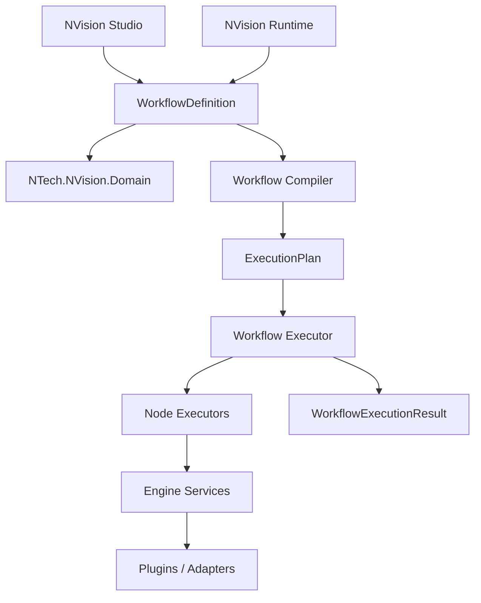
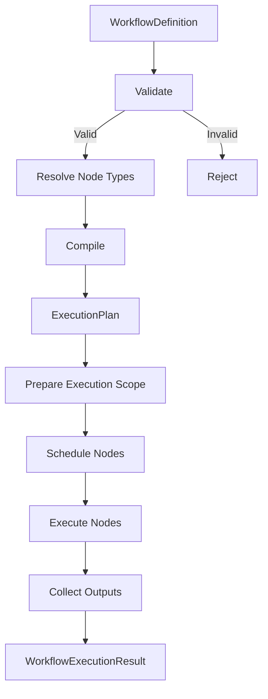
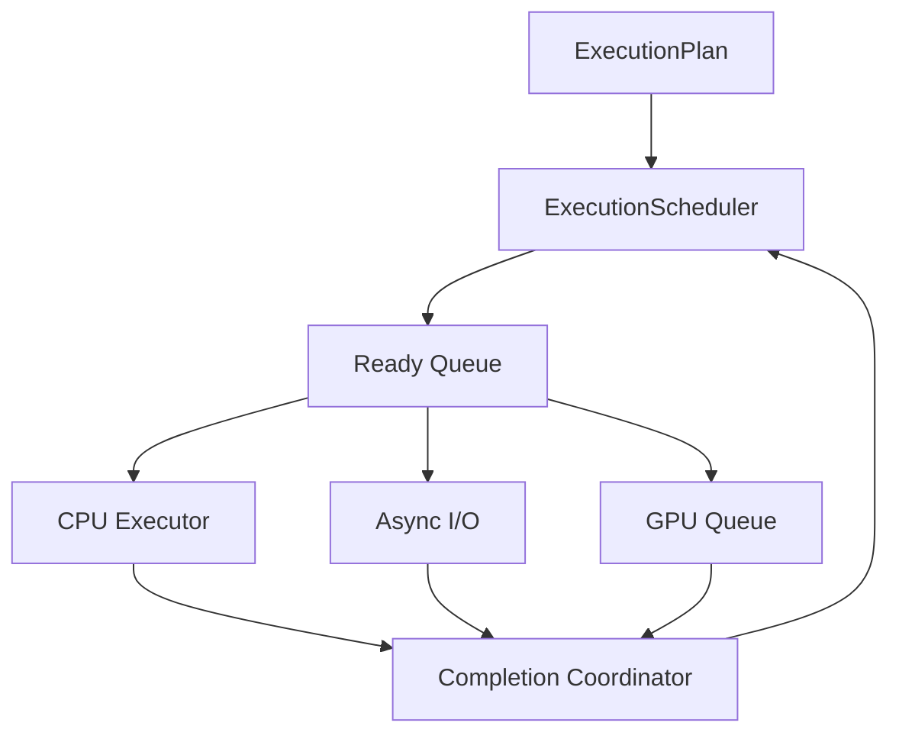
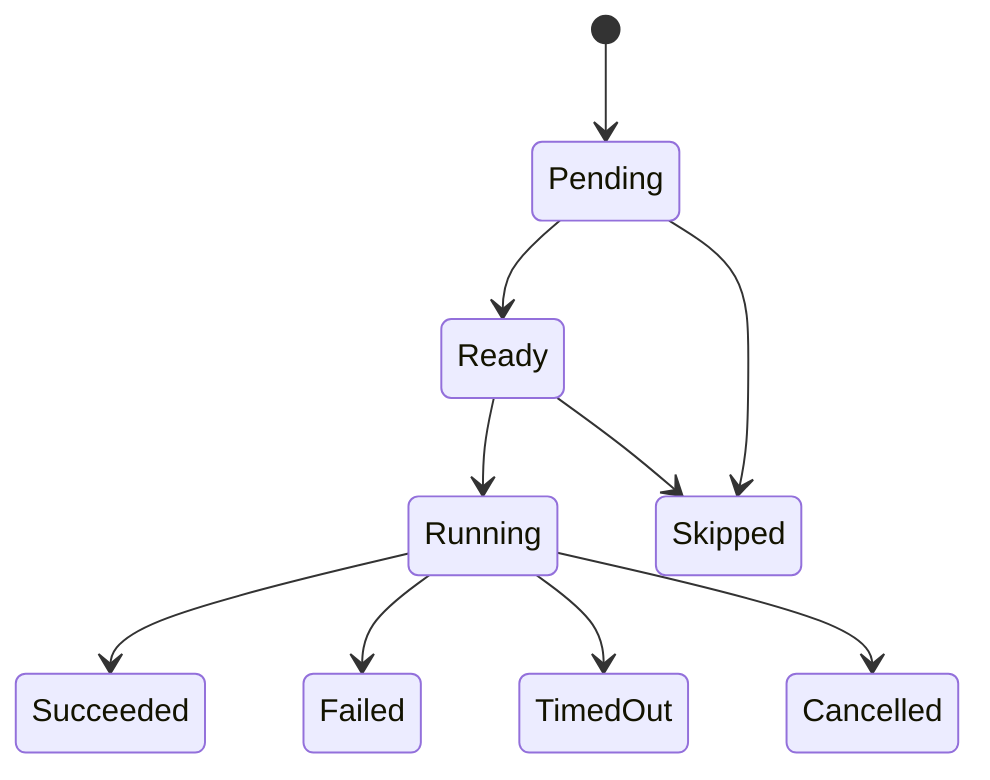
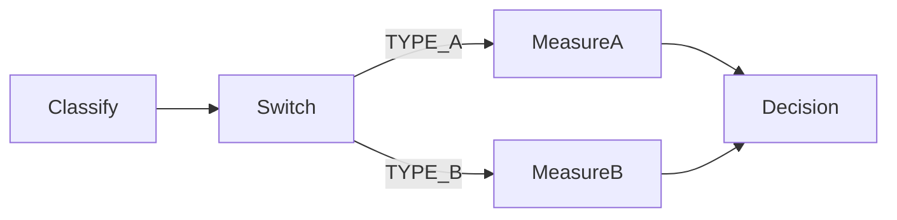
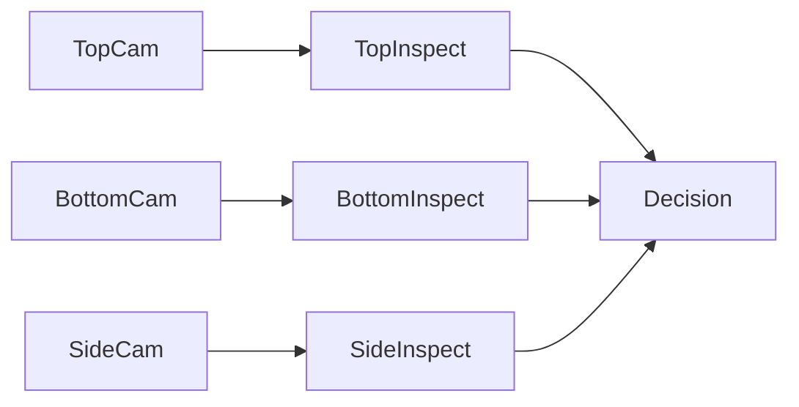
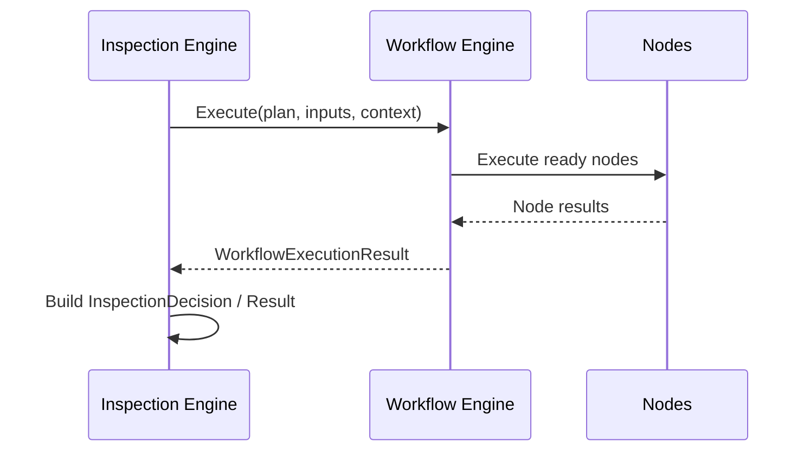
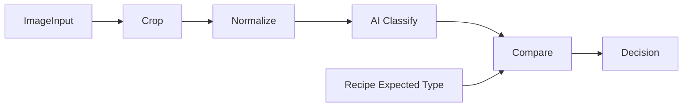
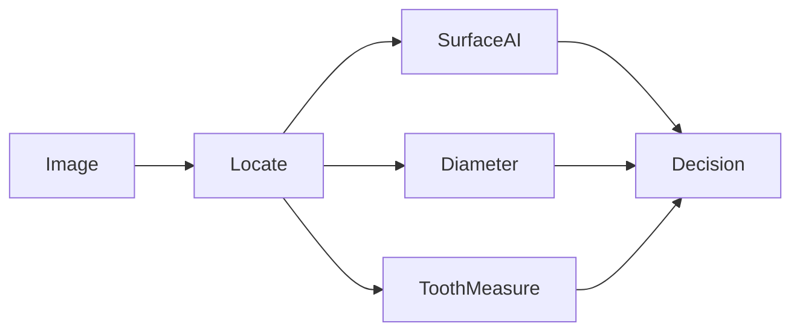
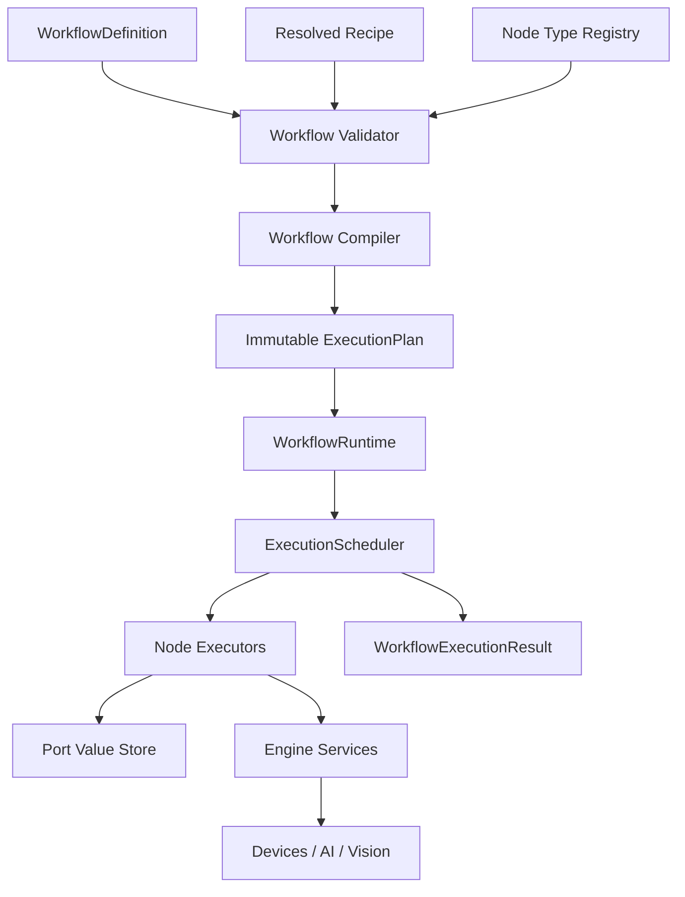

# 03 — NVision Workflow Engine Architecture

**Product:** NTech NVision  
**Document Type:** Core Engine Architecture  
**Component:** `NTech.NVision.Engine.Workflow`  
**Status:** Foundation Architecture  
**Version:** 1.0  
**Date:** 2026-08-18  
**Parent Documents:**  
- `NVISION_PLATFORM_FOUNDATION.md`
- `01_PLATFORM_ARCHITECTURE.md`
- `02_DOMAIN_MODEL.md`

---

# 1. Purpose

This document defines the architecture of the **NVision Workflow Engine**.

The Workflow Engine is the execution heart of NVision. It transforms an authored `WorkflowDefinition` into a validated and executable inspection pipeline.

Its responsibilities include:

- Workflow graph validation
- Node type resolution
- Typed port validation
- Parameter validation
- Dependency analysis
- Execution plan compilation
- Execution scheduling
- Parallel branch execution
- Node lifecycle management
- Typed data transfer
- Execution context management
- Cancellation
- Timeout
- Error propagation
- Failure policy handling
- Runtime diagnostics
- Node timing
- Debug execution
- Result collection
- Resource cleanup

The Workflow Engine must be:

- UI-independent
- Camera-vendor-independent
- AI-backend-independent
- PLC-vendor-independent
- Deterministic enough for industrial inspection
- Testable without physical hardware
- Extensible through node types/plugins

---

# 2. Core Architecture Principle

The Workflow Engine executes **definitions**, not UI objects.

The fundamental pipeline is:

```text
WorkflowDefinition
        │
        ▼
Validation
        │
        ▼
Compilation
        │
        ▼
ExecutionPlan
        │
        ▼
Execution
        │
        ▼
WorkflowExecutionResult
```

Important distinction:

```text
WorkflowDefinition
    = authored domain graph

ExecutionPlan
    = compiled runtime representation
```

The Engine must never repeatedly reinterpret the raw authoring graph for every inspection frame.

---

# 3. Position in NVision Architecture



---

# 4. Responsibilities

The Workflow Engine owns:

```text
Graph Validation
Graph Compilation
Execution Planning
Execution Scheduling
Node Execution
Data Flow
Node Result Tracking
Timeout
Cancellation
Failure Propagation
Diagnostics
Debug Control
Performance Timing
```

The Workflow Engine does **not** own:

```text
Camera vendor SDK
AI backend implementation
PLC vendor protocol
Image persistence implementation
UI
Project authoring persistence
MES logic
Runtime process supervision
```

Those belong to other modules.

---

# 5. Main Components

Recommended internal architecture:

```text
NTech.NVision.Engine.Workflow
│
├── Validation
│   ├── WorkflowValidator
│   ├── PortValidator
│   ├── ParameterValidator
│   └── DependencyValidator
│
├── Compilation
│   ├── WorkflowCompiler
│   ├── NodeResolver
│   ├── DependencyGraphBuilder
│   └── ExecutionPlanBuilder
│
├── Execution
│   ├── WorkflowExecutor
│   ├── ExecutionScheduler
│   ├── NodeExecutor
│   ├── NodeExecutionContext
│   └── ExecutionScope
│
├── DataFlow
│   ├── PortValueStore
│   ├── DataValue
│   └── DataTypeCompatibility
│
├── Debugging
│   ├── DebugController
│   ├── BreakpointManager
│   └── ExecutionTrace
│
├── Diagnostics
│   ├── WorkflowProfiler
│   ├── NodeMetrics
│   └── ExecutionDiagnostics
│
└── Abstractions
    ├── INodeDefinitionProvider
    ├── INodeExecutor
    ├── IWorkflowCompiler
    └── IWorkflowExecutor
```

---

# 6. Core Runtime Flow



---

# 7. WorkflowDefinition Input

The Engine consumes the Domain model:

```text
WorkflowDefinition
├── WorkflowId
├── Nodes
├── Connections
├── Inputs
├── Outputs
├── Variables
└── Metadata
```

Each node contains:

```text
WorkflowNode
├── NodeId
├── NodeTypeId
├── NodeTypeVersion
├── Parameters
├── Enabled
├── FailurePolicy
└── Metadata
```

The Engine must not rely on Studio canvas coordinates or UI metadata.

---

# 8. Node Type Definition

A `NodeTypeDefinition` describes a reusable executable node type.

Example:

```text
NodeTypeId:
nvision.image.crop
```

Conceptual model:

```text
NodeTypeDefinition
├── NodeTypeId
├── Version
├── DisplayName
├── Category
├── InputPorts
├── OutputPorts
├── Parameters
├── Capabilities
├── ExecutionCharacteristics
└── ExecutorFactory
```

This model belongs to Engine/Plugin abstractions, not Domain authoring state.

---

# 9. Node Type Registry

The Engine should use a central registry:

```text
INodeTypeRegistry
```

Responsibilities:

- Register built-in node types
- Register plugin-provided node types
- Resolve by `NodeTypeId`
- Resolve compatible version
- Expose metadata to Studio
- Reject duplicates
- Track origin/plugin

Example:

```text
nvision.image.crop
nvision.image.resize
nvision.ai.classify
nvision.logic.compare
nvision.result.decision
```

---

# 10. Node Executor

Each node type is executed by an `INodeExecutor`.

Conceptual contract:

```csharp
public interface INodeExecutor
{
    ValueTask<NodeExecutionResult> ExecuteAsync(
        NodeExecutionContext context,
        CancellationToken cancellationToken);
}
```

The actual implementation may use generic interfaces for type safety.

The important rule:

> Node execution contract is owned by NVision, not by vendor SDKs.

---

# 11. Node Factory

Prefer factory-based creation:

```text
INodeExecutorFactory
```

Reasons:

- Dependency injection
- Per-execution lifetime
- Resource ownership
- Plugin instantiation
- Test doubles
- Thread-safety control

---

# 12. Node Lifetime

Node types may have different lifetimes.

Recommended categories:

```text
Stateless
PerExecution
PerSession
SingletonShared
```

Examples:

```text
Crop Node             Stateless
Compare Node          Stateless
AI Inference Node     PerSession / shared model session
Camera Node           PerSession device handle
Counter Node          PerSession
```

Lifetime must be explicitly declared.

---

# 13. Execution Characteristics

Each node type may declare:

```text
ThreadSafe
Reentrant
Deterministic
UsesGPU
UsesCamera
UsesExternalIO
MayBlock
SupportsCancellation
SupportsDebugPreview
```

These properties help scheduler and diagnostics.

---

# 14. Workflow Validation

Validation happens before compilation.

Validation stages:

```text
Schema Validation
    ↓
Graph Validation
    ↓
Node Type Validation
    ↓
Port Validation
    ↓
Parameter Validation
    ↓
Reference Validation
    ↓
Execution Constraint Validation
```

---

# 15. Schema Validation

Checks:

- Workflow schema version supported
- Required fields exist
- IDs are syntactically valid
- Collections valid
- No malformed configuration

This happens before deeper semantic validation.

---

# 16. Graph Validation

Checks:

- All Node IDs unique
- All Connection IDs unique
- Source node exists
- Target node exists
- No self-connection unless explicitly supported
- No illegal cycles
- Required graph outputs reachable
- Disabled nodes do not leave illegal required paths

---

# 17. Cycle Policy

Initial NVision workflows should be DAGs:

```text
Directed Acyclic Graph
```

Do not support arbitrary cycles in the MVP.

Why:

- Easier scheduling
- Easier determinism
- Easier debugging
- Easier timeout reasoning
- Easier serialization

Future controlled loop nodes may be added explicitly.

Example future:

```text
Repeat N
ForEach
Retry
```

These should execute internally, not by introducing arbitrary graph cycles.

---

# 18. Port Validation

Checks:

```text
Source port exists
Target port exists
Direction valid
Types compatible
Required inputs connected
Multiplicity valid
```

Example invalid:

```text
Image → Float
```

unless an explicit conversion node exists.

---

# 19. Type Compatibility

Use explicit compatibility rules.

Examples:

```text
Image → Image                  valid
Integer → Float               optional implicit widening
Float → Integer               invalid by default
DetectionList → AnyMetadata   maybe valid only via adapter
```

Avoid implicit broad conversions.

Recommendation:

> Prefer explicit converter nodes.

---

# 20. Port Type Model

Conceptual:

```text
DataTypeId
```

Built-in examples:

```text
nvision.data.image
nvision.data.mask
nvision.data.float
nvision.data.integer
nvision.data.boolean
nvision.data.string
nvision.data.detection-list
nvision.data.measurement
nvision.data.decision
```

Plugins may define custom types only if API policy allows them.

---

# 21. Parameter Validation

Each node parameter validates:

- Required
- Type
- Range
- Enum/allowed values
- Format
- Cross-field constraint
- Recipe binding validity

Example:

```text
ConfidenceThreshold
must be 0.0 .. 1.0
```

---

# 22. Reference Validation

Checks references to:

```text
DeviceId
ModelId / ModelSlot
CalibrationId
Project Variable
Recipe Parameter
External Input
PLC Symbol
```

Authoring may allow unresolved references temporarily.

Publishing must not.

---

# 23. Validation Result

```text
WorkflowValidationResult
├── IsValid
├── Errors
├── Warnings
└── Diagnostics
```

Each issue:

```text
ValidationIssue
├── Code
├── Severity
├── NodeId
├── Port
├── Parameter
├── Message
└── SuggestedAction
```

---

# 24. Validation Error Codes

Examples:

```text
WFL-001 Duplicate node ID
WFL-002 Missing source node
WFL-003 Missing target node
WFL-004 Illegal cycle
WFL-005 Incompatible port types
WFL-006 Required input missing
WFL-007 Unknown node type
WFL-008 Unsupported node version
WFL-009 Invalid parameter
WFL-010 Unresolved model reference
```

Stable codes improve UI and support.

---

# 25. Compilation

Once valid, the graph is compiled.

```text
WorkflowDefinition
        ↓
WorkflowCompiler
        ↓
ExecutionPlan
```

Compilation should happen:

- when opening test mode,
- after relevant edits,
- when publishing,
- at Runtime load.

It should **not** happen for every trigger.

---

# 26. Workflow Compiler Responsibilities

Compiler:

- Resolve node type definitions
- Resolve versions
- Bind parameters
- Resolve recipe-independent static values
- Build dependency graph
- Topologically order nodes
- Detect parallel groups
- Prepare output routing
- Precompute input bindings
- Determine resource requirements
- Generate immutable execution plan

---

# 27. ExecutionPlan

Conceptual model:

```text
ExecutionPlan
├── WorkflowId
├── WorkflowVersion
├── PlanId
├── Nodes
├── DependencyMap
├── EntryNodes
├── TerminalNodes
├── OutputBindings
├── ResourceRequirements
└── Diagnostics
```

`ExecutionPlan` is immutable.

---

# 28. Compiled Node

```text
CompiledNode
├── NodeId
├── NodeTypeDefinition
├── ExecutorFactory
├── BoundParameters
├── InputBindings
├── OutputBindings
├── Dependencies
├── Dependents
├── FailurePolicy
└── ExecutionCharacteristics
```

---

# 29. Execution Plan Cache

Runtime may cache plans by:

```text
ProjectVersion
JobId
RecipeVersion
WorkflowHash
```

If recipe only changes parameter values that do not alter graph topology, the same structural plan may be reused with a resolved parameter set.

---

# 30. Workflow Hash

Recommended future field:

```text
WorkflowHash
```

Computed from execution-relevant content.

Exclude:

```text
Canvas position
Comments
Studio selection state
```

Include:

```text
Node types
Node versions
Connections
Execution parameters
```

Useful for:

- cache
- traceability
- change detection

---

# 31. Recipe Resolution and Compilation

Recommended relationship:

```text
WorkflowDefinition
      +
ResolvedRecipe
      ↓
WorkflowCompiler
      ↓
ExecutionPlan
```

Recipe resolution occurs before execution.

No repeated dictionary lookup should be required for every parameter on every node if avoidable.

---

# 32. Static vs Dynamic Parameters

Classify parameters:

## Static

Known before inspection.

Examples:

```text
ROI
Threshold
Model selection
Tolerance
```

Bind during plan/session preparation.

## Dynamic

Known per inspection.

Examples:

```text
Barcode
PLC product data
Robot pose
External measurement
```

Resolve from `InspectionExecutionContext`.

---

# 33. Execution Scope

Every workflow execution owns an `ExecutionScope`.

Conceptual:

```text
ExecutionScope
├── ExecutionId
├── InspectionId
├── ExecutionPlan
├── InputValues
├── PortValueStore
├── NodeStates
├── Cancellation
├── Timing
├── Diagnostics
└── TemporaryResources
```

This scope is not shared across simultaneous inspections.

---

# 34. NodeExecutionContext

Each node receives a restricted context.

```text
NodeExecutionContext
├── InspectionId
├── NodeId
├── Inputs
├── Parameters
├── Services
├── Recipe
├── RuntimeInputs
├── Diagnostics
└── ResourceScope
```

Do not give nodes unrestricted access to the entire Runtime.

---

# 35. Service Access

Nodes may require Engine services.

Examples:

```text
IImageService
IAIInferenceService
IDeviceService
ICalibrationService
IVariableResolver
ILogger
IMetrics
```

Use explicit service contracts.

Avoid service locator patterns where every node can resolve anything.

---

# 36. Port Value Store

The Engine stores outputs produced by nodes.

Conceptual:

```text
PortValueStore
(NodeId, PortKey) → DataValue
```

Requirements:

- Typed
- Execution-scoped
- Efficient
- Explicit lifetime
- Thread-safe for parallel branches

---

# 37. DataValue

Possible abstraction:

```text
DataValue
├── DataTypeId
├── Value
├── Ownership
└── Metadata
```

For performance-critical built-in types, generic strongly typed wrappers may be better.

The architecture should not force all data through reflection-heavy dynamic objects.

---

# 38. Data Ownership

Ownership categories:

```text
Borrowed
Shared
Owned
Pooled
External
```

Particularly important for:

```text
Image buffers
GPU buffers
Masks
Large detection tensors
```

---

# 39. Image Data Flow

Example:

```text
Camera Node
    │ Frame
    ▼
Crop
    │ ROI Image
    ├────────────► OCR
    │
    └────────────► AI
```

The Engine must avoid copying the ROI separately for each branch if safe shared access is possible.

---

# 40. Immutability of Node Inputs

Preferred rule:

> Node input values are immutable from the perspective of workflow execution.

Image-processing nodes produce new logical outputs.

For performance, underlying buffers may use copy-on-write or pooled memory.

But one node should not mutate another branch's shared input unexpectedly.

---

# 41. Scheduler Architecture



---

# 42. Scheduler Responsibilities

Scheduler:

- Identify ready nodes
- Respect dependency completion
- Respect cancellation
- Respect workflow timeout
- Execute parallel nodes
- Limit concurrency
- Handle resource-specific queues
- Propagate completion
- Stop scheduling after fatal failure

---

# 43. Ready Node Rule

A node becomes ready when:

```text
Enabled
AND
all required dependencies resolved
AND
workflow not cancelled
AND
failure policy allows continuation
```

---

# 44. Topological Execution

For DAGs:

```text
A → B → D
 \→ C →/
```

Possible execution:

```text
A
↓
B || C
↓
D
```

where `B` and `C` execute concurrently.

---

# 45. Concurrency Limits

Do not allow unlimited parallelism.

Configurable limits:

```text
MaxCPUNodeConcurrency
MaxIONodeConcurrency
MaxGPUConcurrency
```

Some GPU backends may use one serialized inference queue.

---

# 46. Node Resource Class

A node may declare:

```text
CPU
IO
GPU
DeviceExclusive
Mixed
```

Scheduler uses this as a hint.

Do not overengineer resource scheduling in MVP.

---

# 47. Device-Exclusive Nodes

Some operations cannot safely overlap.

Example:

```text
Camera Trigger
Camera Grab
PLC handshake
Light controller command
```

Use keyed resource locks.

Concept:

```text
ResourceKey = DeviceId
```

---

# 48. Resource Lock Manager

Possible Engine service:

```text
IExecutionResourceCoordinator
```

Responsibilities:

- keyed async lock
- acquisition timeout
- cancellation
- diagnostics

Avoid global locks.

---

# 49. CPU-Bound Nodes

Examples:

```text
Threshold
Contour
Measurement
Geometry
```

Run on bounded worker pool / TPL.

Avoid blocking UI thread.

---

# 50. I/O-Bound Nodes

Examples:

```text
Camera acquisition
PLC read
Robot request
Database lookup
```

Use async I/O when supported.

---

# 51. GPU Nodes

Examples:

```text
AI inference
CUDA preprocessing
```

GPU scheduling should be delegated partly to AI Engine.

Workflow scheduler should avoid launching uncontrolled inference sessions.

---

# 52. Node State Machine



States:

```text
Pending
Ready
Running
Succeeded
Failed
TimedOut
Cancelled
Skipped
```

---

# 53. Node Execution Result

```text
NodeExecutionResult
├── NodeId
├── Status
├── Outputs
├── Error
├── Warnings
├── StartedAt
├── CompletedAt
├── Duration
└── Metrics
```

---

# 54. WorkflowExecutionResult

```text
WorkflowExecutionResult
├── WorkflowId
├── Status
├── Outputs
├── NodeResults
├── Errors
├── Warnings
├── StartedAt
├── CompletedAt
├── Duration
└── Diagnostics
```

Workflow status:

```text
Succeeded
Failed
TimedOut
Cancelled
Invalid
```

This is not the same as product quality status `OK/NG`.

---

# 55. Workflow Status vs Inspection Decision

Important distinction:

```text
Workflow execution succeeded
```

does not mean:

```text
Inspection = OK
```

Example:

```text
Workflow execution: Succeeded
Decision: NG
Reason: WRONG_TYPE
```

Another example:

```text
Workflow execution: Failed
Inspection: ERROR
Reason: CAMERA_TIMEOUT
```

---

# 56. Failure Policy

Per-node policy:

```text
AbortInspection
ReturnNG
Continue
UseFallback
```

Interpretation belongs to Engine/Application.

---

# 57. AbortInspection

On node failure:

```text
stop scheduling dependent nodes
cancel remaining nonessential work
return workflow Failed
inspection becomes ERROR
```

Recommended default for critical nodes.

---

# 58. ReturnNG

Use only when technical failure semantically means product failure by explicit design.

Example may be rare.

Avoid using it to hide system errors.

---

# 59. Continue

Node failure does not abort workflow.

Use for optional diagnostics.

Example:

```text
SaveDebugImage
Optional OCR
Noncritical analytics
```

---

# 60. UseFallback

Fallback must be explicit.

Example:

```text
Primary OCR fails
→ use secondary OCR
```

Fallback should be represented structurally where possible rather than hidden in generic node policy.

---

# 61. Error Propagation

Errors should carry context:

```text
WorkflowId
NodeId
NodeType
ErrorCode
Category
Message
Recoverable
InnerError
Timestamp
```

Avoid losing the original source.

---

# 62. Technical Error Categories

Examples:

```text
Validation
Configuration
Input
Device
Timeout
AI
Vision
Communication
Resource
Internal
Cancellation
```

---

# 63. Workflow Timeout

Workflow may define:

```text
Timeout
```

Example:

```text
500 ms
```

On timeout:

```text
cancel execution scope
stop scheduling new nodes
request cancellation of running nodes
mark remaining nodes
return TimedOut
```

---

# 64. Node Timeout

Individual nodes may define timeout.

Example:

```text
Camera Grab = 100 ms
AI Inference = 150 ms
PLC Read = 50 ms
```

Node timeout cannot exceed workflow policy unless explicitly allowed.

---

# 65. Cancellation

Cancellation causes:

```text
Runtime Stop
Emergency operating stop
Recipe switch
Deployment switch
Workflow timeout
Inspection cancellation
Application shutdown
```

Use cooperative cancellation.

---

# 66. Cancellation Rule

A node that ignores cancellation may delay shutdown.

Therefore node metadata should declare:

```text
SupportsCancellation
```

Plugins with blocking vendor SDK calls may need:

- vendor abort API,
- dedicated host process,
- bounded timeout.

---

# 67. CancellationToken Hierarchy

Conceptually:

```text
RuntimeToken
    ↓
SessionToken
    ↓
InspectionToken
    ↓
WorkflowToken
    ↓
NodeToken
```

Cancellation flows downward.

---

# 68. Execution Isolation

Each inspection workflow must be isolated.

No mutable node-local state should leak across inspections unless intentionally session-scoped.

Bad:

```text
static LastResult
```

Preferred:

```text
ExecutionScope
SessionService
Explicit Cache
```

---

# 69. State Nodes

Some workflows need state across inspections.

Examples:

```text
Counter
Moving Average
Debounce
Part Sequence
```

These must be explicit stateful nodes/services.

State scope:

```text
Inspection
RuntimeSession
Station
```

No hidden global state.

---

# 70. Stateful Node Contract

A stateful node should declare:

```text
StateScope
PersistencePolicy
ResetPolicy
ThreadSafety
```

Examples:

```text
Reset on Recipe Change
Reset on Runtime Restart
Persist across Runtime Restart
```

---

# 71. Runtime Variables

The Workflow Engine may consume runtime variables.

Examples:

```text
ProductCode
SerialNumber
RobotPose
PLCValue
OperatorInput
```

Use explicit typed input map:

```text
WorkflowInputSet
```

---

# 72. WorkflowInputSet

```text
WorkflowInputSet
├── Named Inputs
├── Trigger Metadata
├── ProductIdentity
└── External Data
```

Validation occurs before execution if required input is missing.

---

# 73. Workflow Outputs

A workflow should define named outputs.

Example:

```text
Decision
DetectedType
Confidence
MeasuredLength
OCRText
```

This improves interoperability.

---

# 74. Output Binding

```text
WorkflowOutput
├── Name
├── DataType
└── SourceBinding
```

Example:

```text
Decision
← DecisionNode.Result
```

---

# 75. Decision Node

Recommended pattern:

```text
Vision nodes
AI nodes
Measurement nodes
        ↓
Decision node
        ↓
Workflow output: Decision
```

The Workflow Engine does not hardcode `OK/NG` into every node.

---

# 76. Control-Flow Nodes

Initial MVP should minimize control-flow complexity.

Potential nodes:

```text
Switch
If
Select
Gate
```

Implementation should preserve DAG semantics.

---

# 77. Conditional Branching

Example:



Inactive branch nodes become:

```text
Skipped
```

---

# 78. Lazy Branch Execution

Conditional branches should not execute both branches if unnecessary.

Compiler may represent branch conditions in plan.

Do not implement by executing all branches and discarding outputs.

---

# 79. Optional Inputs

Some node inputs may be optional.

If missing:

```text
use default
or
node handles null/absent
```

Port definition must declare this.

---

# 80. Null Semantics

Avoid passing generic nulls without meaning.

Prefer:

```text
Optional<T>
Absent
NoDetection
NoResult
```

where domain meaning matters.

---

# 81. Debug Execution Mode

Studio needs an execution mode distinct from Production.

Modes:

```text
Production
Test
Debug
Simulation
```

---

# 82. Debug Features

Future Debug mode should support:

```text
Pause
Resume
Step
Breakpoint
Inspect Input
Inspect Output
Preview Image
Inspect Parameters
Node Timing
Execution Trace
```

---

# 83. Breakpoint Model

Breakpoint can target:

```text
BeforeNode
AfterNode
OnFailure
Conditional
```

MVP may start with:

```text
Pause Before Node
```

---

# 84. Debug Controller

```text
IDebugExecutionController
```

Responsibilities:

- pause gate
- resume
- step
- breakpoint lookup
- debug event emission

Production execution should bypass debugger overhead when disabled.

---

# 85. Step Execution

Possible semantics:

```text
Step Node
```

Execute one ready node, then pause.

Parallel branches complicate step behavior.

Define clearly:

> In debug step mode, scheduler may serialize execution for predictability.

---

# 86. Node Preview

Nodes may publish debug preview values.

Examples:

```text
Image
Mask
Contours
Bounding boxes
Text
Measurements
```

Preview data is diagnostic and should not become production business output unless explicitly bound.

---

# 87. Execution Trace

```text
ExecutionTrace
├── ExecutionId
├── Node Events
├── Timings
├── State Transitions
├── Errors
└── Data Summaries
```

Avoid storing huge image buffers in trace.

Use image references/thumbnails.

---

# 88. Performance Profiling

The Engine should measure:

```text
Queue wait
Node execution
Resource wait
Total workflow time
```

For each node.

---

# 89. Node Metrics

```text
NodeMetrics
├── QueueWaitMs
├── ExecutionMs
├── CPUTime
├── GPUTime
├── ResourceWaitMs
├── AllocatedBytes
└── CustomMetrics
```

Not all metrics available on all platforms.

---

# 90. Workflow Profiler

Future `WorkflowProfiler` supports:

- average
- min
- max
- p95
- p99
- per-node bottleneck
- GPU utilization
- throughput

---

# 91. Timing Accuracy

Use monotonic high-resolution timers for durations.

Do not derive duration from wall-clock timestamps.

In .NET:

```text
Stopwatch
```

or equivalent.

Wall clock remains for trace timestamps.

---

# 92. Logging

Structured workflow log context:

```text
InspectionId
WorkflowId
NodeId
NodeTypeId
ExecutionId
Recipe
ProjectVersion
```

Example:

```text
NodeExecutionStarted
NodeExecutionCompleted
NodeExecutionFailed
WorkflowExecutionCompleted
```

---

# 93. Event Emission

Engine can emit operational events:

```text
WorkflowStarted
NodeStarted
NodeCompleted
NodeFailed
WorkflowCompleted
WorkflowFailed
```

These are execution events, not necessarily Domain Events.

Distinguish:

```text
Engine Events
Domain Events
```

---

# 94. Engine Events

High-frequency, technical.

Examples:

```text
NodeStarted
NodeTimingRecorded
```

May feed:

- UI
- diagnostics
- profiler

Do not persist all of them by default.

---

# 95. Domain Events

Business-significant.

Examples:

```text
InspectionCompleted
```

Created after workflow execution contributes to inspection result.

---

# 96. Resource Scope

Each execution should support deterministic cleanup:

```text
ExecutionResourceScope
```

It tracks:

```text
Pooled image buffers
Temporary GPU memory
Temporary files
Native handles
Disposable resources
```

---

# 97. Resource Cleanup

Cleanup occurs on:

```text
Success
Failure
Timeout
Cancellation
Exception
```

Use `try/finally` / `await using`.

No execution path should leak resources.

---

# 98. Exception Boundary

Unexpected exceptions inside a node must be converted to controlled node failure.

Concept:

```text
try
    Execute Node
catch
    NodeExecutionResult.Failed
```

Workflow process must not crash because a managed node threw an exception.

Native fatal crashes require process isolation strategies.

---

# 99. Native Plugin Failure

Native SDK may cause:

```text
AccessViolation
Process Crash
Deadlock
```

In-process protection is limited.

Future strategy:

```text
Out-of-process Plugin Host
```

for unstable components.

Workflow Engine must remain compatible with remote node/service calls.

---

# 100. Node Retry

Generic automatic retry should be conservative.

Allowed when:

```text
Node declares retry-safe
Operation idempotent
Retry policy explicit
```

Example:

```text
Read optional external value
```

Not safe by default:

```text
Robot movement
PLC output write
Camera hardware trigger
```

---

# 101. Retry Policy

Conceptual:

```text
RetryPolicy
├── MaxAttempts
├── Delay
├── Backoff
├── RetryableErrorCodes
└── IdempotentRequired
```

MVP may omit generic retry from Workflow and leave it to specific device services.

---

# 102. Determinism

For same:

```text
Workflow
Recipe
Input
Model
Calibration
```

pure nodes should produce same logical result.

Mark nodes that depend on:

```text
Time
Randomness
External state
```

as nondeterministic.

---

# 103. Randomness

AI preprocessing/training randomness is not relevant to Runtime inference.

Any random Runtime node should accept explicit seed when reproducibility matters.

---

# 104. Execution Sequence Number

Each node execution may receive:

```text
ExecutionSequence
```

Useful for trace ordering in parallel workflows.

---

# 105. Multi-Camera Workflow

The Engine must support more than one input frame.

Example:



Do not architect around:

```text
one workflow = one image
```

---

# 106. Multi-Shot Workflow

Example:

```text
Light 1 ON → Capture
Light 2 ON → Capture
Darkfield → Capture
```

This may involve device-control nodes.

Scheduler must respect sequential dependencies.

---

# 107. Sequence Nodes

A workflow graph naturally models ordering:

```text
SetLight
   ↓
TriggerCamera
   ↓
GrabFrame
```

No special imperative scripting required.

---

# 108. Hardware Trigger Workflow

In many systems acquisition occurs before workflow invocation.

Support both:

## Mode A

```text
Trigger
→ Runtime acquires frame
→ Workflow(frame)
```

## Mode B

```text
Workflow
→ Camera Trigger Node
→ Grab Node
```

The Inspection Engine decides which model is used per Job.

---

# 109. Workflow Entry Inputs

Recommended to support named graph inputs.

Examples:

```text
SourceImage
TopImage
BottomImage
Barcode
RobotPose
```

This makes workflows reusable across acquisition modes.

---

# 110. Workflow Composition

Future capability:

```text
Subworkflow Node
```

Example:

```text
Main Workflow
├── Locate Part
├── Surface Inspection Subworkflow
└── Decision
```

Do not implement before core workflow is stable.

---

# 111. Subworkflow Rules

When added:

- explicit inputs
- explicit outputs
- no hidden variable capture
- versioned reference
- bounded recursion
- no recursive cycles

---

# 112. Reusable Tool Macro vs Subworkflow

Potential distinction:

```text
Macro
= copied authoring template

Subworkflow
= referenced reusable executable definition
```

Prefer clear versioning.

---

# 113. Script Nodes

Do not add unrestricted scripting in MVP.

Reasons:

- security
- determinism
- supportability
- serialization
- debugging
- deployment safety

If scripting is added later:

- sandbox
- time limit
- limited API
- explicit language/version
- signature policy

---

# 114. Custom Expression Node

Instead of arbitrary scripts, MVP may support a safe expression node.

Example:

```text
Length >= MinLength AND Length <= MaxLength
```

Use a limited expression engine.

---

# 115. Variable Resolver

Expression nodes may resolve:

```text
Node Outputs
Recipe Parameters
Inspection Inputs
Constants
```

Variable binding should be validated at compile time where possible.

---

# 116. Comparison Nodes

Examples:

```text
Equal
NotEqual
GreaterThan
LessThan
InRange
StringEquals
RegexMatch
```

These provide transparent inspection logic.

---

# 117. Logical Nodes

```text
AND
OR
NOT
Any
All
```

Outputs typed `Boolean`.

---

# 118. Decision Node Contract

Inputs:

```text
Boolean conditions
Reason mappings
Optional score
```

Output:

```text
InspectionDecision
```

Example:

```text
Pass = A AND B AND C
```

If false, reasons identify failed conditions.

---

# 119. Explainable Decision

Decision node should preserve:

```text
which condition failed
which measurement caused failure
which source node produced it
```

This supports operator UI.

---

# 120. Workflow Input Validation

Before scheduling:

- required workflow inputs exist
- types compatible
- external references resolved
- session ready

If invalid:

```text
WorkflowExecutionStatus.Invalid
```

No node runs.

---

# 121. Preparation Phase

Before execution, Engine may prepare:

```text
Node executor instances
session resources
bound static parameters
model sessions
device references
```

Separate from per-inspection execution.

---

# 122. Workflow Runtime Instance

Recommended concept:

```text
WorkflowRuntime
```

Created from `ExecutionPlan` for a Runtime Session.

Contains:

```text
Plan
Session-scoped Node Executors
Shared Services
Resource Bindings
```

Per inspection creates:

```text
ExecutionScope
```

---

# 123. Session-Scoped Preparation

Examples:

```text
Load AI model once
Resolve camera device once
Compile expression once
Allocate reusable buffers
```

Do not repeat for every inspection.

---

# 124. Warm-Up

Workflow Runtime may warm up:

```text
AI models
GPU kernels
OpenCV paths
camera stream
```

Warm-up occurs before production state `Ready`.

---

# 125. Workflow Readiness

A compiled workflow can be:

```text
Compiled
Prepared
Ready
NotReady
```

NotReady reasons:

```text
model failed to load
required device unavailable
calibration missing
plugin unavailable
```

---

# 126. Thread Safety

Each Node Type must declare whether executor is thread-safe.

If same WorkflowRuntime handles overlapping inspections, non-thread-safe session nodes require:

- per-inspection instance,
- lock,
- or no-overlap policy.

---

# 127. Overlapping Inspections

Initial Runtime may use:

```text
MaxConcurrentInspections = 1
```

This is a sensible industrial MVP default.

Architecture should not prevent future concurrency.

---

# 128. Concurrency Policy

Per Job:

```text
Single
Bounded(N)
Pipeline
```

MVP:

```text
Single
```

simplifies camera/PLC sequencing.

---

# 129. Backpressure

When trigger arrives while busy:

Possible policies:

```text
Reject
QueueOne
QueueBounded
Drop
SignalBusy
```

Default industrial policy:

```text
SignalBusy / Reject
```

depending on PLC handshake.

---

# 130. Workflow Queue

Do not let Workflow Engine own an unbounded inspection queue.

Queue policy belongs to Inspection/Runtime orchestration.

Workflow Engine executes one submitted scope.

---

# 131. Separation from Inspection Engine

Important:

```text
Inspection Engine
    owns:
    trigger
    inspection lifecycle
    runtime session
    final result
    PLC handshake

Workflow Engine
    owns:
    graph execution
```

---

# 132. Interaction with Inspection Engine



---

# 133. Interaction with Acquisition Engine

Workflow nodes use:

```text
IAcquisitionService
```

or receive pre-acquired frames.

Workflow Engine itself does not call camera SDK.

---

# 134. Interaction with AI Engine

AI nodes call:

```text
IAIInferenceService
```

AI Engine owns:

- model sessions
- backend
- preprocessing implementation if model-specific
- GPU resource

Workflow Engine owns scheduling and data dependency.

---

# 135. Interaction with Calibration Engine

Measurement/transform nodes call:

```text
ICalibrationService
```

Use immutable calibration snapshot for the session.

---

# 136. Interaction with Communication Engine

Output nodes may use:

```text
ICommunicationService
```

However, critical PLC machine handshake should generally remain in Inspection/Runtime orchestration rather than deep inside arbitrary workflows.

---

# 137. Recommended Output Node Scope

Workflow outputs can include:

```text
Save Debug Image
Publish optional message
Set internal result
```

For production safety, core machine handshake should be centralized.

---

# 138. Side Effects

Classify nodes:

```text
Pure
ReadExternal
WriteExternal
Stateful
```

Compiler/scheduler can treat side-effect nodes conservatively.

---

# 139. Pure Nodes

Examples:

```text
Crop
Threshold
Measure
Compare
AND
```

Benefits:

- deterministic
- easy test
- parallelizable

---

# 140. ReadExternal Nodes

Examples:

```text
Read PLC value
Get robot pose
Read barcode
```

Need timeout and error policy.

---

# 141. WriteExternal Nodes

Examples:

```text
Write PLC
Send robot command
Publish MQTT
```

Use with care.

They complicate replay/debugging.

---

# 142. Debug Replay

Offline replay should disable or simulate side-effect nodes.

Execution mode may provide:

```text
SideEffectPolicy
```

Options:

```text
Real
Simulate
Block
RecordOnly
```

---

# 143. Simulation Services

Studio Simulation mode can inject:

```text
FakeCameraService
FakePLCService
FakeRobotService
RecordedInputProvider
```

Node code remains unchanged.

---

# 144. Testability

Workflow Engine must support fully in-memory tests.

Test example:

```text
Constant Node
  ↓
Compare
  ↓
Decision
```

No hardware.

---

# 145. Golden Workflow Test

Test fixture:

```text
WorkflowDefinition
Recipe
Input Values
Expected Node Results
Expected Workflow Output
```

---

# 146. Graph Validation Tests

Required test cases:

```text
duplicate node
missing node
illegal cycle
missing required port
incompatible type
unknown node type
invalid parameter
disabled dependency
```

---

# 147. Scheduler Tests

Test:

```text
sequential order
parallel branch
dependency wait
failure propagation
cancellation
timeout
conditional skip
resource lock
```

---

# 148. Concurrency Tests

Use deterministic fake nodes with barriers to prove:

```text
parallel nodes overlap
dependent nodes do not start early
resource-exclusive nodes serialize
```

---

# 149. Performance Tests

Benchmark:

```text
100 nodes simple flow
large image branches
AI + vision parallel branch
10,000 repeated executions
```

Measure:

- scheduling overhead
- allocations
- memory growth
- execution stability

---

# 150. Workflow Engine Overhead Target

Engine overhead should be small relative to image processing.

Initial target:

```text
< 1 ms
```

for modest graphs excluding node work, where practical.

This is an engineering target, not a hard guarantee.

---

# 151. Allocation Strategy

Avoid per-node unnecessary allocations.

Potential optimizations:

```text
ExecutionScope pooling
port slot arrays
compiled input bindings
ValueTask
buffer pooling
preallocated node state
```

Do not optimize prematurely before profiling.

---

# 152. Reflection

Reflection may be acceptable during registration/compilation.

Avoid reflection-heavy access in hot per-frame execution paths.

---

# 153. Compiled Port Binding

Instead of repeated lookup:

```text
Dictionary<(NodeId,Port), object>
```

compiler may assign slot indexes.

Example:

```text
Slot 0 = Camera.Image
Slot 1 = Crop.Image
Slot 2 = AI.Result
```

Execution uses array-like slots.

---

# 154. Port Slot Plan

Concept:

```text
PortSlot
├── Index
├── DataType
├── Producer
└── Consumers
```

This can significantly reduce runtime overhead.

---

# 155. Output Lifetime Analysis

Compiler may later determine when intermediate values are no longer needed.

Example:

```text
Image output consumed by nodes B and C
release after B and C complete
```

Useful for large image buffers.

---

# 156. Buffer Reuse

Future optimization:

```text
ImageBufferPool
MaskBufferPool
TensorBufferPool
```

Workflow Engine coordinates lifetime but specialized engines own allocation details.

---

# 157. CPU/GPU Transfer Awareness

Avoid repeated:

```text
CPU → GPU → CPU → GPU
```

Future node metadata can describe memory domain.

The compiler may optimize adjacent GPU nodes.

This is a future optimization, not MVP requirement.

---

# 158. Node Fusion

Future optimization only.

Example:

```text
Resize
Normalize
Tensor Convert
```

may be fused by AI backend.

Workflow semantics remain unchanged.

---

# 159. Deterministic Error Result

Unexpected node exception maps to stable error:

```text
WFE-NODE-UNHANDLED
```

with original exception in diagnostics/log.

UI sees safe message.

---

# 160. Sensitive Data in Logs

Node parameters may contain:

```text
credentials
product data
serial numbers
```

Logging must support redaction.

Node metadata should mark sensitive parameters.

---

# 161. Node Parameter Metadata

Add:

```text
Sensitive
RecipeOverridable
RuntimeBindable
RequiresRecompile
RequiresSessionRestart
```

These properties guide Studio/Runtime behavior.

---

# 162. RequiresRecompile

Parameter changes that alter topology/type behavior may require plan rebuild.

Example:

```text
dynamic output type
subworkflow reference
```

Prefer node designs where normal recipe changes do **not** require topology recompile.

---

# 163. RequiresSessionRestart

Examples:

```text
AI model selection
camera pixel format
device endpoint
```

if underlying resource cannot change safely live.

Recipe activation process handles it.

---

# 164. Hot Parameter Update

Some parameters may safely change between inspections:

```text
threshold
tolerance
confidence
```

Never mutate mid-inspection.

---

# 165. Plan Versioning

ExecutionPlan may include internal version:

```text
ExecutionPlanFormatVersion
```

It does not need long-term persistence initially.

Runtime can compile from deployment package on startup.

---

# 166. Serialization

Do not serialize live executor instances.

Serializable:

```text
WorkflowDefinition
Node config
Connections
```

Non-serializable:

```text
ExecutionPlan
NodeExecutor
Resource handles
PortValueStore
```

unless future cache explicitly supports it.

---

# 167. Plugin Node Loading

At compilation:

```text
NodeTypeId
   ↓
NodeTypeRegistry
   ↓
Plugin / Built-in Definition
```

If missing:

```text
validation error
```

No placeholder execution in Production.

---

# 168. Plugin Version Compatibility

Node instance stores:

```text
NodeTypeVersion
```

Registry resolves compatible executor.

Migration may occur in Studio, not silently at Runtime.

---

# 169. Node Migration

Future plugin may provide:

```text
INodeConfigurationMigrator
```

Example:

```text
Crop Node v1 config
→ Crop Node v2 config
```

Runtime should prefer pre-migrated published configuration.

---

# 170. Built-In Node Categories

Initial categories:

```text
Acquisition
Image
Vision
AI
Measurement
Logic
Data
Result
Output
Utility
```

---

# 171. MVP Built-In Nodes

Recommended minimum:

## Acquisition

```text
ImageInput
CameraGrab
```

## Image

```text
Crop
Resize
Rotate
ColorConvert
```

## Vision

```text
Threshold
Blur
Edge
Contour
Blob
```

## AI

```text
Classify
Detect
```

## Logic

```text
Compare
AND
OR
NOT
Switch
```

## Result

```text
Decision
```

## Output

```text
SaveImage
```

PLC handshake can remain outside the graph initially.

---

# 172. ImageInput Node

Useful for:

```text
offline test
Runtime pre-acquired frame
golden image testing
```

Input:

```text
Workflow input image
```

Output:

```text
Image
```

---

# 173. CameraGrab Node

Uses:

```text
DeviceId
Grab settings
Timeout
```

Output:

```text
Image
```

It calls Acquisition Engine.

---

# 174. Crop Node

Inputs:

```text
Image
Optional ROI
```

Parameters:

```text
X
Y
Width
Height
```

Output:

```text
Image
```

---

# 175. AI Classify Node

Inputs:

```text
Image
```

Parameters:

```text
ModelSlot
ConfidenceThreshold
```

Outputs:

```text
Classification
ClassName
Confidence
```

---

# 176. Compare Node

Inputs:

```text
A
B
```

Parameter:

```text
Operator
```

Output:

```text
Boolean
```

---

# 177. Decision Node

Inputs:

```text
Pass
Optional reason inputs
```

Output:

```text
InspectionDecision
```

---

# 178. Example Wire Marker Workflow



---

# 179. Example Execution Plan

For the graph above:

```text
Stage 0
- ImageInput
- Recipe Expected Type

Stage 1
- Crop

Stage 2
- Normalize

Stage 3
- AI Classify

Stage 4
- Compare

Stage 5
- Decision
```

Stages are conceptual.

Scheduler may operate dependency-first without materializing explicit stages.

---

# 180. Example Parallel Gear Workflow



Execution:

```text
Locate
  ↓
SurfaceAI || Diameter || ToothMeasure
  ↓
Decision
```

---

# 181. Node Execution Trace Example

```text
Inspection: GEAR01-...

Locate
  Queue:      0.1 ms
  Execute:    3.2 ms
  Status:     Success

SurfaceAI
  Queue:      0.2 ms
  Execute:   24.8 ms

Diameter
  Queue:      0.2 ms
  Execute:    4.1 ms

Decision
  Execute:    0.3 ms

Workflow Total:
  29.2 ms
```

---

# 182. Execution Result Storage

Workflow Engine returns node results.

Inspection Engine decides persistence detail.

Policies:

```text
Minimal
Standard
Diagnostic
```

Workflow Engine should not write directly to production database.

---

# 183. Preview Data

Runtime/Studio can subscribe to preview stream.

Examples:

```text
Current source image
annotated output
selected node image
```

Use throttling.

Do not let preview rendering block workflow execution.

---

# 184. UI Event Isolation

Workflow thread must never call WPF controls.

Flow:

```text
Workflow Engine
   ↓ event/channel
Application
   ↓
ViewModel
   ↓
UI
```

---

# 185. Event Backpressure

High-frequency node events should be bounded/throttled.

Examples:

```text
preview frames
node timing updates
```

Dropping diagnostic UI updates is preferable to slowing inspection.

---

# 186. Runtime Priority

Production execution priority order:

```text
1. Inspection correctness
2. Machine handshake
3. Result traceability
4. Diagnostics
5. UI preview
```

UI is lowest priority.

---

# 187. Error Visualization Contract

Engine should expose structured node failure:

```text
NodeId
NodeName
ErrorCode
Message
Details
```

Studio highlights failing node.

Runtime displays operator-safe alarm.

---

# 188. Node Status Visualization

UI states:

```text
Idle
Running
Success
Warning
Failed
Skipped
Disabled
```

These are presentation mappings from Engine execution state.

---

# 189. Breakpoint Persistence

Studio breakpoint metadata belongs to authoring/debug metadata.

It should not affect published Production package unless intentionally enabled for service mode.

---

# 190. Production Debugging

Runtime may support diagnostics mode without full breakpoint pause.

Examples:

```text
capture node timing
save intermediate image
trace selected node outputs
```

Safe for maintenance.

---

# 191. Execution Snapshot

For difficult failures, Runtime may generate:

```text
ExecutionSnapshot
```

containing:

```text
workflow version
recipe
node results
selected intermediate data
logs
device snapshot
```

No requirement for MVP.

---

# 192. Workflow Engine Public API

Suggested top-level contracts:

```csharp
public interface IWorkflowCompiler
{
    WorkflowCompileResult Compile(
        WorkflowDefinition workflow,
        WorkflowCompileContext context);
}

public interface IWorkflowExecutor
{
    ValueTask<WorkflowExecutionResult> ExecuteAsync(
        WorkflowRuntime runtime,
        WorkflowInputSet inputs,
        WorkflowExecutionContext context,
        CancellationToken cancellationToken);
}
```

Illustrative only.

---

# 193. Compile Result

```text
WorkflowCompileResult
├── IsSuccess
├── ExecutionPlan
├── Errors
├── Warnings
└── Diagnostics
```

---

# 194. WorkflowRuntime API

Conceptual:

```text
PrepareAsync
ExecuteAsync
ResetSessionState
DisposeAsync
```

Preparation may load resources.

---

# 195. Execution Context

```text
WorkflowExecutionContext
├── InspectionId
├── StationId
├── ExecutionMode
├── Deadline
├── CorrelationId
├── RuntimeVariables
└── TraceOptions
```

---

# 196. Execution Mode

```text
Production
Test
Debug
Simulation
```

Node/service behavior may differ only where explicitly permitted.

---

# 197. Production Mode Restrictions

Production mode should reject:

```text
unresolved node
debug-only node
missing required reference
unsafe script
invalid calibration
```

---

# 198. Test Mode

Allows:

```text
offline images
mock devices
manual input
temporary recipe values
```

Still uses same Workflow Engine.

---

# 199. Simulation Mode

External side effects use simulation adapters.

Example:

```text
PLCWriteNode
→ simulated PLC
```

---

# 200. Architecture Rule: Same Engine Everywhere

Studio test, Runtime production, and CI golden tests should use the same execution engine.

Avoid:

```text
Studio algorithm path
Runtime algorithm path
```

being separate implementations.

---

# 201. Execution Determinism Test

Given:

```text
same workflow
same recipe
same input
same model
same calibration
```

offline test and Runtime should produce equivalent logical results.

---

# 202. Version Traceability

Workflow execution result should record:

```text
WorkflowId
WorkflowHash / Version
ExecutionPlan Build Version
Node Type Versions
```

Inspection result may store summary trace.

---

# 203. Node Version Trace

For regulated/critical deployments, future result may include:

```text
NodeTypeVersions
```

or a package hash sufficient to recover them.

---

# 204. Workflow Engine Security

Risks:

```text
malicious plugin
unsafe script
path traversal in node parameters
resource exhaustion
oversized input
```

Engine validates configuration.

Plugin trust/signing belongs to Plugin Architecture.

---

# 205. Resource Limits

Future safety settings:

```text
MaxNodes
MaxGraphDepth
MaxImageDimensions
MaxExecutionTime
MaxIntermediateMemory
MaxParallelism
```

Prevent corrupted project from exhausting system.

---

# 206. Workflow Size

MVP should comfortably support:

```text
dozens to low hundreds of nodes
```

Industrial inspection flows are normally smaller.

Optimize for clarity over massive general-purpose graphs.

---

# 207. Graph Editor Compatibility

Workflow Engine should expose node metadata used by Studio:

```text
DisplayName
Category
IconKey
Input ports
Output ports
Parameters
Descriptions
```

Actual visual icon assets remain UI responsibility.

---

# 208. Parameter Editor Metadata

Node parameter definition can expose:

```text
EditorHint
Unit
Min
Max
Step
AllowedValues
```

Studio generates property UI.

Engine remains UI-framework-independent.

---

# 209. Node Documentation

Plugin node definition should support:

```text
Description
HelpId
Examples
```

Studio can surface help.

---

# 210. Localization of Node Names

Stable:

```text
NodeTypeId
ParameterKey
PortKey
```

Localized:

```text
DisplayName
Description
Help
```

Do not use translated text as binding key.

---

# 211. Built-In Node Namespace

Recommended:

```text
nvision.*
```

Reserved for NTech built-in nodes.

Plugins should not register under reserved namespace unless signed/owned by NTech.

---

# 212. Compiler Pipeline

Detailed:

```text
1. Normalize Definition
2. Resolve Node Types
3. Validate Node Versions
4. Validate Parameters
5. Validate Connections
6. Resolve Types
7. Detect Cycles
8. Build Dependency Graph
9. Resolve Bindings
10. Build Resource Map
11. Build Execution Nodes
12. Compute Entry/Terminal Nodes
13. Produce ExecutionPlan
```

---

# 213. Definition Normalization

Normalization may:

```text
fill defaults
sort stable collections
canonicalize keys
resolve explicit default parameter values
```

Do not silently change semantic values.

---

# 214. Stable Ordering

For diagnostics and hashing, compiler should use stable ordering by:

```text
NodeId
PortKey
ConnectionId
```

where graph semantics do not impose order.

---

# 215. Cycle Detection

Use standard DAG algorithm:

```text
Kahn
or
DFS
```

Algorithm detail is implementation choice.

Return cycle path in validation error for Studio.

---

# 216. Dependency Map

For each node:

```text
Dependencies
Dependents
RequiredInputCount
```

Scheduler uses this efficiently.

---

# 217. Completion Counter

Runtime optimization:

```text
RemainingDependencies[node]
```

When predecessor completes:

```text
decrement
if zero → ready
```

Avoid scanning entire graph repeatedly.

---

# 218. Conditional Dependency

Conditional branches require additional activation state.

Possible model:

```text
Node activation predicate
```

MVP may implement `Switch` by output validity tokens.

Keep semantics explicit.

---

# 219. Skipped Value Propagation

If upstream branch skipped:

target nodes depending exclusively on that branch may:

```text
Skip
or
receive Absent
```

Port definition and control-flow semantics must decide.

Avoid accidental null propagation.

---

# 220. Failure Propagation Graph

If node fails:

```text
failure policy
        ↓
dependent nodes
        ↓
skip/cancel/continue
```

Engine should mark why nodes were skipped:

```text
SkippedDueToDependencyFailure
SkippedDueToBranch
SkippedDueToCancellation
```

---

# 221. Node Skip Reason

```text
BranchNotSelected
DependencyFailed
WorkflowCancelled
NodeDisabled
FallbackNotNeeded
```

Useful for debug.

---

# 222. Disabled Node Semantics

A disabled node must not produce stale cached output.

Compiler validates downstream dependencies.

Potential rule:

```text
Disabled node = structurally absent
```

unless explicit bypass behavior is defined.

---

# 223. Bypass Node

If engineer wants:

```text
input → output unchanged
```

use explicit:

```text
Bypass Node
```

Do not overload Disabled to mean bypass.

---

# 224. Cached Node Results

Do not reuse previous inspection node outputs by default.

Each inspection starts clean.

Any caching must be explicit and safe.

---

# 225. Static Computation Cache

Compiler may precompute pure constant subgraphs.

Future optimization:

```text
Constant
→ Formula
```

No need in MVP.

---

# 226. AI Session Cache

AI Engine may cache loaded model session across inspections.

This is resource caching, not output caching.

---

# 227. Calibration Cache

Calibration Engine may resolve immutable calibration once per RuntimeSession.

---

# 228. Device Handle Cache

Device Manager owns device connections.

Workflow nodes reference existing session devices.

They do not reconnect camera for every execution.

---

# 229. Workflow Lifecycle

```text
Definition
  ↓
Validate
  ↓
Compile
  ↓
Prepare Runtime
  ↓
Ready
  ↓
Execute many inspections
  ↓
Stop
  ↓
Dispose
```

---

# 230. Recipe Change Lifecycle

```text
Stop accepting triggers
      ↓
finish/cancel current inspection
      ↓
resolve new recipe
      ↓
recompile if required
      ↓
reprepare affected resources
      ↓
Ready
```

---

# 231. Model Change

If Recipe selects different model:

```text
AI Engine loads model
warm-up
validate
atomic activation
```

Do not unload current model before replacement is ready if memory permits.

---

# 232. Workflow Hot Reload

Do not hot reload workflow graph during production inspection.

Changes require new published deployment or controlled engineering mode.

---

# 233. Runtime Package Activation

New package means new:

```text
WorkflowDefinition
ExecutionPlan
WorkflowRuntime
```

Activate atomically.

---

# 234. Compatibility with Headless Runtime

No Workflow Engine code may require:

```text
Dispatcher
Window
BitmapSource
UI thread
```

This is mandatory.

---

# 235. Cross-Platform Requirement

Core Workflow Engine should be portable across:

```text
Windows x64
Linux x64
Linux ARM64
```

assuming referenced services/plugins are available.

---

# 236. C# Project Dependencies

Recommended:

```text
NTech.NVision.Engine.Workflow
    ↓
NTech.NVision.Domain
NTech.NVision.Engine.Core
NTech.NVision.Plugin.Abstractions
```

Avoid direct reference to:

```text
WPF
Basler
TensorRT binding
SQLite
```

---

# 237. Suggested Source Structure

```text
NTech.NVision.Engine.Workflow/
│
├── Abstractions/
│   ├── IWorkflowCompiler.cs
│   ├── IWorkflowExecutor.cs
│   ├── INodeExecutor.cs
│   ├── INodeTypeRegistry.cs
│   └── IExecutionResourceCoordinator.cs
│
├── Validation/
│   ├── WorkflowValidator.cs
│   ├── GraphValidator.cs
│   ├── PortValidator.cs
│   └── ParameterValidator.cs
│
├── Compilation/
│   ├── WorkflowCompiler.cs
│   ├── ExecutionPlan.cs
│   ├── CompiledNode.cs
│   ├── PortSlot.cs
│   └── DependencyGraph.cs
│
├── Execution/
│   ├── WorkflowRuntime.cs
│   ├── WorkflowExecutor.cs
│   ├── ExecutionScheduler.cs
│   ├── ExecutionScope.cs
│   ├── NodeExecutionContext.cs
│   └── PortValueStore.cs
│
├── Debugging/
│   ├── DebugExecutionController.cs
│   ├── Breakpoint.cs
│   └── ExecutionTrace.cs
│
├── Diagnostics/
│   ├── WorkflowProfiler.cs
│   ├── NodeMetrics.cs
│   └── WorkflowMetrics.cs
│
└── Errors/
    ├── WorkflowError.cs
    └── WorkflowErrorCodes.cs
```

---

# 238. Built-In Nodes Source Structure

Prefer separate assembly:

```text
NTech.NVision.Nodes.BuiltIn/
│
├── Acquisition/
├── Image/
├── Vision/
├── AI/
├── Logic/
├── Result/
└── Output/
```

This validates plugin architecture against NTech's own nodes.

---

# 239. Built-In Nodes as Plugins

Architecturally, built-in nodes should use the same abstractions as third-party/plugin nodes where practical.

Avoid privileged hidden APIs only built-ins can use.

---

# 240. Dependency Injection

Use DI for:

```text
services
node factories
registries
validators
```

Do not inject entire application container into node.

---

# 241. Scope Mapping

Suggested DI lifetimes:

```text
Singleton
- NodeTypeRegistry
- Compiler

RuntimeSession
- AI model services
- Device references
- Stateful nodes

Inspection
- ExecutionScope
- Node execution context
```

Actual DI framework mapping can vary.

---

# 242. Node Executor Example

Illustrative:

```csharp
public sealed class CompareNodeExecutor : INodeExecutor
{
    public ValueTask<NodeExecutionResult> ExecuteAsync(
        NodeExecutionContext context,
        CancellationToken ct)
    {
        var a = context.Inputs.Get<double>("a");
        var b = context.Inputs.Get<double>("b");

        bool result = a >= b;

        return ValueTask.FromResult(
            NodeExecutionResult.Success(
                context.NodeId,
                ("result", result)));
    }
}
```

This is conceptual.

---

# 243. Image Node Example

Illustrative:

```csharp
public sealed class CropNodeExecutor : INodeExecutor
{
    private readonly IImageProcessingService _images;

    public async ValueTask<NodeExecutionResult> ExecuteAsync(
        NodeExecutionContext context,
        CancellationToken ct)
    {
        var image = context.Inputs.Get<ImageHandle>("image");
        var roi = context.Parameters.Get<Region>("roi");

        var output = await _images.CropAsync(image, roi, ct);

        return NodeExecutionResult.Success(
            context.NodeId,
            ("image", output));
    }
}
```

Engine sees NVision image abstraction, not `cv::Mat`.

---

# 244. Testing Fake Node

Useful test node:

```text
DelayNode
Parameters:
- DelayMs
- Result
- Fail
```

Enables testing:

- parallelism
- timeout
- cancellation
- dependency order

Keep test nodes out of Production registry.

---

# 245. Compiler Test Example

Input:

```text
A → B
A → C
B → D
C → D
```

Expected:

```text
A dependencies: 0
B dependencies: 1
C dependencies: 1
D dependencies: 2
```

---

# 246. Failure Test Example

```text
A succeeds
B fails
C succeeds
D depends on B+C
```

With AbortInspection:

```text
D skipped
Workflow failed
```

---

# 247. Cancellation Test Example

```text
A → LongRunningB → C
```

Cancel while B running:

```text
B cancelled
C skipped
Workflow cancelled
```

---

# 248. Timeout Test Example

Workflow timeout:

```text
50 ms
```

Node:

```text
100 ms delay
```

Expected:

```text
Workflow TimedOut
Node Cancelled/TimedOut
No downstream execution
```

---

# 249. Debug Test Example

Breakpoint before B:

```text
A completes
B ready
execution pauses
C not executed
```

After resume:

```text
B executes
```

---

# 250. Production Acceptance Criteria

The Workflow Engine MVP is complete when it can reliably execute:

```text
ImageInput
    ↓
Crop
    ↓
AI Classify
    ↓
Compare
    ↓
Decision
```

with:

- validation
- compilation
- typed ports
- recipe-resolved parameters
- cancellation
- workflow timeout
- node error propagation
- node timing
- golden tests
- Studio test mode
- Runtime production mode

---

# 251. MVP Technical Definition of Done

Must demonstrate:

```text
1. Create WorkflowDefinition in code
2. Register built-in node types
3. Validate graph
4. Detect invalid cycle
5. Detect type mismatch
6. Compile to immutable ExecutionPlan
7. Execute sequential nodes
8. Execute parallel branches
9. Propagate typed output
10. Handle failed node
11. Cancel running workflow
12. Timeout workflow
13. Capture node timing
14. Execute same plan repeatedly
15. Run with fake services
16. Run with real Image/AI services
17. Return deterministic WorkflowExecutionResult
```

---

# 252. Recommended Implementation Phases

## Phase W0 — Skeleton

Implement:

```text
interfaces
registry
basic models
errors
```

---

## Phase W1 — Validation

Implement:

```text
node resolution
port validation
graph validation
cycle detection
parameter validation
```

---

## Phase W2 — Compiler

Implement:

```text
dependency graph
topological plan
compiled node
port binding
```

---

## Phase W3 — Sequential Executor

Implement:

```text
ExecutionScope
NodeExecutionContext
PortValueStore
sequential scheduling
```

---

## Phase W4 — Parallel Scheduler

Implement:

```text
ready queue
dependency counters
bounded concurrency
```

---

## Phase W5 — Failure / Cancellation

Implement:

```text
failure policies
timeout
cancellation
skip reasons
```

---

## Phase W6 — Diagnostics

Implement:

```text
node timing
workflow timing
events
structured diagnostics
```

---

## Phase W7 — Debug Mode

Implement:

```text
pause
resume
step
breakpoint
preview
```

---

# 253. Architecture Decisions

## ADR-WF-001 — DAG First

Use DAG workflows in initial versions.

No arbitrary cycles.

---

## ADR-WF-002 — Compile Before Execute

Raw WorkflowDefinition is compiled into immutable ExecutionPlan.

---

## ADR-WF-003 — Typed Ports

Node connections use typed ports.

No generic untyped dictionary as primary graph contract.

---

## ADR-WF-004 — Same Engine for Studio and Runtime

Studio Test and Runtime Production use the same Workflow Engine implementation.

---

## ADR-WF-005 — Engine Owns Scheduling

Nodes do not create unmanaged execution threads for graph concurrency.

---

## ADR-WF-006 — Explicit Side Effects

External writes/state changes are explicit node/service operations.

---

## ADR-WF-007 — No Arbitrary Scripting in MVP

Use built-in nodes and safe expressions first.

---

## ADR-WF-008 — No Silent Error-to-OK Conversion

Technical workflow failures propagate as workflow failure / inspection error.

---

# 254. Anti-Patterns

Avoid:

## 254.1 UI-Driven Execution

```text
Button click
→ manually calls Crop()
→ manually calls AI()
→ manually calls PLC()
```

The workflow graph must own inspection computation.

---

## 254.2 Raw Dictionary Everywhere

```text
Dictionary<string, object>
```

for every port and parameter.

Use typed contracts.

---

## 254.3 One Giant Node

Bad:

```text
WireMarkerInspectionNode
```

that performs:

```text
camera
crop
OCR
AI
decision
PLC
```

This destroys platform reuse.

---

## 254.4 Hidden Node Side Effects

Bad:

```text
AI node also writes PLC
```

Nodes should do what their contract says.

---

## 254.5 Node Creates Global Thread

Bad:

```text
new Thread(...)
```

inside arbitrary node.

Use Engine scheduler/services.

---

## 254.6 Recompile Every Frame

Wasteful and unpredictable.

Compile at configuration/session boundary.

---

## 254.7 Mutable Shared Input

One parallel node mutates shared image used by another.

Use immutable/copy-on-write semantics.

---

## 254.8 Swallow Exception

Bad:

```text
catch { return default; }
```

Failures must be visible.

---

# 255. Long-Term Evolution

Future Workflow Engine may add:

```text
Subworkflows
Loop nodes
Batch processing
3D data types
GPU-aware graph optimization
Distributed execution
Remote node hosts
Workflow templates
Graph diff/migration
Execution snapshot replay
```

These must preserve the core contracts defined here.

---

# 256. Final Workflow Engine Architecture



---

# 257. Core Rule Summary

The Workflow Engine follows these rules:

```text
Definition is authored.
Definition is validated.
Definition is compiled.
Plan is immutable.
Execution is isolated.
Ports are typed.
Dependencies control scheduling.
Parallelism is bounded.
Errors are explicit.
Timeout is bounded.
Cancellation propagates.
Resources are cleaned.
Results are traceable.
UI is external.
Hardware is abstracted.
```

The central architecture statement is:

> **WorkflowDefinition describes what should run. ExecutionPlan describes how it can run. WorkflowRuntime executes it safely and repeatedly.**

---

# 258. Next Document

The recommended next architecture document is:

> `04_PLUGIN_ARCHITECTURE.md`

It should define:

```text
Plugin identity
Plugin package
Plugin manifest
Plugin discovery
API compatibility
Node plugins
Camera plugins
PLC plugins
AI backend plugins
Dependency loading
Isolation
Security
Signing
Versioning
Out-of-process plugin host
```

That document will complete the extension boundary required for NVision to become a true platform rather than a closed application.

---

**End of Document**
