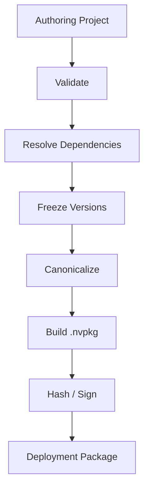
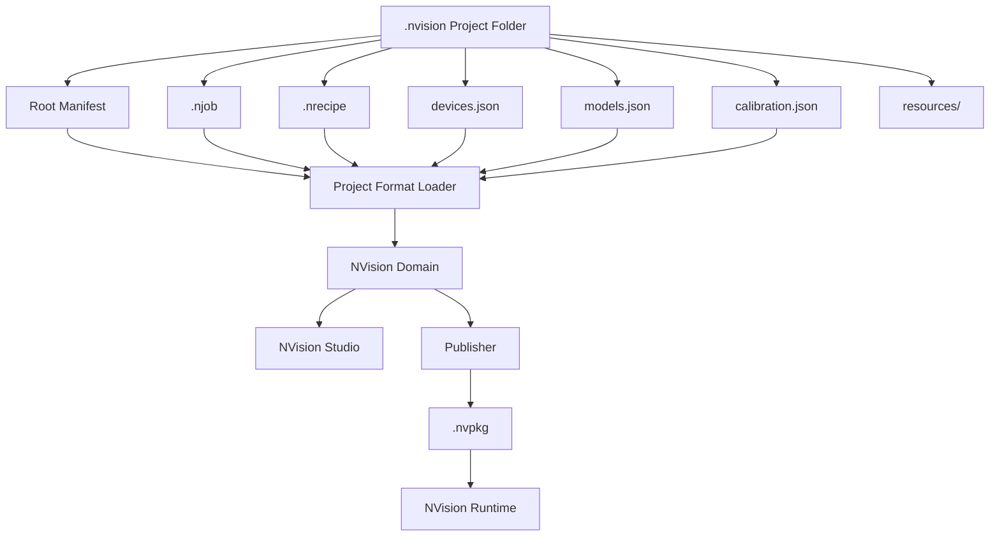

# 05 — NVision Project File Format

**Product:** NTech NVision  
**Document Type:** Persistence / File Format Specification  
**Primary Extension:** `.nvision`  
**Status:** Foundation Specification  
**Version:** 1.0  
**Date:** 2026-08-18  
**Parent Documents:**  
- `NVISION_PLATFORM_FOUNDATION.md`
- `01_PLATFORM_ARCHITECTURE.md`
- `02_DOMAIN_MODEL.md`
- `03_WORKFLOW_ENGINE_ARCHITECTURE.md`
- `04_PLUGIN_ARCHITECTURE.md`

---

# 1. Purpose

This document defines the persistent file format used by **NVision Studio** to store Machine Vision projects.

The project format must support:

- Long-term compatibility
- Human-readable source control
- Reliable serialization
- Stable identifiers
- Explicit schema versioning
- Workflow graph storage
- Recipe storage
- Device configuration
- AI model references
- Calibration references
- Plugin requirements
- Studio authoring metadata
- Project validation
- Migration
- Publishing
- Deployment package generation
- Backup and restore
- Git diff and merge where practical

The main project extension is:

```text
.nvision
```

The central rule is:

> **The `.nvision` project is an authoring format. The `.nvpkg` package is a deployment format.**

They are related but serve different purposes.

---

# 2. Design Goals

The format must be:

## 2.1 Human Inspectable

Most configuration should be readable without proprietary tooling.

Preferred representation:

```text
JSON
```

for the MVP.

---

## 2.2 Git Friendly

Changes such as:

```text
threshold 0.80 → 0.85
recipe TYPE_01 updated
new workflow node added
```

should produce understandable diffs where possible.

---

## 2.3 Stable

Display name changes must not break references.

All important objects use stable IDs.

---

## 2.4 Extensible

Future versions must add:

```text
new node types
new metadata
new device plugins
new calibration types
new AI tasks
```

without invalidating unrelated data.

---

## 2.5 Migratable

Old projects must be explicitly migrated.

Runtime must never silently reinterpret unknown project schemas.

---

## 2.6 Vendor Independent

The core project schema must not directly embed:

```text
Basler SDK object
TensorRT object
Siemens SDK object
OpenCV object
WPF object
```

Vendor-specific configuration belongs in explicit plugin configuration sections.

---

# 3. Project Artifact Strategy

NVision should distinguish four primary artifacts.

```text
.nvision
    Authoring Project

.nrecipe
    Optional standalone/exported Recipe

.nvmodel
    AI Model Package

.nvcal
    Calibration Package

.nvpkg
    Production Deployment Package
```

Future:

```text
.nvbackup
    Station / Project Backup

.nvplugin
    Plugin Package
```

---

# 4. Recommended `.nvision` Representation

Two viable designs exist.

## Option A — Single JSON File

```text
WireMarker.nvision
```

contains entire project.

## Option B — Project Directory with Manifest

```text
WireMarker/
├── project.nvision
├── jobs/
├── recipes/
├── devices/
└── ...
```

Recommended architecture:

> **Use a directory-based project during authoring.**

The `.nvision` file acts as the root manifest.

---

# 5. Why Directory-Based Authoring

Advantages:

- Better Git diffs
- Smaller files
- Easier merge
- Easier large project management
- Model/calibration references remain separate
- Jobs and Recipes can evolve independently
- Less risk of rewriting one huge JSON file
- Better autosave behavior

Recommended structure:

```text
WireMarkerInspection/
│
├── WireMarkerInspection.nvision
│
├── jobs/
│   └── marker-type.njob
│
├── recipes/
│   ├── type-01.nrecipe
│   ├── type-02.nrecipe
│   ├── type-03.nrecipe
│   └── type-04.nrecipe
│
├── devices/
│   ├── cameras.json
│   ├── plc.json
│   └── lighting.json
│
├── models/
│   └── models.json
│
├── calibration/
│   └── calibration.json
│
├── resources/
│   ├── reference-images/
│   └── templates/
│
├── authoring/
│   └── studio.json
│
└── .nvision/
    ├── cache/
    └── temp/
```

---

# 6. Source-Control Boundary

Project source files should be committed.

Recommended:

```text
*.nvision
jobs/
recipes/
devices/
models/
calibration/
resources/ where appropriate
```

Generated/cache data should be ignored:

```text
.nvision/cache/
.nvision/temp/
.nvision/session/
logs/
runtime-data/
```

---

# 7. Recommended `.gitignore`

```gitignore
# NVision authoring caches
.nvision/cache/
.nvision/temp/
.nvision/session/

# Runtime output
runtime-data/
logs/
images/ok/
images/ng/

# Local-only secrets
*.secrets.json
*.local.json

# Build/deployment output
dist/
publish/
*.nvpkg
```

Projects may intentionally version selected golden/reference images.

---

# 8. Root Manifest

Example:

```text
WireMarkerInspection.nvision
```

Conceptual JSON:

```json
{
  "$schema": "https://schemas.ntech.local/nvision/project/1.0",
  "format": "nvision-project",
  "schemaVersion": "1.0",
  "project": {
    "id": "7f5675d6-5a36-4cc0-9d98-84abf8d6cc25",
    "code": "WIRE_MARKER",
    "name": "Wire Marker Inspection",
    "description": "Wire marker type inspection"
  },
  "revision": 42,
  "publishedVersion": "1.4.0",
  "files": {
    "jobs": "jobs/",
    "recipes": "recipes/",
    "devices": "devices/",
    "models": "models/models.json",
    "calibrations": "calibration/calibration.json",
    "authoring": "authoring/studio.json"
  }
}
```

---

# 9. Root Manifest Responsibilities

The root `.nvision` file contains:

```text
Project identity
Project metadata
Schema version
Revision
Published version
Top-level file references
Feature flags
Required format capabilities
```

It should not contain large images or model binaries.

---

# 10. Project Identity

Required:

```text
ProjectId
Code
Name
```

Rules:

```text
ProjectId
= immutable identity

Code
= stable human-readable code

Name
= editable display name
```

Example:

```json
{
  "id": "7f5675d6-...",
  "code": "WIRE_MARKER",
  "name": "Wire Marker Inspection"
}
```

---

# 11. IDs

Recommended serialized IDs:

```text
UUID lowercase string
```

Example:

```text
7f5675d6-5a36-4cc0-9d98-84abf8d6cc25
```

Do not use integer array position as identity.

---

# 12. Stable Codes

Examples:

```text
WIRE_MARKER
TYPE_INSPECTION
TYPE_01
CAM_TOP
PLC_MAIN
```

Recommended pattern:

```text
[A-Z][A-Z0-9_]*
```

or a broader validated project code policy.

Codes are stable but editable with reference migration.

IDs remain authoritative.

---

# 13. Schema Version

Every file type should declare schema version.

Examples:

```json
{
  "schemaVersion": "1.0"
}
```

This applies to:

```text
.nvision
.njob
.nrecipe
device files
model reference files
calibration reference files
```

---

# 14. Schema Version vs Product Version

Do not confuse:

```text
Project Schema Version
```

with:

```text
NVision Studio Version
```

Example:

```text
Studio: 1.8.0
Project Schema: 1.2
```

Studio may support multiple schema versions.

---

# 15. Schema Compatibility

Recommended policy:

```text
1.0 → 1.1
backward-compatible additions

1.x → 2.0
breaking schema
```

But migration remains explicit.

---

# 16. Required Format Field

Each file should include:

```text
format
```

Example:

```json
{
  "format": "nvision-job",
  "schemaVersion": "1.0"
}
```

This prevents accidental loading of wrong JSON type.

---

# 17. File Header Convention

Recommended common header:

```json
{
  "format": "nvision-job",
  "schemaVersion": "1.0",
  "id": "...",
  "revision": 12
}
```

Not every artifact needs `revision`.

---

# 18. Job File

Extension:

```text
.njob
```

Example:

```text
jobs/marker-type.njob
```

Conceptual:

```json
{
  "format": "nvision-job",
  "schemaVersion": "1.0",
  "id": "0ef67eb5-...",
  "code": "TYPE_INSPECTION",
  "name": "Marker Type Inspection",
  "enabled": true,
  "timeoutMs": 500,
  "workflow": {
    "id": "90f01c10-...",
    "nodes": [],
    "connections": [],
    "inputs": [],
    "outputs": []
  }
}
```

---

# 19. Why Workflow Inside `.njob`

Recommended MVP:

> Store the primary WorkflowDefinition inside the Job file.

Benefits:

- Job remains cohesive
- Fewer tiny files
- Easy diff
- Natural ownership

Future large projects may support separate:

```text
.nworkflow
```

but not necessary initially.

---

# 20. Job Metadata

Recommended:

```json
{
  "description": "...",
  "enabled": true,
  "timeoutMs": 500,
  "tags": [
    "production",
    "classification"
  ]
}
```

Avoid arbitrary metadata for core behavior.

---

# 21. Workflow Serialization

Conceptual:

```json
{
  "workflow": {
    "id": "90f01c10-...",
    "schemaVersion": "1.0",
    "nodes": [],
    "connections": [],
    "inputs": [],
    "outputs": [],
    "variables": []
  }
}
```

---

# 22. Node Serialization

Example:

```json
{
  "id": "b083fdf4-...",
  "type": "nvision.image.crop",
  "typeVersion": "1.0",
  "name": "Marker ROI",
  "enabled": true,
  "failurePolicy": "abortInspection",
  "parameters": {
    "x": 100,
    "y": 60,
    "width": 480,
    "height": 180
  }
}
```

---

# 23. Node Type IDs

Always persist full stable Node Type ID.

Good:

```text
nvision.ai.classify
```

Bad:

```text
ClassifyNode
```

because C# class names are implementation details.

---

# 24. Node Type Version

Persist:

```text
typeVersion
```

Example:

```json
{
  "type": "nvision.ai.classify",
  "typeVersion": "1.1"
}
```

Used for plugin/node configuration migration.

---

# 25. Node Name

Node instance display name is optional but recommended.

Example:

```text
Marker Classifier
```

Node ID remains the true identity.

---

# 26. Node Parameters

Parameters use stable parameter keys.

Example:

```json
{
  "parameters": {
    "modelSlot": "marker_classifier",
    "confidenceThreshold": 0.92
  }
}
```

Do not persist translated display labels.

---

# 27. Parameter Data Types

JSON naturally supports:

```text
null
boolean
number
string
array
object
```

NVision parameter definitions provide semantic typing.

Examples:

```text
ROI
Color
Pose
Enum
Measurement
DeviceRef
ModelSlot
```

may serialize as objects/strings.

---

# 28. ROI Serialization

Example:

```json
{
  "roi": {
    "coordinateSpace": "imagePixel",
    "x": 100,
    "y": 60,
    "width": 480,
    "height": 180
  }
}
```

Coordinate space must be explicit where ambiguity exists.

---

# 29. Measurement Serialization

Example:

```json
{
  "expectedLength": {
    "value": 10.25,
    "unit": "mm"
  }
}
```

Do not assume unit from UI.

---

# 30. Reference Serialization

Use explicit references rather than duplicating object.

Example:

```json
{
  "deviceRef": {
    "id": "a0f...",
    "code": "CAM_TOP"
  }
}
```

For compactness, production schema may use only ID.

Recommended authoring format can include both:

```text
id = authoritative
code = readability hint
```

---

# 31. Reference Validation Rule

When both ID and code are present:

```text
ID wins
```

If code does not match actual referenced object:

```text
warning
```

Studio may auto-update readability hints.

---

# 32. Workflow Connection Serialization

Example:

```json
{
  "id": "917a...",
  "source": {
    "nodeId": "b083...",
    "port": "image"
  },
  "target": {
    "nodeId": "bd21...",
    "port": "image"
  }
}
```

---

# 33. Connections Order

Connection order should not carry semantics unless explicitly specified.

Canonical serialization sorts by:

```text
sourceNodeId
sourcePort
targetNodeId
targetPort
```

or stable ConnectionId.

---

# 34. Workflow Inputs

Example:

```json
{
  "inputs": [
    {
      "key": "sourceImage",
      "type": "nvision.data.image",
      "required": true
    }
  ]
}
```

---

# 35. Workflow Outputs

Example:

```json
{
  "outputs": [
    {
      "key": "decision",
      "type": "nvision.data.decision",
      "source": {
        "nodeId": "a12...",
        "port": "decision"
      }
    }
  ]
}
```

---

# 36. Authoring Metadata

Workflow visual layout should be stored separately from execution data where practical.

Recommended inside `.njob`:

```json
{
  "authoring": {
    "nodes": {
      "b083...": {
        "x": 120,
        "y": 200,
        "width": 180,
        "height": 80
      }
    }
  }
}
```

Alternative:

```text
authoring/studio.json
```

for all Studio-only state.

---

# 37. Authoring Metadata Rule

Authoring metadata must never affect inspection result.

Examples:

```text
Canvas position
Node color
Collapsed state
Zoom
Selected tab
```

are non-execution data.

---

# 38. Recommended Split

Execution-relevant authoring data:

```text
node names
comments meaningful for engineering
```

may remain near workflow.

Pure UI state:

```text
canvas zoom
window state
last selected node
```

belongs in:

```text
authoring/studio.local.json
```

and should usually not be committed.

---

# 39. Recipe File

Extension:

```text
.nrecipe
```

Example:

```text
recipes/type-01.nrecipe
```

---

# 40. Recipe Serialization

Conceptual:

```json
{
  "format": "nvision-recipe",
  "schemaVersion": "1.0",
  "id": "a58f3d12-...",
  "code": "TYPE_01",
  "name": "Type 01",
  "version": "2.0.0",
  "enabled": true,
  "productCode": "TYPE01",
  "overrides": [],
  "deviceOverrides": [],
  "modelSelections": {}
}
```

---

# 41. Recipe Override Serialization

Example:

```json
{
  "overrides": [
    {
      "target": {
        "type": "node",
        "id": "d91..."
      },
      "parameter": "confidenceThreshold",
      "value": 0.92
    }
  ]
}
```

---

# 42. Recipe Device Override

Example:

```json
{
  "deviceOverrides": [
    {
      "deviceId": "a0f...",
      "parameters": {
        "exposureUs": 8000,
        "gain": 2.0
      }
    }
  ]
}
```

---

# 43. Recipe Model Selection

Example:

```json
{
  "modelSelections": {
    "marker_classifier": {
      "modelId": "8e5...",
      "version": "1.3.2"
    }
  }
}
```

---

# 44. Model Slots

Workflow should prefer model slots where recipe-specific model selection is useful.

Workflow:

```json
{
  "modelSlot": "marker_classifier"
}
```

Recipe:

```json
{
  "modelSelections": {
    "marker_classifier": {
      "modelId": "...",
      "version": "1.3.2"
    }
  }
}
```

---

# 45. Recipe Inheritance

If supported later:

```json
{
  "baseRecipeId": "..."
}
```

MVP recommendation:

> Avoid recipe inheritance unless a real use case requires it.

Flat recipes are easier to inspect and deploy.

---

# 46. Devices Directory

Recommended:

```text
devices/
├── cameras.json
├── plc.json
├── lights.json
└── robot.json
```

Alternative one file:

```text
devices/devices.json
```

Recommended MVP:

> Use one `devices/devices.json` file unless project scale requires splitting.

---

# 47. Device File

Example:

```json
{
  "format": "nvision-devices",
  "schemaVersion": "1.0",
  "devices": [
    {
      "id": "a0f...",
      "code": "CAM_TOP",
      "name": "Top Camera",
      "type": "camera",
      "driver": "ntech.camera.basler",
      "required": true,
      "enabled": true,
      "connection": {},
      "parameters": {}
    }
  ]
}
```

---

# 48. Vendor-Specific Device Config

Example:

```json
{
  "driver": "ntech.camera.basler",
  "connection": {
    "serialNumber": "12345678"
  },
  "parameters": {
    "exposureUs": 7500,
    "gain": 1.5,
    "pixelFormat": "Mono8"
  }
}
```

These keys are validated by plugin schema.

---

# 49. Generic vs Driver Configuration

Common fields remain core:

```text
id
code
name
type
driver
required
enabled
```

Driver-specific values remain inside:

```text
connection
parameters
```

---

# 50. Secrets

Never persist plaintext secrets in `.nvision`.

Bad:

```json
{
  "password": "secret"
}
```

Preferred:

```json
{
  "credentialRef": "plc-main"
}
```

Actual secret resolved from secure local store.

---

# 51. Local Machine Overrides

Some deployment details should not live in portable Project source.

Examples:

```text
local NIC binding
credential reference
machine-specific path
station code
```

Use:

```text
*.local.json
```

or Station deployment configuration.

---

# 52. Model Reference File

Recommended:

```text
models/models.json
```

Conceptual:

```json
{
  "format": "nvision-model-references",
  "schemaVersion": "1.0",
  "models": [
    {
      "id": "8e5...",
      "code": "MARKER_CLASSIFIER",
      "name": "Marker Classifier",
      "task": "classification",
      "version": "1.3.2",
      "package": "artifacts/models/marker-classifier-1.3.2.nvmodel",
      "checksum": "sha256:..."
    }
  ]
}
```

---

# 53. Model Binary Placement

Do not embed ONNX binary in JSON.

Options:

```text
Project-local artifact
External model registry
Library reference
```

MVP recommendation:

```text
artifacts/models/
```

for portable project if model size is acceptable.

---

# 54. Git and Large Models

Large model binaries should not normally be committed to regular Git.

Options:

```text
Git LFS
Artifact Registry
NAS
Model Registry
Release Asset
```

Project stores stable reference/checksum.

---

# 55. Calibration Reference File

Recommended:

```text
calibration/calibration.json
```

Conceptual:

```json
{
  "format": "nvision-calibrations",
  "schemaVersion": "1.0",
  "calibrations": [
    {
      "id": "c41...",
      "name": "Top Camera Pixel/mm",
      "type": "pixelToMillimeter",
      "version": "1.0.2",
      "package": "artifacts/calibration/top-pixel-mm-1.0.2.nvcal",
      "status": "valid",
      "checksum": "sha256:..."
    }
  ]
}
```

---

# 56. Calibration Binary/Data

Calibration parameters may be:

```text
small JSON
```

or:

```text
.nvcal package
```

depending on complexity.

For MVP, small calibration can remain JSON.

Future `.nvcal` supports:

- images
- matrices
- reports
- quality metrics

---

# 57. Resource References

Project may contain:

```text
Reference Images
Templates
Masks
Lookup Tables
Sample Images
```

Recommended:

```text
resources/
```

---

# 58. Resource Manifest

Optional:

```text
resources/resources.json
```

Example:

```json
{
  "resources": [
    {
      "id": "...",
      "kind": "referenceImage",
      "name": "TYPE_01 Golden",
      "path": "reference-images/type01.png",
      "checksum": "sha256:..."
    }
  ]
}
```

---

# 59. Relative Paths

Project-internal paths must be relative to project root.

Good:

```text
resources/reference-images/type01.png
```

Bad:

```text
D:\Projects\WireMarker\...
```

Absolute paths break portability.

---

# 60. Path Separator

Canonical serialized path separator:

```text
/
```

even on Windows.

Runtime/Studio converts to platform path.

---

# 61. Path Traversal

Reject project-relative paths containing unsafe traversal:

```text
../../
```

when leaving project root.

Security validation required.

---

# 62. External References

If project references external artifact:

```json
{
  "uri": "nvision-model://MARKER_CLASSIFIER/1.3.2"
}
```

Future registry scheme.

MVP may use relative file reference.

---

# 63. Plugin Requirements

Authoring Project may include required plugin IDs.

Example:

```json
{
  "pluginRequirements": [
    {
      "id": "ntech.camera.basler",
      "minimumVersion": "1.0.0"
    }
  ]
}
```

However exact plugin locking belongs primarily to deployment package.

---

# 64. Why Project Uses Loose Requirement

Portable project may be opened on engineering machine with newer compatible plugins.

Deployment package uses exact:

```text
plugins.lock
```

for reproducibility.

---

# 65. Plugin Requirement Extraction

Studio should derive requirements from:

```text
Device driver IDs
Node type origins
AI backend policies
Custom plugin configuration
```

Manual declaration only for requirements not automatically discoverable.

---

# 66. Project Settings

Root manifest may contain:

```json
{
  "settings": {
    "defaultJobId": "...",
    "defaultRecipeId": "...",
    "inspection": {
      "maxConcurrent": 1
    }
  }
}
```

Only stable domain settings belong here.

---

# 67. Runtime Settings

Runtime-machine settings should not pollute portable project.

Examples:

```text
database path
log retention
station network port
service startup
```

belong to Station/Runtime config.

---

# 68. Environment Separation

Recommended layers:

```text
Project Configuration
Deployment Configuration
Station Configuration
Runtime Local Configuration
Secrets
```

Do not flatten all into one file.

---

# 69. Project Variables

Example:

```json
{
  "variables": [
    {
      "key": "defaultConfidence",
      "type": "float",
      "value": 0.9
    }
  ]
}
```

Scope and mutability must be explicit.

---

# 70. Runtime Variables

Do not serialize current runtime values into project source.

Only definitions/defaults.

---

# 71. Authoring Revision

Project root:

```json
{
  "revision": 42
}
```

Revision increments on meaningful save/commit by Studio policy.

It is not required to equal Git commit count.

---

# 72. Published Version

Example:

```json
{
  "publishedVersion": "1.4.0"
}
```

This is latest published project version.

Draft may include changes beyond it.

---

# 73. Draft State

Optional:

```json
{
  "state": "draft"
}
```

But authoring folder naturally represents draft.

Published deployment is generated artifact.

---

# 74. File Modification Metadata

Avoid excessive timestamps in every file because they create noisy Git diffs.

Recommended:

- Keep meaningful audit metadata
- Avoid auto-updating `modifiedAt` on trivial UI state if source-controlled
- Use Studio history/audit separately where needed

---

# 75. Canonical JSON

To improve Git diff and checksums, define canonical write rules.

Recommended:

```text
UTF-8
2-space indentation
LF line endings preferred
No BOM
Deterministic property order
Deterministic collection ordering where semantics unordered
Final newline
```

---

# 76. Property Ordering

Recommended common order:

```text
format
schemaVersion
id
code
name
description
version/revision
core properties
references
metadata
```

JSON property order is not semantic, but deterministic writing helps diff.

---

# 77. Array Ordering

If order carries semantics:

```text
preserve order
```

Examples:

```text
explicit ordered UI tabs
priority rules
```

If order does not carry semantics:

```text
sort canonically
```

Examples:

```text
plugin requirements
resource list
```

For workflow nodes, either:

- sort by NodeId, or
- preserve authoring creation order.

Recommended:

> Sort by stable ID for canonical persistence.

Canvas position handles human layout.

---

# 78. Numeric Serialization

Use culture-invariant numeric representation.

Good:

```text
0.92
```

Never locale-dependent:

```text
0,92
```

---

# 79. Floating-Point Precision

Persist enough precision for calibration and measurements.

Do not round using UI formatting.

Example UI:

```text
0.92
```

may internally serialize:

```text
0.923456789
```

when required.

---

# 80. Enum Serialization

Prefer stable lowercase/camelCase string values.

Example:

```json
{
  "failurePolicy": "abortInspection"
}
```

instead of numeric enum:

```json
{
  "failurePolicy": 2
}
```

Strings are more readable and migration-friendly.

---

# 81. Boolean Serialization

Use true JSON booleans.

Not:

```text
"true"
1
"yes"
```

unless protocol/plugin-specific value requires it.

---

# 82. Null Handling

Omit optional properties when absent where practical.

Use explicit `null` only where distinction between:

```text
unset
```

and:

```text
explicitly null
```

matters.

---

# 83. Unknown Fields

Forward-compatible readers should generally:

- ignore unknown optional fields
- preserve them where possible during round-trip if supported
- reject unknown required capabilities

---

# 84. Required Capabilities

Root may declare:

```json
{
  "requiredFormatCapabilities": [
    "workflow.conditional-branch.v1"
  ]
}
```

If Studio does not support required capability:

```text
open read-only or reject
```

This helps prevent data loss.

---

# 85. Round-Trip Preservation

A newer project opened by older Studio is risky.

Policy:

> Do not allow older Studio to save project containing unsupported required features.

Read-only view may be acceptable.

---

# 86. Schema Migration

Migration pipeline:

```text
Load Raw File
    ↓
Detect Schema
    ↓
Validate Old Schema
    ↓
Migrate Step-by-Step
    ↓
Validate New Schema
    ↓
Create Backup
    ↓
Save New Format
```

---

# 87. Migration Rules

Never migrate:

```text
1.0 → 3.0
```

using one giant opaque step if intermediate migrations exist.

Prefer:

```text
1.0 → 1.1
1.1 → 2.0
2.0 → 3.0
```

---

# 88. Migration Interface

Conceptual:

```text
IProjectSchemaMigrator
```

Methods:

```text
CanMigrate(from, to)
Migrate(...)
```

Node/plugin configuration migration is delegated to plugin migrators where required.

---

# 89. Migration Backup

Before destructive save:

```text
ProjectName.backup/
```

or:

```text
.nvision/migrations/
```

Recommended to preserve original files.

---

# 90. Migration Log

Example:

```text
.nvision/migrations/20260818-153000.json
```

contains:

```text
from schema
to schema
files changed
warnings
plugin migrations
```

Useful for support.

---

# 91. Node Configuration Migration

Example:

```text
nvision.image.crop v1
```

parameters:

```text
left
top
right
bottom
```

v2:

```text
x
y
width
height
```

Plugin/built-in node migrator converts explicitly.

---

# 92. Missing Plugin During Migration

If node plugin missing:

- preserve raw configuration
- mark unresolved
- prevent publish
- do not delete unknown node data

Studio should support "unresolved node" representation.

---

# 93. Unresolved Node

Authoring-only placeholder:

```text
NodeId
NodeTypeId
NodeTypeVersion
RawConfig
```

Runtime must never execute unresolved node.

---

# 94. Missing Device Plugin

Same policy:

```text
preserve configuration
mark unresolved
block publish if required
```

---

# 95. Project Validation

Load validation layers:

```text
File Structure
JSON Syntax
Schema
References
Plugins
Workflow
Recipes
Models
Calibration
Deployment Readiness
```

---

# 96. File Structure Validation

Checks:

```text
root manifest exists
referenced files exist
duplicate IDs absent
paths safe
unexpected duplicate definitions absent
```

---

# 97. Reference Validation

Checks:

```text
Job references
Recipe override targets
Device references
Model references
Calibration references
Resource references
```

---

# 98. Duplicate Identity

Project loader must reject or require repair when two entities share same ID.

Never silently pick first.

---

# 99. Duplicate Code

Codes should be unique within scope.

Example:

```text
DeviceCode
RecipeCode
JobCode
```

Studio may auto-suggest correction but should not silently rename on load.

---

# 100. Corrupted File

If JSON file is malformed:

```text
project opens in recovery mode where possible
```

Do not auto-overwrite malformed original.

---

# 101. Autosave

Studio autosave should write to separate location:

```text
.nvision/autosave/
```

Do not continuously mutate authoritative source file every few seconds if it harms Git workflow.

---

# 102. Atomic Save

Saving a source file should use:

```text
write temp
fsync/flush where appropriate
atomic replace
```

to reduce corruption risk.

---

# 103. Save Transaction

Multi-file save requires consistency.

Possible process:

```text
1. Write changed files to temp
2. Validate temp state
3. Replace files
4. Update root revision last
```

Future journal may improve crash recovery.

---

# 104. Project Lock

Studio may use:

```text
.nvision/project.lock
```

to detect concurrent editing.

Lock should contain:

```text
machine
user
process
timestamp
```

Do not treat stale lock as permanent.

---

# 105. Multi-User Editing

MVP does not need real-time collaborative project editing.

Git-based collaboration is acceptable.

---

# 106. Merge Strategy

Project format should minimize merge conflicts.

Split:

```text
jobs
recipes
devices
```

so different engineers can work independently.

---

# 107. Workflow Merge Complexity

Workflow graphs are inherently harder to merge.

Stable Node IDs help.

Future Studio may provide semantic graph merge.

MVP relies on Git/manual resolution.

---

# 108. Avoid Random Reordering

Studio must not rewrite arrays/properties randomly on every save.

Stable formatting is essential for useful Git diffs.

---

# 109. Comments

JSON does not support comments.

Engineering comments should be explicit fields:

```json
{
  "notes": "Classifier trained with dataset 2026-08"
}
```

Do not use JSON-with-comments unless intentionally adopting JSONC.

Recommendation:

> Standard JSON for machine format.

---

# 110. YAML Consideration

YAML is human-friendly but introduces:

- parsing complexity
- implicit types
- formatting variance

Recommendation:

```text
JSON for canonical project format.
```

Markdown remains for documentation.

---

# 111. Binary Project Format

Do not use binary proprietary format for MVP.

Reasons:

- poor diff
- hard recovery
- vendor lock-in perception
- harder debugging

Binary packages may be used for deployment/model/calibration where justified.

---

# 112. Checksum Strategy

Source project files do not need mandatory checksum for every save.

Deployment package should.

However resource/model references should include checksum.

Example:

```text
sha256:...
```

---

# 113. Project Content Hash

Future:

```text
ProjectContentHash
```

computed from execution-relevant canonical content.

Exclude:

```text
authoring UI layout
local cache
timestamps
```

Useful for:

- publish comparison
- deployment traceability
- dirty detection

---

# 114. Workflow Hash

Defined in Workflow Engine architecture.

Persist optionally:

```json
{
  "workflowHash": "sha256:..."
}
```

Studio may recompute and verify.

Not authoritative if raw graph changes.

---

# 115. Publish Process



---

# 116. What Publish Freezes

Publish must freeze:

```text
Project version
Jobs
Workflow definitions
Recipes
Device configuration
Model versions
Calibration versions
Required plugins
Resources
```

---

# 117. Authoring Data Excluded from Deployment

Exclude:

```text
window layout
selected node
canvas zoom
autosave
debug breakpoints unless service mode explicitly allows
unused resources
training datasets
Git metadata
```

---

# 118. Deployment Package Relation

Example:

```text
WireMarkerInspection/
    authoring folder
        ↓ Publish
WireMarkerInspection-1.4.0.nvpkg
```

Runtime should consume `.nvpkg`, not editable folder.

---

# 119. `.nvpkg` Conceptual Structure

```text
package/
├── manifest.json
├── project.json
├── jobs/
├── recipes/
├── devices/
├── models/
├── calibration/
├── resources/
├── plugins.lock
└── integrity.json
```

Exact package format may be ZIP-like later.

---

# 120. Deployment Manifest

Conceptual:

```json
{
  "format": "nvision-deployment-package",
  "schemaVersion": "1.0",
  "packageId": "...",
  "projectId": "...",
  "projectVersion": "1.4.0",
  "minimumRuntimeVersion": "1.2.0",
  "createdAt": "2026-08-18T15:30:00+07:00"
}
```

---

# 121. Plugin Lock

Example:

```json
{
  "plugins": [
    {
      "id": "ntech.camera.basler",
      "version": "1.3.2",
      "apiVersion": "1.0",
      "required": true
    }
  ]
}
```

---

# 122. Model Lock

Deployment package should resolve exact model version/checksum.

Example:

```json
{
  "modelId": "...",
  "version": "1.3.2",
  "checksum": "sha256:..."
}
```

---

# 123. Calibration Lock

Same rule:

```text
CalibrationId
Version
Checksum
```

---

# 124. Deployment Integrity

Package should contain:

```text
integrity.json
```

with hashes of package files.

Future package signing builds on this.

---

# 125. Published Version Immutability

Never mutate:

```text
Project 1.4.0
```

after publish.

New changes create:

```text
1.4.1
or
1.5.0
```

---

# 126. Draft Recipe vs Published Recipe

Authoring Recipe file may be edited.

At publish:

```text
Recipe version snapshot
```

is frozen into package.

---

# 127. Recipe Version Update

Studio should require or auto-propose version bump when execution-relevant Recipe changes before publish.

Do not silently publish changed content under same version.

---

# 128. Model Version Immutability

Same version must always map to same checksum.

If model binary changes:

```text
new version required
```

---

# 129. Calibration Version Immutability

Same rule for calibration.

---

# 130. Resource Versioning

Reference/template image changes may use:

```text
resource checksum
```

without separate semantic version unless required.

---

# 131. Project Templates

Future:

```text
.nvtemplate
```

or project folder template.

Template creates new IDs for new Project and selected entities.

Do not clone stable ProjectId accidentally.

---

# 132. Project Copy

When "Save As New Project":

Generate new:

```text
ProjectId
```

Policy for child IDs:

Option:

```text
regenerate all IDs
```

Recommended for full independent copy.

---

# 133. Branching Project in Git

Git branch retains same ProjectId.

This is correct because it represents same logical project history.

---

# 134. Import / Export Recipe

Standalone `.nrecipe` export may include:

```text
Recipe data
source ProjectId
compatible Job/parameter schema
model selections
```

Import validates target compatibility.

---

# 135. Portable Recipe

Recipe cannot be blindly imported if Node IDs differ.

Future recipe template may use semantic parameter keys.

MVP recipe is project-specific.

---

# 136. File Naming

File names are not identity.

Example:

```text
type-01.nrecipe
```

may be renamed.

References should use ID, not filename where possible.

Root file index maps entities to paths.

---

# 137. Project File Index

Recommended root manifest includes explicit file index:

```json
{
  "files": {
    "jobs": [
      {
        "id": "...",
        "path": "jobs/marker-type.njob"
      }
    ],
    "recipes": [
      {
        "id": "...",
        "path": "recipes/type-01.nrecipe"
      }
    ]
  }
}
```

This is preferable to blindly scanning directories.

---

# 138. Why Explicit File Index

Benefits:

- deterministic load
- detect orphan files
- allow arbitrary filenames
- faster validation
- safer rename

---

# 139. Orphan Files

Files present but not in index:

```text
warning
```

Studio may offer:

```text
Import
Delete
Ignore
```

Never auto-execute orphan config.

---

# 140. Missing Indexed File

Error:

```text
Project invalid
```

unless optional artifact.

---

# 141. Root File Index Example

```json
{
  "files": {
    "jobs": [
      {
        "id": "0ef...",
        "path": "jobs/marker-type.njob"
      }
    ],
    "recipes": [
      {
        "id": "a58...",
        "path": "recipes/type-01.nrecipe"
      }
    ],
    "devices": "devices/devices.json",
    "models": "models/models.json",
    "calibrations": "calibration/calibration.json"
  }
}
```

---

# 142. Root Manifest Full Example

```json
{
  "format": "nvision-project",
  "schemaVersion": "1.0",
  "project": {
    "id": "7f5675d6-5a36-4cc0-9d98-84abf8d6cc25",
    "code": "WIRE_MARKER",
    "name": "Wire Marker Inspection",
    "description": "Inspect wire marker type"
  },
  "revision": 42,
  "publishedVersion": "1.4.0",
  "settings": {
    "defaultJobId": "0ef67eb5-...",
    "defaultRecipeId": "a58f3d12-..."
  },
  "files": {
    "jobs": [
      {
        "id": "0ef67eb5-...",
        "path": "jobs/marker-type.njob"
      }
    ],
    "recipes": [
      {
        "id": "a58f3d12-...",
        "path": "recipes/type-01.nrecipe"
      }
    ],
    "devices": "devices/devices.json",
    "models": "models/models.json",
    "calibrations": "calibration/calibration.json"
  }
}
```

---

# 143. Complete Job Example

```json
{
  "format": "nvision-job",
  "schemaVersion": "1.0",
  "id": "0ef67eb5-2ba1-4db2-9e90-0cc86c151abc",
  "code": "TYPE_INSPECTION",
  "name": "Marker Type Inspection",
  "description": "Classifies marker and verifies active type",
  "enabled": true,
  "timeoutMs": 500,

  "workflow": {
    "id": "90f01c10-31fe-4efc-9d0c-9201dd982456",

    "inputs": [
      {
        "key": "sourceImage",
        "type": "nvision.data.image",
        "required": true
      }
    ],

    "nodes": [
      {
        "id": "11111111-1111-1111-1111-111111111111",
        "type": "nvision.input.image",
        "typeVersion": "1.0",
        "name": "Source Image",
        "enabled": true,
        "failurePolicy": "abortInspection",
        "parameters": {
          "inputKey": "sourceImage"
        }
      },

      {
        "id": "22222222-2222-2222-2222-222222222222",
        "type": "nvision.image.crop",
        "typeVersion": "1.0",
        "name": "Marker ROI",
        "enabled": true,
        "failurePolicy": "abortInspection",
        "parameters": {
          "roi": {
            "coordinateSpace": "imagePixel",
            "x": 100,
            "y": 60,
            "width": 480,
            "height": 180
          }
        }
      },

      {
        "id": "33333333-3333-3333-3333-333333333333",
        "type": "nvision.ai.classify",
        "typeVersion": "1.0",
        "name": "Marker Classifier",
        "enabled": true,
        "failurePolicy": "abortInspection",
        "parameters": {
          "modelSlot": "marker_classifier",
          "confidenceThreshold": 0.9
        }
      },

      {
        "id": "44444444-4444-4444-4444-444444444444",
        "type": "nvision.logic.compare",
        "typeVersion": "1.0",
        "name": "Compare Expected Type",
        "enabled": true,
        "failurePolicy": "abortInspection",
        "parameters": {
          "operator": "equals"
        }
      },

      {
        "id": "55555555-5555-5555-5555-555555555555",
        "type": "nvision.result.decision",
        "typeVersion": "1.0",
        "name": "Final Decision",
        "enabled": true,
        "failurePolicy": "abortInspection",
        "parameters": {
          "ngCode": "WRONG_TYPE"
        }
      }
    ],

    "connections": [
      {
        "id": "c1",
        "source": {
          "nodeId": "11111111-1111-1111-1111-111111111111",
          "port": "image"
        },
        "target": {
          "nodeId": "22222222-2222-2222-2222-222222222222",
          "port": "image"
        }
      },
      {
        "id": "c2",
        "source": {
          "nodeId": "22222222-2222-2222-2222-222222222222",
          "port": "image"
        },
        "target": {
          "nodeId": "33333333-3333-3333-3333-333333333333",
          "port": "image"
        }
      }
    ],

    "outputs": [
      {
        "key": "decision",
        "type": "nvision.data.decision",
        "source": {
          "nodeId": "55555555-5555-5555-5555-555555555555",
          "port": "decision"
        }
      }
    ]
  }
}
```

---

# 144. Example Recipe

```json
{
  "format": "nvision-recipe",
  "schemaVersion": "1.0",
  "id": "a58f3d12-65b1-42dc-9f30-9ba204aa3001",
  "code": "TYPE_01",
  "name": "Type 01",
  "version": "2.0.0",
  "enabled": true,

  "productCode": "TYPE01",

  "overrides": [
    {
      "target": {
        "type": "node",
        "id": "33333333-3333-3333-3333-333333333333"
      },
      "parameter": "confidenceThreshold",
      "value": 0.92
    }
  ],

  "deviceOverrides": [
    {
      "deviceId": "aaaaaaaa-aaaa-aaaa-aaaa-aaaaaaaaaaaa",
      "parameters": {
        "exposureUs": 8000
      }
    }
  ],

  "modelSelections": {
    "marker_classifier": {
      "modelId": "bbbbbbbb-bbbb-bbbb-bbbb-bbbbbbbbbbbb",
      "version": "1.3.2"
    }
  }
}
```

---

# 145. Example Device File

```json
{
  "format": "nvision-devices",
  "schemaVersion": "1.0",

  "devices": [
    {
      "id": "aaaaaaaa-aaaa-aaaa-aaaa-aaaaaaaaaaaa",
      "code": "CAM_TOP",
      "name": "Top Camera",
      "type": "camera",
      "driver": "ntech.camera.basler",
      "required": true,
      "enabled": true,

      "connection": {
        "serialNumber": "40123456"
      },

      "parameters": {
        "exposureUs": 7500,
        "gain": 1.5,
        "pixelFormat": "Mono8",
        "triggerMode": "software"
      }
    },

    {
      "id": "cccccccc-cccc-cccc-cccc-cccccccccccc",
      "code": "PLC_MAIN",
      "name": "Main PLC",
      "type": "plc",
      "driver": "ntech.plc.mitsubishi-mc",
      "required": true,
      "enabled": true,

      "connection": {
        "host": "192.168.1.20",
        "port": 5000
      },

      "credentialRef": "plc-main"
    }
  ]
}
```

---

# 146. PLC Symbol Mapping File

Recommended optional:

```text
devices/plc-mapping.json
```

Example:

```json
{
  "format": "nvision-plc-mapping",
  "schemaVersion": "1.0",
  "plcDeviceId": "cccccccc-cccc-cccc-cccc-cccccccccccc",

  "signals": {
    "trigger": {
      "address": "D100",
      "type": "bool"
    },
    "busy": {
      "address": "D101",
      "type": "bool"
    },
    "done": {
      "address": "D102",
      "type": "bool"
    },
    "inspectionResult": {
      "address": "D110",
      "type": "int16"
    }
  }
}
```

---

# 147. Why Separate PLC Mapping

Separates:

```text
machine symbolic contract
```

from:

```text
workflow logic
```

Workflow/application refers to:

```text
inspectionResult
```

rather than:

```text
D110
```

---

# 148. Model Reference Example

```json
{
  "format": "nvision-model-references",
  "schemaVersion": "1.0",

  "models": [
    {
      "id": "bbbbbbbb-bbbb-bbbb-bbbb-bbbbbbbbbbbb",
      "code": "MARKER_CLASSIFIER",
      "name": "Marker Classifier",
      "task": "classification",
      "version": "1.3.2",

      "package": {
        "path": "artifacts/models/marker-classifier-1.3.2.nvmodel",
        "checksum": "sha256:..."
      },

      "classes": [
        "TYPE_01",
        "TYPE_02",
        "TYPE_03",
        "TYPE_04"
      ]
    }
  ]
}
```

---

# 149. Calibration Example

```json
{
  "format": "nvision-calibrations",
  "schemaVersion": "1.0",

  "calibrations": [
    {
      "id": "dddddddd-dddd-dddd-dddd-dddddddddddd",
      "code": "CAM_TOP_PIXEL_MM",
      "name": "Top Camera Pixel to mm",
      "type": "pixelToMillimeter",
      "version": "1.0.2",
      "status": "valid",

      "devices": [
        "aaaaaaaa-aaaa-aaaa-aaaa-aaaaaaaaaaaa"
      ],

      "parameters": {
        "scaleX": {
          "value": 0.0214,
          "unit": "mmPerPixel"
        },
        "scaleY": {
          "value": 0.0215,
          "unit": "mmPerPixel"
        }
      },

      "quality": {
        "rmsError": 0.03
      }
    }
  ]
}
```

---

# 150. Studio Authoring File

Recommended local file:

```text
authoring/studio.local.json
```

Example:

```json
{
  "lastOpenedJobId": "...",
  "workflowViews": {
    "90f...": {
      "zoom": 1.1,
      "offsetX": 120,
      "offsetY": 50
    }
  }
}
```

Usually ignored by Git.

---

# 151. Shared Authoring Metadata

If node layout should be shared among engineers:

```text
authoring/layout.json
```

commit it.

Contains:

```text
node positions
groups
comments
```

No machine-local state.

---

# 152. File Ownership Summary

Recommended:

| File | Purpose | Git |
|---|---|---|
| `*.nvision` | root project manifest | Yes |
| `*.njob` | Job + Workflow | Yes |
| `*.nrecipe` | Recipe | Yes |
| `devices.json` | device config | Yes |
| `models.json` | model refs | Yes |
| `calibration.json` | calibration refs/data | Yes |
| `layout.json` | shared graph layout | Yes |
| `studio.local.json` | local UI state | No |
| `.nvision/cache/*` | generated cache | No |
| `.nvpkg` | deployment output | Usually No |

---

# 153. Validation Severity

Project validation issues:

```text
Info
Warning
Error
Blocking
```

Publishing requires:

```text
no Error/Blocking
```

depending on policy.

---

# 154. Example Validation Error

```text
Code: PRJ-REF-004
File: recipes/type-01.nrecipe
Target: Node 333...
Message:
Recipe override references missing node.
```

---

# 155. Source Location

Validation issue should include:

```text
file
JSON path
entity ID
```

Example:

```text
/overrides/0/target/id
```

This helps Studio and CLI tools.

---

# 156. CLI Validation

Future:

```text
nvision project validate WireMarkerInspection.nvision
```

Useful for CI.

---

# 157. CI Workflow

Example:

```text
Git push
   ↓
nvision project validate
   ↓
schema validation
workflow validation
plugin contract check
golden tests
```

---

# 158. Project Formatter

Future CLI:

```text
nvision project format
```

rewrites canonical JSON.

Useful for consistent commits.

---

# 159. Project Diff

Future semantic tool:

```text
nvision project diff A B
```

Output:

```text
Recipe TYPE_01
- confidenceThreshold 0.90
+ confidenceThreshold 0.92

Workflow
+ Node OCR Check
```

Not MVP requirement.

---

# 160. Project Linter

Future:

```text
nvision project lint
```

Rules:

```text
unused node
unused model
duplicate resource
disabled required device
dead branch
unreachable output
```

---

# 161. Package Builder

Future CLI:

```text
nvision project publish \
  --project WireMarkerInspection.nvision \
  --version 1.4.0
```

produces `.nvpkg`.

---

# 162. Source vs Generated Data

Source of truth:

```text
.nvision + referenced authoring files
```

Generated:

```text
execution plan
compiled graph cache
thumbnails
preview cache
deployment package
```

Generated data can always be recreated.

---

# 163. Do Not Persist ExecutionPlan

`ExecutionPlan` is Engine implementation detail.

Do not store in `.nvision` as source of truth.

Runtime compiles from frozen WorkflowDefinition.

A cache may exist but must be disposable.

---

# 164. Do Not Persist Runtime State

Examples not stored in authoring project:

```text
Camera online
Current inspection
PLC connected
Counter = 1234
Current alarm
Runtime busy
```

---

# 165. Do Not Persist UI Objects

Never serialize:

```text
WPF ViewModel
BitmapSource
Control
Brush
Dispatcher
```

---

# 166. Do Not Persist Vendor Runtime Objects

Never serialize:

```text
Basler camera handle
ONNX session
TensorRT engine context
PLC socket
```

Only configuration/reference.

---

# 167. Project Package Portability

A valid Project should be copyable to another engineering PC.

Potential unresolved items:

```text
vendor SDK missing
model artifact unavailable
local secrets missing
```

Studio should report these, not corrupt project.

---

# 168. Offline Engineering

Project format must support disconnected environment.

No mandatory cloud URI.

All essential artifacts can be bundled locally where licensing permits.

---

# 169. Path Case Sensitivity

Windows and Linux differ.

Recommended:

- treat project file references as case-sensitive at validation level
- enforce exact path casing
- avoid files differing only by case

This improves cross-platform portability.

---

# 170. Unicode

Use UTF-8.

Names/descriptions may contain Unicode.

Stable IDs/codes should preferably remain ASCII.

---

# 171. Vietnamese Text

Example valid:

```json
{
  "name": "Kiểm tra TYPE Wire Marker",
  "description": "Kiểm tra phân loại và chiều chữ"
}
```

No problem.

---

# 172. Newline Policy

Canonical output:

```text
LF
```

Git may configure normalization.

---

# 173. JSON Schema Files

Repository should eventually include:

```text
schemas/
├── project/
│   └── 1.0.schema.json
├── job/
│   └── 1.0.schema.json
├── recipe/
│   └── 1.0.schema.json
├── devices/
│   └── 1.0.schema.json
└── ...
```

---

# 174. `$schema`

Optional root field:

```json
{
  "$schema": "../schemas/project/1.0.schema.json"
}
```

For IDE tooling.

For deployed project, canonical URI may be used.

---

# 175. JSON Schema Role

JSON Schema validates syntax/shape.

Domain validation still checks:

```text
cross-file references
workflow graph
plugin compatibility
recipe targets
model compatibility
```

Schema alone is not enough.

---

# 176. Schema vs Plugin Schema

Core schema validates:

```text
device.parameters = object
```

Plugin schema validates actual keys:

```text
exposureUs
gain
pixelFormat
```

---

# 177. Plugin Configuration Preservation

If plugin missing, Studio must preserve unknown plugin config object exactly where possible.

Do not deserialize into lossy generic model and rewrite incorrectly.

---

# 178. Raw Extension Data

Use:

```text
JsonElement
JsonNode
```

or equivalent for unknown plugin-owned config preservation.

Keep this boundary out of Domain semantics where possible.

---

# 179. Extension Sections

Project may allow:

```json
{
  "extensions": {
    "partner.custom": {
      "...": "..."
    }
  }
}
```

Use namespaced keys.

Do not allow extensions to override core fields.

---

# 180. Extension Namespace

Recommended:

```text
publisher.extension
```

Example:

```text
ntech.experimental
partner.analytics
```

---

# 181. Feature Capability Declaration

Project using extension should declare requirement if it affects execution.

Otherwise older Studio could discard it.

---

# 182. Schema Read Strategy

Recommended loader:

```text
Parse Raw JSON
   ↓
Read format/schemaVersion
   ↓
Select parser
   ↓
Parse DTO
   ↓
Map to Domain
```

Do not deserialize unknown version directly into current DTO.

---

# 183. DTO Layer

Recommended:

```text
ProjectFileDtoV1
JobFileDtoV1
RecipeFileDtoV1
```

Map to Domain:

```text
Project
WorkflowDefinition
Recipe
```

This protects Domain from persistence shape.

---

# 184. Save Strategy

Domain:

```text
Project
```

maps to:

```text
Current file DTO
```

then canonical JSON.

---

# 185. Migration Strategy Using DTOs

Example:

```text
JobFileDtoV1
    ↓ migrator
JobFileDtoV2
    ↓
Domain
```

Clear and testable.

---

# 186. File Format Tests

Required:

```text
load valid project
save round-trip
unknown optional fields
malformed JSON
unsupported schema
duplicate IDs
missing reference
path traversal
plugin config preservation
```

---

# 187. Golden Project Fixtures

Repository:

```text
tests/fixtures/projects/
├── wire-marker-v1/
├── gear-v1/
├── invalid-cycle/
├── missing-plugin/
└── migration-v0-to-v1/
```

---

# 188. Round-Trip Test

```text
Load
→ Domain
→ Save
→ Reload
```

Execution semantics must remain equal.

Exact whitespace equality not required unless formatter test.

---

# 189. Migration Tests

Every migration step needs fixtures:

```text
input old schema
expected new schema
warnings
```

---

# 190. Compatibility Fixture Retention

Do not delete old fixtures after schema evolution.

They become regression protection.

---

# 191. Project Recovery

If root manifest valid but one recipe corrupt:

Studio may open partial project in:

```text
Recovery Mode
```

Features:

- identify corrupt file
- preserve original
- allow export unaffected files
- block publish

---

# 192. Backup Before Save

Not necessary every save if atomic writes reliable.

But before:

```text
schema migration
bulk refactor
project import
```

create backup.

---

# 193. Project Repair Tool

Future:

```text
nvision project repair
```

could:

- rebuild file index
- detect orphans
- fix code hints
- remove stale cache

Never invent missing execution configuration automatically.

---

# 194. Naming Conventions

Recommended filenames:

```text
kebab-case
```

Examples:

```text
marker-type.njob
type-01.nrecipe
devices.json
models.json
```

Identity does not depend on filename.

---

# 195. Directory Naming

Recommended fixed directories:

```text
jobs/
recipes/
devices/
models/
calibration/
resources/
authoring/
artifacts/
```

---

# 196. Reserved `.nvision` Directory

Inside project:

```text
.nvision/
```

reserved for Studio internal/generated local state.

Do not place user source configuration there.

---

# 197. Artifact Directory

Recommended:

```text
artifacts/
├── models/
├── calibration/
└── external/
```

May be Git LFS or ignored depending project policy.

---

# 198. Project Documentation

Project may include:

```text
docs/
```

Example:

```text
docs/
├── README.md
├── MACHINE_IO.md
└── INSPECTION_CRITERIA.md
```

Not interpreted by Runtime.

---

# 199. Customer-Specific Source

If a custom plugin/script is needed:

Do not embed arbitrary executable code inside `.nvision` by default.

Reference versioned plugin.

---

# 200. Project Example Structure — Wire Marker

```text
WireMarkerInspection/
│
├── WireMarkerInspection.nvision
│
├── jobs/
│   └── marker-type.njob
│
├── recipes/
│   ├── type-01.nrecipe
│   ├── type-02.nrecipe
│   ├── type-03.nrecipe
│   └── type-04.nrecipe
│
├── devices/
│   ├── devices.json
│   └── plc-mapping.json
│
├── models/
│   └── models.json
│
├── calibration/
│   └── calibration.json
│
├── resources/
│   └── reference-images/
│
├── artifacts/
│   └── models/
│       └── marker-classifier-1.3.2.nvmodel
│
├── authoring/
│   ├── layout.json
│   └── studio.local.json
│
├── docs/
│   └── README.md
│
└── .nvision/
    ├── cache/
    └── autosave/
```

---

# 201. Project Example Structure — Gear Inspection

```text
GearInspection/
│
├── GearInspection.nvision
│
├── jobs/
│   ├── top-inspection.njob
│   ├── bottom-inspection.njob
│   └── side-inspection.njob
│
├── recipes/
│   ├── gear-a.nrecipe
│   └── gear-b.nrecipe
│
├── devices/
│   └── devices.json
│
├── models/
│   └── models.json
│
├── calibration/
│   └── calibration.json
│
└── resources/
```

---

# 202. Publish Example

```text
GearInspection/
   source project
       ↓
Studio Publish 2.1.0
       ↓
GearInspection-2.1.0.nvpkg
```

---

# 203. Project Loading Sequence

```text
1. Locate .nvision
2. Parse root header
3. Check format
4. Check schemaVersion
5. Resolve file index
6. Load Jobs
7. Load Recipes
8. Load Devices
9. Load Models
10. Load Calibration
11. Load Resources
12. Resolve references
13. Resolve plugins
14. Validate workflows
15. Build Domain model
16. Report warnings/errors
```

---

# 204. Lazy Loading

Large resources/models should be lazy-loaded.

Opening Project Explorer should not load every model binary into memory.

Only metadata.

---

# 205. Studio Dirty Tracking

Track dirty state per file/entity.

Example:

```text
marker-type.njob *
type-01.nrecipe *
```

Save only changed source files where possible.

---

# 206. Undo/Redo

Undo/redo belongs to Studio authoring commands.

It should not depend on file format.

Save serializes resulting Domain state.

---

# 207. Conflict Detection

If source file changed externally while Studio open:

```text
detect file hash/timestamp mismatch
```

Prompt engineering workflow to:

- reload
- compare
- overwrite intentionally

Do not silently overwrite.

---

# 208. File Watcher

Studio may watch source project files for external Git changes.

Useful but not MVP-critical.

---

# 209. Project Read-Only Mode

Open read-only when:

```text
newer unsupported schema
project lock owned elsewhere
permissions deny write
migration declined
```

---

# 210. Runtime Never Edits Project Source

Critical:

> NVision Runtime must never modify `.nvision` authoring source.

Runtime writes production data elsewhere.

---

# 211. Runtime Deployment Directory

Example:

```text
ProgramData/NTech/NVision/packages/
```

contains immutable extracted `.nvpkg`.

---

# 212. Runtime Recipe Selection

Runtime selects among Recipes included in active deployment.

It does not edit `.nrecipe`.

Operator-adjustable production parameters, if allowed, should create controlled runtime overrides/audited changes, not modify authoring files directly.

---

# 213. Runtime Override Policy

Future:

```text
Approved Runtime Override
```

such as temporary exposure adjustment.

Must be:

- explicit
- bounded
- auditable
- distinguishable from published Recipe

Not MVP default.

---

# 214. Project File Security

Threats:

```text
path traversal
malformed huge JSON
plugin injection
external URI abuse
resource exhaustion
secret leakage
```

Loader must validate.

---

# 215. JSON Size Limits

Set reasonable limits for:

```text
file size
node count
string length
array count
nesting depth
```

to prevent corrupted/malicious project exhaustion.

---

# 216. External URI Policy

MVP recommendation:

```text
relative local paths only
```

for project artifacts.

Future external URI schemes must be allowlisted.

---

# 217. Executable Content

`.nvision` must not automatically execute:

```text
PowerShell
Python
shell commands
arbitrary DLL path
```

Plugins must come through plugin system.

---

# 218. Plugin Path Security

Project references plugin by ID/version requirement.

Never by arbitrary executable path such as:

```text
C:\temp\malicious.dll
```

---

# 219. Model Security

Model package checksum validated at publish/runtime.

Future signature support.

---

# 220. Calibration Security

Same principle.

---

# 221. Source Project Trust

Studio opening untrusted `.nvision` should not load arbitrary plugins solely from project folder.

Plugin installation is separate privileged action.

---

# 222. Publish Reproducibility

Given:

```text
same Project source
same artifact versions
same plugin versions
same publisher version
```

publish should produce semantically equivalent deployment package.

Byte-identical output is optional depending timestamps/signature.

---

# 223. Reproducible Build Metadata

Separate:

```text
semantic content hash
```

from:

```text
build timestamp
package ID
```

---

# 224. Project Content Hash Inputs

Include:

```text
Jobs
Recipes
Devices
Models refs
Calibration refs
Resources
Project settings
```

Exclude:

```text
Studio local state
cache
Git metadata
```

---

# 225. Project Diff Classification

Changes can be classified:

```text
AuthoringOnly
RuntimeParameter
WorkflowLogic
DeviceConfig
ModelChange
CalibrationChange
PluginRequirement
```

Future Studio can warn about production impact.

---

# 226. Publish Change Summary

Before publish:

```text
Project 1.3.0 → 1.4.0

Changed:
- TYPE_01 confidence 0.90 → 0.92
- Marker model 1.3.1 → 1.3.2
- Added OCR node
```

Useful audit feature.

---

# 227. Semantic Version Suggestion

Studio may suggest:

```text
PATCH
parameter/calibration minor fix

MINOR
new feature/job/recipe

MAJOR
breaking project behavior/schema
```

Final version policy belongs to NTech process.

---

# 228. Deployment Notes

Publish may require:

```text
releaseNotes
```

Example:

```json
{
  "releaseNotes": "Improved TYPE_01 classification threshold."
}
```

---

# 229. Project Audit

Authoring project may keep separate:

```text
audit/
```

or rely on Git.

Recommendation:

> Use Git for engineering history; Runtime audit for production actions.

Do not duplicate entire Git history inside project files.

---

# 230. Git Commit Recommendation

Commit message examples:

```text
feat(workflow): add OCR orientation validation
fix(recipe): adjust TYPE_04 confidence threshold
chore(model): update marker classifier to 1.3.2
```

---

# 231. Project File Format API

Recommended module:

```text
NTech.NVision.ProjectFormat
```

or:

```text
NTech.NVision.Infrastructure.ProjectFiles
```

Responsibilities:

- load
- save
- validate structure
- migrate
- canonicalize

Domain remains independent.

---

# 232. Suggested Source Structure

```text
NTech.NVision.ProjectFormat/
│
├── Abstractions/
│   ├── IProjectLoader.cs
│   ├── IProjectWriter.cs
│   ├── IProjectMigrator.cs
│   └── IProjectValidator.cs
│
├── V1/
│   ├── ProjectFileDto.cs
│   ├── JobFileDto.cs
│   ├── RecipeFileDto.cs
│   ├── DeviceFileDto.cs
│   ├── ModelFileDto.cs
│   └── CalibrationFileDto.cs
│
├── Loading/
├── Writing/
├── Validation/
├── Migration/
├── Canonicalization/
└── Errors/
```

---

# 233. Project Loader Contract

Conceptual:

```csharp
public interface IProjectLoader
{
    Task<ProjectLoadResult> LoadAsync(
        string projectPath,
        CancellationToken ct);
}
```

---

# 234. Project Load Result

```text
ProjectLoadResult
├── Project
├── Errors
├── Warnings
├── SchemaVersion
├── MigrationRequired
├── UnresolvedPlugins
└── RecoveryState
```

---

# 235. Project Writer Contract

```csharp
public interface IProjectWriter
{
    Task<ProjectSaveResult> SaveAsync(
        Project project,
        ProjectSaveContext context,
        CancellationToken ct);
}
```

---

# 236. Project Save Context

Contains:

```text
RootPath
CurrentSchema
DirtyEntities
FormattingPolicy
AuthoringMetadata
```

---

# 237. Atomic File Writer

Implement helper:

```text
IAtomicFileWriter
```

to centralize safe replacement.

---

# 238. Canonical JSON Writer

Use:

```text
System.Text.Json
```

with controlled options.

Potential custom converters for:

```text
Strong IDs
SemanticVersion
Units
Coordinates
```

---

# 239. Avoid TypeNameHandling

Never serialize CLR type names into JSON.

Bad:

```json
{
  "$type": "NTech.NVision.SomeClass, Assembly..."
}
```

This couples file to implementation and can create security issues.

---

# 240. Polymorphism

Use explicit discriminator.

Example:

```json
{
  "type": "camera"
}
```

not CLR assembly name.

---

# 241. Strong ID Serialization

Serialize as plain UUID string.

Domain maps to strongly typed ID.

---

# 242. Date Serialization

Use ISO 8601 offset-aware:

```text
2026-08-18T15:30:00+07:00
```

Avoid locale date strings.

---

# 243. Duration Serialization

Recommended milliseconds for execution timeouts:

```json
{
  "timeoutMs": 500
}
```

or explicit ISO duration if generality needed.

MVP:

```text
milliseconds integer
```

is simple and clear.

---

# 244. Color Serialization

If UI metadata needs color:

```text
#RRGGBB
```

But color must not affect Runtime unless node parameter explicitly defines industrial color threshold.

---

# 245. Binary Data

Never Base64 large images/models in project JSON.

Use external file reference.

---

# 246. Small Binary Blob

Even small binary should usually be external or encoded only if truly configuration-level.

Default:

```text
external file
```

---

# 247. Compression

Authoring project folder is uncompressed.

Deployment package may be compressed archive.

This is better for Git/source editing.

---

# 248. Project Archive Export

Future Studio can export:

```text
WireMarker.nvision-project.zip
```

for transfer/support.

This is not canonical authoring format.

---

# 249. Support Bundle vs Project Export

Support bundle may include:

```text
project
logs
diagnostics
sample NG images
plugin inventory
```

Different from clean project export.

---

# 250. Project File Format MVP Scope

Implement first:

```text
root .nvision manifest
.njob
.nrecipe
devices.json
models.json
calibration.json
relative resource references
schemaVersion
stable IDs
canonical JSON
atomic save
load validation
basic migration infrastructure
```

Delay:

```text
custom archive project
cloud URI
semantic merge
public JSON schema service
complex recipe inheritance
project signing
collaborative editing
```

---

# 251. Phase 1 Directory Layout

Recommended final MVP layout:

```text
<ProjectName>/
│
├── <ProjectName>.nvision
├── jobs/
│   └── *.njob
├── recipes/
│   └── *.nrecipe
├── devices/
│   ├── devices.json
│   └── plc-mapping.json
├── models/
│   └── models.json
├── calibration/
│   └── calibration.json
├── resources/
├── artifacts/
├── authoring/
│   └── layout.json
└── .nvision/
    ├── cache/
    └── autosave/
```

---

# 252. MVP Load Definition of Done

Loader must:

```text
1. Load root manifest
2. Verify format/schema
3. Resolve indexed files
4. Load Job
5. Load Workflow
6. Load Recipes
7. Load Devices
8. Load Models
9. Load Calibrations
10. Resolve all IDs
11. Preserve plugin config
12. Validate paths
13. Report missing refs
14. Map to Domain
```

---

# 253. MVP Save Definition of Done

Writer must:

```text
1. Map Domain to DTOs
2. Save deterministic JSON
3. Preserve stable IDs
4. Write only relative paths
5. Write changed files atomically
6. Maintain file index
7. Increment revision intentionally
8. Preserve authoring layout
9. Not persist runtime state
10. Round-trip successfully
```

---

# 254. MVP Publish Definition of Done

Publisher must:

```text
1. Validate Project
2. Validate workflows
3. Validate Recipes
4. Resolve devices/plugins
5. Resolve model versions
6. Resolve calibration versions
7. Freeze Project version
8. Generate exact plugin lock
9. Generate integrity hashes
10. Build .nvpkg
```

---

# 255. Architecture Decisions

## ADR-FMT-001 — JSON First

Use JSON as canonical configuration representation.

---

## ADR-FMT-002 — Directory-Based Authoring Project

`.nvision` is the root manifest of a project folder.

---

## ADR-FMT-003 — Separate Authoring and Deployment Formats

`.nvision` is editable source.

`.nvpkg` is immutable deployment.

---

## ADR-FMT-004 — Stable IDs

References use IDs, not file names or display names.

---

## ADR-FMT-005 — Explicit Schema Version

Every file type declares format/schema version.

---

## ADR-FMT-006 — Relative Paths

Portable project artifacts use project-relative paths.

---

## ADR-FMT-007 — No Runtime Objects in Source

Only configuration/reference data is serialized.

---

## ADR-FMT-008 — Canonical Serialization

Studio writes deterministic JSON to improve Git diff and hashing.

---

## ADR-FMT-009 — Migration Is Explicit

Unknown/breaking schema is never silently interpreted.

---

## ADR-FMT-010 — Plugin Config Is Namespaced and Preserved

Missing plugin must not cause destructive config loss.

---

# 256. Anti-Patterns

## 256.1 One Giant JSON File

Possible initially, but poor long-term Git/merge behavior.

---

## 256.2 Serialize C# Class Names

Never persist CLR implementation type names.

---

## 256.3 Reference by Display Name

Bad:

```text
"camera": "Top Camera"
```

Use ID.

---

## 256.4 Absolute Paths

Break portability.

---

## 256.5 Store Model as Base64

Bad for Git and memory.

---

## 256.6 Store Password

Never.

---

## 256.7 Mix Runtime Counters with Project

Bad:

```json
{
  "okCount": 12450
}
```

in source project.

---

## 256.8 Rewrite Entire Project Randomly

Creates noisy diffs.

---

## 256.9 Silent Migration

Never mutate project semantics without explicit migration/report.

---

## 256.10 Runtime Edits `.nvision`

Forbidden.

---

# 257. Recommended Implementation Order

## F0 — DTO + Header

Implement common:

```text
format
schemaVersion
IDs
versions
```

---

## F1 — Root Manifest

Implement:

```text
Project metadata
file index
settings
```

---

## F2 — Job / Workflow

Implement `.njob`.

---

## F3 — Recipe

Implement `.nrecipe`.

---

## F4 — Devices

Implement `devices.json`.

---

## F5 — Models / Calibration

Implement reference files.

---

## F6 — Loader / Resolver

Resolve cross-file IDs.

---

## F7 — Writer

Canonical JSON + atomic save.

---

## F8 — Validation

Structure, refs, path safety.

---

## F9 — Migration Framework

Support future schema change before it is needed.

---

## F10 — Publisher

Build `.nvpkg`.

---

# 258. File Format Testing Matrix

| Area | Test |
|---|---|
| Root | valid/invalid format |
| Schema | supported/unsupported version |
| IDs | duplicate/missing |
| Paths | relative/traversal/missing |
| Workflow | valid/invalid graph |
| Recipe | override target valid/missing |
| Device | driver config preservation |
| Model | checksum/version |
| Calibration | version/status |
| Migration | old → current |
| Save | atomic/round-trip |
| Git | stable ordering |

---

# 259. Final Architecture



---

# 260. Core Rule Summary

The NVision Project File Format follows these rules:

```text
Project source is readable.
Project source is versioned.
IDs are stable.
Paths are relative.
Schemas are explicit.
References are validated.
Plugins are referenced by stable ID.
Models/calibrations are versioned.
Runtime state is excluded.
UI-local state is separated.
JSON output is deterministic.
Migration is explicit.
Deployment is immutable.
Runtime consumes .nvpkg, not editable .nvision source.
```

The central statement is:

> **`.nvision` is the durable engineering source of truth for an NVision Project. `.nvpkg` is the immutable production snapshot generated from that source.**

---

# 261. Next Document

The recommended next document is:

> `06_INSPECTION_RESULT_SCHEMA.md`

It should define the persistent and API contract for:

```text
InspectionId
Final status
Decision code
NG reasons
Measurements
Detections
OCR results
Node results
Timing
Image references
Project/Recipe/Model/Calibration traceability
Device snapshot
Persistence levels
JSON schema
Database mapping
PLC/MES mapping
Retention
```

This is the next critical contract because production traceability, statistics, reporting, debugging, NVision Hub, and customer integration all depend on a stable Inspection Result model.

---

**End of Document**
