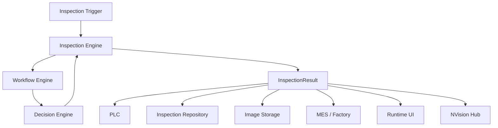
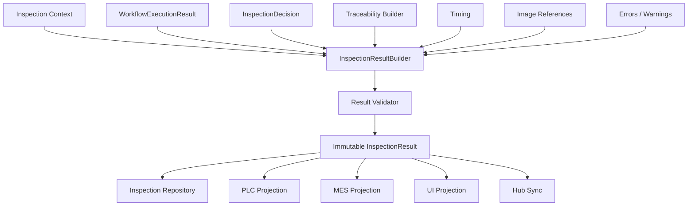

# 06 — NVision Inspection Result Schema

**Product:** NTech NVision  
**Document Type:** Production Data Contract / Result Schema Specification  
**Primary Domain Object:** `InspectionResult`  
**Status:** Foundation Specification  
**Version:** 1.0  
**Date:** 2026-08-18  
**Parent Documents:**  
- `NVISION_PLATFORM_FOUNDATION.md`
- `01_PLATFORM_ARCHITECTURE.md`
- `02_DOMAIN_MODEL.md`
- `03_WORKFLOW_ENGINE_ARCHITECTURE.md`
- `04_PLUGIN_ARCHITECTURE.md`
- `05_PROJECT_FILE_FORMAT.md`

---

# 1. Purpose

This document defines the canonical data contract used by NVision to represent the result of one production inspection.

The Inspection Result is the primary traceability record used by:

- NVision Runtime
- NVision Studio debug/test mode
- Local production history
- PLC result mapping
- MES integration
- NVision Hub
- Reporting
- Statistics
- Alarm analysis
- Quality analysis
- Audit
- Customer integration
- Golden image regression testing
- Support diagnostics

The result schema must answer:

- What was inspected?
- When was it inspected?
- On which station?
- Which Project/Job/Recipe was used?
- Which model/calibration/plugin versions were used?
- Was the inspection OK, NG, or technically invalid?
- Why was it NG?
- Which measurement failed?
- Which AI prediction contributed to the decision?
- How long did the inspection take?
- Which images are related to the result?
- Were there device or execution errors?
- Can this result be reproduced or investigated later?

The central rule is:

> **Every production inspection must produce an explicit, immutable, traceable result record.**

---

# 2. Core Design Principles

## 2.1 Quality Result and Technical Execution Are Different

NVision must distinguish:

```text
Product Quality Decision
```

from:

```text
Technical Execution Status
```

Example:

```text
Workflow execution succeeded
Inspection quality = NG
```

is a valid quality result.

Example:

```text
Camera timeout
Inspection quality cannot be determined
```

must be:

```text
ERROR / NO_RESULT / TIMEOUT
```

not `NG` unless an explicit machine policy maps it externally.

---

## 2.2 No Silent Error-to-OK Conversion

The following statuses are never equivalent to `OK`:

```text
ERROR
NO_RESULT
TIMEOUT
CANCELLED
INVALID
```

A technical failure must remain visible.

---

## 2.3 Final Results Are Immutable

Once finalized and persisted, an `InspectionResult` must not be edited in place.

If a correction or annotation is required, store a separate:

```text
Review Record
Correction Record
Operator Annotation
Disposition Record
```

while preserving the original result.

---

## 2.4 Traceability First

A production result must identify the exact execution context.

At minimum:

```text
Station
Project Version
Job
Recipe Version
Runtime Version
Timestamp
Inspection ID
```

For AI/calibrated systems, additionally:

```text
Model Version
Calibration Version
Plugin Set
```

---

## 2.5 Stable Codes, Localized Text

Persist stable machine-readable codes:

```text
WRONG_TYPE
OCR_MISMATCH
CAMERA_TIMEOUT
```

Do not make localized text the only meaning.

UI may render:

```text
WRONG_TYPE
→ Sai loại sản phẩm
```

---

## 2.6 Configurable Persistence Detail

Not every station needs full node-level diagnostics for every OK product.

The schema supports multiple persistence levels:

```text
Minimal
Standard
Diagnostic
```

---

# 3. Position in NVision Architecture



---

# 4. Inspection Lifecycle vs Final Result

Inspection lifecycle:

```text
Created
WaitingForAcquisition
Processing
Deciding
Finalizing
Completed / Failed / TimedOut / Cancelled
```

The persisted `InspectionResult` represents the finalized output of that lifecycle.

---

# 5. High-Level Result Structure

Canonical logical structure:

```text
InspectionResult
├── Identity
├── Context
├── Final Status
├── Decision
├── Reasons
├── Measurements
├── AI / Vision Results
├── OCR / Code Results
├── Timing
├── Images
├── Node Execution Summary
├── Device Snapshot
├── Traceability
├── Errors / Warnings
└── Metadata
```

---

# 6. Canonical Inspection Result Model

Conceptual:

```text
InspectionResult
├── SchemaVersion
├── InspectionId
├── CorrelationId
├── Station
├── Product
├── Project
├── Job
├── Recipe
├── Execution
├── Status
├── DecisionCode
├── Score
├── Reasons
├── Measurements
├── Detections
├── Classifications
├── TextResults
├── CodeResults
├── Timings
├── Images
├── NodeResults
├── DeviceSnapshot
├── Traceability
├── Errors
├── Warnings
├── StartedAt
├── CompletedAt
└── Metadata
```

---

# 7. Result Schema Version

Every serialized result declares:

```json
{
  "format": "nvision-inspection-result",
  "schemaVersion": "1.0"
}
```

This version is independent from:

```text
NVision Runtime version
Project version
Recipe version
```

---

# 8. Result Identity

## 8.1 InspectionId

Each inspection must have a unique ID.

Recommended pattern:

```text
{StationCode}-{yyyyMMddHHmmssfff}-{Sequence}
```

Example:

```text
WM01-20260818155530125-00012345
```

A UUID may additionally be used internally.

---

## 8.2 Why Human-Readable Inspection IDs

Benefits:

- operator communication
- log search
- customer support
- screenshot debugging
- database lookup
- image folder correlation

---

# 9. CorrelationId

Optional but strongly recommended.

Used to correlate:

```text
Trigger
Inspection
PLC transaction
MES message
Logs
Distributed services
```

Example:

```text
CorrelationId = UUID
```

---

# 10. Station Identity

Result must include:

```text
StationId
StationCode
```

Example:

```json
{
  "station": {
    "id": "a5c...",
    "code": "WM01",
    "name": "Wire Marker Station 01"
  }
}
```

`StationCode` improves readability.

`StationId` remains authoritative.

---

# 11. Product Identity

Optional unless required by Project policy.

```text
ProductIdentity
├── ProductCode
├── SerialNumber
├── Lot
├── Batch
├── WorkOrder
├── Barcode
├── ExternalId
└── Metadata
```

---

# 12. Product Example

```json
{
  "product": {
    "productCode": "TYPE01",
    "serialNumber": "SN20260818001234",
    "lot": "LOT-0826-A",
    "workOrder": "WO-10291"
  }
}
```

---

# 13. Project Trace

```text
ProjectTrace
├── ProjectId
├── ProjectCode
└── ProjectVersion
```

Example:

```json
{
  "project": {
    "id": "7f5675d6-...",
    "code": "WIRE_MARKER",
    "version": "1.4.0"
  }
}
```

---

# 14. Job Trace

```text
JobTrace
├── JobId
├── JobCode
└── WorkflowHash
```

Job may optionally have independent version later.

Example:

```json
{
  "job": {
    "id": "0ef67eb5-...",
    "code": "TYPE_INSPECTION",
    "workflowHash": "sha256:..."
  }
}
```

---

# 15. Recipe Trace

```text
RecipeTrace
├── RecipeId
├── RecipeCode
└── RecipeVersion
```

Example:

```json
{
  "recipe": {
    "id": "a58f3d12-...",
    "code": "TYPE_01",
    "version": "2.0.0"
  }
}
```

---

# 16. Final Inspection Status

Canonical quality/execution statuses:

```text
OK
NG
ERROR
NO_RESULT
TIMEOUT
CANCELLED
BYPASS
INVALID
```

Recommended serialized values:

```text
ok
ng
error
noResult
timeout
cancelled
bypass
invalid
```

---

# 17. Status Semantics

## OK

Inspection completed technically and the product passed all acceptance criteria.

## NG

Inspection completed technically and the product failed one or more quality criteria.

## ERROR

Inspection could not produce a valid quality decision due to technical/system failure.

## NO_RESULT

Inspection completed or terminated without enough information to determine quality.

## TIMEOUT

Inspection exceeded configured time limit.

## CANCELLED

Inspection was deliberately cancelled.

## BYPASS

Inspection was intentionally bypassed according to an explicit operating mode.

## INVALID

Request/configuration/context was invalid before a trustworthy inspection could be performed.

---

# 18. Workflow Status

Store technical Workflow status separately when useful:

```text
Succeeded
Failed
TimedOut
Cancelled
Invalid
```

Example:

```json
{
  "execution": {
    "workflowStatus": "succeeded"
  },
  "status": "ng"
}
```

This means:

> software executed correctly; product failed inspection.

---

# 19. Decision Code

Every finalized inspection should have a stable `decisionCode`.

Examples:

```text
OK
WRONG_TYPE
OCR_MISMATCH
DIMENSION_OUT_OF_RANGE
MISSING_PART
SURFACE_SCRATCH
CAMERA_TIMEOUT
MODEL_LOAD_FAILED
CALIBRATION_INVALID
INSPECTION_TIMEOUT
MANUAL_BYPASS
```

---

# 20. Decision Code Rules

- Stable across UI languages
- Uppercase snake case recommended
- Do not reuse same code for unrelated causes
- `OK` reserved for accepted product
- Technical error codes remain distinguishable from quality NG codes

---

# 21. Decision Category

Recommended categories:

```text
Quality
Vision
AI
Measurement
OCR
Device
Communication
Configuration
System
Operator
Bypass
```

Example:

```json
{
  "decisionCategory": "quality"
}
```

---

# 22. Score

Optional overall normalized score:

```text
0.0 .. 1.0
```

Meaning must be defined by Project.

Do not assume all inspections have a meaningful single score.

Example:

```json
{
  "score": 0.982
}
```

---

# 23. Reason List

A result may contain multiple reasons.

```text
InspectionReason
├── Code
├── Category
├── Severity
├── MessageKey
├── SourceNodeId
├── MeasurementKey
├── Expected
├── Actual
└── Details
```

---

# 24. Reason Example

```json
{
  "reasons": [
    {
      "code": "WRONG_TYPE",
      "category": "quality",
      "severity": "error",
      "messageKey": "inspection.reason.wrongType",
      "sourceNodeId": "33333333-...",
      "expected": "TYPE_01",
      "actual": "TYPE_04"
    }
  ]
}
```

---

# 25. Reason Severity

Suggested:

```text
Info
Warning
Error
Critical
```

For normal NG quality reasons:

```text
Error
```

is often sufficient.

`Critical` should normally indicate machine/system severity, not merely bad product.

---

# 26. Primary vs Secondary Reason

Optional fields:

```text
isPrimary
```

or ordering.

Recommended:

- `decisionCode` = primary summary
- `reasons[]` = all detailed reasons

---

# 27. Measurement Model

Canonical:

```text
MeasurementResult
├── Key
├── Name
├── Value
├── Unit
├── Min
├── Max
├── Nominal
├── Tolerance
├── Passed
├── SourceNodeId
└── Metadata
```

---

# 28. Measurement Example

```json
{
  "measurements": [
    {
      "key": "markerLength",
      "name": "Marker Length",
      "value": 10.24,
      "unit": "mm",
      "min": 10.0,
      "max": 10.5,
      "passed": true,
      "sourceNodeId": "..."
    }
  ]
}
```

---

# 29. Measurement Unit Rule

Physical values must carry units.

Good:

```text
10.24 mm
```

Bad:

```text
10.24
```

without known unit.

---

# 30. Measurement Precision

Persist actual calculation precision.

UI formatting is separate.

Example:

```text
stored = 10.243817
display = 10.24
```

---

# 31. Boolean Inspection Checks

Simple checks may be represented as:

```text
CheckResult
├── Key
├── Passed
├── Expected
├── Actual
├── SourceNodeId
└── ReasonCode
```

Examples:

```text
PartPresent
OrientationCorrect
TextMatch
ColorMatch
```

---

# 32. Classification Result

```text
ClassificationResult
├── Key
├── ClassId
├── ClassName
├── Confidence
├── TopK
├── ModelRef
├── SourceNodeId
└── Metadata
```

---

# 33. Classification Example

```json
{
  "classifications": [
    {
      "key": "markerType",
      "className": "TYPE_01",
      "confidence": 0.982,
      "topK": [
        {
          "className": "TYPE_01",
          "confidence": 0.982
        },
        {
          "className": "TYPE_04",
          "confidence": 0.011
        }
      ],
      "modelRef": "marker_classifier",
      "sourceNodeId": "..."
    }
  ]
}
```

---

# 34. Detection Result

```text
DetectionResult
├── DetectionId
├── ClassId
├── ClassName
├── Confidence
├── BoundingBox
├── Polygon / MaskRef
├── Attributes
├── SourceNodeId
└── ModelRef
```

---

# 35. Bounding Box

Must declare coordinate space.

```json
{
  "boundingBox": {
    "coordinateSpace": "imagePixel",
    "x": 120.5,
    "y": 80.2,
    "width": 205.4,
    "height": 91.7
  }
}
```

---

# 36. Coordinate Spaces

Initial:

```text
imagePixel
imageNormalized
camera
fixture
part
robotBase
world
```

Do not mix silently.

---

# 37. Segmentation Result

Avoid embedding large masks directly.

Use:

```text
MaskReference
```

Example:

```json
{
  "maskRef": {
    "imageId": "..."
  }
}
```

or encoded compact geometry when appropriate.

---

# 38. OCR / Text Result

```text
TextResult
├── Key
├── Text
├── Confidence
├── Region
├── Characters
├── SourceNodeId
├── ModelRef
└── Metadata
```

---

# 39. OCR Example

```json
{
  "textResults": [
    {
      "key": "markerText",
      "text": "AB123",
      "confidence": 0.974,
      "sourceNodeId": "..."
    }
  ]
}
```

---

# 40. Barcode / Code Result

Separate logical result is useful for:

```text
Barcode
QR
DataMatrix
```

Canonical:

```text
CodeResult
├── Key
├── Symbology
├── Data
├── Confidence
├── Region
└── SourceNodeId
```

---

# 41. Pose Result

Future robot guidance:

```text
PoseResult
├── Key
├── Frame
├── Position
├── Orientation
├── Confidence
├── SourceNodeId
└── CalibrationRef
```

Not required for Phase 1 but schema should be extensible.

---

# 42. Timing Model

Inspection timing must use duration values.

Recommended:

```text
milliseconds
```

for serialized standard fields.

---

# 43. Timing Summary

```text
InspectionTiming
├── acquisitionMs
├── preprocessingMs
├── visionMs
├── aiInferenceMs
├── decisionMs
├── communicationMs
├── persistenceMs
└── totalMs
```

Not all fields required.

---

# 44. Timing Example

```json
{
  "timing": {
    "acquisitionMs": 8.2,
    "visionMs": 11.4,
    "aiInferenceMs": 27.8,
    "decisionMs": 0.4,
    "communicationMs": 2.1,
    "totalMs": 52.7
  }
}
```

---

# 45. Timing Source

Durations should be measured using monotonic timer.

Wall-clock timestamps are used for:

```text
StartedAt
CompletedAt
```

but not to compute performance durations when avoidable.

---

# 46. Node Timing

Diagnostic persistence may include:

```text
NodeExecutionResult
```

with:

```text
queueWaitMs
executionMs
resourceWaitMs
```

---

# 47. Node Result Model

```text
NodeExecutionSummary
├── NodeId
├── NodeTypeId
├── NodeName
├── Status
├── DurationMs
├── ErrorCode
├── Warnings
└── OutputSummary
```

---

# 48. Node Status

```text
success
failed
skipped
timeout
cancelled
invalidInput
```

---

# 49. Skip Reason

Optional:

```text
branchNotSelected
dependencyFailed
workflowCancelled
nodeDisabled
fallbackNotNeeded
```

---

# 50. Node Result Storage Policy

For normal high-volume production:

```text
do not persist every node output
```

Persist:

```text
final measurements
final AI results
important reasons
timing summary
```

Use detailed node records for:

```text
NG only
Error only
Sampling
Diagnostic mode
```

---

# 51. Image Reference Model

Inspection result references images by storage key.

```text
InspectionImageReference
├── ImageId
├── Kind
├── StorageKey
├── Width
├── Height
├── PixelFormat
├── Checksum
├── CameraId
├── FrameId
├── CapturedAt
└── Metadata
```

---

# 52. Image Kinds

Suggested:

```text
source
annotated
ng
reference
thumbnail
debug
mask
depth
```

---

# 53. Image Reference Example

```json
{
  "images": [
    {
      "id": "img-...",
      "kind": "source",
      "storageKey": "2026/08/18/WM01/.../source.png",
      "width": 2448,
      "height": 2048,
      "pixelFormat": "Mono8",
      "cameraId": "aaaaaaaa-..."
    }
  ]
}
```

---

# 54. Do Not Embed Images in Result JSON

Avoid:

```text
Base64 image
```

in normal result records.

Reasons:

- bloated DB
- poor API efficiency
- hard retention management
- bad logging behavior

Use external image/object storage.

---

# 55. Image Retention Policy

Example:

```text
NG source + annotated: 180 days
ERROR images: 180 days
OK images: 7 days
Thumbnails: 30 days
Metadata: 365 days
```

Policy is station/customer configurable.

---

# 56. Save-Image Decision

Possible policies:

```text
Always
NGOnly
ErrorOnly
Sampled
Never
RuleBased
```

---

# 57. Sampling

Example:

```text
Save 1 of every 100 OK images
```

Useful for:

- drift analysis
- audit
- model retraining

Sampling decision should be traceable if relevant.

---

# 58. Device Snapshot

Inspection may record important device state.

```text
DeviceSnapshot
├── DeviceId
├── DeviceCode
├── State
├── ConfigurationHash
├── Firmware
├── Diagnostics
└── ParametersSnapshot
```

Do not persist every device parameter unless needed.

---

# 59. Camera Snapshot Example

Useful fields:

```text
Exposure
Gain
Trigger Mode
Frame ID
Temperature
```

depending on traceability requirements.

---

# 60. Device Configuration Hash

Instead of duplicating entire device configuration, result may store:

```text
DeviceConfigHash
```

plus active deployment version.

This is efficient and reproducible.

---

# 61. Model Traceability

Canonical:

```text
ModelExecutionTrace
├── Slot
├── ModelId
├── ModelCode
├── ModelVersion
├── Checksum
├── BackendId
├── BackendVersion
├── Device
└── Precision
```

---

# 62. Model Trace Example

```json
{
  "models": [
    {
      "slot": "marker_classifier",
      "modelId": "bbbb...",
      "code": "MARKER_CLASSIFIER",
      "version": "1.3.2",
      "checksum": "sha256:...",
      "backend": "ntech.ai.onnxruntime",
      "precision": "fp32"
    }
  ]
}
```

---

# 63. Calibration Traceability

```text
CalibrationTrace
├── CalibrationId
├── Code
├── Type
├── Version
├── Checksum
└── StatusAtExecution
```

---

# 64. Plugin Traceability

Full plugin list does not need to be repeated in every result if station/session metadata can resolve it.

Options:

## Option A

Store:

```text
PluginSetHash
```

## Option B

Store exact plugin list per inspection.

Recommendation:

> Store `pluginSetHash` per result and exact plugin inventory per Runtime Session / Deployment.

---

# 65. Runtime Trace

Recommended:

```text
RuntimeTrace
├── RuntimeVersion
├── EngineVersion
├── DeploymentPackageId
├── DeploymentHash
├── PluginSetHash
├── OS
└── Architecture
```

OS/architecture may be session-level rather than every result.

---

# 66. Complete Traceability Block

Conceptual:

```json
{
  "traceability": {
    "runtimeVersion": "1.4.0",
    "deploymentPackageId": "dep-...",
    "deploymentHash": "sha256:...",
    "pluginSetHash": "sha256:...",

    "models": [],
    "calibrations": []
  }
}
```

---

# 67. Error Model

Technical errors:

```text
InspectionError
├── Code
├── Category
├── Source
├── SourceId
├── MessageKey
├── Detail
├── Recoverable
└── Timestamp
```

---

# 68. Error Categories

```text
configuration
device
camera
plc
robot
ai
vision
calibration
workflow
storage
communication
system
security
```

---

# 69. Error Example

```json
{
  "errors": [
    {
      "code": "CAMERA_TIMEOUT",
      "category": "camera",
      "source": "device",
      "sourceId": "aaaaaaaa-...",
      "messageKey": "inspection.error.cameraTimeout",
      "recoverable": true
    }
  ]
}
```

---

# 70. Warning Model

Warnings do not necessarily invalidate inspection.

Examples:

```text
Disk space low
Optional MES offline
Confidence near threshold
Optional camera telemetry missing
```

Persist important warnings if they matter to traceability.

---

# 71. Alarm vs Inspection Error

Distinguish:

```text
InspectionError
```

= error attached to one inspection.

```text
Alarm
```

= operational state that may span many inspections.

Example:

```text
PLC communication lost
```

may raise Alarm and also create error for affected inspection.

---

# 72. Start and Completion Timestamps

Required:

```text
startedAt
completedAt
```

Use:

```text
ISO 8601
DateTimeOffset
```

Example:

```text
2026-08-18T15:55:30.125+07:00
```

---

# 73. Server / Station Time

For centralized Hub:

- station captures local offset-aware time
- system may normalize UTC for storage/query

Preserve original station timestamp when useful.

---

# 74. Sequence Number

Optional station sequence:

```text
12345
```

Useful for:

- production counter correlation
- PLC trace
- image naming

---

# 75. Trigger Trace

```text
TriggerTrace
├── TriggerId
├── Source
├── ReceivedAt
├── Sequence
└── Metadata
```

---

# 76. Trigger Sources

```text
manual
software
plc
digitalInput
camera
sensor
timer
robot
```

---

# 77. External Input Snapshot

Inspection may record inputs that materially affect decision.

Examples:

```text
PLC product code
robot pose
operator-selected type
MES work order
```

Store only selected relevant inputs, not arbitrary whole PLC memory.

---

# 78. Result Metadata

Optional extension data:

```json
{
  "metadata": {
    "customerLine": "LINE-A"
  }
}
```

Important core semantics must not be hidden here.

---

# 79. Extension Namespaces

Future extensions:

```json
{
  "extensions": {
    "customer.factory-a": {
      "shift": "A"
    }
  }
}
```

Use namespaced keys.

---

# 80. Persistence Levels

NVision should define standardized result detail levels.

---

# 81. Minimal Result

Contains:

```text
InspectionId
Station
Timestamp
Project
Job
Recipe
Status
DecisionCode
CycleTime
Traceability hashes
```

Suitable for:

- very high throughput
- basic counters

---

# 82. Standard Result

Adds:

```text
Reasons
Measurements
Classifications
Detections
OCR
Image References
Important Errors
Timing breakdown
```

Recommended production default.

---

# 83. Diagnostic Result

Adds:

```text
Node results
Node timing
Intermediate summaries
Device snapshot
Debug image references
Detailed errors
```

Used for:

- engineering
- service
- NG/Error capture
- sampled diagnostics

---

# 84. Dynamic Persistence Policy

Example:

```text
OK
→ Standard

NG
→ Diagnostic

ERROR
→ Diagnostic
```

Good production strategy.

---

# 85. Result JSON — Standard Example

```json
{
  "format": "nvision-inspection-result",
  "schemaVersion": "1.0",

  "inspectionId": "WM01-20260818155530125-00012345",
  "correlationId": "f61a18b5-...",

  "station": {
    "id": "a5c...",
    "code": "WM01"
  },

  "product": {
    "productCode": "TYPE01",
    "serialNumber": "SN20260818001234"
  },

  "project": {
    "id": "7f5675d6-...",
    "code": "WIRE_MARKER",
    "version": "1.4.0"
  },

  "job": {
    "id": "0ef67eb5-...",
    "code": "TYPE_INSPECTION",
    "workflowHash": "sha256:..."
  },

  "recipe": {
    "id": "a58f3d12-...",
    "code": "TYPE_01",
    "version": "2.0.0"
  },

  "execution": {
    "workflowStatus": "succeeded"
  },

  "status": "ok",
  "decisionCode": "OK",
  "decisionCategory": "quality",
  "score": 0.982,

  "reasons": [],

  "classifications": [
    {
      "key": "markerType",
      "className": "TYPE_01",
      "confidence": 0.982,
      "modelRef": "marker_classifier",
      "sourceNodeId": "33333333-..."
    }
  ],

  "measurements": [],

  "timing": {
    "acquisitionMs": 8.2,
    "aiInferenceMs": 27.8,
    "decisionMs": 0.4,
    "totalMs": 52.7
  },

  "images": [
    {
      "id": "img-001",
      "kind": "source",
      "storageKey": "2026/08/18/WM01/WM01-.../source.png",
      "width": 2448,
      "height": 2048,
      "pixelFormat": "Mono8"
    }
  ],

  "traceability": {
    "runtimeVersion": "1.4.0",
    "deploymentPackageId": "dep-...",
    "deploymentHash": "sha256:...",
    "pluginSetHash": "sha256:...",

    "models": [
      {
        "slot": "marker_classifier",
        "modelId": "bbbb...",
        "code": "MARKER_CLASSIFIER",
        "version": "1.3.2",
        "checksum": "sha256:...",
        "backend": "ntech.ai.onnxruntime"
      }
    ]
  },

  "errors": [],
  "warnings": [],

  "startedAt": "2026-08-18T15:55:30.125+07:00",
  "completedAt": "2026-08-18T15:55:30.178+07:00"
}
```

---

# 86. NG Example

```json
{
  "status": "ng",
  "decisionCode": "WRONG_TYPE",
  "reasons": [
    {
      "code": "WRONG_TYPE",
      "category": "quality",
      "sourceNodeId": "33333333-...",
      "expected": "TYPE_01",
      "actual": "TYPE_04"
    }
  ],
  "classifications": [
    {
      "key": "markerType",
      "className": "TYPE_04",
      "confidence": 0.971
    }
  ]
}
```

---

# 87. ERROR Example

```json
{
  "execution": {
    "workflowStatus": "failed"
  },
  "status": "error",
  "decisionCode": "CAMERA_TIMEOUT",
  "errors": [
    {
      "code": "CAMERA_TIMEOUT",
      "category": "camera",
      "sourceId": "CAM_TOP",
      "recoverable": true
    }
  ]
}
```

Important:

```text
ERROR ≠ NG
```

---

# 88. BYPASS Example

```json
{
  "status": "bypass",
  "decisionCode": "MANUAL_BYPASS",
  "metadata": {
    "operatorReason": "Maintenance validation"
  }
}
```

BYPASS must be audited.

---

# 89. Manual Review

Future support:

```text
ReviewStatus
```

separate from original result.

Example:

```text
Inspection result = NG
Human review = False Reject
Final disposition = Accept
```

Do not overwrite original NG.

---

# 90. Review Record

Conceptual:

```text
InspectionReview
├── ReviewId
├── InspectionId
├── Reviewer
├── ReviewType
├── Disposition
├── Reason
├── CreatedAt
└── Metadata
```

Future NVision Hub feature.

---

# 91. Disposition

Possible:

```text
Accepted
Rejected
Rework
Scrap
FalseReject
FalseAccept
Unknown
```

This is downstream quality disposition, not inspection algorithm result.

---

# 92. Database Strategy

Initial local station:

```text
SQLite
```

Recommended central Hub:

```text
PostgreSQL
```

Images remain outside relational DB.

---

# 93. Database Mapping — Inspection Table

Suggested table:

```text
inspections
├── inspection_id
├── station_id
├── sequence
├── started_at
├── completed_at
├── project_id
├── project_version
├── job_id
├── recipe_id
├── recipe_version
├── product_code
├── serial_number
├── status
├── decision_code
├── score
├── total_ms
├── deployment_hash
├── plugin_set_hash
└── payload_json
```

---

# 94. Why Hybrid Relational + JSON

Relational columns for frequent queries:

```text
date
station
status
recipe
decision code
product
cycle time
```

JSON payload for variable detail:

```text
detections
measurements
node diagnostics
extensions
```

This balances flexibility and query performance.

---

# 95. Measurement Table

If high-volume querying required:

```text
inspection_measurements
├── inspection_id
├── key
├── value
├── unit
├── passed
├── min
└── max
```

MVP may keep measurements in JSON.

---

# 96. Reason Table

For analytics:

```text
inspection_reasons
├── inspection_id
├── code
├── category
├── source_node_id
└── severity
```

Useful for Pareto charts.

---

# 97. Image Table

```text
inspection_images
├── image_id
├── inspection_id
├── kind
├── storage_key
├── width
├── height
├── checksum
└── created_at
```

---

# 98. Model Trace Table

Optional central analytics:

```text
inspection_models
```

Most stations can store model trace in result JSON.

---

# 99. Database Source of Truth

The immutable Inspection Result record is the source of truth.

Counters and dashboard statistics are derived.

---

# 100. Counter Update

On finalized result:

```text
OK → OK++
NG → NG++
ERROR → ERROR++
BYPASS → BYPASS++
```

Total policy must be explicit.

---

# 101. Yield Formula

Recommended default:

```text
Yield = OK / (OK + NG)
```

Do not include technical errors unless customer explicitly defines otherwise.

---

# 102. First Pass Yield

Future:

```text
FPY
```

requires product identity and reinspection relationships.

Not identical to simple yield.

---

# 103. Reinspection Relationship

Future field:

```text
parentInspectionId
```

or:

```text
inspectionAttempt
```

Useful when same serial is inspected repeatedly.

---

# 104. PLC Mapping

PLC usually cannot receive full result object.

Map to compact machine signals.

Example:

```text
Ready
Busy
Done
ResultCode
NGCode
Sequence
```

---

# 105. PLC Result Code

Recommended configurable mapping:

```text
OK       = 1
NG       = 2
ERROR    = 3
BYPASS   = 4
NO_RESULT= 5
```

Never hardcode universally in Domain.

Machine integration config owns numeric mapping.

---

# 106. PLC NG Code

Example:

```text
WRONG_TYPE            = 101
OCR_MISMATCH          = 102
DIMENSION_OUT_OF_RANGE= 103
```

Stable project-specific mapping.

---

# 107. PLC Mapping Principle

Canonical result remains rich.

PLC mapping is a projection:

```text
InspectionResult
      ↓
PLC Result Mapper
      ↓
Integer / Boolean signals
```

Do not shape the whole result schema around PLC register limitations.

---

# 108. MES Mapping

MES payload may include:

```text
inspectionId
station
serial
product
result
decisionCode
recipe
timestamp
measurements
image URLs
```

Mapping layer converts canonical NVision result into customer MES format.

---

# 109. MES Example

```json
{
  "inspectionId": "WM01-...",
  "serial": "SN...",
  "result": "PASS",
  "nvisionDecisionCode": "OK",
  "station": "WM01",
  "timestamp": "..."
}
```

Customer-specific field names belong to adapter, not core schema.

---

# 110. OPC UA Mapping

Expose selected fields as nodes:

```text
LatestInspection.Id
LatestInspection.Status
LatestInspection.DecisionCode
LatestInspection.CycleTime
Counters.OK
Counters.NG
```

Do not publish huge detection arrays unless needed.

---

# 111. MQTT Mapping

Topic example:

```text
factory/line1/nvision/wm01/inspection
```

Payload can use standard result subset.

Full canonical result may be too large for every system.

---

# 112. Result Projections

Define standard projections:

```text
CompactResult
StandardResult
FullResult
```

Useful for APIs.

---

# 113. Compact Result

```text
InspectionId
Timestamp
Status
DecisionCode
ProductCode
SerialNumber
CycleTime
```

---

# 114. Standard Result Projection

Adds:

```text
Reasons
Measurements
Classification
Images
Trace versions
```

---

# 115. Full Result Projection

Adds:

```text
Node diagnostics
device snapshot
detailed timing
extensions
```

---

# 116. Runtime API Contract

Possible:

```text
GetLatestInspection
GetInspectionById
QueryInspections
SubscribeInspectionResults
```

Use DTOs based on canonical schema.

---

# 117. gRPC Contract

gRPC may use protobuf rather than JSON.

Semantic fields must map one-to-one.

JSON schema remains canonical external/documentation representation.

---

# 118. API Versioning

Do not assume Result Schema version equals API version.

Example:

```text
Result Schema 1.0
Runtime API v2
```

API can transport same semantic object.

---

# 119. JSON Serialization Rules

Recommended:

```text
UTF-8
camelCase properties
string enums
ISO 8601 timestamps
culture-invariant numbers
omit absent optional fields
```

---

# 120. Null Semantics

Prefer omission.

Use null only if:

```text
known field explicitly has no value
```

Do not emit huge structures of nulls.

---

# 121. Unknown Fields

Readers should ignore unknown optional fields.

If required semantic feature is introduced, schema/capability version must communicate it.

---

# 122. Result Migration

Historical results generally should not be rewritten eagerly.

Preferred:

```text
read old schema
map to current query/domain projection
```

Preserve original payload.

---

# 123. Immutable Historical Payload

Store original schema version with record.

Future analytics layer can normalize.

This reduces audit risk.

---

# 124. Schema Evolution

Backward-compatible addition example:

```text
1.0 → 1.1
add optional `review`
```

Breaking example:

```text
1.x → 2.0
change coordinate semantics
```

---

# 125. Stable Status Values

Core statuses should be extremely stable.

Avoid casually adding new final statuses.

New detail often belongs in:

```text
decisionCode
reason
category
```

instead.

---

# 126. Error Code Stability

Once used in production/MES/PLC analytics, codes become integration contracts.

Changing:

```text
WRONG_TYPE
```

to:

```text
TYPE_MISMATCH
```

is a breaking integration change unless alias/migration exists.

---

# 127. Decision Code Registry

Recommended Project-level registry:

```text
DecisionCodeDefinition
├── Code
├── Category
├── DefaultStatus
├── Description
├── PlcCode
└── Severity
```

---

# 128. Example Registry

```text
OK
status: OK

WRONG_TYPE
status: NG
PLC: 101

CAMERA_TIMEOUT
status: ERROR
PLC: 901
```

---

# 129. Reason Registry vs Dynamic Reason

Use stable reason codes.

Dynamic detail goes into:

```text
expected
actual
details
```

not into dynamically generated code.

---

# 130. Privacy / Sensitive Data

Inspection results may contain:

```text
serial numbers
operator IDs
customer order data
images
```

Retention and access policies must reflect customer requirements.

---

# 131. Secrets

Never store:

```text
password
API token
PLC credential
```

inside result payload.

---

# 132. Operator Identity

If required:

```text
OperatorRef
```

should store user ID/code, not unnecessary personal data.

---

# 133. Image Access Security

Images may reveal proprietary parts/processes.

NVision Hub should enforce role-based access.

Local Runtime file paths should not be exposed directly to untrusted remote clients.

---

# 134. Integrity

Future result may include:

```text
resultHash
```

computed from canonical finalized content.

Useful for audit/tamper detection.

---

# 135. Result Signing

Future regulated deployments may digitally sign result batches or individual results.

Not MVP requirement.

---

# 136. Batch Integrity

Alternative:

```text
daily result archive hash
```

more efficient than per-result signing.

---

# 137. Retention

Separate retention by data class:

```text
Result metadata
Images
Debug details
Logs
Audit
```

---

# 138. Example Retention

```text
Inspection metadata: 365 days
NG metadata: 730 days
NG images: 180 days
OK images: 7 days
Diagnostic node data: 30 days
Audit: 730 days
```

Customer policy overrides.

---

# 139. Deletion

When retention deletes images:

Result remains:

```text
image reference
```

with storage state:

```text
expired/deleted
```

or reference row removed based on policy.

Do not make result invalid.

---

# 140. Storage State

Optional image field:

```text
available
expired
archived
missing
```

Useful for Hub.

---

# 141. Archive

Old results may move to:

```text
NAS
Object storage
Cold archive
```

Storage key abstraction allows relocation.

---

# 142. Offline Station

Result schema must work without cloud.

Local Runtime persists fully offline.

Later Hub sync is additive.

---

# 143. Hub Synchronization

Use:

```text
InspectionId
```

for idempotency.

If same result uploaded twice:

```text
do not create duplicate
```

---

# 144. Sync State

Local storage may track separately:

```text
Pending
Synced
Failed
```

This is transport state, not part of canonical Inspection Result semantics.

---

# 145. Outbox Pattern

For MES/Hub:

```text
Finalize result
    ↓
Persist result
    ↓
Write outbox event
    ↓
Async sender
```

Avoid losing result when network unavailable.

---

# 146. Result Persistence Order

Machine timing may require:

```text
Decision
→ PLC response
→ full persistence
```

or:

```text
Persist critical metadata
→ PLC
```

Exact ordering belongs to Runtime architecture.

Regardless:

> final result must eventually be persisted or persistence failure must become visible.

---

# 147. Persistence Failure

If disk/DB write fails after PLC already received result:

- raise critical operational alarm
- keep in-memory/outbox recovery if possible
- never pretend traceability is complete

---

# 148. Disk Full

Must be monitored before total failure.

Possible policy:

```text
Warning threshold
Critical threshold
Stop inspection when traceability cannot be guaranteed
```

Customer/project policy decides criticality.

---

# 149. Result Queue

Persistence pipeline must be bounded.

Do not allow unbounded result queue during storage outage.

---

# 150. Result Event

After finalization:

```text
InspectionCompleted
```

domain event may carry:

```text
InspectionId
Status
DecisionCode
CycleTime
```

Heavy payload can be retrieved separately.

---

# 151. Runtime UI Mapping

Operator screen should show:

```text
Result: OK / NG / ERROR
Decision Code
Primary reason
Current image
Cycle time
Recipe
Counters
```

Do not expose raw JSON.

---

# 152. Studio Debug Mapping

Studio may show:

```text
full node results
measurements
AI outputs
timing tree
image overlays
traceability
```

using same result model.

---

# 153. Result Overlay

Annotated image overlay is UI representation.

Canonical result stores geometry:

```text
BoundingBox
Contour
Text region
Measurement points
```

UI renders it.

---

# 154. Annotation Snapshot

If exact rendered annotation is important, save an `annotated` image reference.

Otherwise regenerate from result geometry.

---

# 155. Wire Marker Example

```text
InspectionResult

Status:
OK

Classification:
TYPE_01
Confidence:
98.2%

Expected:
TYPE_01

DecisionCode:
OK

Recipe:
TYPE_01 v2.0.0

Model:
MarkerClassifier v1.3.2

Cycle:
52.7 ms
```

---

# 156. Wrong Wire Marker Example

```text
Status:
NG

DecisionCode:
WRONG_TYPE

Expected:
TYPE_01

Detected:
TYPE_04

Confidence:
97.1%
```

---

# 157. Gear Inspection Example

```text
Status:
NG

Reasons:
- SURFACE_SCRATCH
- DIAMETER_OUT_OF_RANGE

Measurements:
Diameter = 31.82 mm
Allowed = 31.90 ... 32.10 mm

Detection:
Scratch
Confidence 0.94
```

---

# 158. Multi-Camera Result

Result may reference:

```text
Top Image
Bottom Image
Side Image
```

Example:

```json
{
  "images": [
    {
      "kind": "source",
      "role": "top"
    },
    {
      "kind": "source",
      "role": "bottom"
    },
    {
      "kind": "source",
      "role": "side"
    }
  ]
}
```

---

# 159. Frame Role

Recommended optional field:

```text
role
```

Examples:

```text
top
bottom
side
shot1
brightfield
darkfield
```

---

# 160. Multi-Shot Result

Same camera may produce multiple source frames.

Use unique:

```text
FrameId
Role
CapturedAt
```

---

# 161. 3D Result Future Extension

Potential:

```text
PointCloudReference
DepthImageReference
PoseResult
PlaneMeasurement
VolumeMeasurement
```

Do not overload 2D bounding box fields.

---

# 162. Thermal / Multispectral Future

Image reference includes:

```text
PixelFormat
Kind
Metadata
```

for extensibility.

---

# 163. Statistics

Common aggregate queries:

```text
Total by day
Yield by Recipe
NG Pareto by DecisionCode
Average cycle time
AI confidence distribution
Measurement Cp/Cpk future
Error rate by station
```

Schema should make these efficient.

---

# 164. NG Pareto

Primary query:

```text
count(reasons.code)
```

or:

```text
count(decisionCode)
```

depending report.

---

# 165. Cycle Time Analytics

Store:

```text
totalMs
```

as indexed numeric column.

Node timing can remain JSON unless detailed analytics required.

---

# 166. Confidence Analytics

If AI performance monitoring important, store selected primary confidence in relational projection.

Not mandatory for every result.

---

# 167. Drift Monitoring

Future Hub may analyze:

```text
confidence distribution
measurement distribution
NG rate
image embedding drift
```

Result schema supports source data.

---

# 168. Training Feedback Loop

Reviewed false reject/false accept results can feed Trainer.

Relationship:

```text
InspectionResult
    +
Human Review
    ↓
Dataset Candidate
```

Keep review separate from original result.

---

# 169. Golden Test Result

CI tests can use same semantic result subset.

Example expected fixture:

```json
{
  "status": "ok",
  "decisionCode": "OK",
  "classifications": [
    {
      "key": "markerType",
      "className": "TYPE_01"
    }
  ]
}
```

Ignore volatile fields:

```text
timestamp
inspectionId
cycle time
```

during golden semantic comparison.

---

# 170. Result Comparator

Future test utility:

```text
InspectionResultComparer
```

supports tolerances:

```text
measurement tolerance
confidence tolerance
geometry tolerance
```

---

# 171. Deterministic Fields

Expected deterministic:

```text
status
decisionCode
classification class
measurement logical values within numeric tolerance
```

Potentially nondeterministic:

```text
cycle time
timestamp
GPU backend timing
```

---

# 172. Result Schema Validation

Validation layers:

```text
JSON Schema
Domain Validation
Traceability Validation
Project Policy Validation
```

---

# 173. Result Domain Validation

Checks:

- InspectionId exists
- Status valid
- DecisionCode exists
- StartedAt <= CompletedAt
- totalMs >= 0
- Confidence in [0,1]
- Bounding boxes valid
- Measurements finite
- Finalized result immutable
- Required project/job/recipe traces present

---

# 174. Status-Specific Invariants

## OK

Should not contain primary quality failure reason.

## NG

Must normally contain at least one quality reason or meaningful decision code.

## ERROR

Must contain technical error/decision code.

## TIMEOUT

Must include timeout context.

## BYPASS

Must include bypass reason/audit context where required.

---

# 175. NaN / Infinity

JSON does not safely represent:

```text
NaN
Infinity
```

Measurement results containing invalid numeric values must become explicit errors, not invalid JSON numbers.

---

# 176. Geometry Validation

Bounding box:

```text
width >= 0
height >= 0
```

Normalized coordinates should be within policy range where required.

---

# 177. Confidence Validation

```text
0 <= confidence <= 1
```

If model produces invalid value:

```text
AI result invalid
```

---

# 178. Timestamp Validation

Use offset-aware timestamps.

Avoid ambiguous local time without offset.

---

# 179. JSON Schema Repository

Recommended:

```text
schemas/
└── inspection-result/
    └── 1.0.schema.json
```

---

# 180. Result DTO Project

Recommended module:

```text
NTech.NVision.Contracts
```

or:

```text
NTech.NVision.Contracts.Results
```

This may be shared by:

```text
Runtime API
Hub
MES adapters
SDK
```

Do not expose Domain internals directly.

---

# 181. Suggested C# Contract Structure

```text
NTech.NVision.Contracts.Results/
│
├── InspectionResultDto.cs
├── InspectionStatusDto.cs
├── InspectionReasonDto.cs
├── MeasurementResultDto.cs
├── ClassificationResultDto.cs
├── DetectionResultDto.cs
├── TextResultDto.cs
├── InspectionTimingDto.cs
├── InspectionImageDto.cs
├── TraceabilityDto.cs
└── InspectionErrorDto.cs
```

---

# 182. Domain vs DTO

Domain:

```text
InspectionResult
```

Transport:

```text
InspectionResultDto
```

Persistence:

```text
InspectionRecordEntity
```

Keep mappings explicit.

---

# 183. Protobuf Model

Future gRPC schema may map:

```text
enum InspectionStatus
message InspectionResult
message Measurement
message Detection
```

Do not force JSON-specific quirks into Domain.

---

# 184. SQLite Schema — Minimal MVP

Suggested:

```sql
CREATE TABLE inspections (
    inspection_id TEXT PRIMARY KEY,
    station_code TEXT NOT NULL,
    sequence INTEGER,
    started_at TEXT NOT NULL,
    completed_at TEXT,
    project_id TEXT NOT NULL,
    project_version TEXT NOT NULL,
    job_id TEXT NOT NULL,
    recipe_id TEXT,
    recipe_version TEXT,
    product_code TEXT,
    serial_number TEXT,
    status TEXT NOT NULL,
    decision_code TEXT NOT NULL,
    score REAL,
    total_ms REAL NOT NULL,
    payload_json TEXT NOT NULL
);
```

Illustrative only.

---

# 185. SQLite Indexes

Recommended:

```text
started_at
status
decision_code
recipe_id
serial_number
product_code
```

depending query patterns.

---

# 186. Large JSON Payload

SQLite can hold JSON text, but avoid excessive node traces for every OK item.

Use persistence levels.

---

# 187. Image Storage Layout

Recommended:

```text
images/
└── 2026/
    └── 08/
        └── 18/
            └── WM01/
                └── <InspectionId>/
                    ├── source-top.png
                    ├── annotated-top.jpg
                    └── debug-ocr.png
```

---

# 188. File Naming

Image path is storage implementation.

Result only stores:

```text
storageKey
```

Avoid building business logic from actual disk path.

---

# 189. Image Format

Use format based on need:

```text
PNG
lossless inspection evidence

JPEG
preview / lower storage

TIFF
high bit-depth/special cases
```

Raw vendor frame format optional.

---

# 190. Image Checksum

For audit-sensitive applications:

```text
SHA-256
```

optional on image references.

---

# 191. Compression Impact

Never silently use lossy compression for images later used for reinspection/model evaluation unless policy allows.

---

# 192. PLC/MES Race

Inspection ID should be generated before processing so all systems can correlate result.

---

# 193. Result Finalization

Flow:

```text
Create Inspection
      ↓
Execute Workflow
      ↓
Evaluate Decision
      ↓
Build Result
      ↓
Validate Result
      ↓
Finalize Immutable Result
      ↓
Publish/Persist
```

---

# 194. Result Builder

Consider:

```text
InspectionResultBuilder
```

in Application/Inspection Engine.

It collects:

```text
workflow output
decision
timing
traceability
errors
images
```

then creates immutable Domain result.

---

# 195. Finalization Guard

Once finalized:

```text
Cannot Add Reason
Cannot Change Status
Cannot Change Recipe Version
Cannot Change Measurement
```

Review/annotation is separate.

---

# 196. Result Enrichment

Some non-critical metadata may arrive slightly later:

```text
image storage checksum
MES acknowledgment
sync state
```

Do not mutate canonical result if these are operational metadata.

Store linked records.

---

# 197. Associated Records

Examples:

```text
InspectionResult
├── ImageStorageRecord
├── SyncRecord
├── ReviewRecord
├── AuditRecord
└── MESDeliveryRecord
```

---

# 198. MES Delivery State

Separate:

```text
Pending
Sent
Acknowledged
Failed
```

This is not inspection status.

---

# 199. Hub Sync State

Same principle.

---

# 200. Result Query API

Example filters:

```text
time range
station
status
decisionCode
recipe
productCode
serialNumber
modelVersion
```

---

# 201. Pagination

Use cursor/keyset pagination for large history.

Not offset-only at huge scale.

MVP SQLite may use simple paging.

---

# 202. Latest Inspection

Runtime should cache/serve:

```text
LatestInspectionSummary
```

without rereading huge payload every UI refresh.

---

# 203. Result Summary DTO

```text
InspectionResultSummary
├── InspectionId
├── Timestamp
├── Status
├── DecisionCode
├── ProductCode
├── RecipeCode
├── CycleTimeMs
└── ThumbnailRef
```

---

# 204. Result Detail DTO

Loaded on demand.

Includes measurements, detections, images, traceability.

---

# 205. Real-Time Result Stream

Runtime UI subscribes to result summaries.

Do not stream full diagnostic payload by default.

---

# 206. Result Event Backpressure

If UI/HUB subscriber slow:

- do not block inspection
- use bounded channels
- drop/reload UI summaries if needed
- persist source result first

---

# 207. Critical Consumer Priority

Priority:

```text
1. Machine handshake
2. Durable result persistence
3. Operational alarm
4. MES/Hub
5. UI visualization
```

Exact 1/2 ordering can be machine-specific.

---

# 208. Error Result Image

On camera acquisition timeout, there may be no image.

Schema must allow:

```text
images = []
```

---

# 209. Partial Inspection

If some cameras succeeded and one failed:

```text
status = error
```

but retain available image/results for diagnostics.

---

# 210. Multi-Job Result

MVP recommendation:

```text
one Inspection = one Job
```

If station executes multiple Jobs for one physical part, correlate them via:

```text
ProductIdentity
ParentProcessId
```

Future `CompositeInspection` can be introduced if necessary.

---

# 211. Composite Inspection Future

Potential:

```text
PartInspection
├── TopInspectionResult
├── BottomInspectionResult
└── SideInspectionResult
```

Do not complicate Phase 1 schema prematurely.

---

# 212. Reuse of InspectionResult Across Applications

The same schema should support:

```text
Wire Marker
Gear
PCB
Label
Surface Defect
Assembly Verification
Robot Guidance
```

via optional specialized arrays/extensions.

---

# 213. Project-Specific Extension

If unavoidable:

```json
{
  "extensions": {
    "ntech.wireMarker": {
      "detectedType": "TYPE_01"
    }
  }
}
```

But prefer common fields such as `classification`.

---

# 214. Avoid Duplicate Semantics

Bad:

```text
classification.className = TYPE_01
metadata.detectedType = TYPE_01
extensions.type = TYPE_01
```

One canonical representation is better.

---

# 215. Inspection Result Naming Rules

Recommended:

```text
InspectionResult
InspectionReason
MeasurementResult
ClassificationResult
DetectionResult
TextResult
InspectionTiming
InspectionImageReference
InspectionError
Traceability
```

---

# 216. Stable Property Keys

Once external integrations consume:

```text
decisionCode
```

renaming it is breaking.

Plan field names carefully.

---

# 217. Units Registry

Future common unit identifiers:

```text
mm
um
px
deg
ms
us
percent
mm2
mm3
```

Use standard short codes.

---

# 218. Measurement Type

Optional future:

```text
length
angle
area
diameter
distance
count
score
temperature
```

Useful for analytics.

---

# 219. Statistical Limits

Measurement may optionally contain:

```text
LSL
USL
Nominal
```

for SPC.

These are recipe/spec data copied into result for traceability when useful.

---

# 220. Cp/Cpk

Do not compute/store per inspection.

Calculate over populations in analytics.

---

# 221. Count Results

Object count can use:

```text
MeasurementResult
```

with:

```text
unit = count
```

or dedicated check.

---

# 222. Confidence Threshold Trace

If threshold materially controls acceptance, result should be reconstructible from Recipe version.

No need to duplicate every threshold in each result.

For critical reason, may include:

```text
expected/min/actual
```

inside reason.

---

# 223. Recipe Snapshot vs Version Ref

Recommendation:

> Store Recipe ID/version, not full Recipe JSON in every result.

Deployment package preserves exact recipe snapshot.

---

# 224. Workflow Snapshot vs Hash

Store:

```text
workflowHash
```

not full workflow per result.

Deployment package is source for reconstruction.

---

# 225. Deployment Package Retention

To reconstruct historical results, retain deployment packages at least as long as required traceability window.

---

# 226. Plugin Package Retention

Likewise, preserve plugin versions/artifacts where legal/possible for reproducibility.

---

# 227. Model Retention

Never delete model version still referenced by retained production results without archive policy.

---

# 228. Calibration Retention

Same rule.

---

# 229. Traceability Chain

Ideal:

```text
InspectionResult
   │
   ├── DeploymentPackage
   │      ├── Project
   │      ├── Job / Workflow
   │      ├── Recipe
   │      └── Plugin Lock
   │
   ├── Model Packages
   ├── Calibration Packages
   └── Images
```

---

# 230. Support Investigation Flow

Customer reports:

```text
InspectionId
```

Engineer retrieves:

```text
Result
Images
Deployment
Recipe
Model
Calibration
Plugin Set
Logs
```

This is a core NVision capability.

---

# 231. Runtime Session Record

Store once per session:

```text
SessionId
Station
Deployment
Plugin inventory
Runtime version
Start/end
Operator
```

Inspection result references:

```text
SessionId
```

This can reduce repeated metadata.

---

# 232. SessionId

Recommended addition:

```text
runtimeSessionId
```

Useful for:

- plugin trace
- deployment trace
- shift/run analysis

---

# 233. Normalization Strategy

Local JSON result may contain full trace.

Central Hub can normalize fields into relational tables.

Keep canonical semantics consistent.

---

# 234. Eventual Consistency

MES/Hub delivery may happen after inspection completes.

Original result does not wait unless integration is machine-critical.

---

# 235. Result Acknowledgment

External ACK belongs to delivery record.

Example:

```text
MESDelivery
├── InspectionId
├── Status
├── AttemptCount
└── LastResponse
```

---

# 236. Retry Safety

Result publishing uses `InspectionId` as idempotency key.

MES adapter should use it if customer API supports idempotency.

---

# 237. Result Export

Future formats:

```text
CSV
JSON
Parquet
Excel
PDF report
```

Export is projection, not source of truth.

---

# 238. CSV Projection

Typical columns:

```text
Timestamp
InspectionId
ProductCode
SerialNumber
Recipe
Status
DecisionCode
CycleTimeMs
```

Measurements can be flattened by selected keys.

---

# 239. JSONL Export

Useful for large data:

```text
one InspectionResult per line
```

---

# 240. Parquet

Future analytics export for large datasets.

Not Runtime MVP dependency.

---

# 241. Reporting

Reports should query canonical result repository.

Do not parse log files to calculate production quality.

---

# 242. Auditability

A user changing Recipe after inspection must not change interpretation of old result because result references exact Recipe version.

---

# 243. Timezone in Reports

Central reports can convert timestamps to plant timezone.

Stored source timestamps remain offset-aware.

---

# 244. Shift Calculation

Shift is derived from timestamp and configured schedule.

May optionally be stored in projection for convenience.

Do not make it core required result field.

---

# 245. Production Order

WorkOrder may be product trace field.

Useful filter for reports.

---

# 246. Lot / Batch

Same.

---

# 247. False Reject Analysis

Requires review linkage.

Query:

```text
InspectionStatus = NG
ReviewDisposition = FalseReject
```

---

# 248. False Accept Analysis

Usually discovered downstream.

Attach quality review/correction record to original InspectionId.

---

# 249. Model Performance Analytics

Use:

```text
classification confidence
decision
review outcome
```

to evaluate model.

---

# 250. Data Quality

Result repository should detect impossible records:

```text
missing timestamp
unknown status
negative timing
duplicate InspectionId
```

---

# 251. Duplicate Inspection IDs

Reject duplicate insert unless exact idempotent replay of same immutable result.

If payload differs:

```text
critical integrity error
```

---

# 252. Idempotent Persistence

Repository may compare:

```text
result hash
```

when same InspectionId arrives again.

---

# 253. Result Hash

Future:

```text
SHA-256 canonical semantic payload
```

Useful for duplication/integrity.

---

# 254. Canonicalization

If hash used:

- deterministic property order
- deterministic relevant array order
- exclude volatile transport fields
- normalize numeric/timestamp representation

---

# 255. Result Schema MVP Scope

Implement Phase 1:

```text
InspectionId
Station
Project
Job
Recipe
ProductIdentity
Status
DecisionCode
Reasons
Measurements
Classification
Detection
TextResult
Timing
ImageReferences
Model Trace
Calibration Trace
Runtime/Deployment Trace
Errors
StartedAt
CompletedAt
```

Delay:

```text
Human review
Digital signing
Point clouds
Complex SPC
Parquet
Composite inspection
Full event sourcing
```

---

# 256. MVP C# Domain Contract

Recommended core:

```text
InspectionResult
InspectionStatus
InspectionDecision
InspectionReason
Measurement
ClassificationResult
Detection
TextResult
ImageReference
InspectionTiming
InspectionError
InspectionTraceability
```

---

# 257. MVP Persistence Contract

SQLite:

```text
indexed summary columns
+
payload_json
```

File system:

```text
images
```

This is simple and robust.

---

# 258. MVP API Contract

Runtime exposes:

```text
GetLatestInspectionSummary
GetInspection
QueryInspectionHistory
SubscribeInspectionSummaries
```

---

# 259. MVP PLC Contract

Map:

```text
Status
DecisionCode
Sequence
Done/Busy
```

through configurable numeric/symbolic mapping.

---

# 260. MVP MES Contract

Provide adapter input:

```text
InspectionResult
```

Customer adapter creates external payload.

---

# 261. MVP Definition of Done

The Inspection Result subsystem is complete enough when the following scenario works:

```text
1. Runtime receives trigger
2. InspectionId generated
3. Workflow executes
4. Decision = OK/NG/ERROR
5. Result builder collects:
   project
   job
   recipe
   model
   timing
   reasons
   measurements
   images
6. Result validates
7. Result finalizes immutably
8. PLC mapping publishes compact result
9. SQLite stores summary + payload
10. NG image is stored by policy
11. Runtime UI receives summary
12. History query retrieves result
13. Result can reconstruct exact Project/Recipe/Model context
```

---

# 262. Example Wire Marker Result — OK

```json
{
  "format": "nvision-inspection-result",
  "schemaVersion": "1.0",

  "inspectionId": "WM01-20260818155530125-00012345",

  "station": {
    "code": "WM01"
  },

  "project": {
    "code": "WIRE_MARKER",
    "version": "1.4.0"
  },

  "job": {
    "code": "TYPE_INSPECTION"
  },

  "recipe": {
    "code": "TYPE_01",
    "version": "2.0.0"
  },

  "status": "ok",
  "decisionCode": "OK",

  "classifications": [
    {
      "key": "markerType",
      "className": "TYPE_01",
      "confidence": 0.982
    }
  ],

  "timing": {
    "totalMs": 52.7
  },

  "startedAt": "2026-08-18T15:55:30.125+07:00",
  "completedAt": "2026-08-18T15:55:30.178+07:00"
}
```

---

# 263. Example Wire Marker Result — NG

```json
{
  "status": "ng",
  "decisionCode": "WRONG_TYPE",

  "reasons": [
    {
      "code": "WRONG_TYPE",
      "expected": "TYPE_01",
      "actual": "TYPE_04"
    }
  ],

  "classifications": [
    {
      "key": "markerType",
      "className": "TYPE_04",
      "confidence": 0.971
    }
  ]
}
```

---

# 264. Example Wire Marker Result — ERROR

```json
{
  "status": "error",
  "decisionCode": "CAMERA_TIMEOUT",

  "execution": {
    "workflowStatus": "failed"
  },

  "errors": [
    {
      "code": "CAMERA_TIMEOUT",
      "category": "camera",
      "sourceId": "CAM_TOP",
      "recoverable": true
    }
  ]
}
```

---

# 265. Example Gear Result

```json
{
  "status": "ng",
  "decisionCode": "MULTIPLE_DEFECTS",

  "reasons": [
    {
      "code": "SURFACE_SCRATCH"
    },
    {
      "code": "DIAMETER_OUT_OF_RANGE"
    }
  ],

  "measurements": [
    {
      "key": "outerDiameter",
      "value": 31.82,
      "unit": "mm",
      "min": 31.9,
      "max": 32.1,
      "passed": false
    }
  ],

  "detections": [
    {
      "className": "scratch",
      "confidence": 0.94,
      "boundingBox": {
        "coordinateSpace": "imagePixel",
        "x": 302,
        "y": 144,
        "width": 81,
        "height": 25
      }
    }
  ]
}
```

---

# 266. Suggested Source Structure

```text
NTech.NVision.Domain/
└── Inspections/
    ├── Inspection.cs
    ├── InspectionId.cs
    ├── InspectionResult.cs
    ├── InspectionStatus.cs
    ├── InspectionDecision.cs
    ├── InspectionReason.cs
    ├── Measurement.cs
    ├── ClassificationResult.cs
    ├── Detection.cs
    ├── TextResult.cs
    ├── InspectionTiming.cs
    ├── ImageReference.cs
    └── InspectionError.cs
```

Transport:

```text
NTech.NVision.Contracts.Results/
```

Persistence:

```text
NTech.NVision.Infrastructure.Sqlite/
```

---

# 267. Result Builder Source

Suggested:

```text
NTech.NVision.Engine.Inspection/
├── InspectionResultBuilder.cs
├── InspectionFinalizer.cs
├── InspectionResultValidator.cs
└── ResultTraceabilityBuilder.cs
```

---

# 268. Image Storage Source

Suggested:

```text
NTech.NVision.Engine.Data/
or
NTech.NVision.Infrastructure.Storage/
```

with:

```text
IInspectionImageStorage
```

---

# 269. Inspection Repository Contract

```csharp
public interface IInspectionRepository
{
    Task AppendAsync(
        InspectionResult result,
        CancellationToken ct);

    Task<InspectionResult?> GetAsync(
        InspectionId inspectionId,
        CancellationToken ct);
}
```

Append-oriented.

---

# 270. Query Repository

Separate read interface may later support:

```text
IInspectionQueryService
```

This avoids bloating append repository.

---

# 271. Architecture Decisions

## ADR-RES-001 — Quality and Technical Status Are Separate

Workflow success does not mean product OK.

---

## ADR-RES-002 — Result Is Immutable

Final production result cannot be edited in place.

---

## ADR-RES-003 — Stable Decision Codes

Codes are integration contracts.

---

## ADR-RES-004 — Images Are References

Do not embed image binaries into result JSON.

---

## ADR-RES-005 — Version Traceability Is Mandatory

Project/Recipe and relevant model/calibration versions must be recoverable.

---

## ADR-RES-006 — Persistence Levels

Support Minimal, Standard, Diagnostic detail.

---

## ADR-RES-007 — Hybrid Relational + JSON Storage

Use indexed summary fields plus flexible payload.

---

## ADR-RES-008 — PLC/MES Are Projections

Canonical result remains independent from external protocol limitations.

---

## ADR-RES-009 — Historical Results Preserve Original Schema

Do not rewrite historical production evidence unnecessarily.

---

## ADR-RES-010 — Reviews Are Separate Records

Human disposition does not overwrite algorithm result.

---

# 272. Anti-Patterns

## 272.1 Boolean-Only Result

Bad:

```text
true / false
```

No reason, traceability, or technical distinction.

---

## 272.2 ERROR Mapped to NG Internally

This hides machine faults.

---

## 272.3 Store Only Display Text

Bad:

```text
"Sai loại"
```

without stable code.

---

## 272.4 Store Images as Base64 in Database JSON

Avoid.

---

## 272.5 Store Current Recipe Name Only

Need ID/version.

---

## 272.6 Mutable Historical Results

Destroys auditability.

---

## 272.7 Build Reports from Logs

Use result repository.

---

## 272.8 Hardcode PLC Numeric Codes in Domain

Use mapping layer.

---

## 272.9 Duplicate Same Meaning Across Metadata

Keep one canonical field.

---

## 272.10 Store Every Intermediate Buffer for Every OK Product

Storage explosion.

Use policy.

---

# 273. Recommended Implementation Sequence

## R0 — Domain Types

Implement:

```text
InspectionStatus
InspectionDecision
InspectionReason
Measurement
Classification
Detection
TextResult
Timing
Traceability
```

---

## R1 — Result Builder

Build immutable result from inspection context + workflow output.

---

## R2 — Validation

Implement status-specific invariants.

---

## R3 — JSON Contract

Define DTO + JSON schema v1.0.

---

## R4 — SQLite

Store indexed summary + canonical payload.

---

## R5 — Image References

Implement local image storage and retention metadata.

---

## R6 — PLC Projection

Map canonical result to machine codes.

---

## R7 — Runtime UI Projection

Summary/detail DTOs.

---

## R8 — MES Adapter Input

Provide stable result contract.

---

## R9 — Retention

Implement configurable cleanup.

---

## R10 — Hub Sync

Later.

---

# 274. Test Matrix

| Area | Required tests |
|---|---|
| Status | OK/NG/ERROR invariants |
| Decision | stable code mapping |
| Measurement | units/ranges |
| Confidence | 0..1 |
| Detection | coordinate validation |
| Timing | non-negative |
| Traceability | required versions |
| JSON | round-trip |
| SQLite | append/query |
| Images | reference/storage |
| Duplicate ID | idempotency/error |
| Persistence level | minimal/standard/diagnostic |
| PLC mapper | status/code mapping |

---

# 275. Golden Result Fixtures

Recommended:

```text
tests/fixtures/results/
├── wire-marker-ok-v1.json
├── wire-marker-ng-v1.json
├── camera-timeout-v1.json
├── gear-multi-defect-v1.json
└── invalid-result-v1.json
```

---

# 276. Schema Compatibility Tests

Retain fixtures for every released result schema version.

Future Runtime/Hub must be able to read supported historical results.

---

# 277. Final Result Architecture



---

# 278. Core Rule Summary

The NVision Inspection Result contract follows these rules:

```text
Every inspection gets an ID.
Every final result is explicit.
OK/NG and technical failure are distinct.
Decision codes are stable.
Reasons are structured.
Measurements include units.
AI outputs are traceable.
Images are referenced, not embedded.
Project/Recipe/Model/Calibration versions are recoverable.
Final results are immutable.
PLC and MES receive projections.
Persistence detail is configurable.
Historical evidence is preserved.
```

The central statement is:

> **An NVision Inspection Result is not merely OK/NG; it is the immutable production evidence explaining what was inspected, how it was inspected, what decision was made, why that decision was made, and exactly which execution context produced it.**

---

# 279. Next Document

The recommended next document is:

> `07_CAMERA_ABSTRACTION.md`

It should define:

```text
Camera identity
Discovery
Connection lifecycle
Feature/capability model
Trigger modes
Acquisition modes
Frame contract
Buffer ownership
Pixel formats
Timestamping
Exposure/Gain
ROI
GenICam/vendor adapters
Reconnect
Timeout
Multi-camera
Hardware trigger
PTP synchronization
Simulation camera
Diagnostics
Performance
Plugin integration
```

The Camera abstraction is the next critical hardware boundary because image acquisition is the first physical input into almost every NVision inspection pipeline.

---

**End of Document**
