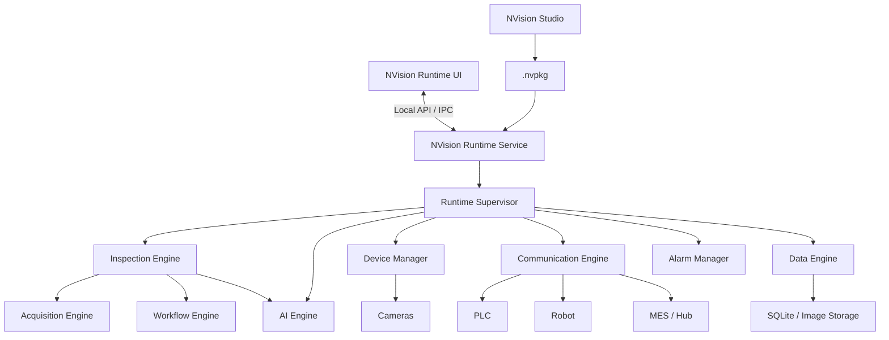
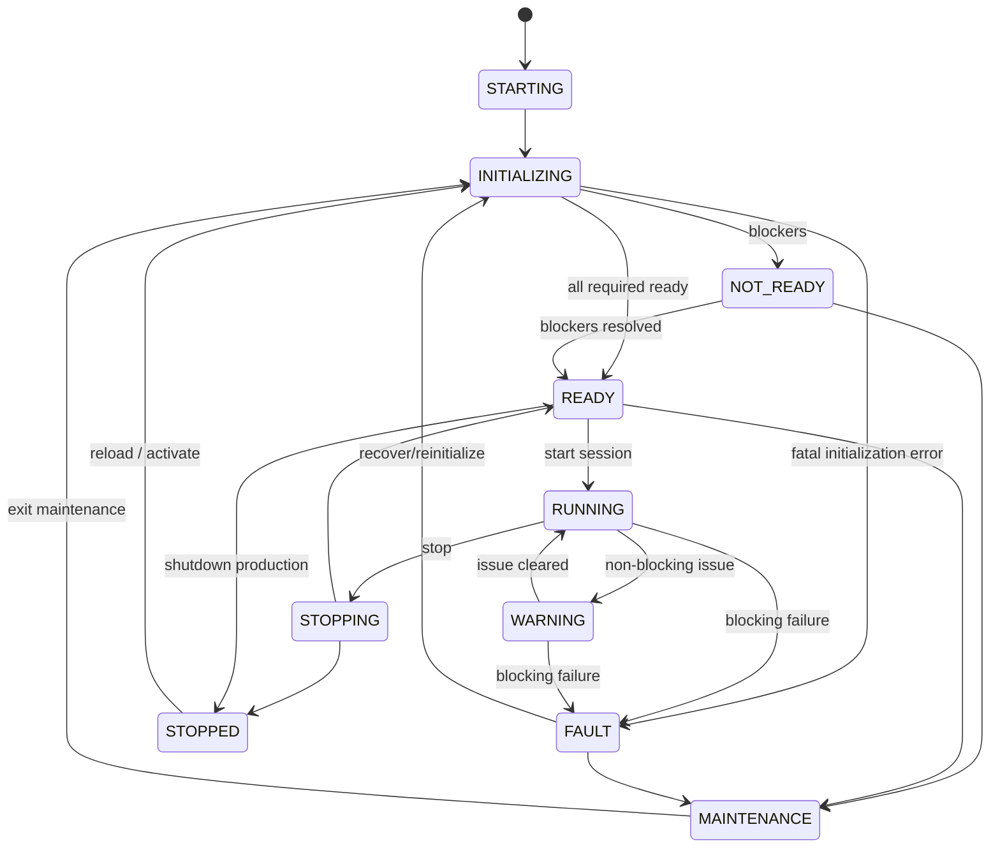
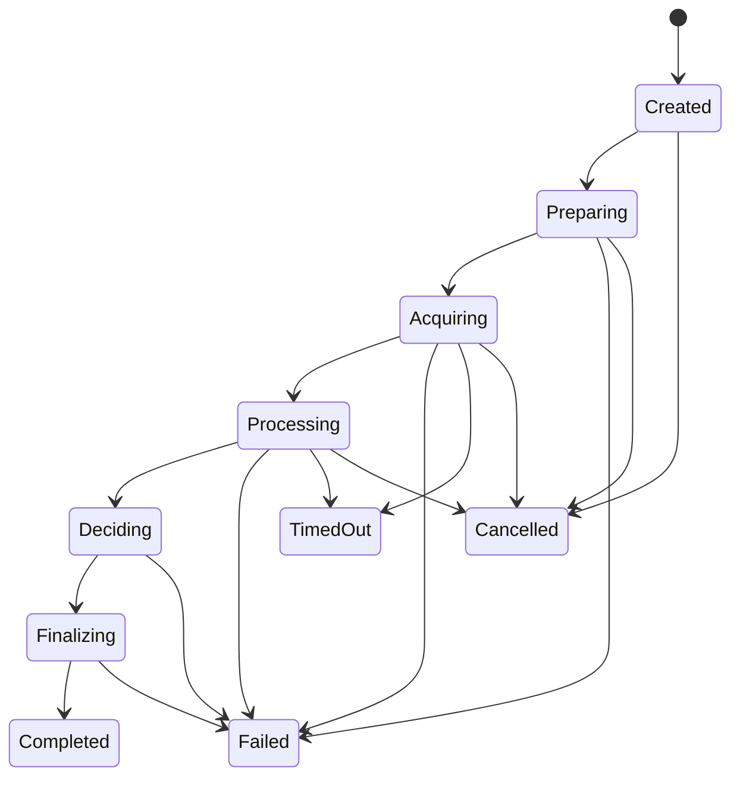
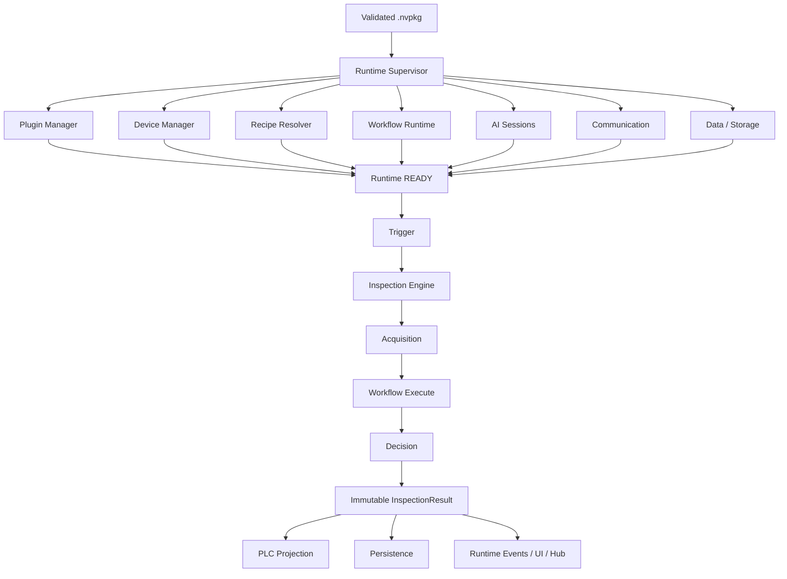

# 09 — NVision Runtime Architecture

**Product:** NTech NVision  
**Document Type:** Production Runtime / Execution Architecture  
**Primary Components:**  
- `NTech.NVision.Runtime`
- `NTech.NVision.Runtime.Service`
- `NTech.NVision.Engine.Inspection`
- `NTech.NVision.Engine.Acquisition`
- `NTech.NVision.Engine.Workflow`
- `NTech.NVision.Engine.AI`
- `NTech.NVision.Engine.Communication`
- `NTech.NVision.Engine.Data`

**Status:** Foundation Architecture  
**Version:** 1.0  
**Date:** 2026-08-18  

**Parent Documents:**  
- `NVISION_PLATFORM_FOUNDATION.md`
- `01_PLATFORM_ARCHITECTURE.md`
- `02_DOMAIN_MODEL.md`
- `03_WORKFLOW_ENGINE_ARCHITECTURE.md`
- `04_PLUGIN_ARCHITECTURE.md`
- `05_PROJECT_FILE_FORMAT.md`
- `06_INSPECTION_RESULT_SCHEMA.md`
- `07_CAMERA_ABSTRACTION.md`
- `08_AI_ENGINE_ARCHITECTURE.md`

---

# 1. Purpose

This document defines the production architecture of **NVision Runtime**.

NVision Runtime is the production execution environment responsible for turning a published NVision deployment into reliable, repeatable, traceable industrial inspections.

The Runtime combines previously defined subsystems into one production lifecycle:

```text
Deployment
    ↓
Validation
    ↓
Plugin Initialization
    ↓
Device Initialization
    ↓
Recipe Resolution
    ↓
Workflow Compilation
    ↓
AI Model Loading / Warm-up
    ↓
Runtime Ready
    ↓
Trigger
    ↓
Acquisition
    ↓
Workflow Execution
    ↓
Decision
    ↓
Machine Result
    ↓
Persistence
    ↓
Next Inspection
```

The Runtime must operate reliably even when:

- UI is closed or crashes
- camera disconnects
- PLC temporarily becomes unavailable
- AI backend reports an error
- disk space becomes low
- a result cannot be persisted immediately
- a deployment activation fails
- a recipe change fails validation
- the station runs unattended
- the network to MES/Hub is unavailable

The central architecture rule is:

> **Production inspection execution belongs to a headless Runtime Service. The UI observes and controls the Runtime but does not own inspection execution.**

---

# 2. Runtime Goals

NVision Runtime must provide:

## 2.1 Reliability

The inspection process must not depend on:

```text
WPF window
UI thread
operator screen
Studio process
network connectivity to Hub
```

---

## 2.2 Deterministic Startup

Runtime must progress through explicit startup phases.

It must never report:

```text
READY
```

until all required production dependencies are valid.

---

## 2.3 Fail-Safe Behavior

When a required subsystem fails:

```text
inspection must not silently continue as OK
```

The system must transition to explicit:

```text
Warning
Fault
NotReady
```

state according to policy.

---

## 2.4 Recoverability

Recoverable failures should be handled through controlled:

```text
Reconnect
Retry
Restart subsystem
Reload resource
```

without requiring full machine restart where practical.

---

## 2.5 Traceability

Every production result must identify:

```text
Deployment
Project
Job
Recipe
Models
Calibrations
Plugins
Runtime version
Station
Inspection ID
```

---

## 2.6 Headless Deployment

Runtime must support:

```text
Windows Service
Linux systemd service
Jetson / Edge
```

without GUI.

---

# 3. Position in NVision Ecosystem



---

# 4. Main Runtime Processes

Recommended production topology:

```text
NVision Runtime Service
    +
Optional NVision Runtime UI
```

The UI is a separate process.

---

# 5. Why Separate Runtime Service and UI

Benefits:

- UI restart does not stop inspection
- headless deployment
- safer process boundaries
- service startup at boot
- remote diagnostics
- clearer responsibility
- simpler future Edge deployment

---

# 6. MVP Process Topology

Recommended:

```text
Process 1:
NTech.NVision.Runtime.Service

Process 2:
NTech.NVision.Runtime.UI
```

Optional:

```text
Process 3+:
Plugin Host
```

in future.

---

# 7. Runtime Service Responsibilities

`NTech.NVision.Runtime.Service` owns:

```text
Deployment loading
Runtime state
Inspection lifecycle
Devices
Workflow execution
AI model sessions
PLC handshake
Result persistence
Alarms
Diagnostics
Watchdog integration
Runtime API
```

---

# 8. Runtime UI Responsibilities

Runtime UI owns:

```text
Operator display
Start/Stop command
Recipe selection
Counters
Latest result
Alarm visualization
Live image preview
History view
Maintenance screens
```

The UI must not directly control hardware SDKs.

---

# 9. Runtime Supervisor

The top-level orchestrator:

```text
RuntimeSupervisor
```

Responsibilities:

- startup sequence
- shutdown sequence
- active deployment
- runtime state transitions
- dependency readiness
- subsystem health
- recovery coordination
- maintenance mode
- fault handling

---

# 10. Runtime State Model

Canonical Runtime states:

```text
STARTING
INITIALIZING
NOT_READY
READY
RUNNING
STOPPING
STOPPED
WARNING
FAULT
MAINTENANCE
```

Serialized/API style may use camelCase.

---

# 11. Runtime State Semantics

## STARTING

Process has started but subsystem initialization has not completed.

## INITIALIZING

Deployment/plugins/devices/models are being prepared.

## NOT_READY

Initialization completed enough to identify blockers, but production cannot start.

## READY

All required production dependencies are ready.

Runtime is able to accept start/trigger according to operating policy.

## RUNNING

Production inspection session active.

## STOPPING

New triggers blocked; active execution is being completed/cancelled.

## STOPPED

Runtime service alive, production session inactive.

## WARNING

Runtime remains operable but one or more non-blocking issues exist.

## FAULT

Production execution is blocked due to critical failure.

## MAINTENANCE

Engineering/service operations allowed; normal production triggers blocked.

---

# 12. Runtime State Machine



---

# 13. Runtime State Ownership

Only the Runtime Supervisor may change global Runtime state.

Subsystems report:

```text
Health
Readiness
Faults
Events
```

They do not independently set global state.

---

# 14. Runtime Readiness

Runtime readiness is calculated from required dependencies.

Example:

```text
Deployment Valid
AND
Required Plugins Loaded
AND
Required Cameras Ready
AND
PLC Ready
AND
Required Models Ready
AND
Calibration Valid
AND
Storage Ready
```

---

# 15. RuntimeReadinessResult

Conceptual:

```text
RuntimeReadinessResult
├── IsReady
├── BlockingIssues
├── Warnings
├── CheckedAt
└── DependencyStates
```

---

# 16. Required vs Optional Dependencies

Each dependency should be classified.

Example:

```text
CAM_TOP
Required

PLC_MAIN
Required

MES
Optional

Hub
Optional

Debug Image Exporter
Optional
```

---

# 17. Blocking Dependency Failure

Required dependency failure:

```text
Runtime → NOT_READY or FAULT
```

depending whether production was active.

---

# 18. Optional Dependency Failure

Example:

```text
MES offline
```

can produce:

```text
WARNING
```

while local production continues if policy permits.

---

# 19. Startup Sequence

Recommended startup sequence:

```text
1. Process bootstrap
2. Load Runtime local configuration
3. Initialize logging
4. Initialize diagnostics
5. Load active deployment metadata
6. Validate deployment integrity
7. Resolve plugin requirements
8. Load plugins
9. Initialize repositories/storage
10. Create devices
11. Connect required devices
12. Resolve active Job/Recipe
13. Validate calibrations
14. Compile workflow
15. Resolve models
16. Load AI sessions
17. Warm up AI
18. Prepare acquisition
19. Initialize PLC handshake
20. Evaluate readiness
21. Enter READY / NOT_READY
```

---

# 20. Startup Must Be Observable

Each startup stage emits:

```text
Stage
Progress
Status
Error
Duration
```

for Runtime UI and diagnostics.

---

# 21. Startup Stage Example

```text
[OK] Deployment validated
[OK] Plugins loaded
[OK] CAM_TOP ready
[OK] PLC_MAIN connected
[OK] MarkerClassifier v1.3.2 warmed up
[OK] Workflow compiled
[OK] Storage available

Runtime READY
```

---

# 22. Startup Failure Example

```text
[OK] Deployment validated
[OK] Plugins loaded
[FAIL] CAM_TOP not found

Runtime NOT_READY
Blocking issue:
CAMERA_NOT_FOUND
```

---

# 23. Local Runtime Configuration

Runtime machine-specific configuration should include:

```text
Station identity
Runtime API endpoint
Storage location
Log location
Plugin roots
Deployment roots
Local NIC binding
Secrets provider
Watchdog settings
Retention policy
```

---

# 24. Local Config vs Project

Do not store machine-local settings in portable Project source unless intentionally deployment-specific.

Separation:

```text
Project
Deployment
Station
Runtime Local Config
Secrets
```

---

# 25. Active Deployment

Runtime maintains:

```text
ActiveDeployment
PreviousKnownGoodDeployment
PendingDeployment
```

---

# 26. Deployment Activation

Activation flow:

```text
Receive Deployment
    ↓
Validate package
    ↓
Validate plugin compatibility
    ↓
Validate device/model/calibration requirements
    ↓
Prepare candidate Runtime context
    ↓
Warm-up
    ↓
Atomic activation
```

---

# 27. Atomic Deployment Activation

Production must never operate in a half-old/half-new deployment state.

Build candidate:

```text
RuntimeExecutionContextCandidate
```

then swap only when fully ready.

---

# 28. Deployment Failure

If candidate fails:

```text
keep current known-good deployment active
```

when possible.

Report activation failure.

---

# 29. First Deployment Failure

If there is no previous known-good package:

```text
Runtime NOT_READY
```

---

# 30. Rollback

Runtime should support:

```text
Rollback to PreviousKnownGoodDeployment
```

in maintenance/service workflow.

---

# 31. Deployment Package Integrity

Before activation verify:

```text
Package format
Schema version
Hashes
Plugin lock
Model checksums
Calibration checksums
Required files
Minimum Runtime version
```

---

# 32. Plugin Initialization

Runtime loads exact required plugins from deployment/plugin inventory.

If required plugin missing:

```text
deployment cannot activate
```

---

# 33. Plugin Startup Failure

Required plugin:

```text
NOT_READY / FAULT
```

Optional plugin:

```text
WARNING
```

---

# 34. Device Initialization

Runtime creates configured devices through plugin registries.

Example:

```text
CAM_TOP
→ DriverId ntech.camera.basler
→ Camera factory
→ ICameraDevice
```

---

# 35. Device Readiness

Each device reports:

```text
Unknown
Offline
Connecting
Online
Ready
Busy
Warning
Fault
Disabled
```

Global readiness evaluates required devices.

---

# 36. Device Recovery

Generic recovery policy belongs to Device Manager.

Examples:

```text
Reconnect camera
Reconnect PLC
Restart device adapter
Reapply configuration
Revalidate readiness
```

---

# 37. Recipe Resolution

At startup/session activation:

```text
Active Recipe
    ↓
Resolve node overrides
Resolve device overrides
Resolve model slots
Resolve decision parameters
```

Produce:

```text
ResolvedRecipe
```

---

# 38. Active Recipe

Runtime stores:

```text
RecipeId
RecipeCode
RecipeVersion
ResolvedParameters
ResolvedModels
ResolvedDeviceOverrides
```

---

# 39. Recipe Activation State

Possible:

```text
Inactive
Preparing
Active
Failed
```

---

# 40. Recipe Change Flow

```text
Block new triggers
    ↓
Finish current inspection
    ↓
Resolve target recipe
    ↓
Validate target
    ↓
Apply device changes
    ↓
Load/warm required models
    ↓
Recompile if required
    ↓
Check calibration compatibility
    ↓
Atomic activate
    ↓
Resume
```

---

# 41. Recipe Switch Failure

If target recipe preparation fails:

```text
keep current recipe active
```

when possible.

If current state was already disrupted:

```text
NOT_READY
```

until recovered.

---

# 42. Recipe Change During Inspection

Forbidden by default.

Current inspection must use one immutable Recipe version.

---

# 43. Runtime Execution Context

Once deployment + recipe are prepared:

```text
RuntimeExecutionContext
├── Station
├── Deployment
├── ProjectVersion
├── Job
├── Recipe
├── WorkflowRuntime
├── Models
├── Calibrations
├── Devices
├── Communication Mapping
└── Traceability Snapshot
```

---

# 44. Context Immutability

The active context is immutable for one inspection.

Session changes occur only between inspections.

---

# 45. Runtime Session

A production run is represented by:

```text
RuntimeSession
```

Contains:

```text
SessionId
Station
Deployment
Job
Recipe
StartedAt
Operator
Counters
State
```

---

# 46. Session Lifecycle

```text
Create
    ↓
Prepare
    ↓
Ready
    ↓
Running
    ↓
Stopping
    ↓
Completed
```

---

# 47. Session Start

A session starts only if Runtime is `READY`.

---

# 48. Session Stop

Stop means:

```text
block new triggers
finish or cancel current inspection according to policy
flush persistence
finalize counters
transition READY/STOPPED
```

---

# 49. Trigger Sources

Runtime may receive trigger from:

```text
PLC
Digital Input
Software API
Manual UI
Camera
Robot
Sensor
Timer
```

---

# 50. Trigger Adapter

Each source maps into canonical:

```text
InspectionRequest
```

---

# 51. Inspection Request

Conceptual:

```text
InspectionRequest
├── RequestId
├── Trigger
├── JobId
├── RecipeId
├── ProductIdentity
├── ExternalInputs
└── CorrelationId
```

---

# 52. Trigger Acceptance

Inspection Engine checks:

```text
Runtime RUNNING
Session active
No blocking fault
Concurrency capacity available
Recipe active
Required devices ready
```

---

# 53. Trigger Rejection

Return explicit reason:

```text
RUNTIME_NOT_RUNNING
BUSY
NOT_READY
RECIPE_INVALID
DEVICE_FAULT
MAINTENANCE
```

---

# 54. Backpressure

Trigger overload must be bounded.

Policies:

```text
Reject
SignalBusy
QueueOne
BoundedQueue
```

---

# 55. Recommended PLC Policy

For standard machine vision station:

```text
one active inspection
+
Busy signal
+
reject/ignore new trigger while Busy
```

unless machine protocol explicitly requires queueing.

---

# 56. Max Concurrent Inspections

MVP default:

```text
1
```

This simplifies:

- camera ownership
- PLC sequence
- recipe consistency
- result ordering
- debugging

---

# 57. Future Concurrency

Architecture may support:

```text
N concurrent inspections
```

for conveyor/high-throughput systems later.

---

# 58. Inspection Engine

`NTech.NVision.Engine.Inspection`

owns:

```text
InspectionId
Inspection lifecycle
Acquisition coordination
Workflow invocation
Decision collection
Result building
Machine result projection
Persistence coordination
```

---

# 59. Inspection Engine Does Not Own

```text
Camera SDK
AI backend SDK
PLC vendor SDK
UI
```

---

# 60. Inspection Lifecycle



---

# 61. InspectionId Generation

Generate before acquisition.

This enables correlation across:

```text
Logs
PLC
Images
Workflow
MES
```

---

# 62. Inspection Execution Sequence

```text
1. Accept trigger
2. Generate InspectionId
3. Snapshot execution context
4. Mark Busy
5. Acquire input
6. Validate frames
7. Execute Workflow
8. Build Decision
9. Build InspectionResult
10. Validate Result
11. Finalize
12. Send machine result
13. Persist
14. Publish result event
15. Clear Busy
```

Exact PLC/persistence ordering may vary by machine requirements.

---

# 63. Acquisition Phase

Use:

```text
AcquisitionPlan
```

or direct configured acquisition mode.

Result:

```text
FrameSet
```

---

# 64. Acquisition Error

Example:

```text
CAM_TOP timeout
```

inspection becomes:

```text
ERROR
CAMERA_TIMEOUT
```

---

# 65. Workflow Phase

Invoke prepared:

```text
WorkflowRuntime
```

with:

```text
FrameSet
External Inputs
Inspection Context
```

---

# 66. Workflow Technical Status

Possible:

```text
Succeeded
Failed
TimedOut
Cancelled
Invalid
```

---

# 67. Decision Phase

If Workflow succeeded:

```text
collect InspectionDecision
```

Possible product result:

```text
OK
NG
NO_RESULT
```

according to project policy.

---

# 68. Technical Failure Mapping

Example:

```text
Workflow Failed
→ Inspection ERROR
```

unless a very explicit policy exists.

---

# 69. Result Finalization

Result Builder collects:

```text
Identity
Station
Project
Job
Recipe
Product
Decision
Reasons
Measurements
AI results
Timing
Images
Errors
Traceability
```

---

# 70. Result Validation

Before finalizing:

```text
status invariants
traceability required
timestamps valid
decision code valid
measurements valid
```

---

# 71. Immutable Final Result

Once finalized:

```text
do not mutate
```

Transport/persistence state remains separate.

---

# 72. PLC Handshake Architecture

Recommended common machine handshake:

```text
PLC
  Trigger
    ↓
Runtime
  Busy = ON
    ↓
Inspection
    ↓
ResultCode
NGCode
Sequence
    ↓
Done = ON
    ↓
PLC ACK
    ↓
Done = OFF
Busy = OFF
```

Exact signal names/configurable mapping may vary.

---

# 73. PLC Handshake State Machine

```text
Idle
  ↓ Trigger
Accepted
  ↓
Busy
  ↓
ResultReady
  ↓
WaitAck
  ↓ ACK
Complete
  ↓
Idle
```

---

# 74. PLC Handshake Signals

Typical symbolic signals:

```text
Trigger
Busy
Done
ResultCode
NGCode
Sequence
RecipeCode
Ack
Reset
```

---

# 75. Symbolic Mapping

Runtime logic uses symbolic keys.

Example:

```text
InspectionResult
```

maps through adapter config to:

```text
D110
```

---

# 76. PLC Result Projection

Canonical:

```text
InspectionResult
    ↓
PLCResultMapper
    ↓
ResultCode
NGCode
Sequence
```

---

# 77. PLC Result Code Example

Configurable:

```text
OK       → 1
NG       → 2
ERROR    → 3
BYPASS   → 4
NO_RESULT→ 5
TIMEOUT  → 6
```

---

# 78. PLC Decision Code Example

```text
WRONG_TYPE             → 101
OCR_MISMATCH           → 102
CAMERA_TIMEOUT         → 901
AI_INFERENCE_FAILED    → 902
```

---

# 79. PLC Communication Failure

If PLC communication fails during production:

```text
Alarm
PLC state Fault
Runtime FAULT
```

for required PLC systems.

---

# 80. PLC Failure During Result Delivery

The inspection result still exists.

Store locally and raise:

```text
PLC_RESULT_DELIVERY_FAILED
```

Machine behavior depends on handshake policy.

---

# 81. Result Persistence

Persistence architecture:

```text
InspectionResult
    ↓
Inspection Repository
    ↓
SQLite
```

Images:

```text
Image Storage
    ↓
File System / Object Storage
```

---

# 82. Persistence Principle

Result metadata is the source of truth.

Counters are derived.

---

# 83. Recommended Local Persistence

MVP:

```text
SQLite
+
File System
```

---

# 84. Persistence Pipeline

```text
Final Result
   ├── summary fields
   ├── payload JSON
   └── image references
        ↓
Repository
```

---

# 85. Image Persistence

Policy:

```text
OK → standard/sampled
NG → save source + annotated
ERROR → diagnostic images where available
```

---

# 86. Persistence Failure

Failure must not be hidden.

Raise:

```text
STORAGE_WRITE_FAILED
```

Potentially transition:

```text
WARNING
or
FAULT
```

depending traceability requirements.

---

# 87. Disk Space Monitoring

Monitor:

```text
FreeBytes
FreePercent
EstimatedRetentionUsage
```

---

# 88. Disk Space Thresholds

Example:

```text
Warning < 15%
Critical < 5%
```

Configurable.

---

# 89. Critical Disk Policy

If system cannot guarantee required traceability:

```text
stop accepting inspections
```

recommended for strict production environments.

---

# 90. Result Outbox

For asynchronous integrations:

```text
MES
Hub
MQTT
```

use outbox pattern.

---

# 91. Outbox Flow

```text
Persist InspectionResult
    ↓
Persist Outbox Event
    ↓
Commit
    ↓
Background Sender
```

---

# 92. Network Integration Failure

If MES unavailable:

```text
result remains local
outbox remains pending
retry later
```

if MES is optional.

---

# 93. Machine-Critical External Integration

If MES acknowledgment is required before machine proceeds:

treat integration as required dependency.

This is Project/Station policy.

---

# 94. Alarm Manager

Central operational subsystem:

```text
AlarmManager
```

Responsibilities:

- raise alarm
- update alarm
- clear alarm
- acknowledge alarm
- expose active alarms
- persist audit where required

---

# 95. Alarm Categories

Examples:

```text
Device
Communication
AI
Storage
Deployment
Security
Runtime
Performance
```

---

# 96. Alarm Severity

```text
Info
Warning
Error
Critical
```

---

# 97. Blocking Alarm

Alarm definition may include:

```text
BlocksProduction = true
```

---

# 98. Alarm Example

```text
CAMERA_DISCONNECTED
Severity: Error
BlocksProduction: true
Source: CAM_TOP
```

---

# 99. Alarm Acknowledgment

Acknowledgment:

```text
does not equal clear
```

Fault condition must actually disappear or be reset according to policy.

---

# 100. Alarm Lifecycle

```text
Raised
    ↓
Active
    ↓ acknowledge optional
Acknowledged
    ↓ condition cleared
Cleared
```

---

# 101. Runtime Fault Handling

A blocking fault during RUNNING:

```text
stop accepting triggers
cancel/finish active inspection according to fault type
set machine fault outputs
transition FAULT
```

---

# 102. Fault During Inspection

Examples:

```text
Camera disconnect
AI backend crash
PLC disconnect
```

The active inspection must end explicitly:

```text
ERROR
```

not remain hanging.

---

# 103. Recovery Classification

Faults can be:

```text
AutomaticallyRecoverable
ManualResetRequired
MaintenanceRequired
FatalProcessFailure
```

---

# 104. Automatically Recoverable

Example:

```text
temporary camera network drop
```

Recovery:

```text
reconnect
reapply configuration
validate
restore Ready
```

---

# 105. Manual Reset Required

Example:

```text
repeated inspection timeout
machine interlock
```

Operator/engineer confirms reset.

---

# 106. Maintenance Required

Example:

```text
calibration invalid
camera replacement
plugin incompatibility
```

---

# 107. Fatal Process Failure

Handled by external service manager/watchdog.

Example:

```text
Runtime process crash
native SDK access violation
```

---

# 108. Runtime Watchdog

Two levels:

## Internal Watchdog

Monitors:

```text
inspection loop
subsystem heartbeats
deadlocks/timeouts
```

## External Watchdog

Windows Service Control Manager / systemd / dedicated watchdog process.

---

# 109. Internal Heartbeats

Subsystems may report:

```text
LastHeartbeat
State
ActiveOperation
```

---

# 110. Dead Inspection Detection

If inspection exceeds hard maximum:

```text
cancel
mark TIMEOUT
raise alarm
```

---

# 111. Hard Timeout

Separate from normal workflow timeout.

Example:

```text
Job timeout 500 ms
Hard supervisor timeout 2 s
```

If engine does not respond:

```text
subsystem fault
```

---

# 112. Process Watchdog

External manager should restart Runtime service on unexpected process exit.

---

# 113. Restart Policy

Avoid uncontrolled restart loops.

Example:

```text
restart up to N times in time window
then remain faulted
```

handled by OS/service configuration.

---

# 114. Crash Recovery

On restart:

```text
initialize logs
inspect previous shutdown state
validate active deployment
check storage
reinitialize devices
restore safe station state
```

---

# 115. Incomplete Inspection After Crash

Do not continue it.

Create recovery/audit record if possible:

```text
Previous inspection interrupted by process termination
```

Machine state must resynchronize with PLC.

---

# 116. Crash Marker

Runtime may create:

```text
runtime.lock / session marker
```

or DB state to detect unclean shutdown.

---

# 117. Safe Startup After Crash

Do not immediately accept triggers.

Re-establish:

```text
PLC handshake state
devices
recipe
models
storage
```

first.

---

# 118. PLC Resynchronization

On Runtime restart:

```text
clear/set known Busy/Done/Fault state
read machine signals
establish safe handshake
```

Protocol must define who owns reset.

---

# 119. Runtime Shutdown

Graceful shutdown:

```text
block triggers
finish/cancel active inspection
flush result repository
flush outbox
stop acquisition
disconnect communication
dispose AI sessions
stop plugins
close DB
exit
```

---

# 120. Shutdown Timeout

Each subsystem gets bounded stop timeout.

---

# 121. Forced Shutdown

If graceful shutdown fails:

```text
log critical
allow OS termination
```

External process isolation may improve future resilience.

---

# 122. Maintenance Mode

`MAINTENANCE` is for:

```text
camera configuration
manual grabs
calibration
plugin diagnostics
device replacement
deployment operations
```

Production trigger acceptance disabled.

---

# 123. Maintenance Entry

Only when:

```text
no active inspection
```

unless emergency service override exists.

---

# 124. Maintenance Exit

Run readiness validation again.

Do not simply return to RUNNING.

---

# 125. Service Mode

Optional future submode of Maintenance:

```text
Service
```

for advanced diagnostics.

---

# 126. Runtime User Roles

Operator:

```text
Start/Stop
Select approved Recipe
Acknowledge alarms
View result
Reset counters if permitted
```

Engineer:

```text
Maintenance
Device diagnostics
Recipe activation
Deployment activation
```

Administrator:

```text
Users
Plugins
Security
Licensing
System configuration
```

---

# 127. Runtime API

Headless Runtime exposes local/remote service API.

Recommended initial transports:

```text
gRPC
```

plus optional:

```text
REST
WebSocket
```

for specific needs.

---

# 128. Local IPC

Possible:

```text
gRPC localhost
Named Pipes on Windows
Unix Domain Socket on Linux
```

---

# 129. Runtime API Responsibilities

Expose:

```text
GetRuntimeState
GetReadiness
StartSession
StopSession
GetActiveRecipe
ActivateRecipe
GetDevices
GetAlarms
AcknowledgeAlarm
GetLatestResult
QueryHistory
SubscribeEvents
GetDiagnostics
```

---

# 130. Runtime API Must Not Expose

Raw:

```text
camera SDK objects
TensorRT context
SQLite connection
workflow internal mutable state
```

---

# 131. Command vs Query

Separate logically:

```text
Commands
Start
Stop
ActivateRecipe
AcknowledgeAlarm

Queries
State
Devices
Results
Diagnostics
```

---

# 132. Runtime Commands

Commands return structured result:

```text
Accepted
Rejected
Failed
```

with stable reason codes.

---

# 133. Idempotent Commands

Where practical:

```text
Stop when already stopped
```

can safely return success/current state.

---

# 134. Runtime Events

High-level events:

```text
RuntimeStateChanged
ReadinessChanged
SessionStarted
SessionStopped
RecipeActivated
InspectionCompleted
AlarmRaised
AlarmCleared
DeviceStateChanged
```

---

# 135. Event Stream

Runtime UI subscribes through:

```text
gRPC streaming
WebSocket
```

or local equivalent.

---

# 136. Event Backpressure

UI event channel must be bounded.

Slow UI cannot block inspection.

---

# 137. Latest Result Stream

Use summary result.

Full image/detail fetched separately.

---

# 138. Live Preview Stream

Separate from result event stream.

Potential:

```text
JPEG frames
throttled
```

---

# 139. UI Disconnect

Runtime continues production.

---

# 140. UI Reconnect

UI queries:

```text
current Runtime state
active Recipe
latest result
active alarms
counters
```

then resumes subscriptions.

---

# 141. Runtime UI Crash

No effect on Runtime Service.

---

# 142. Remote UI

Future remote workstation can use authenticated Runtime API.

---

# 143. Security

Runtime service should support:

```text
Authentication
Role-based authorization
TLS for remote connections
Audit
Secrets isolation
```

---

# 144. Local UI Authentication

Depending station policy:

```text
Windows account
NVision user
local token
```

---

# 145. Remote API

Must not expose unauthenticated control endpoint on plant network.

---

# 146. Secrets

Stored via:

```text
Windows Credential Manager
DPAPI-backed storage
Linux secret/config mechanism
enterprise vault future
```

Runtime configuration stores references.

---

# 147. Runtime File Permissions

Protect:

```text
deployment packages
database
logs
plugins
secrets
```

according to OS/service account.

---

# 148. Runtime Service Account

Use dedicated account where practical.

Avoid running as unrestricted administrator/root.

---

# 149. Windows Deployment

Recommended:

```text
NTech NVision Runtime Service
```

installed as Windows Service.

---

# 150. Windows Service Lifecycle

```text
Automatic Start
Service Start
Service Stop
Service Restart
Recovery actions
```

---

# 151. Windows Paths

Example:

```text
C:\Program Files\NTech\NVision\
    binaries/plugins

C:\ProgramData\NTech\NVision\
    deployments
    data
    logs
    config
```

---

# 152. Linux Deployment

Recommended service manager:

```text
systemd
```

---

# 153. Linux Paths

Example:

```text
/opt/ntech/nvision/
    binaries/plugins

/etc/ntech/nvision/
    config

/var/lib/ntech/nvision/
    data/deployments

/var/log/ntech/nvision/
    logs
```

---

# 154. systemd Responsibilities

Use:

```text
Restart policy
Startup ordering
Service account
Environment
Resource limits
Watchdog future
```

---

# 155. Jetson Deployment

Typical:

```text
NVision Runtime Service
+
TensorRT AI plugin
+
industrial camera plugin
+
PLC plugin
```

headless.

---

# 156. Jetson Startup

Runtime should wait for required:

```text
network
camera NIC
GPU runtime
storage
```

according to service dependencies/readiness.

---

# 157. Edge Offline Operation

NVision Edge must continue production without:

```text
Internet
Hub
Cloud
```

---

# 158. Hub Reconnection

When Hub returns:

```text
sync pending results/events
```

using idempotent upload.

---

# 159. Runtime Data Directories

Recommended:

```text
data/
├── results/
├── images/
├── outbox/
├── cache/
├── diagnostics/
└── backups/
```

---

# 160. Deployment Directories

Example:

```text
deployments/
├── active/
├── previous/
├── pending/
└── archive/
```

---

# 161. Active Deployment Pointer

Use atomic pointer/metadata:

```text
active-deployment.json
```

rather than relying only on directory name.

---

# 162. Deployment Extraction

`.nvpkg` should be validated before extraction/activation.

Use safe extraction:

- reject path traversal
- validate hashes
- validate schema
- enforce size limits

---

# 163. Runtime Backup

Backup may include:

```text
active deployment
previous deployment
Runtime local config
SQLite DB
calibration packages
selected logs
```

Secrets require special handling.

---

# 164. Configuration Backup

Before major changes:

```text
deployment activation
plugin update
station config change
```

create recoverable snapshot where appropriate.

---

# 165. Runtime Logging

Use structured logs.

Context:

```text
Station
RuntimeSessionId
InspectionId
DeploymentId
Recipe
Device
Node
Model
```

---

# 166. Log Levels

```text
Trace
Debug
Information
Warning
Error
Critical
```

Production default:

```text
Information
```

with selected diagnostic categories.

---

# 167. Log Rotation

Required.

Avoid unbounded log growth.

---

# 168. Log Retention

Separate from inspection retention.

Example:

```text
30 days
```

configurable.

---

# 169. Crash Dumps

Enable where supported.

Sensitive data policy applies.

---

# 170. Diagnostics Snapshot

Runtime can generate:

```text
DiagnosticsSnapshot
```

containing:

```text
Runtime state
Deployment
Plugin inventory
Device states
AI models
Active alarms
Storage health
Performance summary
Recent logs
```

---

# 171. Support Bundle

Future export:

```text
support-bundle.zip
```

with diagnostics and selected data.

Exclude secrets.

---

# 172. Runtime Metrics

Core metrics:

```text
runtime.uptime
runtime.state
inspection.total
inspection.ok
inspection.ng
inspection.error
inspection.cycle_ms
camera.grab_ms
ai.inference_ms
workflow.total_ms
storage.write_ms
plc.roundtrip_ms
```

---

# 173. Metrics Collection

Metrics must not significantly affect production performance.

---

# 174. Performance Budget

Job can define:

```text
TargetCycleTime
MaximumCycleTime
```

---

# 175. Cycle Time Breakdown

```text
Acquisition
Vision
AI
Decision
PLC
Persistence
Total
```

---

# 176. Performance Warning

If moving average/p95 exceeds threshold:

```text
PERFORMANCE_DEGRADED
```

warning.

---

# 177. Performance Fault

If cycle time becomes unsafe for machine sequencing:

```text
FAULT
```

depending policy.

---

# 178. Threading Model

Runtime should avoid one giant global lock.

Use:

```text
async orchestration
bounded worker pools
resource-specific locks
immutable execution context
```

---

# 179. UI Thread Independence

Runtime Service has no UI thread.

---

# 180. Inspection Serial Execution MVP

One inspection execution pipeline at a time simplifies thread safety.

Background tasks still operate asynchronously:

```text
logging
MES sender
health monitoring
preview encoding
```

---

# 181. Background Services

Examples:

```text
Health Monitor
Alarm Monitor
Outbox Sender
Retention Worker
Metrics Collector
Preview Encoder
```

---

# 182. Background Service Rule

Background workers must be:

```text
bounded
cancellable
observable
non-blocking to inspection
```

---

# 183. Retention Worker

Runs periodically.

Deletes/archives according to policy.

Must not block inspection IO path.

---

# 184. Image Compression Worker

If encoding expensive:

```text
raw frame result
→ bounded image save queue
```

But required evidence must not be lost due to queue overflow.

---

# 185. Persistence Queue Policy

Critical records:

```text
never silently drop
```

If queue full:

```text
backpressure / fault
```

according to policy.

---

# 186. Preview Queue Policy

Preview:

```text
drop old frames freely
```

to protect production.

---

# 187. Priority Principle

```text
Inspection correctness
> machine handshake
> result traceability
> diagnostics
> UI preview
```

---

# 188. Health Monitoring

Subsystems expose:

```text
State
Health
LastSuccess
LastError
Metrics
```

---

# 189. Health Polling

Central Health Service aggregates:

```text
Devices
AI
Storage
Communication
Runtime internals
```

---

# 190. Health Levels

```text
Healthy
Degraded
Unhealthy
Unknown
```

---

# 191. Health vs Readiness

Distinguish:

```text
Health
= subsystem condition

Readiness
= may Runtime accept production?
```

Example:

```text
MES unhealthy
but Runtime ready
```

if MES optional.

---

# 192. Liveness

For service orchestration:

```text
Liveness = process/event loop alive
```

---

# 193. Readiness Endpoint

Future:

```text
/health/ready
```

or gRPC equivalent.

---

# 194. Liveness Endpoint

Future:

```text
/health/live
```

---

# 195. Runtime Self-Test

Maintenance command:

```text
Run Self Test
```

could verify:

```text
camera grab
AI inference test
PLC communication
storage write
```

---

# 196. Self-Test Result

```text
Pass
Warning
Fail
```

with per-subsystem detail.

---

# 197. Startup Self-Test

Optional lightweight version during initialization.

---

# 198. Production Counters

Runtime session maintains:

```text
Total
OK
NG
Error
Bypass
```

---

# 199. Counter Source

Counters update from finalized Inspection Results.

---

# 200. Counter Reset

Operator action:

```text
audited
```

Does not delete inspection history.

---

# 201. Shift Counters

Future can derive by time window.

No need to reset source history.

---

# 202. Runtime State Persistence

On clean shutdown, may persist:

```text
last active recipe
last deployment
selected operator state
```

Do not persist live device state as truth.

---

# 203. Last Active Recipe

Startup policy:

```text
restore last approved active recipe
```

or configured default.

---

# 204. Recipe Restore Validation

Always revalidate on startup.

Do not trust previous readiness.

---

# 205. Runtime Configuration Changes

Some changes require:

```text
restart
reinitialize subsystem
maintenance mode
```

Expose impact before applying.

---

# 206. Safe Configuration Apply

Pattern:

```text
Validate
Prepare
Apply
Verify
Commit
```

---

# 207. Runtime Update

Application binary/plugin update occurs in maintenance.

Production session stopped.

---

# 208. Software Version Trace

Every result can resolve:

```text
RuntimeVersion
EngineVersion
DeploymentHash
PluginSetHash
```

---

# 209. Runtime Upgrade Rollback

Installer/update mechanism should support previous version where practical.

Not core Runtime logic but important deployment requirement.

---

# 210. Compatibility Before Upgrade

Check active deployments/plugins against target Runtime version.

---

# 211. Runtime Licensing

Future Licensing context may gate:

```text
AI
Runtime
Edge
Hub
```

License failure must be explicit.

Offline licensing supported.

---

# 212. License Expiry During Production

Policy must avoid unsafe abrupt behavior.

Potential:

```text
warning period
controlled stop at session boundary
```

depending commercial design.

---

# 213. Runtime Security Audit

Audit events:

```text
SessionStarted
SessionStopped
RecipeActivated
DeploymentActivated
AlarmAcknowledged
MaintenanceEntered
DeviceRebound
CounterReset
```

---

# 214. Audit Actor

```text
User
System
Remote API Client
```

---

# 215. Audit Storage

Separate from operational logs.

---

# 216. Inspection Error Isolation

One bad inspection should not automatically crash Runtime.

Example:

```text
one AI input invalid
→ inspection ERROR
→ next inspection may proceed
```

if subsystem remains healthy.

---

# 217. Repeated Error Escalation

Policy may escalate repeated failures.

Example:

```text
5 CAMERA_TIMEOUT within 10 inspections
→ Camera Warning/Fault
→ Runtime FAULT
```

---

# 218. Error Rate Policy

Future:

```text
ErrorEscalationPolicy
```

---

# 219. Circuit Breaker

Useful for optional external services:

```text
MES repeatedly fails
→ circuit open
→ continue local production
→ retry later
```

---

# 220. Do Not Use Circuit Breaker for Machine-Critical PLC

PLC failure should be explicit machine fault.

---

# 221. Device Recovery During Idle

Reconnect attempts should preferably occur between inspections when possible.

---

# 222. Device Recovery During Active Inspection

If required device is lost:

```text
active inspection ERROR
```

then recovery begins.

---

# 223. AI Backend Recovery

Possible:

```text
session reload
backend reinitialize
```

before returning Ready.

---

# 224. AI Fallback

Only if configured.

Fallback may change Runtime state to:

```text
WARNING
```

---

# 225. Storage Recovery

If SQLite transient failure:

```text
retry bounded
```

If corruption:

```text
FAULT
```

and recovery procedure.

---

# 226. SQLite Reliability

Use:

```text
WAL mode where appropriate
transactions
integrity checks
backups
```

Exact DB settings belong to Data Architecture.

---

# 227. Time Synchronization

Station time matters for traceability.

Recommend system-level:

```text
NTP/PTP
```

depending plant.

Runtime monitors large clock changes if possible.

---

# 228. Clock Jump

Durations use monotonic timer.

Wall-clock jump must not corrupt cycle time.

---

# 229. Timezone

Store offset-aware timestamps.

Station config includes local timezone.

---

# 230. Sequence Ordering

Inspection sequence number gives local ordering even if wall clock changes slightly.

---

# 231. Runtime Startup Race

Do not accept triggers before handshake and readiness complete.

---

# 232. PLC Trigger During INITIALIZING

Respond according to configured machine protocol:

```text
NotReady/Fault signal
```

Do not start inspection.

---

# 233. Recipe Request from PLC

Future PLC may request product Recipe.

Flow:

```text
PLC ProductCode
    ↓
Recipe Resolver
    ↓
controlled Recipe activation
```

---

# 234. PLC Recipe Change While Busy

Reject/defer until inspection completes.

---

# 235. Barcode-Based Recipe Selection

Same controlled activation policy.

Do not switch model/config mid-inspection.

---

# 236. Master Sample Session

For applications such as Wire Marker, a session may begin with:

```text
Master sample acquisition
    ↓
Determine candidate type
    ↓
Operator confirmation
    ↓
Activate session Recipe/type
```

This is an application workflow built above Runtime session primitives.

---

# 237. Application-Specific Session State

Do not hardcode Wire Marker master-sample behavior into generic Runtime.

Represent through:

```text
Project Job logic
Application service/plugin
Session workflow
```

---

# 238. Runtime Extension Hooks

Possible controlled extension points:

```text
BeforeInspection
AfterInspection
SessionStarted
SessionStopped
```

Avoid unrestricted plugin lifecycle hooks that can break core safety.

---

# 239. Pre/Post Inspection Actions

Examples:

```text
Light setup
Robot positioning
Fixture command
```

should be explicit workflow/orchestration steps.

---

# 240. Machine Sequence Orchestrator

Future complex stations may need:

```text
MachineSequence
```

above Workflow Engine.

MVP Inspection Engine can handle simple sequence.

---

# 241. Workflow vs Machine Sequence

Workflow:

```text
image/data computation graph
```

Machine sequence:

```text
physical machine coordination
```

Do not force every actuator sequence into dataflow graph.

---

# 242. Runtime Determinism

Same:

```text
Deployment
Recipe
Input
Model
Calibration
```

should produce equivalent logical output.

Runtime orchestration should not introduce hidden mutable behavior.

---

# 243. Runtime Isolation from Studio

Studio can publish/control Runtime via API.

Studio must not inject in-memory project objects directly into production engine.

---

# 244. Deployment Contract

Only:

```text
validated .nvpkg
```

is production configuration source.

---

# 245. Test Mode vs Production Mode

Runtime Service may support:

```text
Production
Test
Simulation
Maintenance
```

but production restrictions are strictest.

---

# 246. Simulation Runtime

Uses:

```text
File Camera
PLC Simulator
Fake Robot
```

with same Inspection Engine/Workflow Engine.

---

# 247. CI Runtime Harness

Headless integration test can start Runtime components in-process using fake plugins.

---

# 248. End-to-End Golden Test

```text
Load test deployment
Activate TYPE_01
Feed type01 image
Trigger
Expect OK
Persist result
```

---

# 249. Fault Injection Tests

Inject:

```text
Camera timeout
PLC disconnect
AI failure
Disk full
Workflow timeout
```

verify Runtime state/result/alarm.

---

# 250. Runtime Test Matrix

| Area | Tests |
|---|---|
| Startup | ready/not-ready/fault |
| Deployment | valid/invalid/rollback |
| Recipe | activation/failure |
| Trigger | accept/reject/busy |
| Inspection | OK/NG/ERROR |
| Camera | disconnect/reconnect |
| PLC | handshake/loss |
| AI | load/inference failure |
| Storage | write failure/disk low |
| Shutdown | graceful/timeout |
| UI | disconnect/reconnect |
| Watchdog | hung inspection |
| Recovery | service restart |

---

# 251. Soak Test

Production Runtime should run:

```text
24h
72h
7 days
```

where possible before major release.

Monitor:

```text
memory
handles
thread count
cycle time
camera frames
AI latency
DB size
queue depth
alarms
```

---

# 252. Restart Soak

Repeated:

```text
start
run inspections
stop
restart
```

to detect resource leaks/state corruption.

---

# 253. Power Loss Test

Simulate abrupt machine power loss.

After reboot verify:

```text
DB usable
deployment valid
Runtime recovers
PLC handshake safe
no fake completed inspection
```

---

# 254. Network Loss Test

Disconnect:

```text
camera network
PLC network
MES network
Hub network
```

verify correct differing behavior.

---

# 255. Disk Full Test

Verify:

```text
warning
critical alarm
bounded queues
safe production stop if configured
```

---

# 256. UI Failure Test

Kill Runtime UI during production.

Inspection must continue.

---

# 257. Runtime Service Failure Test

Kill Runtime Service.

OS recovery + safe machine handshake must occur.

---

# 258. Plugin Failure Test

Required plugin fails initialization.

Runtime never reaches Ready.

---

# 259. Recipe Failure Test

Invalid target recipe must not replace active valid recipe.

---

# 260. Deployment Failure Test

Invalid candidate package must not replace current known-good deployment.

---

# 261. Performance Test

Measure end-to-end:

```text
Trigger → Busy
Trigger → Frame
Frame → Workflow done
Workflow → PLC result
Total cycle
```

---

# 262. Timing Trace

For each Inspection:

```text
TriggerReceivedAt
AcquisitionStart
FrameReceived
WorkflowStart
WorkflowEnd
DecisionReady
PLCSent
PersistenceCompleted
```

Selected fields may remain diagnostic.

---

# 263. Runtime SLA Targets

Project-specific.

Possible target:

```text
Cycle p95 < 100 ms
Result delivery < 10 ms after decision
```

Do not make one global SLA for all NVision applications.

---

# 264. Resource Limits

Runtime local config should allow:

```text
MaxInspectionQueue
MaxPreviewQueue
MaxImageSaveQueue
MaxOutboxQueue
MaxMemoryBudget
MaxGpuMemoryBudget
```

---

# 265. Queue Monitoring

Every bounded queue exposes:

```text
Depth
Capacity
Dropped
OldestAge
```

---

# 266. Queue Overflow

Critical queue:

```text
fault/backpressure
```

Preview queue:

```text
drop
```

---

# 267. Memory Pressure

Monitor process memory.

High memory:

```text
warning
```

Critical:

```text
fault/restart policy
```

after diagnostic capture.

---

# 268. GC Pressure

For .NET Runtime:

- reuse large buffers,
- avoid per-frame large allocations,
- monitor LOH,
- use pooling.

---

# 269. Native Memory

Camera and AI plugins may use large native memory.

Diagnostics must include plugin/backend memory where possible.

---

# 270. Runtime Process Architecture

Suggested projects:

```text
NTech.NVision.Runtime.Service
NTech.NVision.Runtime.Application
NTech.NVision.Engine.Inspection
NTech.NVision.Runtime.Contracts
NTech.NVision.Runtime.UI
```

---

# 271. Runtime.Application

Application layer orchestrates:

```text
commands
queries
deployment
recipe
session
maintenance
```

without UI dependency.

---

# 272. Engine.Inspection

Owns per-inspection execution.

---

# 273. Runtime.Contracts

Contains:

```text
RuntimeStateDto
ReadinessDto
DeviceStateDto
AlarmDto
InspectionSummaryDto
Commands
Events
```

---

# 274. Runtime.Service

Hosts:

```text
DI container
background services
gRPC
supervisor
application services
```

---

# 275. Suggested Source Structure

```text
src/runtime/
├── NTech.NVision.Runtime.Service/
│   ├── Program.cs
│   ├── Hosting/
│   ├── Api/
│   └── Configuration/
│
├── NTech.NVision.Runtime.Application/
│   ├── RuntimeSupervisor.cs
│   ├── Deployment/
│   ├── Recipes/
│   ├── Sessions/
│   ├── Maintenance/
│   └── Readiness/
│
├── NTech.NVision.Runtime.Contracts/
│   ├── RuntimeStateDto.cs
│   ├── RuntimeCommandResultDto.cs
│   ├── AlarmDto.cs
│   └── Events/
│
└── NTech.NVision.Runtime.UI/
```

---

# 276. Inspection Engine Structure

```text
NTech.NVision.Engine.Inspection/
├── InspectionEngine.cs
├── InspectionCoordinator.cs
├── InspectionContextFactory.cs
├── InspectionResultBuilder.cs
├── InspectionFinalizer.cs
├── InspectionTimeoutPolicy.cs
├── AcquisitionCoordinator.cs
└── ResultPublisher.cs
```

---

# 277. Communication Structure

```text
NTech.NVision.Engine.Communication/
├── Plc/
├── Robot/
├── Mes/
├── Mqtt/
└── OpcUa/
```

---

# 278. Data Structure

```text
NTech.NVision.Engine.Data/
├── InspectionRepository
├── ImageStorage
├── Retention
├── Outbox
└── Backup
```

---

# 279. Runtime Supervisor Interface

Conceptual:

```csharp
public interface IRuntimeSupervisor
{
    RuntimeState State { get; }

    Task InitializeAsync(CancellationToken ct);

    Task<RuntimeCommandResult> StartAsync(CancellationToken ct);

    Task<RuntimeCommandResult> StopAsync(CancellationToken ct);

    Task<RuntimeCommandResult> EnterMaintenanceAsync(
        CancellationToken ct);
}
```

---

# 280. Inspection Engine Interface

Conceptual:

```csharp
public interface IInspectionEngine
{
    ValueTask<InspectionResult> ExecuteAsync(
        InspectionRequest request,
        RuntimeExecutionContext context,
        CancellationToken ct);
}
```

---

# 281. Runtime State Store

Use in-memory authoritative state with controlled persistence of selected settings.

Do not use UI ViewModels as runtime state.

---

# 282. State Change Serialization

Global lifecycle commands should be serialized:

```text
Start
Stop
ActivateRecipe
ActivateDeployment
EnterMaintenance
```

to avoid conflicting transitions.

---

# 283. Runtime Transition Lock

Use one orchestration lock/state machine for configuration transitions.

Do not lock per-frame execution hot path unnecessarily.

---

# 284. Cancellation Hierarchy

Conceptually:

```text
ServiceToken
    ↓
RuntimeToken
    ↓
SessionToken
    ↓
InspectionToken
    ↓
WorkflowToken
    ↓
NodeToken
```

---

# 285. Stop Command

Cancels at appropriate layer.

Default graceful policy:

```text
finish current inspection
```

unless immediate stop required.

---

# 286. Emergency Stop

Safety E-Stop belongs to machine safety system.

NVision may receive state and stop operations.

NVision software must not be treated as the sole safety-rated E-Stop mechanism.

---

# 287. Safety Boundary

Hard safety:

```text
Safety PLC
Safety relay
Hardware E-Stop
Robot safety controller
```

outside NVision quality Runtime.

---

# 288. NVision Safety Response

When E-Stop signal observed:

```text
stop accepting triggers
cancel safe software operations
set Runtime fault/stopped state
```

but do not claim safety certification unless designed/certified accordingly.

---

# 289. Runtime Mode Manager

Potential:

```text
Production
Maintenance
Simulation
Service
```

Mode transitions controlled/audited.

---

# 290. Production Mode Restrictions

Reject:

```text
unsigned development plugin if policy forbids
unresolved node
invalid calibration
debug breakpoint
temporary model
local ad hoc parameter override
```

---

# 291. Engineering Overrides

If supported:

```text
temporary
bounded
audited
visibly indicated
```

Do not silently become production Recipe.

---

# 292. Runtime Readiness UI

Example:

```text
RUNTIME READY

CAM_TOP        READY
PLC_MAIN       READY
AI             READY
STORAGE        READY
RECIPE         TYPE_01
DEPLOYMENT     1.4.0
```

---

# 293. Not Ready UI

Example:

```text
RUNTIME NOT READY

CAM_TOP        FAULT
  Camera not found

PLC_MAIN       READY
AI             READY
STORAGE        READY
```

---

# 294. Fault UI

Operator should see:

```text
Primary fault
Source
Action guidance
Acknowledgment/reset state
```

Not raw stack trace.

---

# 295. Engineering Diagnostics

Engineer can inspect:

```text
full error
vendor code
plugin version
device diagnostics
logs
```

---

# 296. Runtime API Versioning

Runtime API has independent version.

Clients negotiate supported API.

---

# 297. Backward-Compatible UI

A newer Runtime UI may support older Runtime API within defined window.

---

# 298. Runtime Contract Stability

Stable:

```text
RuntimeState
InspectionSummary
Alarm
DeviceState
Recipe identity
```

avoid frequent breaking changes.

---

# 299. Runtime Event Persistence

Not every transient event must persist.

Persist business/operational significant:

```text
Session start/stop
Deployment activation
Recipe activation
Fault
Alarm
Inspection result
```

---

# 300. Event Ordering

Within station, attach:

```text
EventSequence
```

if exact ordering required.

---

# 301. Runtime Session Traceability

Every InspectionResult references:

```text
RuntimeSessionId
```

recommended.

---

# 302. Session Metadata

Store once:

```text
Deployment
PluginSet
OS
Runtime version
Station
StartedAt
```

reducing repeated result payload.

---

# 303. Runtime Debugging

Production-safe diagnostics:

```text
node timing
selected debug images
device snapshot
AI timing
```

without pausing machine.

---

# 304. Breakpoints

Only in Studio/Test/Service modes.

Never active in normal Production.

---

# 305. Execution Snapshot

For selected failure:

```text
InspectionId
Workflow trace
Device state
AI trace
Images
Logs correlation
```

can be captured.

---

# 306. Runtime History

UI queries local repository.

Supports:

```text
date
status
recipe
decision code
serial
```

---

# 307. History Performance

Use indexed summary columns.

Load full payload on detail view.

---

# 308. Image Loading

Lazy load images.

Do not load historical full-resolution images into memory for table view.

---

# 309. Runtime Cleanup

Periodic cleanup according to retention.

Never delete active/open files.

---

# 310. Deployment Retention

Keep:

```text
Active
Previous Known Good
Historical packages needed for traceability
```

according to policy.

---

# 311. Model/Calibration Retention

Do not remove artifacts referenced by retained deployment packages/results without archive.

---

# 312. Plugin Retention

Keep previous required plugin versions for rollback where possible.

---

# 313. Runtime Database Migration

Runtime binary update may require DB schema migration.

Use explicit migrations.

Backup before destructive migration.

---

# 314. Database Startup Failure

If migration/integrity fails:

```text
Runtime NOT_READY/FAULT
```

not silently recreate empty DB unless policy explicitly allows.

---

# 315. Database Recovery

Provide maintenance workflow:

```text
backup
integrity check
restore
export
```

---

# 316. Runtime Configuration Schema

Version local config too.

Do not rely on ad hoc settings.

---

# 317. Environment Variables

Use for deployment/service overrides where appropriate.

Secrets preferably secure provider.

---

# 318. Command Line

Runtime Service may support:

```text
--config
--validate-deployment
--safe-mode
--diagnostics
```

for service tooling.

---

# 319. Safe Mode

Potential startup mode:

```text
no production
no hardware auto-connect beyond diagnostics
```

for recovery after repeated startup failure.

---

# 320. Plugin Quarantine Startup

If known bad optional plugin quarantined:

Runtime may start with warning.

Required plugin quarantine blocks readiness.

---

# 321. Service Recovery Loop Prevention

Persist startup failure count or rely on OS manager.

Do not reboot endlessly without diagnostics.

---

# 322. Runtime Telemetry Privacy

Do not send customer data externally unless explicitly configured.

Offline-first.

---

# 323. Cloud Independence

No production-critical dependency on NTech cloud.

---

# 324. Hub Relationship

Hub is management/aggregation layer.

Runtime remains autonomous.

---

# 325. Hub Commands

Future central deployment/recipe changes still execute through same local validation and activation pipeline.

Hub cannot bypass Runtime safety/readiness checks.

---

# 326. Remote Deployment

Flow:

```text
Hub sends package
    ↓
Runtime stores as Pending
    ↓
Local validation
    ↓
Controlled activation
```

---

# 327. Remote Command Authorization

Strict role/authentication/audit.

---

# 328. MES Relationship

MES integration consumes result and may provide:

```text
WorkOrder
ProductCode
Serial
```

but inspection engine remains local.

---

# 329. Runtime Resilience Philosophy

The system should prefer:

```text
explicit degraded state
```

over:

```text
silent best effort
```

for production-critical dependencies.

---

# 330. Known-Good Principle

Maintain last known-good:

```text
Deployment
Recipe
Model sessions
Device configuration
```

where practical.

---

# 331. Candidate Preparation Principle

New configuration is prepared separately before activation.

This reduces downtime and rollback risk.

---

# 332. Production Atomicity

Atomic boundaries:

```text
Deployment activation
Recipe activation
Inspection finalization
```

---

# 333. Inspection Atomicity

An inspection either has a finalized result or explicit interruption/failure record.

Never leave ambiguous "probably OK".

---

# 334. Machine Handshake Atomicity

PLC should receive one coherent result for one sequence/InspectionId mapping.

---

# 335. Sequence Mismatch

If PLC sequence and Runtime expected sequence differ:

```text
COMMUNICATION_SEQUENCE_MISMATCH
```

fault or controlled recovery.

---

# 336. Duplicate Trigger

Detect by:

```text
TriggerId
Sequence
Busy state
```

according to protocol.

---

# 337. Trigger Debounce

For digital input:

```text
debounce
edge detection
```

configured explicitly.

---

# 338. Result ACK Timeout

PLC handshake may define:

```text
Ack timeout
```

Failure:

```text
PLC_ACK_TIMEOUT
```

---

# 339. PLC Reset

Reset signal can clear machine-level result/fault handshake.

Must not erase inspection history.

---

# 340. Runtime Counter and PLC Counter

If PLC has own counter, correlate via sequence.

Do not assume identical after resets unless protocol defines.

---

# 341. Product Identity Acquisition

Possible sources:

```text
PLC
Barcode
MES
Manual
```

resolved before inspection where required.

---

# 342. Missing Product Identity

If required:

```text
Inspection INVALID / request rejected
```

depending timing.

---

# 343. Barcode Failure

If barcode is part of inspection:

technical/quality mapping depends project semantics.

If reader device fails:

```text
ERROR
```

If barcode image read returns no code despite technically successful capture:

possibly `NG` or `NO_RESULT` according to Recipe.

---

# 344. External Input Snapshot

Freeze all decision-relevant external inputs at inspection start.

---

# 345. Robot Coordination

Robot vision station may use:

```text
RobotReady
VisionTrigger
VisionResult
PoseOffset
Ack
```

similar controlled handshake.

---

# 346. Robot Command Safety

Do not send robot motion directly from arbitrary AI node by default.

Use communication/orchestration policy.

---

# 347. Runtime Extension for Robot Guidance

Future Inspection Result can include Pose.

Machine sequence layer delivers pose to robot.

---

# 348. Multi-Camera Runtime

Acquisition Coordinator can create:

```text
FrameSet
```

with synchronization validation.

---

# 349. Camera Failure in Multi-Camera

If required one fails:

```text
inspection ERROR
```

retain successful frames for diagnostics.

---

# 350. Multi-Shot Runtime

Sequence:

```text
Light A
Capture
Light B
Capture
Workflow
```

managed via AcquisitionPlan/MachineSequence.

---

# 351. Runtime Configuration Hot Reload

Do not hot reload arbitrary local config during production.

Classify settings:

```text
LiveSafe
BetweenInspections
RequiresSessionRestart
RequiresServiceRestart
```

---

# 352. Logging Level Hot Change

Can be live-safe.

---

# 353. Storage Retention Change

Can often be live-safe.

---

# 354. Plugin Root Change

Requires restart/maintenance.

---

# 355. Service Endpoint Change

Usually restart.

---

# 356. Runtime Shutdown on OS Update

Service should handle stop gracefully.

---

# 357. Power Failure Resilience

Use industrial UPS where needed.

Software still must handle abrupt loss.

---

# 358. Clock / RTC on Edge

Ensure Jetson/industrial PC has reliable time source if traceability required.

---

# 359. Runtime Observability Dashboard

Future UI may show:

```text
Cycle p95
Camera FPS
AI latency
Queue depths
Disk usage
Uptime
Error rate
```

---

# 360. Operator Simplicity

Operator screen should not expose architecture complexity.

Focus:

```text
READY/RUNNING
Recipe
OK/NG
Counters
Alarm
```

---

# 361. Engineer Mode

Expose:

```text
devices
models
plugins
performance
logs
diagnostics
```

---

# 362. Runtime Definition of Done — Core

Runtime architecture is sufficiently implemented when:

```text
1. Service starts headless
2. Loads active .nvpkg
3. Validates deployment
4. Loads required plugins
5. Connects camera
6. Connects PLC/simulator
7. Resolves Recipe
8. Compiles Workflow
9. Loads and warms AI model
10. Evaluates READY
11. Starts production session
12. Accepts trigger
13. Generates InspectionId
14. Acquires frame
15. Executes Workflow
16. Builds OK/NG/ERROR
17. Sends PLC result
18. Persists result
19. Publishes Runtime event
20. Handles next trigger
```

---

# 363. Runtime Definition of Done — Recovery

Also demonstrate:

```text
21. Camera disconnect causes ERROR/FAULT
22. Camera reconnects
23. Config reapplied
24. Runtime returns READY
25. PLC disconnect blocks production
26. AI inference failure does not crash service
27. Invalid Recipe activation preserves current Recipe
28. Invalid deployment preserves known-good deployment
29. UI can restart independently
30. Service can restart and recover station safely
```

---

# 364. Runtime Definition of Done — Persistence

Demonstrate:

```text
31. SQLite history
32. NG image storage
33. retention worker
34. outbox persistence
35. disk-low warning
36. persistence failure alarm
```

---

# 365. Runtime Definition of Done — Service

Demonstrate:

```text
37. Windows Service or systemd hosting
38. structured logs
39. health/readiness API
40. graceful shutdown
```

---

# 366. Recommended Implementation Phases

## RT0 — Host Skeleton

Implement:

```text
Runtime.Service
DI
configuration
logging
state model
```

---

## RT1 — Supervisor

Implement:

```text
startup/shutdown
readiness
state transitions
```

---

## RT2 — Deployment

Implement:

```text
active package
validation
activation
previous known-good
```

---

## RT3 — Devices

Integrate Camera Manager and PLC simulator.

---

## RT4 — Recipe / Workflow

Resolve Recipe and prepare WorkflowRuntime.

---

## RT5 — AI

Load/warm active model.

---

## RT6 — Inspection Engine

Implement trigger → result pipeline.

---

## RT7 — PLC Handshake

Implement symbolic state machine.

---

## RT8 — Persistence

SQLite + image storage.

---

## RT9 — Alarm / Recovery

Reconnect, faults, alarms.

---

## RT10 — Runtime API

gRPC + event stream.

---

## RT11 — Runtime UI

Operator shell.

---

## RT12 — Hardening

Watchdog, soak tests, recovery, diagnostics.

---

# 367. Recommended First End-to-End Vertical Slice

Use:

```text
File Camera
PLC Simulator
ONNX Runtime
Wire Marker Workflow
SQLite
```

Flow:

```text
PLC Simulator Trigger
      ↓
Runtime
      ↓
File Camera image
      ↓
AI Classifier
      ↓
Compare TYPE_01
      ↓
OK/NG
      ↓
PLC Simulator Result
      ↓
SQLite
```

This proves the architecture before adding vendor hardware.

---

# 368. Second Vertical Slice

Replace:

```text
File Camera
```

with first real industrial camera.

Everything else unchanged.

---

# 369. Third Vertical Slice

Replace:

```text
PLC Simulator
```

with first real PLC protocol plugin.

---

# 370. Fourth Vertical Slice

Add:

```text
TensorRT
```

while Workflow remains unchanged.

---

# 371. Architecture Decisions

## ADR-RT-001 — Headless Runtime Service

Production execution lives in a service process, not UI.

---

## ADR-RT-002 — Explicit Runtime State Machine

READY/RUNNING/FAULT transitions are controlled centrally.

---

## ADR-RT-003 — Readiness Before Production

Required dependencies must be ready before triggers are accepted.

---

## ADR-RT-004 — Immutable Runtime Execution Context Per Inspection

No mid-inspection Recipe/deployment changes.

---

## ADR-RT-005 — One Concurrent Inspection First

MVP defaults to single active inspection.

---

## ADR-RT-006 — Atomic Deployment and Recipe Activation

Prepare candidate before swap.

---

## ADR-RT-007 — Known-Good Rollback

Invalid new configuration does not destroy current valid production state.

---

## ADR-RT-008 — PLC/MES Are Integrations Around Canonical Result

Runtime core Inspection Result remains independent.

---

## ADR-RT-009 — UI Is Non-Critical

UI disconnect/crash does not stop Runtime.

---

## ADR-RT-010 — Offline First

Runtime operates without Hub/cloud.

---

# 372. Anti-Patterns

## 372.1 WPF Window Owns Inspection Loop

Forbidden.

---

## 372.2 UI Directly Calls Camera SDK

Forbidden.

---

## 372.3 Trigger Accepted Before Ready

Unsafe.

---

## 372.4 Recipe Changes Mid-Inspection

Breaks traceability.

---

## 372.5 Silent Device Reconnect Without Revalidation

Camera config/calibration may no longer be valid.

---

## 372.6 Infinite Trigger Queue

Creates stale inspections.

---

## 372.7 MES Failure Stops Everything by Accident

Only if explicitly configured as required.

---

## 372.8 Result Persistence Failure Ignored

Breaks traceability.

---

## 372.9 Runtime Modifies `.nvision`

Runtime only consumes deployment package.

---

## 372.10 ERROR Reported as NG

Forbidden.

---

# 373. Final Runtime Architecture



---

# 374. Production Lifecycle Summary

```text
BOOT
 ↓
LOAD
 ↓
VALIDATE
 ↓
INITIALIZE
 ↓
CONNECT
 ↓
PREPARE
 ↓
WARM-UP
 ↓
READY
 ↓
START SESSION
 ↓
RUN
 ↓
TRIGGER
 ↓
INSPECT
 ↓
RESULT
 ↓
PERSIST / HANDSHAKE
 ↓
NEXT TRIGGER
 ↓
STOP
 ↓
FLUSH
 ↓
SHUTDOWN
```

---

# 375. Core Rule Summary

The NVision Runtime follows these rules:

```text
Runtime is headless-first.
UI is optional.
Deployment is immutable.
Startup is staged.
Readiness is explicit.
Required dependencies block production when unavailable.
Recipe changes occur between inspections.
Inspection context is immutable.
One inspection gets one explicit final result.
Technical failures never become silent OK/NG.
Machine handshake is controlled.
Results are persisted.
External integrations use outbox where appropriate.
Faults are visible.
Recovery is bounded.
Reconnect requires revalidation.
Known-good configuration is preserved.
Shutdown is graceful.
Runtime works offline.
```

The central architecture statement is:

> **NVision Runtime is the production authority of a vision station: it owns readiness, inspection execution, machine coordination, recovery, and traceability independently of any user interface.**

---

# 376. Next Document

The recommended next document is:

> `10_STUDIO_UI_ARCHITECTURE.md`

It should define:

```text
Studio shell
Workspace layout
Project Explorer
Toolbox
Image Canvas
Workflow Editor
Property Inspector
Device configuration
Recipe editor
Model manager
Calibration UI
Debug/test mode
Docking
MVVM boundaries
Commands
Undo/Redo
Selection model
Document model
Runtime connection
Design system
State persistence
```

This document will convert the already-defined Domain, Workflow, Plugin, Camera, AI, and Runtime contracts into the engineering workstation users interact with daily.

---

**End of Document**
