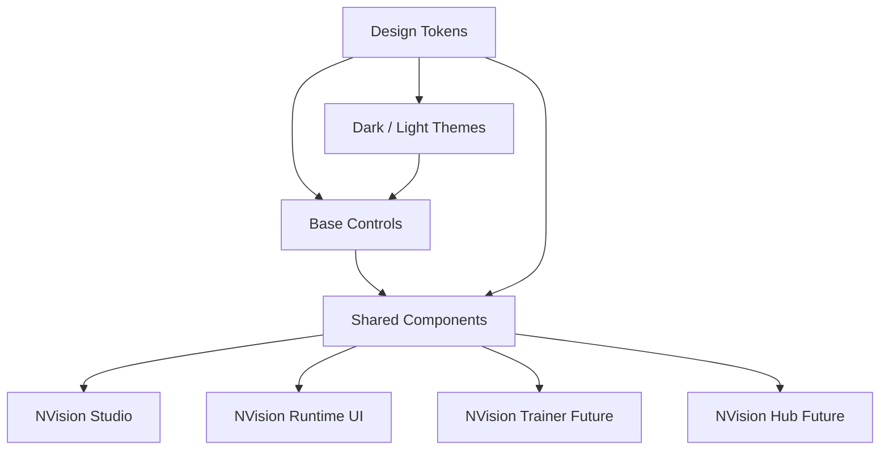

# 11 — NVision Design System

**Product:** NTech NVision  
**Document Type:** Visual Design System / UI Component Standard  
**Applies To:**  
- `NVision Studio`
- `NVision Runtime UI`
- Future `NVision Trainer`
- Future `NVision Hub` where applicable

**Primary Technology Baseline:** `.NET + WPF`  
**Status:** Foundation Design Specification  
**Version:** 1.0  
**Date:** 2026-08-18  

**Parent Documents:**  
- `NVISION_PLATFORM_FOUNDATION.md`
- `10_STUDIO_UI_ARCHITECTURE.md`
- `09_RUNTIME_ARCHITECTURE.md`

---

# 1. Purpose

This document defines the visual language, interaction rules, component styling, semantic colors, typography, density, spacing, and reusable UI conventions for the **NVision** product family.

The Design System exists to ensure that:

- Studio screens feel like one coherent engineering application
- Runtime UI communicates machine state clearly
- OK / NG / ERROR are visually distinct
- workflow nodes behave consistently
- image overlays are readable
- engineering data is compact but not cluttered
- plugin-generated controls remain visually compatible
- WPF implementation does not devolve into per-screen styling
- future products can reuse the same design language

The central rule is:

> **NVision UI should feel like a professional industrial engineering tool: technical, precise, calm, dense, and predictable.**

---

# 2. Product Design Principles

## 2.1 Industrial First

NVision is not a consumer app.

The UI must prioritize:

```text
Clarity
Status visibility
Fast scanning
Data density
Predictability
Operational confidence
```

over decorative visuals.

---

## 2.2 Image and Result Are Primary

Machine Vision UI should make these first-class:

```text
Image
Inspection Result
Workflow
Device State
Parameters
Timing
```

The interface should not bury these behind large decorative cards.

---

## 2.3 Dense but Controlled

Engineering users expect high information density.

However:

```text
dense
≠
cluttered
```

Use hierarchy, spacing, alignment, and grouping to create structure.

---

## 2.4 Semantic Color

Color communicates system meaning.

It must never be purely decorative when representing:

```text
OK
NG
ERROR
WARNING
RUNNING
READY
OFFLINE
```

---

## 2.5 Stable Interaction Patterns

If a control behaves one way in Camera Settings, it should behave similarly in Recipe Settings.

Examples:

```text
Apply
Reset
Override
Validation
Editable numeric field
Read-only field
Status badge
```

must be consistent.

---

# 3. Brand Foundation

Official product:

```text
NVISION
Industrial Vision Intelligence
by NTech
```

Suggested hierarchy:

```text
NVISION
Industrial Vision Intelligence
```

Use `by NTech` in:

```text
About
Splash
Login
Product branding areas
```

not repeatedly inside engineering workspaces.

---

# 4. Brand Personality

NVision should communicate:

```text
Precision
Reliability
Technology
Industrial competence
Modern engineering
Restraint
```

Avoid:

```text
Gaming aesthetics
Neon-heavy cyberpunk
Glassmorphism
Excessive gradients
Oversized rounded cards
Consumer-dashboard look
```

---

# 5. Core Visual Direction

Primary visual direction:

```text
Dark neutral surfaces
Subtle panel hierarchy
High contrast image areas
Compact controls
Sharp data alignment
Soft but minimal radius
Thin borders
Limited accent usage
```

---

# 6. Design Token Architecture

All styles should derive from tokens.

Categories:

```text
Color
Typography
Spacing
Sizing
Radius
Border
Elevation
Motion
Icon
Status
Overlay
```

WPF should map tokens into:

```text
ResourceDictionary
DynamicResource
StaticResource
```

as appropriate.

---

# 7. Token Naming Convention

Recommended naming:

```text
NV.Color.Surface.Base
NV.Color.Surface.Panel
NV.Color.Text.Primary
NV.Color.Status.Success
NV.Space.200
NV.Radius.Small
NV.Control.Height.Compact
```

Avoid arbitrary:

```text
DarkGray2
Green123
ButtonBlue
```

---

# 8. Color System — Dark Theme

Recommended semantic structure.

## Background

```text
Canvas / App Background
Panel
Raised Panel
Input
Hover
Selected
Border
Divider
```

Suggested starting palette:

```text
App Background      #0F1115
Surface Base        #14171C
Surface Panel       #181C22
Surface Raised      #1E232B
Surface Input       #111419
Surface Hover       #222832
Surface Selected    #283241

Border Subtle       #2A3038
Border Strong       #3A424D
Divider             #242A31
```

These values are initial design tokens, not hard-coded control colors.

---

# 9. Text Colors — Dark Theme

Suggested:

```text
Text Primary        #E8EDF2
Text Secondary      #AAB3BD
Text Muted          #78838F
Text Disabled       #58616B
Text Inverse        #0F1115
```

---

# 10. Accent Color

NVision should use one restrained primary accent.

Suggested starting direction:

```text
Accent Primary      #3D8BFF
Accent Hover        #579BFF
Accent Pressed      #2C74E8
Accent Subtle       #1C2F4C
```

Use accent for:

```text
selected tab
active document
primary command
focus ring
running/active state
selected graph node
```

Do not use accent for everything.

---

# 11. Semantic Status Colors

Recommended:

```text
Success / OK        #39B56A
Warning             #D9A441
Error               #E15B64
Critical            #FF3B45
Info                #4B92E8
Running / Active    #4B92E8
Offline             #6D7680
Disabled            #59616A
```

---

# 12. Product NG vs System ERROR

This distinction is critical.

Product NG:

```text
Status = NG
Category = Quality
```

System Error:

```text
Status = ERROR
Category = Technical
```

Recommended visual distinction:

```text
NG
- red/orange quality badge
- inspection-specific icon
- "NG" label

ERROR
- stronger critical red
- system/error icon
- "ERROR" label
```

Do not rely only on hue.

---

# 13. Example Result Colors

```text
OK       Green
NG       Red-orange
ERROR    Critical red
WARNING  Amber
BYPASS   Gray/blue
NO_RESULT Amber-gray
TIMEOUT  Critical/amber depending context
```

---

# 14. Light Theme

Light theme may be supported later.

The semantic token names remain the same.

Only token values change.

Do not create separate component logic for dark/light.

---

# 15. Theme Architecture

WPF:

```text
Themes/
├── Base.xaml
├── Dark.xaml
├── Light.xaml
├── Typography.xaml
├── Controls.xaml
└── Components.xaml
```

---

# 16. Theme Switching

Application-level theme:

```text
Dark
Light
System
```

Studio default recommendation:

```text
Dark
```

Runtime UI may support dark/light depending installation.

---

# 17. Typography System

Typography must optimize technical readability.

Recommended role categories:

```text
Display
Heading
Title
Body
Label
Caption
Numeric
Monospace
```

---

# 18. Font Strategy

Use a professional sans-serif available/licensed for product distribution.

Preferred criteria:

- clear small-size rendering,
- strong numeric legibility,
- good Vietnamese support,
- good bold/medium weights.

Use a separate monospace font for:

```text
IDs
Addresses
Logs
JSON
Code
Hex
PLC registers
```

---

# 19. Typography Scale

Suggested WPF DIP sizes:

```text
Display       28
Heading 1     22
Heading 2     18
Title         15
Body          13
Body Small    12
Caption       11
Micro         10
```

---

# 20. Font Weights

Recommended:

```text
Regular       400
Medium        500
Semibold      600
Bold          700
```

Avoid excessive bold.

Use Semibold for:

```text
panel titles
result state
active document
important labels
```

---

# 21. Numeric Typography

For measurement-heavy UI, consider tabular numerals.

Example:

```text
31.82 mm
100.00 ms
0.982
```

should align visually in tables.

---

# 22. Monospace Usage

Use for:

```text
CAM_TOP
D110
192.168.1.20
sha256:...
InspectionId
NodeTypeId
PluginId
```

Do not use monospace for long normal prose.

---

# 23. Spacing Scale

Use a 4-DIP base scale.

Recommended tokens:

```text
NV.Space.050 = 2
NV.Space.100 = 4
NV.Space.150 = 6
NV.Space.200 = 8
NV.Space.300 = 12
NV.Space.400 = 16
NV.Space.500 = 20
NV.Space.600 = 24
NV.Space.800 = 32
NV.Space.1000 = 40
```

---

# 24. Layout Rhythm

Standard control spacing:

```text
Control-to-control vertical: 6–8
Group-to-group: 12–16
Panel padding: 12–16
Large document margins: 16–24
```

---

# 25. Density

Default Studio:

```text
Compact
```

Runtime Operator UI:

```text
Comfortable
```

where touch/visibility matters.

---

# 26. Control Height Tokens

Suggested:

```text
Compact Input      28
Standard Input     32
Comfortable Input  36
Toolbar Button     28
Runtime Button     40+
```

---

# 27. Border Radius

Keep industrial, restrained.

Suggested:

```text
None       0
Small      3
Medium     5
Large      8
```

Do not use 16–24 px consumer-card radii everywhere.

---

# 28. Borders

Standard border:

```text
1 DIP
```

Use subtle border separation rather than heavy shadows.

---

# 29. Elevation

Minimal.

Possible levels:

```text
0 Flat
1 Raised popover
2 Floating window/dialog
```

Dark UI often uses surface contrast more than shadow.

---

# 30. Focus Ring

Keyboard focus must be clear.

Use:

```text
Accent border
2 DIP visual emphasis
```

without changing layout size.

---

# 31. Hover

Hover should be subtle:

```text
surface lighten
border strengthen
```

Avoid large motion/color shifts.

---

# 32. Pressed State

Use:

```text
darker accent / compressed highlight
```

Functional, not animated heavily.

---

# 33. Disabled State

Use:

```text
reduced text contrast
muted background
```

but keep reason discoverable via tooltip when command disabled by validation state.

---

# 34. Buttons

Button categories:

```text
Primary
Secondary
Ghost
Danger
Toolbar
Icon
Split
```

---

# 35. Primary Button

Use for one main action per context.

Examples:

```text
Publish
Run Test
Apply
Activate
```

Do not have five primary buttons in one panel.

---

# 36. Secondary Button

Used for normal actions:

```text
Validate
Browse
Refresh
Connect
```

---

# 37. Ghost Button

Used in toolbars and low-priority actions.

---

# 38. Danger Button

For destructive actions:

```text
Delete
Remove
Force Stop
```

Use sparingly.

---

# 39. Icon Buttons

Need:

```text
tooltip
accessible name
consistent icon sizing
```

Recommended icon size:

```text
16
```

within 28–32 DIP button.

---

# 40. Toolbar

Toolbar height:

```text
32–36 DIP
```

Use grouped commands with dividers.

---

# 41. Global Command Bar

Studio top command bar may contain:

```text
Project
Recipe
Run
Debug
Validate
Publish
Runtime
```

Avoid clutter with rarely used actions.

---

# 42. Inputs

Input types:

```text
Text
Numeric
Combo
CheckBox
Toggle
Slider
Search
Path
Reference selector
```

---

# 43. Text Input

States:

```text
Default
Hover
Focused
Invalid
Disabled
ReadOnly
```

---

# 44. Numeric Input

Recommended structure:

```text
[ 7500        ] us
```

Unit should be visually adjacent but not editable unless unit choice itself is a feature.

---

# 45. Numeric Validation

Invalid number:

```text
red border
error icon
inline validation text
```

Do not rely on modal alert.

---

# 46. Spin Buttons

Useful for engineering numeric controls.

Keep small and unobtrusive.

---

# 47. ComboBox

Use compact list.

Selected text must remain readable with long vendor/model names.

---

# 48. CheckBox vs Toggle

CheckBox:

```text
configuration option
```

Toggle:

```text
current enabled/disabled mode
```

Use consistently.

---

# 49. Read-Only Fields

Do not style exactly like disabled input.

Read-only is still meaningful data.

Suggested:

```text
normal text
slightly flatter background
no edit affordance
```

---

# 50. Property Grid

Core Studio component.

Layout:

```text
Label          Editor        Unit/Status
```

Recommended widths:

```text
Label 35–45%
Editor flexible
Unit/status compact
```

---

# 51. Property Group

Example:

```text
ACQUISITION
Exposure
Gain
Trigger Mode

IMAGE FORMAT
Pixel Format
Width
Height
```

Use uppercase micro-label or semibold title.

---

# 52. Collapsible Property Groups

Support collapse for large inspectors.

Persist local collapse state if useful.

---

# 53. Property Description

Show help text:

```text
tooltip
info icon
bottom description area
```

Avoid large descriptions under every row.

---

# 54. Base / Override / Effective Styling

For Recipe-aware properties:

```text
Base value
Override indicator
Effective value
```

Recommended visual:

```text
Exposure       7500 us    ↳ TYPE_01: 8000 us
```

or detailed inspector:

```text
Base       7500
Override   8000
Effective  8000
```

---

# 55. Override Badge

Example:

```text
OVERRIDE
```

small accent badge.

Click may allow:

```text
Reset Override
```

---

# 56. Validation Indicator

Property-level:

```text
✓ valid
! warning
✕ invalid
```

Icon and tooltip.

---

# 57. Panels

Standard panel:

```text
Header
Content
Optional footer
```

Header height:

```text
30–34 DIP
```

---

# 58. Panel Header

Contains:

```text
Title
Context info
Actions
```

Example:

```text
PROPERTIES       AI Classify
```

---

# 59. Docked Panels

Use thin borders.

Do not wrap each docked panel inside a large card.

---

# 60. Cards

Cards should be limited to:

```text
Dashboard summaries
Runtime state blocks
Model overview
```

Not every property group.

---

# 61. Tabs

Tab types:

```text
Document Tabs
Panel Tabs
Segmented Tabs
```

---

# 62. Document Tabs

Need:

```text
dirty indicator
close button
active state
icon
```

Example:

```text
● Marker Type Inspection *
```

---

# 63. Active Document Tab

Use accent underline or stronger surface.

Avoid huge pill-style tabs.

---

# 64. Tab Overflow

Support:

```text
scroll
dropdown
```

for many open documents.

---

# 65. Tables

Engineering tables must support:

```text
sorting
filtering
selection
copy
column resize
virtualization
```

---

# 66. Table Density

Default row height:

```text
26–30 DIP
```

Studio.

Runtime history can be slightly larger.

---

# 67. Table Header

Compact semibold.

Avoid oversized 40+ px headers.

---

# 68. Numeric Table Alignment

Right-align:

```text
measurements
timing
counts
confidence
```

---

# 69. Status Table Cell

Use:

```text
badge + text
```

not color-only cell fill.

---

# 70. Result Badge

Core component:

```text
ResultBadge
```

Variants:

```text
OK
NG
ERROR
BYPASS
NO RESULT
TIMEOUT
```

---

# 71. Result Badge Size

Studio:

```text
Small / Medium
```

Runtime main result:

```text
Large
```

---

# 72. Large Runtime Result

Example:

```text
┌──────────────────────────┐
│            OK            │
│        TYPE_01           │
│        52.7 ms           │
└──────────────────────────┘
```

Result status must dominate operator view.

---

# 73. Status Badge

For operational states:

```text
READY
RUNNING
OFFLINE
FAULT
WARNING
DISABLED
```

Different from inspection result badge.

---

# 74. Alarm Banner

Critical Runtime component.

Contains:

```text
Severity icon
Alarm code
Short message
Source
Action
Acknowledge/Details
```

---

# 75. Alarm Severity Styling

Warning:

```text
amber
```

Error:

```text
red
```

Critical:

```text
strong red + high contrast
```

Avoid flashing by default.

---

# 76. Alarm Flashing

Only use flashing/pulsing if industrial UX requirements justify it.

Repeated animation can be distracting.

---

# 77. Error Code Presentation

Show stable code:

```text
CAMERA_TIMEOUT
```

as secondary technical line.

Primary message human-readable.

---

# 78. Empty State

Examples:

```text
No Project Open
No Camera Connected
No Results
No Validation Issues
```

Use simple icon + explanation + primary action.

---

# 79. Progress Indicator

Use for operations > roughly immediate response.

Examples:

```text
Loading model
Publishing
Discovering cameras
Deploying
```

---

# 80. Determinate vs Indeterminate

Use determinate progress when stages/percentage known.

Else spinner + stage text.

---

# 81. Background Task Status

Status bar may show:

```text
Publishing package...
```

without blocking entire Studio.

---

# 82. Dialogs

Dialog categories:

```text
Confirmation
Wizard
Settings
Error Details
Migration
Credential
```

---

# 83. Dialog Width

Prefer moderate widths:

```text
420–720 DIP
```

depending content.

Do not use tiny modal for complex migration details.

---

# 84. Confirmation Dialog

State:

```text
What will happen
What is affected
Can it be undone
```

---

# 85. Dangerous Confirmation

Example:

```text
Delete Recipe TYPE_01?
Used by active deployment.
```

Use explicit destructive action label.

---

# 86. Wizard

Use for multi-step operations:

```text
Project Creation
Model Import
Calibration
Publish
```

---

# 87. Wizard Step Indicator

Keep simple:

```text
1 Overview
2 Configure
3 Validate
4 Finish
```

---

# 88. Search Field

Standard component with:

```text
search icon
clear button
keyboard focus
```

---

# 89. Global Search Result

Group by:

```text
Command
Job
Recipe
Device
Model
Node
```

---

# 90. Workflow Node Design

Core visual component:

```text
WorkflowNode
```

---

# 91. Node Anatomy

```text
┌──────────────────────────────┐
│ [icon] AI Classify       ●   │
│ Marker Classifier            │
├──────────────────────────────┤
│ ○ Image                      │
│                              │
│ Class           ○            │
│ Confidence      ○            │
└──────────────────────────────┘
```

---

# 92. Node Header

Contains:

```text
Icon
Node type/name
Status indicator
Optional breakpoint
```

---

# 93. Node Body

Show:

```text
ports
one or two key parameters/status lines
```

Do not show entire Property Inspector inside node.

---

# 94. Node Width

Recommended:

```text
160–220 DIP
```

default.

Resizable only if useful.

---

# 95. Node Radius

Small:

```text
4–6 DIP
```

---

# 96. Node Selection

Selected node:

```text
accent border
slightly elevated surface
```

---

# 97. Node Running

Use:

```text
blue accent status
subtle activity indicator
```

---

# 98. Node Success

Optional small success indicator.

Do not turn entire node bright green.

---

# 99. Node Failure

Use red border/header indicator.

Keep readable internal content.

---

# 100. Node Disabled

Desaturate.

Show:

```text
DISABLED
```

or crossed icon.

---

# 101. Node Skipped

Muted with:

```text
SKIPPED
```

indicator in debug mode.

---

# 102. Breakpoint

Small red breakpoint marker at header edge.

---

# 103. Node Timing

Debug overlay:

```text
18.7 ms
```

small caption.

---

# 104. Node Category Icons

Examples:

```text
Camera
Image
Vision
AI
Logic
Measurement
Data
Output
```

Use one consistent icon system.

---

# 105. Port Design

Ports need:

```text
type identity
direction
connection state
```

---

# 106. Port Shape

Suggested:

```text
circle
```

with connector line.

Alternative shapes for control/data not needed initially.

---

# 107. Port Type Color

Color may encode type.

Example concept:

```text
Image        Blue
Boolean      Green
Number       Amber
String       Purple
Detection    Cyan
Decision     Red/Green semantic
```

But also show tooltip/type label.

---

# 108. Port Hover

Enlarge slightly or show ring.

---

# 109. Valid Connection Target

Highlight strongly.

---

# 110. Invalid Target

Muted/red prohibited cursor.

---

# 111. Connection Line

Default:

```text
1.5–2 DIP
```

Smooth orthogonal/Bezier.

Avoid excessive crossings where graph can route around.

---

# 112. Connection Selected

Accent/thicker.

---

# 113. Data Flow Animation

Not recommended in normal editing.

In debug mode, optional subtle pulse can indicate execution.

---

# 114. Workflow Grid

Use subtle dots/lines.

Example:

```text
20 DIP major spacing
```

Low contrast.

---

# 115. Workflow Group

Visual group:

```text
subtle translucent surface
title
border
```

Must not visually overpower nodes.

---

# 116. Workflow Comment

Use note-style neutral/amber surface.

---

# 117. Image Canvas

Image should be central and uncluttered.

Background:

```text
near-black neutral
```

with checker only when transparency matters.

---

# 118. Image Canvas Toolbar

Compact top/side tools:

```text
Fit
1:1
Zoom
Pan
ROI
Measure
Overlay
Pixel
Compare
```

---

# 119. Image Canvas Crosshair

Thin high-contrast line.

Do not permanently obstruct image.

---

# 120. Pixel Inspector

Display:

```text
X
Y
Value
RGB/Gray
```

small status component.

---

# 121. ROI Styling

Selected ROI:

```text
accent outline
handles
semi-transparent fill
```

---

# 122. ROI Unselected

Thin neutral/accent outline.

---

# 123. Detection Overlay

Bounding box:

```text
class color
label
confidence
```

---

# 124. Detection Label

Example:

```text
scratch 0.94
```

small high-contrast background.

---

# 125. Detection Color Rule

Use stable class colors within one session/view.

For quality semantics, failing detection can use NG accent.

---

# 126. OCR Overlay

Use:

```text
polygon/box
recognized text label
confidence optional
```

---

# 127. Measurement Overlay

Use:

```text
line
end caps
label
unit
```

Example:

```text
31.82 mm
```

---

# 128. Calibration Overlay

Use distinct technical color from NG/error.

Examples:

```text
cyan/blue
```

for calibration geometry.

---

# 129. Overlay Legend

For multiple overlay types/classes, provide legend.

---

# 130. Overlay Visibility

Users can toggle:

```text
Detections
Measurements
OCR
ROI
Debug
```

---

# 131. Overlay Accessibility

Labels must include text.

Do not encode pass/fail only by color.

---

# 132. Image Compare

Modes:

```text
Side-by-side
Split
Opacity
Difference
```

---

# 133. Difference Heatmap

Use a clear legend/scaling.

Do not present arbitrary thermal colors without scale explanation.

---

# 134. Runtime Operator UI Design

Runtime is simpler than Studio.

Primary hierarchy:

```text
Runtime State
Current Recipe
Current Result
Image
Counters
Alarm
```

---

# 135. Runtime Main Layout

Suggested:

```text
┌──────────────────────────────────────────────────────────────┐
│ NVISION RUNTIME     RUNNING      TYPE_01        WM01        │
├──────────────────────────────────┬───────────────────────────┤
│                                  │ RESULT                    │
│                                  │                           │
│          LIVE / RESULT IMAGE     │          OK               │
│                                  │       TYPE_01             │
│                                  │       52.7 ms             │
├──────────────────────────────────┼───────────────────────────┤
│ Counters                         │ Device / Alarm Summary    │
└──────────────────────────────────┴───────────────────────────┘
```

---

# 136. Operator Priority

Operator should understand within one glance:

```text
Is system running?
Which recipe?
Was last product OK or NG?
Is there a machine fault?
```

---

# 137. Runtime Buttons

Larger than Studio.

Examples:

```text
START
STOP
RESET
ACKNOWLEDGE
CHANGE RECIPE
```

---

# 138. Production State Banner

Top-level state:

```text
READY
RUNNING
FAULT
MAINTENANCE
```

prominent but not oversized.

---

# 139. Counter Design

Examples:

```text
TOTAL    12540
OK       12388
NG         146
ERROR        6
YIELD     98.84%
```

Use aligned numerics.

---

# 140. Counter Color

Use semantic color for value emphasis, but keep label clear.

---

# 141. Yield

Do not use green solely because yield number is high unless threshold defined.

---

# 142. Recipe Selector

Runtime recipe selection should be obvious and controlled.

Show:

```text
Active Recipe
Version
```

---

# 143. Recipe Change Confirmation

If changing production setup:

```text
TYPE_01 → TYPE_04
```

show clear controlled confirmation.

---

# 144. Device Status Strip

Compact:

```text
CAM_TOP ✓
PLC_MAIN ✓
AI ✓
STORAGE ✓
```

with drill-down.

---

# 145. Runtime Fault State

When fault:

```text
production image/results remain visible
fault panel becomes prominent
```

Do not replace entire UI with blank error page.

---

# 146. Runtime Maintenance Mode

Use strong banner:

```text
MAINTENANCE MODE
Production triggers disabled
```

---

# 147. Simulation Mode

Show persistent badge/banner:

```text
SIMULATION
```

---

# 148. Live Hardware Indicator

Studio engineering screens connected to real machine show:

```text
LIVE HARDWARE
```

---

# 149. Data Visualization

Charts are secondary in Studio/Runtime.

Use only when they answer engineering questions:

```text
Cycle time trend
Yield
NG Pareto
Confidence distribution
```

---

# 150. Chart Style

Simple:

```text
thin grid
clear axes
compact labels
semantic highlight
```

Avoid 3D charts and decorative gradients.

---

# 151. NG Pareto

Bar chart sorted descending.

Labels show stable reason code / readable label.

---

# 152. Cycle Time Chart

Show:

```text
target/max line
actual trend
```

---

# 153. Confidence Distribution

Engineering/AI view only.

---

# 154. Tooltips

Tooltips useful for:

```text
icons
abbreviations
status
technical codes
```

Delay short but not instant spam.

---

# 155. Context Help

Properties may have:

```text
? icon
```

to open detailed documentation.

---

# 156. Icon System

Use one coherent icon family.

Criteria:

```text
simple
outline/solid consistency
recognizable at 16px
industrial-neutral
```

---

# 157. Icon Sizes

Recommended:

```text
12 micro
16 standard
20 prominent
24 runtime/action
```

---

# 158. Icon + Text

Critical actions/status use both.

Example:

```text
⚠ CAMERA FAULT
```

not icon only.

---

# 159. Icons for Workflow Categories

Suggested concepts:

```text
Camera      camera/aperture
Image       image
Vision      target/scan
AI          neural/node
Logic       branching
Measure     ruler
Data        database/brackets
Output      arrow/export
```

---

# 160. Branding Iconography

Avoid generic eye/camera icon everywhere.

NVision brand may use:

```text
N/V geometry
FOV shape
pixel/node motif
```

---

# 161. Motion

Motion must be functional.

Recommended durations:

```text
Fast        80–120 ms
Normal      150–200 ms
Panel       180–240 ms
```

---

# 162. Motion Uses

Suitable:

```text
hover
selection
panel expand
toast
loading state
```

---

# 163. Motion Avoidance

Avoid:

```text
background animation
continuous glowing
moving gradients
animated graph lines in normal mode
```

---

# 164. Reduced Motion

Respect system/user reduced-motion preference where practical.

---

# 165. Accessibility

Requirements:

```text
Keyboard navigation
Focus visibility
Text contrast
Non-color status cues
Readable scaling
Screen-reader labels where practical
```

---

# 166. Contrast

Target standard desktop readability.

Critical text/status should have strong contrast on surfaces.

---

# 167. Color Blindness

OK/NG must use:

```text
color
+
text
+
icon
```

---

# 168. Keyboard Navigation

Tab order logical.

Workflow editor requires specific keyboard focus handling.

---

# 169. High DPI

All sizes defined in DIP.

Avoid raster assets without scale variants.

---

# 170. Localization

Components must support longer translated labels.

Avoid fixed pixel widths for text-heavy controls.

---

# 171. Vietnamese Support

Typography must render Vietnamese diacritics clearly.

---

# 172. Numeric Localization

UI may display locale decimal separator.

Persistence remains invariant.

---

# 173. Error Message Structure

Recommended component:

```text
[icon] Short summary

Code: CAMERA_TIMEOUT
Source: CAM_TOP

Suggested action:
Check camera connection.

[Show Technical Details]
```

---

# 174. Validation Message

Inline validation:

```text
Confidence must be between 0 and 1.
```

Use next to property.

---

# 175. Warning vs Error

Warning:

```text
can continue
```

Error:

```text
cannot save/apply/publish depending scope
```

---

# 176. Notification Toast

Use for:

```text
Saved
Connected
Published
Copied
```

Do not use toast for critical fault that user may miss.

---

# 177. Notification Center

Optional history of recent non-critical notifications.

---

# 178. Loading Skeletons

Useful for:

```text
history list
remote diagnostics
```

not necessary in dense local property panels.

---

# 179. Empty / Error / Loading States

Every document/panel should define these three states.

---

# 180. Component State Matrix

Each reusable component should consider:

```text
Default
Hover
Focused
Pressed
Selected
Disabled
ReadOnly
Warning
Error
Loading
```

where applicable.

---

# 181. ResourceDictionary Organization

Recommended:

```text
UI/
├── Tokens/
│   ├── Colors.xaml
│   ├── Typography.xaml
│   ├── Spacing.xaml
│   ├── Sizing.xaml
│   └── Motion.xaml
│
├── Themes/
│   ├── Dark.xaml
│   └── Light.xaml
│
├── Controls/
│   ├── Button.xaml
│   ├── TextBox.xaml
│   ├── ComboBox.xaml
│   ├── CheckBox.xaml
│   ├── TabControl.xaml
│   ├── DataGrid.xaml
│   └── ScrollBar.xaml
│
└── Components/
    ├── StatusBadge.xaml
    ├── ResultBadge.xaml
    ├── PropertyRow.xaml
    ├── AlarmBanner.xaml
    ├── WorkflowNode.xaml
    ├── Port.xaml
    ├── ImageOverlay.xaml
    └── ValidationBadge.xaml
```

---

# 182. No Per-Screen Magic Colors

Forbidden:

```xaml
Background="#212121"
Foreground="Lime"
```

inside arbitrary screens.

Use semantic resources.

---

# 183. Semantic Resource Example

```xaml
Background="{DynamicResource NV.Color.Surface.Panel}"
Foreground="{DynamicResource NV.Color.Text.Primary}"
```

---

# 184. Component Styles

Use named style keys for reusable variants.

Example:

```text
NV.Button.Primary
NV.Button.Secondary
NV.Button.Danger
NV.Badge.Status.Ready
NV.Badge.Result.OK
```

---

# 185. Token vs Component Style

Token:

```text
color / spacing / radius
```

Component:

```text
Button
```

Component style consumes tokens.

Do not have ViewModels know token names.

---

# 186. Theme Switching Implementation

Use `DynamicResource` for theme-dependent resources.

Use `StaticResource` for immutable sizing/spacing where appropriate.

---

# 187. View-Specific Styling

Allowed only when component truly unique.

Still use global tokens.

---

# 188. Plugin UI Styling

Plugin-provided schema editors automatically use standard property components.

This is another reason to prefer schema-driven UI.

---

# 189. Custom Plugin UI

If allowed later, plugin receives documented design resources.

Must not override global theme dictionaries.

---

# 190. Design System Versioning

Design system has own version.

Example:

```text
NVision Design System 1.0
```

Breaking visual API changes should be controlled.

---

# 191. Component API Stability

Reusable custom controls should expose stable properties.

Example:

```text
StatusBadge.Status
ResultBadge.ResultStatus
PropertyRow.Label
```

---

# 192. Storybook / Component Gallery

WPF should have an internal:

```text
DesignSystemGallery
```

application/page showing all components and states.

---

# 193. Why Component Gallery

Allows:

- fast visual QA,
- theme testing,
- regression checks,
- plugin design testing,
- developer reference.

---

# 194. Gallery Sections

```text
Colors
Typography
Buttons
Inputs
Badges
Tables
Workflow
Image overlays
Alarms
Dialogs
Runtime components
```

---

# 195. Visual Regression

Future screenshot-based regression can monitor component drift.

---

# 196. Design Review Checklist

For new screen:

```text
Uses design tokens?
Uses existing components?
Correct information hierarchy?
Correct density?
OK/NG/ERROR distinct?
Keyboard focus visible?
No vendor-specific styling leak?
No magic colors?
High-DPI safe?
```

---

# 197. Studio Shell Visual Hierarchy

Priority:

```text
1 Active Document
2 Project/Recipe context
3 Properties
4 Navigation
5 Debug/Output
```

Avoid making sidebar brighter than working canvas.

---

# 198. Image-First Document

When image is central, image viewport should use majority of space.

Properties stay narrower.

---

# 199. Workflow-First Document

Workflow canvas gets central largest area.

Toolbox and Properties remain compact.

---

# 200. Camera Editor Hierarchy

Priority:

```text
1 Live Image
2 Exposure/Gain/Trigger
3 Connection state
4 Transport diagnostics
```

---

# 201. AI Model Editor Hierarchy

Priority:

```text
1 Model identity/task/status
2 Test image/result
3 preprocessing/postprocessing
4 backend diagnostics
```

---

# 202. Calibration UI Hierarchy

Priority:

```text
1 Instructions / current step
2 Image / target
3 calculated result
4 error/quality
5 accept/save
```

---

# 203. Publish UI Hierarchy

Priority:

```text
1 Validation state
2 Changes
3 Version
4 Target
5 Publish action
```

---

# 204. Runtime UI Hierarchy

Priority:

```text
1 Current result
2 Runtime state
3 Alarm
4 Recipe
5 Counters
6 Device detail
```

---

# 205. Responsive Desktop Behavior

NVision is desktop-first.

Minimum Studio target:

```text
1366×768
```

Recommended:

```text
1920×1080+
```

---

# 206. Small Window Behavior

Panels collapse/auto-hide.

Do not shrink image/workflow to unusable size.

---

# 207. Wide Screen

Take advantage of extra width:

```text
Explorer
Canvas
Properties
```

simultaneously.

---

# 208. Multi-Monitor

Allow:

```text
floating Image View
floating Debug panel
secondary Runtime diagnostics
```

---

# 209. Split Documents

Future:

```text
Workflow + Image
Model Test + Result
```

side-by-side.

---

# 210. Selection Highlight

Consistent across:

```text
tree
table
workflow node
property row
```

Use same selected surface/accent language.

---

# 211. Drag and Drop

Drag states:

```text
grabbed
valid target
invalid target
drop preview
```

---

# 212. Cursor Semantics

Use:

```text
crosshair for ROI
hand for pan
resize for handles
connector cursor for ports
```

---

# 213. Tool Modes

Image canvas selected tool should be obvious:

```text
Pan
Select ROI
Measure
```

---

# 214. Tool Mode Exit

Escape returns to default/select mode.

---

# 215. Context Persistence

Remember selected tool locally where sensible.

---

# 216. Runtime Critical Action Styling

Examples:

```text
STOP
FORCE STOP
RESET FAULT
```

must be distinct.

Do not style normal Stop as giant emergency E-Stop unless it actually is one.

---

# 217. Safety UI Boundary

NVision UI must not visually imply safety-rated functionality unless certified.

Hardware E-Stop remains separate.

---

# 218. Maintenance Actions

Use amber/maintenance semantics.

---

# 219. Warning Banners

Examples:

```text
UNSAVED CHANGES
LIVE HARDWARE
RUNTIME RUNNING
SIMULATION
MAINTENANCE
```

Use top-of-document/status strip.

---

# 220. Banner Priority

If multiple:

```text
Critical Fault
Maintenance/Production mode
Unsaved/support info
```

Do not stack many giant banners.

---

# 221. Tooltip Data Format

For technical data, use concise structured content.

Example:

```text
Plugin:
ntech.camera.basler
Version:
1.3.2
```

---

# 222. Copyable Technical Data

IDs, addresses, codes should support easy copy.

Context menu:

```text
Copy ID
Copy Code
Copy Path
```

---

# 223. Truncation

Long IDs can truncate visually:

```text
7f5675d6…cc25
```

tooltip/copy provides full value.

---

# 224. Breadcrumbs

Use when navigation depth matters.

Example:

```text
Project / Jobs / Marker Type / Workflow
```

---

# 225. Section Headers

Compact.

Avoid huge page titles that waste vertical space.

---

# 226. Dashboard Tiles

If used, keep data-focused:

```text
Runtime Ready
4 Recipes
2 Cameras
1 Validation Warning
```

---

# 227. Status Summary Component

Example:

```text
SYSTEM HEALTH

Camera      Ready
PLC         Ready
AI          Ready
Storage     Warning
```

---

# 228. Diagnostics Key/Value Layout

Use two-column compact layout.

---

# 229. Log Viewer Style

Monospace message body optional.

Columns:

```text
Time
Level
Source
Inspection
Message
```

---

# 230. Log Level Color

Use subtle semantic indicator, not full row bright color.

---

# 231. Stack Trace

Monospace, selectable, collapsible.

---

# 232. Code / JSON Viewer

Use:

```text
monospace
syntax highlighting optional
copy
search
```

---

# 233. Diff Viewer

Future:

```text
Added
Removed
Changed
```

with standard green/red but also symbols.

---

# 234. Recipe Diff

Highlight changed values, not entire panel.

---

# 235. Validation Summary

Counts:

```text
Errors 2
Warnings 3
Info 5
```

Click filters list.

---

# 236. Validation List

Columns:

```text
Severity
Code
Source
Message
```

---

# 237. Validation Navigation

Double-click issue navigates to exact property/node.

---

# 238. Status Bar Design

Low height:

```text
22–26 DIP
```

Shows concise context.

---

# 239. Status Bar Items

Possible:

```text
Validation
Recipe
Runtime connection
Background task
Zoom
```

---

# 240. Window Title

Recommended:

```text
Wire Marker Inspection — NVision Studio
```

Dirty:

```text
* Wire Marker Inspection — NVision Studio
```

---

# 241. Splash Screen

Minimal branding.

Do not turn into marketing page.

---

# 242. About Screen

Show:

```text
NVision
Version
Runtime compatibility
License
Build
Copyright
```

---

# 243. Design System Governance

All new shared UI components should be reviewed before adding.

Ask:

```text
Can existing component handle this?
Is new semantic token needed?
Is styling local or platform-wide?
```

---

# 244. Avoid Token Explosion

Do not create unique token for every screen.

Prefer semantic reuse.

---

# 245. Breaking Visual Changes

Update Design System version and migration notes for custom plugins/components.

---

# 246. Design System Repository Structure

Recommended:

```text
docs/design/
├── 11_DESIGN_SYSTEM.md
├── COMPONENT_RULES.md
├── UI_GUIDELINES.md
└── screenshots/

src/ui/
└── NTech.NVision.UI/
    ├── Tokens/
    ├── Themes/
    ├── Controls/
    ├── Components/
    ├── Icons/
    └── Converters/
```

---

# 247. Shared UI Library

Recommended project:

```text
NTech.NVision.UI
```

contains:

```text
Design tokens
Styles
Generic controls
Shared components
```

---

# 248. Studio-Specific Components

```text
NTech.NVision.Studio.Presentation
```

contains complex Studio-only controls:

```text
WorkflowEditor
ImageCanvas
PropertyInspector
```

---

# 249. Runtime-Specific Components

```text
NTech.NVision.Runtime.UI
```

can reuse base components but have operator-focused composites.

---

# 250. No Engine Dependency in UI Library

`NTech.NVision.UI` should not depend on:

```text
Workflow Engine
Camera SDK
AI Engine
```

Only presentation contracts/types as needed.

---

# 251. Semantic Status Enum Mapping

Presentation mapper converts Domain/API statuses to semantic tokens.

Example:

```text
InspectionStatus.OK
→ ResultBadgeVariant.OK
```

ViewModel should not pass hex color.

---

# 252. Bad

```csharp
ResultColor = "#39B56A";
```

---

# 253. Good

```csharp
ResultStatus = InspectionStatus.Ok;
```

View/style resolves visual semantics.

---

# 254. Design Token Example — WPF

Conceptual:

```xaml
<SolidColorBrush
    x:Key="NV.Brush.Surface.Panel"
    Color="{StaticResource NV.Color.Surface.Panel}" />
```

---

# 255. Button Style Example

Conceptual:

```xaml
<Style
    x:Key="NV.Button.Primary"
    TargetType="Button">
    <Setter Property="Height"
            Value="{StaticResource NV.Control.Height.Standard}" />
</Style>
```

Implementation detail may differ.

---

# 256. Status Badge API

Conceptual:

```text
<StatusBadge Status="Ready" />
<ResultBadge Status="NG" />
```

not:

```text
<Border Background="Red">
```

in screens.

---

# 257. Component Documentation

Each reusable component should document:

```text
Purpose
Variants
States
Properties
Examples
Do/Don't
```

---

# 258. Button Do

```text
Use one primary action per context.
```

---

# 259. Button Don't

```text
Do not make every action blue.
```

---

# 260. Badge Do

```text
Use stable semantic statuses.
```

---

# 261. Badge Don't

```text
Do not invent local status colors.
```

---

# 262. Workflow Node Do

```text
Show node type, key ports, state.
```

---

# 263. Workflow Node Don't

```text
Do not put 20 editable parameters inside node body.
```

---

# 264. Image Overlay Do

```text
Use labels and stable geometry.
```

---

# 265. Image Overlay Don't

```text
Do not cover defect region with opaque fill.
```

---

# 266. Property Grid Do

```text
Align labels and units.
```

---

# 267. Property Grid Don't

```text
Do not mix arbitrary editor heights.
```

---

# 268. Runtime Result Do

```text
Make OK/NG immediately visible.
```

---

# 269. Runtime Result Don't

```text
Do not bury last result in a table row.
```

---

# 270. Alarm Do

```text
Show actionable source and code.
```

---

# 271. Alarm Don't

```text
Do not show only "Something went wrong".
```

---

# 272. Component Naming

C# controls:

```text
NVStatusBadge
NVResultBadge
NVPropertyRow
NVImageViewport
NVWorkflowNode
NVAlarmBanner
```

or product namespace prefix via namespace rather than class prefix.

Prefer consistent naming.

---

# 273. XAML Resource Naming

Use:

```text
NV.*
```

prefix for clarity.

---

# 274. Design Token Export

Future design tooling/Figma can maintain equivalent token JSON.

Example:

```text
design-tokens.json
```

shared conceptually with WPF resource generation.

---

# 275. Figma Alignment

Figma component names should align with code:

```text
Button/Primary
Badge/Result/OK
Workflow/Node
Property/Row
Alarm/Banner
```

---

# 276. Design-to-Code Rule

Do not let Figma invent arbitrary spacing/color not present in tokens without updating Design System.

---

# 277. Screenshot Reference Library

Maintain:

```text
docs/design/screenshots/
```

for approved patterns:

```text
Studio Shell
Workflow Editor
Camera Editor
Model Manager
Runtime Main
Fault State
```

---

# 278. UX Acceptance Review

Before feature completion, check:

```text
Default state
Empty state
Loading state
Error state
Disabled state
Keyboard
High DPI
Long text
Dark theme
```

---

# 279. Runtime UX Acceptance

Additionally:

```text
Can operator see state from distance?
Can operator distinguish NG from fault?
Can operator identify active Recipe?
Can fault action be understood quickly?
```

---

# 280. Studio UX Acceptance

Additionally:

```text
Can engineer find invalid node quickly?
Can engineer distinguish base/override/effective values?
Can engineer tell live vs simulation?
Can engineer inspect node output without modal navigation?
```

---

# 281. Design System MVP Scope

Implement first:

```text
Dark theme
Color tokens
Typography
Spacing
Buttons
Inputs
Tabs
DataGrid
PropertyRow
StatusBadge
ResultBadge
ValidationBadge
AlarmBanner
WorkflowNode
Port
ImageViewport base
Overlay primitives
```

---

# 282. Phase 2 Components

Add:

```text
Model cards
Calibration wizard
Runtime dashboards
Chart styles
Diff viewer
Notification center
```

---

# 283. Delay for Later

Do not overbuild initially:

```text
complex animation framework
large illustration library
multiple accent themes
consumer-style dashboard cards
custom chart engine
```

---

# 284. First Design System Vertical Slice

Apply to:

```text
Studio Shell
Project Explorer
Workflow Editor
Property Inspector
Image Canvas
```

---

# 285. Second Design System Vertical Slice

Apply to:

```text
Camera Editor
AI Model Manager
Recipe Editor
```

---

# 286. Third Design System Vertical Slice

Apply to:

```text
Runtime Main
Alarm State
History
```

---

# 287. Recommended Component Build Order

```text
DS0 Tokens
 ↓
DS1 Typography / Surfaces
 ↓
DS2 Buttons / Inputs
 ↓
DS3 Tabs / Panels / Tables
 ↓
DS4 Badges / Validation / Alarm
 ↓
DS5 Property Grid
 ↓
DS6 Workflow Node / Ports
 ↓
DS7 Image Canvas / Overlays
 ↓
DS8 Runtime composites
 ↓
DS9 Component Gallery
```

---

# 288. Design Decisions

## ADR-DS-001 — Dark-First Studio

Studio uses dark theme as primary baseline.

---

## ADR-DS-002 — Semantic Tokens

Screens never own production/status colors directly.

---

## ADR-DS-003 — Compact Engineering Density

Default Studio density is compact.

---

## ADR-DS-004 — Subtle Radius and Elevation

Industrial clarity over consumer-card styling.

---

## ADR-DS-005 — Result and Operational Status Are Separate Components

`ResultBadge` and `StatusBadge` must not be conflated.

---

## ADR-DS-006 — NG and System ERROR Are Visually Distinct

Color + label + icon.

---

## ADR-DS-007 — Workflow Node Details Live in Inspector

Node canvas remains readable.

---

## ADR-DS-008 — Image Overlays Are Semantic Geometry

Not baked-only graphics.

---

## ADR-DS-009 — WPF Styles Consume Design Tokens

No magic colors/sizes in feature screens.

---

## ADR-DS-010 — Same Design Language Across Studio and Runtime

Density and hierarchy differ, semantics remain consistent.

---

# 289. Anti-Patterns

## 289.1 Neon Cyberpunk UI

Not appropriate for industrial production.

---

## 289.2 Every Panel Is a Rounded Card

Wastes space and weakens hierarchy.

---

## 289.3 Color-Only Status

Accessibility and clarity issue.

---

## 289.4 Green Means Everything Good

Differentiate:

```text
Ready
Connected
OK
```

through label/icon/context.

---

## 289.5 Full Row Red for Every Error

Creates visual overload.

Use controlled emphasis.

---

## 289.6 Large Typography Everywhere

Engineering tools require density.

---

## 289.7 40px Inputs in Studio

Wastes workspace.

---

## 289.8 Workflow Node as Property Form

Property editing belongs in inspector.

---

## 289.9 UI Hardcodes Domain-to-Color Mapping Everywhere

Centralize semantic mapping.

---

## 289.10 Plugin Defines Its Own Theme

Plugins use NVision resources.

---

# 290. Default Studio Token Snapshot

Initial baseline:

```text
Surface Background    #0F1115
Surface Panel         #181C22
Surface Raised        #1E232B
Border Subtle         #2A3038

Text Primary          #E8EDF2
Text Secondary        #AAB3BD
Text Muted            #78838F

Accent                #3D8BFF

OK                     #39B56A
Warning                #D9A441
NG/Error               #E15B64
Critical               #FF3B45
Info/Running           #4B92E8
Offline                #6D7680
```

These are starting implementation values and should be validated visually on real screens.

---

# 291. Default Typography Snapshot

```text
Display       28 / Semibold
H1            22 / Semibold
H2            18 / Semibold
Title         15 / Semibold
Body          13 / Regular
Small         12 / Regular
Caption       11 / Regular
Mono          12 / Regular
```

---

# 292. Default Spacing Snapshot

```text
2
4
6
8
12
16
20
24
32
40
```

---

# 293. Default Radius Snapshot

```text
Small   3
Medium  5
Large   8
```

---

# 294. Default Control Snapshot

```text
Compact Input      28
Standard Input     32
Toolbar Button     28
Panel Header       32
Table Row          28
Document Tab       32
```

---

# 295. Runtime Variant Snapshot

Runtime can increase:

```text
Buttons        40–48
Primary result  large
Counter value   24–32
Status banner   36–44
```

while reusing the same semantic tokens.

---

# 296. Studio Workflow Node Snapshot

```text
Width          180
Header         30
Port spacing   22
Radius         5
Border         1
Selected       Accent 2
```

---

# 297. Image Overlay Snapshot

```text
Box line       2
Selected ROI   2
Measurement    2
Label text     11–12
Label padding  4
```

Scale overlay thickness appropriately with zoom.

---

# 298. Design System Definition of Done

Version 1.0 is sufficiently implemented when:

```text
1. Studio shell uses tokens
2. Dark theme complete
3. Buttons/inputs/tabs consistent
4. Property Inspector uses shared rows/editors
5. DataGrid styling complete
6. StatusBadge implemented
7. ResultBadge implemented
8. AlarmBanner implemented
9. Workflow node/port styles implemented
10. Image overlay primitives implemented
11. Runtime main screen reuses same semantic tokens
12. No feature screen uses magic production colors
13. 100/125/150/200% DPI verified
14. OK/NG/ERROR understandable without color alone
15. Component Gallery exists
```

---

# 299. Final Design System Architecture



---

# 300. Core Rule Summary

The NVision Design System follows these rules:

```text
Industrial first.
Dark-first Studio.
Compact engineering density.
Semantic tokens everywhere.
No magic colors.
Image/workflow/result get visual priority.
OK, NG, and ERROR are distinct.
Color is never the only status signal.
Property editing is consistent.
Workflow nodes remain compact.
Image overlays use semantic geometry.
Runtime UI is simpler and larger than Studio.
Theme values may change; semantic names do not.
Plugins inherit NVision styling.
High-DPI and localization are first-class.
```

The central design statement is:

> **NVision should look and behave like one coherent industrial vision engineering platform, regardless of whether the user is editing a workflow, tuning a camera, reviewing an AI model, or operating a production Runtime.**

---

# 301. Next Document

The recommended next document is:

> `12_PRODUCT_ROADMAP.md`

It should convert all current platform architecture into an implementation roadmap with:

```text
Phases
Milestones
MVP scope
Vertical slices
Dependencies
Repository implementation order
Studio deliverables
Runtime deliverables
Plugin deliverables
Testing gates
Production hardening
Release criteria
```

A particularly useful roadmap should prioritize an end-to-end Wire Marker vertical slice first, then progressively replace simulators with real Camera/PLC/AI acceleration while preserving the same core architecture.

---

**End of Document**
