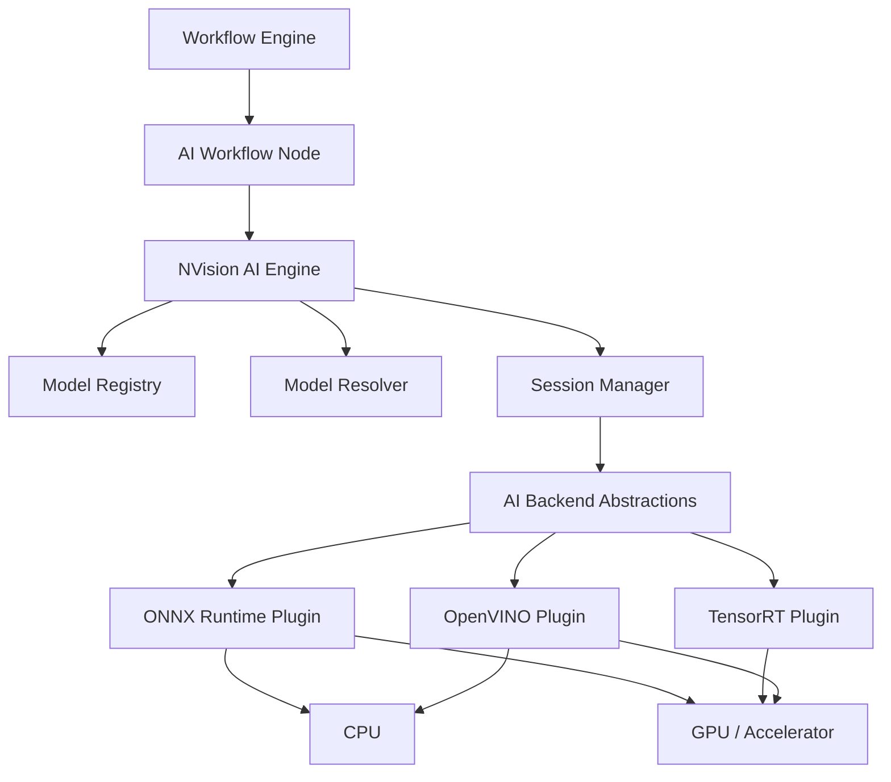
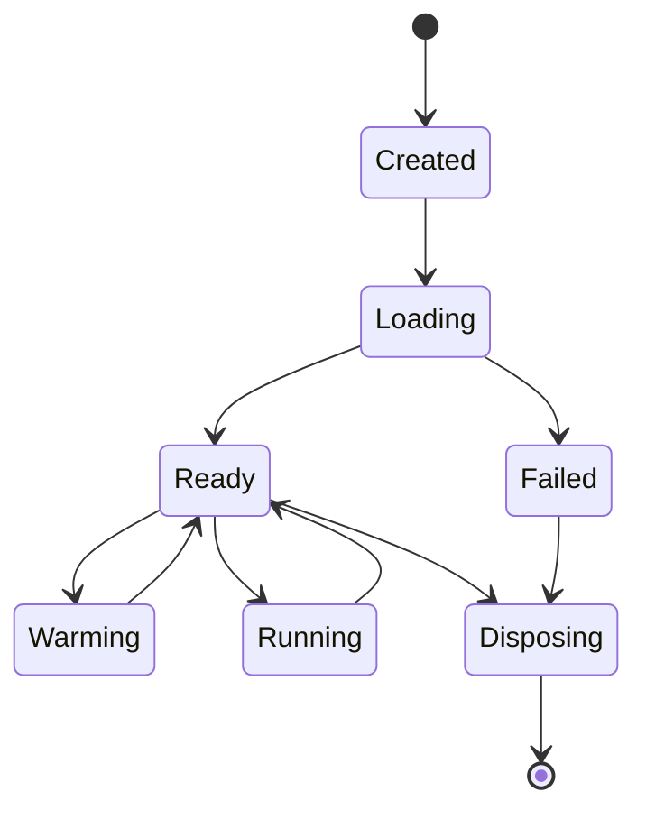
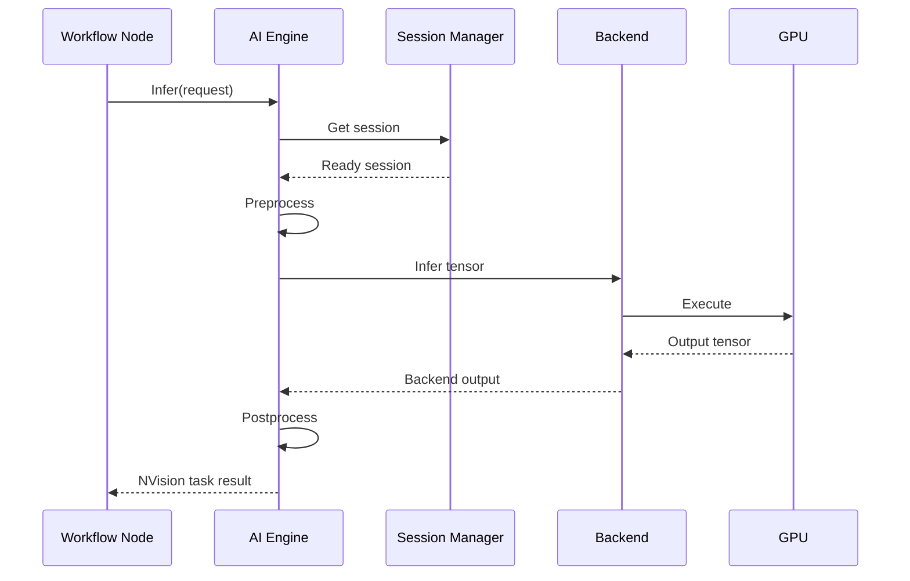
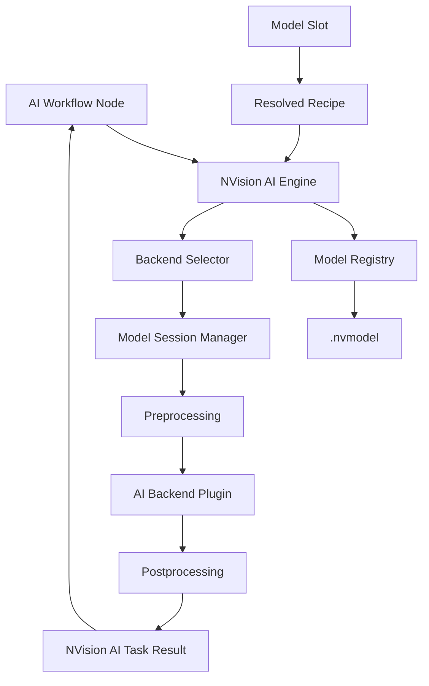

# 08 — NVision AI Engine Architecture

**Product:** NTech NVision  
**Document Type:** AI Runtime / Inference Architecture  
**Primary Components:**  
- `NTech.NVision.Engine.AI`
- `NTech.NVision.Plugin.Abstractions.AI`
- `NTech.NVision.Plugin.AI.*`
- `NTech.NVision.Contracts.AI`

**Status:** Foundation Architecture  
**Version:** 1.0  
**Date:** 2026-08-18  

**Parent Documents:**  
- `NVISION_PLATFORM_FOUNDATION.md`
- `01_PLATFORM_ARCHITECTURE.md`
- `02_DOMAIN_MODEL.md`
- `03_WORKFLOW_ENGINE_ARCHITECTURE.md`
- `04_PLUGIN_ARCHITECTURE.md`
- `05_PROJECT_FILE_FORMAT.md`
- `06_INSPECTION_RESULT_SCHEMA.md`
- `07_CAMERA_ABSTRACTION.md`

---

# 1. Purpose

This document defines the architecture of the **NVision AI Engine**.

> **Implementation authority:** Model execution, preprocessing, postprocessing, ONNX
> Runtime, TensorRT, OpenVINO, and performance-sensitive AI nodes are native C++20.
> Managed AI contracts are facades/projections and never host the production hot path.

The AI Engine is responsible for providing a stable, backend-independent inference layer for Machine Vision applications.

The Engine must allow NVision workflows to perform tasks such as:

```text
Classification
Object Detection
Semantic Segmentation
Instance Segmentation
OCR
Anomaly Detection
Embedding
Similarity
Feature Extraction
```

without coupling workflow logic to a specific:

```text
Training framework
Inference runtime
GPU vendor
Model format
Operating system
```

The central rule is:

> **Workflow nodes request an AI task. The AI Engine decides how that task is executed.**

---

# 2. Architecture Goals

The AI Engine must satisfy the following goals.

## 2.1 Backend Independence

Workflow must not reference:

```text
OrtSession
TensorRT Engine
OpenVINO CompiledModel
Torch Tensor
CUDA Stream
```

directly.

These types remain behind AI backend plugins.

---

## 2.2 Model Portability

Preferred general deployment path:

```text
Training Framework
        ↓
      ONNX
        ↓
Backend Optimization
```

Possible backends:

```text
ONNX Runtime
TensorRT
OpenVINO
DirectML
Future vendor runtimes
```

---

## 2.3 Reusable Task Contracts

A `ClassificationNode` should produce the same NVision classification contract regardless of backend.

Likewise:

```text
Detection
Segmentation
OCR
Embedding
```

must use NVision-owned result types.

---

## 2.4 Deterministic Production Runtime

Production inference should support:

- fixed preprocessing,
- fixed postprocessing,
- versioned models,
- warm-up,
- bounded latency,
- explicit errors,
- exact backend traceability.

---

## 2.5 Edge Deployment

The same model architecture must support:

```text
Windows Industrial PC
Linux x64
Jetson ARM64
```

with backend choice depending on target platform.

---

# 3. Position in NVision Architecture



---

# 4. Core AI Components

Recommended logical structure:

```text
NTech.NVision.Engine.AI
│
├── Models
│   ├── ModelRegistry
│   ├── ModelResolver
│   ├── ModelPackageLoader
│   └── ModelValidator
│
├── Backends
│   ├── AIBackendRegistry
│   ├── BackendSelector
│   └── BackendCompatibility
│
├── Sessions
│   ├── ModelSessionManager
│   ├── ModelSessionPool
│   └── SessionWarmup
│
├── Preprocessing
│   ├── ImagePreprocessor
│   ├── TensorBuilder
│   └── Normalization
│
├── Postprocessing
│   ├── ClassificationPostprocessor
│   ├── DetectionPostprocessor
│   ├── SegmentationPostprocessor
│   └── OCRPostprocessor
│
├── Execution
│   ├── AIInferenceService
│   ├── InferenceRequest
│   ├── InferenceContext
│   └── InferenceResult
│
├── Resources
│   ├── GPUResourceManager
│   ├── TensorBufferPool
│   └── DeviceMemoryPolicy
│
└── Diagnostics
    ├── AIProfiler
    ├── BackendDiagnostics
    └── ModelDiagnostics
```

---

# 5. Core AI Domain Concepts

NVision distinguishes:

```text
AIModelDefinition
ModelPackage
ModelSlot
AIBackend
AIModelSession
InferenceRequest
InferenceResult
TaskResult
```

These are different concepts.

---

# 6. AIModelDefinition

Defined in Domain.

Represents logical model identity and metadata.

Example:

```text
ModelId
Code
Name
Task
Version
PackageReference
Classes
PreferredBackend
Checksum
```

It does not contain a live inference session.

---

# 7. Model Package

Physical deployable artifact:

```text
.nvmodel
```

The package contains everything required to interpret and execute a model.

Possible contents:

```text
manifest.json
model.onnx
labels.json
preprocess.json
postprocess.json
metadata.json
optional optimized engines
signature/
```

---

# 8. Why `.nvmodel`

A plain `.onnx` file is not enough for a production platform.

NVision also needs:

```text
Task
Input specification
Class labels
Normalization
Resize policy
Postprocessing
Output mapping
Model version
Checksum
Backend requirements
```

Therefore the model is packaged.

---

# 9. Model Package Structure

Recommended:

```text
marker-classifier-1.3.2.nvmodel
│
├── manifest.json
├── model/
│   └── model.onnx
├── labels/
│   └── classes.json
├── preprocess/
│   └── preprocess.json
├── postprocess/
│   └── postprocess.json
├── engines/
│   ├── win-x64/
│   └── linux-arm64/
└── integrity.json
```

Initial MVP can keep package simpler.

---

# 10. Model Manifest

Conceptual:

```json
{
  "format": "nvision-ai-model",
  "schemaVersion": "1.0",

  "id": "bbbbbbbb-bbbb-bbbb-bbbb-bbbbbbbbbbbb",
  "code": "MARKER_CLASSIFIER",
  "name": "Marker Classifier",
  "version": "1.3.2",

  "task": "classification",

  "input": {
    "width": 640,
    "height": 640,
    "channels": 3,
    "layout": "NCHW",
    "dataType": "float32"
  },

  "preferredBackend": "auto",

  "artifacts": {
    "onnx": "model/model.onnx"
  }
}
```

---

# 11. Model Versioning

Model versions must be immutable.

Rule:

```text
same ModelId + Version
= same model content
```

If binary, labels, preprocessing, or postprocessing changes:

```text
new version
```

---

# 12. Model Checksum

Recommended:

```text
SHA-256
```

Model traceability includes checksum.

---

# 13. Model Registry

Component:

```text
IModelRegistry
```

Responsibilities:

- register models,
- resolve ModelId/version,
- validate package,
- locate artifacts,
- track availability,
- expose metadata,
- prevent duplicate conflicting versions.

---

# 14. Model Registry Scope

Initial Runtime:

```text
Local Model Registry
```

Future Hub:

```text
Central Model Registry
```

Runtime must not depend on network registry to operate.

---

# 15. Model Slot

Workflow should often reference:

```text
ModelSlot
```

rather than fixed ModelId.

Example:

```text
marker_classifier
```

Recipe resolves:

```text
marker_classifier
    ↓
MARKER_CLASSIFIER v1.3.2
```

---

# 16. Why Model Slots

Benefits:

- Recipe-specific model
- A/B testing
- Model update without graph change
- Same workflow reused across product variants

---

# 17. Resolved Model

Before Runtime session begins:

```text
ModelSlot
+
Recipe
+
Deployment
    ↓
ResolvedModel
```

Contains exact:

```text
ModelId
Version
Checksum
Backend policy
```

---

# 18. AI Tasks

Initial task taxonomy:

```text
Classification
ObjectDetection
SemanticSegmentation
InstanceSegmentation
OCR
AnomalyDetection
Embedding
Similarity
```

---

# 19. Task Contract

Task is a semantic concept independent of network architecture.

Example:

```text
ObjectDetection
```

could be implemented by:

```text
YOLO
RT-DETR
custom detector
```

Workflow should not care.

---

# 20. Classification Contract

Input:

```text
Image / Tensor
```

Output:

```text
ClassificationResult
├── ClassId
├── ClassName
├── Confidence
└── TopK
```

---

# 21. Detection Contract

Output:

```text
DetectionList
```

Each detection:

```text
ClassId
ClassName
Confidence
BoundingBox
Optional Mask
Attributes
```

---

# 22. Semantic Segmentation Contract

Output:

```text
SegmentationResult
├── Class Map
├── Optional Probability Map
├── Mask References
└── Metadata
```

Large data should use handles/references, not giant JSON objects in hot path.

---

# 23. Instance Segmentation

Each instance:

```text
Class
Confidence
BoundingBox
Mask
```

---

# 24. OCR Contract

OCR may involve two phases:

```text
Text Detection
Text Recognition
```

NVision task abstraction can present combined result:

```text
TextResult[]
```

---

# 25. Anomaly Detection

Output may include:

```text
AnomalyScore
AnomalyMap
Threshold
Decision
```

Workflow still controls final product acceptance.

---

# 26. Embedding

Output:

```text
EmbeddingVector
```

Use cases:

```text
Similarity
Few-shot matching
Reference comparison
Clustering
```

Avoid serializing huge vectors into every production result unless needed.

---

# 27. AI Workflow Nodes

Initial nodes:

```text
nvision.ai.classify
nvision.ai.detect
nvision.ai.segment
nvision.ai.ocr
nvision.ai.anomaly
nvision.ai.embedding
nvision.ai.similarity
```

---

# 28. Node Responsibility

AI node should handle:

```text
task configuration
model slot
task thresholds
input ROI
result selection
```

It should not directly instantiate backend runtime.

---

# 29. AIInferenceService

High-level service used by workflow nodes.

Conceptual:

```csharp
public interface IAIInferenceService
{
    ValueTask<AIInferenceResult> InferAsync(
        AIInferenceRequest request,
        CancellationToken cancellationToken);
}
```

---

# 30. Inference Request

Conceptual:

```text
AIInferenceRequest
├── Task
├── ModelSlot / ResolvedModel
├── Input
├── Thresholds
├── ExecutionOptions
├── InspectionId
└── NodeId
```

---

# 31. Inference Result

```text
AIInferenceResult
├── Status
├── Task
├── ModelTrace
├── Output
├── Timing
├── Warnings
└── Error
```

---

# 32. Inference Status

```text
Success
Failed
Timeout
Cancelled
InvalidInput
BackendUnavailable
ModelUnavailable
```

---

# 33. Backend Abstraction

Core interfaces:

```text
IAIBackendFactory
IAIBackend
IAIModelSession
```

---

# 34. AI Backend Factory

Conceptual:

```csharp
public interface IAIBackendFactory
{
    string BackendId { get; }

    AIBackendCapabilities Capabilities { get; }

    ValueTask<AIBackendCompatibilityResult> CheckAsync(
        AIModelPackage model,
        AIBackendOptions options,
        CancellationToken ct);

    ValueTask<IAIModelSession> LoadAsync(
        AIModelPackage model,
        AIBackendOptions options,
        CancellationToken ct);
}
```

---

# 35. Backend IDs

Examples:

```text
ntech.ai.onnxruntime
ntech.ai.tensorrt
ntech.ai.openvino
ntech.ai.directml
```

---

# 36. Backend Capability Model

Examples:

```text
CPU
GPU
FP32
FP16
INT8
DynamicShape
DynamicBatch
Classification
Detection
Segmentation
OCR
TensorInput
ImageInput
```

---

# 37. Backend Selection

Component:

```text
BackendSelector
```

Inputs:

```text
Model
Platform
Installed plugins
Available accelerators
Recipe/deployment policy
Precision requirement
Performance policy
```

Output:

```text
Selected Backend
```

---

# 38. Backend Selection Policy

Possible configuration:

```text
Auto
Preferred
Required
FallbackList
```

---

# 39. Auto Backend

Example:

```text
Jetson
TensorRT available
compatible engine exists
→ TensorRT

otherwise
→ ONNX Runtime
```

Selection must be explicit in traceability.

---

# 40. Required Backend

Example:

```text
RequiredBackend = ntech.ai.tensorrt
```

If unavailable:

```text
Runtime NotReady
```

No fallback.

---

# 41. Explicit Fallback

Example:

```text
Preferred:
TensorRT

Fallback:
ONNX Runtime CUDA
ONNX Runtime CPU
```

Only execute fallback if deployment policy permits.

---

# 42. No Silent Fallback

Critical rule:

> Backend fallback must never happen silently.

Inspection trace records actual backend.

---

# 43. Backend Compatibility

Compatibility checks:

```text
Model format
Ops support
Input shape
Output shape
Precision
GPU capability
OS
Architecture
Runtime version
```

---

# 44. ONNX as Exchange Format

Recommended general model interchange:

```text
ONNX
```

Benefits:

- broad runtime support,
- decouples training from deployment,
- works across Windows/Linux/Edge.

---

# 45. ONNX Is Not Mandatory Forever

Architecture must permit:

```text
TensorRT engine only
OpenVINO IR
Future accelerator format
```

for special deployments.

---

# 46. Model Session

A loaded model is represented by:

```text
IAIModelSession
```

It owns:

```text
backend model handle
device resources
allocated buffers
optimization state
```

---

# 47. Session Lifecycle



---

# 48. Session Scope

Recommended:

```text
RuntimeSession
```

not per inspection.

Load model once and reuse.

---

# 49. Why Session Reuse

Avoid:

```text
Load model
Infer once
Unload
```

for every frame.

Model loading can be much more expensive than inference.

---

# 50. Session Manager

Component:

```text
ModelSessionManager
```

Responsibilities:

- load required models,
- cache sessions,
- reference-count usage,
- warm up,
- validate health,
- dispose on deployment/recipe change.

---

# 51. Session Key

Potential:

```text
ModelId
ModelVersion
BackendId
DeviceId
Precision
OptimizationProfile
```

---

# 52. Session Cache

Do not cache by ModelId alone.

Different backend/precision may require different session.

---

# 53. Warm-Up

Before Runtime becomes Ready:

```text
load model
allocate buffers
execute warm-up inference
validate output
```

This avoids first-inspection latency spike.

---

# 54. Warm-Up Input

Options:

```text
synthetic zero tensor
model-provided sample
representative image
```

Model package may include recommended warm-up input.

---

# 55. Warm-Up Validation

Check:

```text
inference completes
output shape valid
no NaN/invalid output
```

---

# 56. Model Readiness

Model state:

```text
Unavailable
Loading
Ready
Warning
Fault
Disabled
```

---

# 57. Runtime Readiness

Required model not Ready:

```text
Runtime NotReady
```

---

# 58. AI Preprocessing

Preprocessing is execution-critical.

It must be versioned with model.

Common operations:

```text
Resize
Letterbox
Crop
Color Convert
Normalize
Scale
Mean/Std
Channel Reorder
Tensor Layout Convert
Data Type Convert
```

---

# 59. Preprocessing Ownership

Recommended:

> Model-specific preprocessing belongs to model package / AI Engine.

Workflow may perform higher-level ROI extraction before AI node.

---

# 60. Workflow vs AI Preprocessing

Example:

```text
Workflow:
Locate marker
Crop ROI

AI Engine:
Resize 640x640
Normalize
RGB
NCHW
```

This separation is clean.

---

# 61. Why Preprocessing Must Be Packaged

A model trained with:

```text
RGB
mean/std normalization
letterbox
```

will produce wrong results if Runtime uses different preprocessing.

Therefore preprocessing is part of model identity.

---

# 62. Preprocessing Manifest

Conceptual:

```json
{
  "resize": {
    "mode": "letterbox",
    "width": 640,
    "height": 640
  },
  "color": "rgb",
  "scale": 0.0039215686,
  "mean": [0.0, 0.0, 0.0],
  "std": [1.0, 1.0, 1.0],
  "layout": "nchw",
  "dataType": "float32"
}
```

---

# 63. Resize Modes

Possible:

```text
Stretch
Letterbox
CenterCrop
FitShortest
None
```

---

# 64. Letterbox Metadata

Detection postprocessing needs:

```text
scale
padding
original dimensions
```

to map boxes back to original image.

---

# 65. Preprocessing Result

Concept:

```text
PreparedTensor
+
TransformMetadata
```

Postprocessor uses transform metadata.

---

# 66. Tensor Layout

Common:

```text
NCHW
NHWC
```

Must be explicit.

---

# 67. Tensor Data Types

Possible:

```text
float32
float16
uint8
int8
int32
```

---

# 68. Normalization

Explicit:

```text
scale
mean
std
range
```

Avoid hardcoded model-family assumptions.

---

# 69. Color Channel Order

Explicit:

```text
RGB
BGR
GRAY
```

---

# 70. Alpha Channel

If source RGBA:

preprocessing defines whether alpha is:

```text
discarded
used
```

---

# 71. Dynamic Input Shape

Model may support:

```text
dynamic width/height
```

but production should prefer bounded profiles.

---

# 72. Dynamic Shape Policy

Model manifest declares:

```text
fixed
dynamic
profiles
```

---

# 73. TensorRT Optimization Profiles

For dynamic shapes, backend plugin may require:

```text
min
opt
max
```

shape profiles.

These are deployment/backend settings.

---

# 74. Postprocessing

Like preprocessing, model-specific postprocessing must be explicit.

Examples:

```text
Softmax
TopK
Confidence threshold
NMS
Box decode
Mask decode
OCR decode
Anomaly threshold
```

---

# 75. Classification Postprocessing

Possible:

```text
Logits
→ Softmax
→ TopK
```

Some models already output probabilities.

Manifest must declare semantics.

---

# 76. Detection Postprocessing

Typical:

```text
Raw output
→ decode boxes
→ confidence filter
→ NMS
→ map coordinates back
```

Do not hardcode YOLO assumptions globally.

---

# 77. NMS Parameters

Examples:

```text
ConfidenceThreshold
IoUThreshold
ClassAgnostic
MaxDetections
```

Threshold may be:

- model default,
- node parameter,
- Recipe override.

---

# 78. Threshold Ownership

Recommended hierarchy:

```text
Model Default
    ↓
Node Setting
    ↓
Recipe Override
```

---

# 79. Detection Coordinate Mapping

Postprocessor must return boxes in explicit coordinate space.

Preferred Workflow result:

```text
Original Input Image Pixel Space
```

unless node specifies otherwise.

---

# 80. Segmentation Postprocessing

May return:

```text
ClassMask
InstanceMasks
Polygons
Areas
```

Keep large mask data as handles/references in execution memory.

---

# 81. OCR Postprocessing

Possible:

```text
CTC decode
token decode
language model
character confidence
```

Model package defines decoder type.

---

# 82. Anomaly Postprocessing

May produce:

```text
Global score
Threshold
Pixel anomaly map
Regions
```

Final OK/NG remains Decision Engine responsibility.

---

# 83. Task Result vs Decision

Critical:

```text
AI Result
    ≠
Inspection Decision
```

Example:

```text
AI classifies TYPE_04
```

Decision Engine decides if that is acceptable for active Recipe.

---

# 84. Model Result Traceability

Every AI result should be able to identify:

```text
ModelId
Version
Checksum
Backend
Precision
```

Inspection Result may persist this centrally.

---

# 85. Precision Modes

Common:

```text
FP32
FP16
INT8
```

Potential future:

```text
BF16
FP8
```

---

# 86. Precision Policy

Deployment may specify:

```text
Required
Preferred
Auto
```

---

# 87. FP32

Best reference precision.

Usually:

- slower,
- more memory,
- easiest validation baseline.

---

# 88. FP16

Often useful on GPU.

Requires validation that quality remains acceptable.

---

# 89. INT8

Requires calibration/quantization strategy.

Performance may improve substantially.

Quality validation is mandatory.

---

# 90. Model Precision Validation

Do not assume optimized precision preserves output quality.

Each optimized artifact should pass regression tests against acceptance dataset.

---

# 91. Optimized Engine Artifact

Model package may contain:

```text
TensorRT engine
```

for a specific platform.

Example:

```text
engines/linux-arm64/tensorrt-fp16.engine
```

---

# 92. Engine Portability Warning

TensorRT engines may depend on:

```text
GPU architecture
TensorRT version
CUDA version
builder configuration
```

Therefore optimized engines are less portable than ONNX.

---

# 93. Recommended Deployment Strategy

Store portable source:

```text
ONNX
```

plus optional target-optimized artifact.

Runtime:

```text
use compatible optimized engine
otherwise build/use generic backend according to policy
```

---

# 94. Runtime Engine Build

Building TensorRT engine on production startup can be slow.

Recommended:

```text
prebuild during deployment
```

where possible.

---

# 95. Model Optimization Pipeline

Future:

```text
.nvmodel ONNX
    ↓
NVision Model Optimizer
    ↓
TensorRT / OpenVINO artifacts
    ↓
Validated model package
```

---

# 96. Trainer Relationship

Future:

```text
NVision Trainer
      ↓ export
.nvmodel
      ↓
NVision AI Engine
```

Trainer and Runtime share package specification.

---

# 97. Training Framework Independence

Training may use:

```text
PyTorch
Ultralytics
TensorFlow
custom training stack
```

Runtime should not require these frameworks.

---

# 98. Python Boundary

Python is suitable for:

```text
training
conversion
evaluation
dataset tooling
```

Production inference orchestration should remain in Engine/backend layer.

---

# 99. AI Backend Plugin Architecture


---

# 100. ONNX Runtime Plugin

Plugin:

```text
ntech.ai.onnxruntime
```

Can support execution providers depending deployment.

Core only sees backend capabilities.

---

# 101. TensorRT Plugin

Plugin:

```text
ntech.ai.tensorrt
```

Target:

```text
NVIDIA GPU
Jetson
industrial RTX GPU
```

Plugin owns native CUDA/TensorRT types.

---

# 102. OpenVINO Plugin

Plugin:

```text
ntech.ai.openvino
```

Useful for compatible Intel CPU/iGPU/NPU platforms.

---

# 103. DirectML Plugin

Potential Windows fallback backend.

Not required MVP.

---

# 104. Backend Plugin Responsibilities

Plugin owns:

```text
runtime initialization
device enumeration
model loading
tensor binding
backend execution
native resource cleanup
backend diagnostics
```

---

# 105. AI Engine Responsibilities

Core AI Engine owns:

```text
model registry
task semantics
preprocessing contract
postprocessing contract
backend selection
session lifecycle
traceability
error mapping
```

---

# 106. GPU Device Identity

Represent accelerator:

```text
AIComputeDevice
├── DeviceId
├── Backend
├── Name
├── Vendor
├── Memory
├── Capabilities
└── Architecture
```

---

# 107. Device Selection

Deployment may configure:

```text
Auto
GPU 0
CPU
Specific accelerator ID
```

---

# 108. Multi-GPU

Future:

```text
Model A → GPU0
Model B → GPU1
```

Architecture should not assume one GPU.

MVP can support one selected device.

---

# 109. GPU Resource Manager

Component:

```text
IGPUResourceManager
```

Responsibilities:

- track device memory,
- coordinate model loads,
- limit session count,
- expose diagnostics.

---

# 110. GPU Memory Budget

Station config may define:

```text
MaxGpuMemoryUsage
```

to avoid overcommit.

---

# 111. Model Load Planning

Before Ready:

```text
estimate required GPU memory
compare budget
load models
```

If insufficient:

```text
NotReady
```

or explicit fallback.

---

# 112. GPU OOM

Never silently crash or return stale result.

Map to:

```text
AI_RESOURCE_EXHAUSTED
```

and inspection `ERROR`.

---

# 113. Tensor Buffer Pool

Repeated allocations can hurt performance.

Use pooled:

```text
input tensors
output tensors
temporary buffers
```

where backend permits.

---

# 114. CPU Memory

Use:

```text
pooled buffers
pinned memory
```

when beneficial.

---

# 115. CPU-to-GPU Transfers

Avoid unnecessary round-trips.

Typical:

```text
Image CPU
→ preprocess CPU/GPU
→ Tensor GPU
→ infer GPU
→ small output CPU
```

---

# 116. GPU-Aware Future Pipeline

Future optimization:

```text
Camera buffer
→ GPU preprocessing
→ AI
→ GPU postprocessing
```

with minimal CPU copies.

Not MVP requirement.

---

# 117. Workflow Integration

Workflow AI node receives:

```text
ImageHandle
```

and calls AI Engine.

It receives NVision task result.

---

# 118. AI Node Execution Sequence

```text
Resolve model
    ↓
Get session
    ↓
Validate input
    ↓
Preprocess
    ↓
Infer
    ↓
Postprocess
    ↓
Return task result
```

---

# 119. Inference Timing

Track:

```text
queueWaitMs
preprocessMs
inferenceMs
postprocessMs
totalMs
```

---

# 120. AI Timing Example

```json
{
  "preprocessMs": 2.4,
  "inferenceMs": 18.7,
  "postprocessMs": 1.8,
  "totalMs": 22.9
}
```

---

# 121. Scheduler Integration

Workflow scheduler may classify AI node as:

```text
GPU
```

or:

```text
AI
```

resource class.

---

# 122. Inference Queue

AI Engine should maintain bounded concurrency.

Do not let every AI node launch unlimited GPU inference.

---

# 123. GPU Concurrency

Possible policies:

```text
Serialized
Bounded N
BackendManaged
```

MVP can start with:

```text
1 concurrent inference per session/device
```

where appropriate.

---

# 124. Batch Inference

Batching may improve throughput.

But industrial inspection often prioritizes latency.

---

# 125. Batch Modes

```text
Disabled
Fixed
Dynamic
```

---

# 126. MVP Batch Policy

Recommended:

```text
Batch size = 1
```

for deterministic low-latency inspection.

Add batching only for throughput-driven use cases.

---

# 127. Dynamic Batching Risks

Can increase:

```text
latency
jitter
complexity
```

Not ideal for machine-triggered inspection unless carefully controlled.

---

# 128. Multiple AI Nodes

Workflow may contain:

```text
Detector
OCR
Classifier
```

AI Engine coordinates sessions/resources.

---

# 129. Shared Model Session

Multiple node instances using same model can share session if backend is thread-safe and policy permits.

---

# 130. Session Thread Safety

Backend declares:

```text
ThreadSafe
SupportsConcurrentInference
```

AI Engine respects it.

---

# 131. Session Pool

If concurrent inference required and backend session is not thread-safe:

```text
ModelSessionPool
```

may maintain N sessions.

---

# 132. Session Pool Limit

Bounded by:

```text
GPU memory
CPU memory
configured concurrency
```

---

# 133. Cancellation

Inference API accepts:

```text
CancellationToken
```

Backend support varies.

---

# 134. Backend Cancellation Limitations

Some native inference calls may not be interruptible mid-kernel.

Policy:

- honor cancellation before/after call,
- use finite workflow timeout,
- avoid claiming immediate cancellation where impossible.

---

# 135. Inference Timeout

Workflow node may define timeout.

Example:

```text
100 ms
```

Timeout becomes explicit AI/Workflow error.

---

# 136. AI Error Codes

Suggested:

```text
AI_MODEL_NOT_FOUND
AI_MODEL_INVALID
AI_MODEL_LOAD_FAILED
AI_BACKEND_NOT_FOUND
AI_BACKEND_INCOMPATIBLE
AI_INPUT_INVALID
AI_OUTPUT_INVALID
AI_INFERENCE_FAILED
AI_INFERENCE_TIMEOUT
AI_RESOURCE_EXHAUSTED
AI_UNSUPPORTED_PRECISION
AI_WARMUP_FAILED
AI_POSTPROCESS_FAILED
```

---

# 137. AI Error Model

```text
AIError
├── Code
├── ModelId
├── ModelVersion
├── BackendId
├── NodeId
├── Message
├── BackendCode
├── Recoverable
└── Diagnostics
```

---

# 138. Backend Error Preservation

Map native error to common code but preserve:

```text
backend/vendor error detail
```

for service diagnostics.

---

# 139. NaN / Invalid Output

If output contains invalid values:

```text
NaN
Infinity
wrong shape
```

return:

```text
AI_OUTPUT_INVALID
```

Do not let Decision Engine consume invalid result.

---

# 140. Output Shape Validation

Model package defines expected output signatures.

AI Engine validates backend output.

---

# 141. Tensor Specification

```text
TensorSpec
├── Name
├── DataType
├── Shape
├── Layout
├── DynamicDimensions
└── SemanticRole
```

---

# 142. Semantic Output Roles

Examples:

```text
classification_logits
boxes
scores
classes
masks
tokens
embedding
```

This helps generic postprocessing.

---

# 143. Model Architecture Metadata

Model package may record:

```text
family
architecture
training framework
export version
```

for diagnostics.

Not required for runtime semantics.

---

# 144. Class Labels

Classification/detection model package includes stable labels.

Example:

```json
[
  {
    "id": 0,
    "name": "TYPE_01"
  },
  {
    "id": 1,
    "name": "TYPE_02"
  }
]
```

---

# 145. Class ID Stability

Within one model version, class IDs are immutable.

Changing class order requires new model version.

---

# 146. Class Code vs Display Name

Potential:

```text
Code: TYPE_01
DisplayName: Type 01
```

Use code for decision logic.

---

# 147. Confidence

Normalize AI confidence:

```text
0.0 .. 1.0
```

where task semantics support confidence.

---

# 148. Confidence Calibration

Model confidence may not be statistically calibrated.

Do not equate:

```text
0.95 confidence
```

with exactly 95% probability unless validated.

Platform still stores normalized model score.

---

# 149. Thresholds

Thresholds belong to inspection configuration.

Examples:

```text
classification confidence
detection confidence
NMS IoU
anomaly threshold
```

---

# 150. Recipe Override

Recipe may override:

```text
confidence threshold
allowed classes
anomaly threshold
```

without modifying model package.

---

# 151. Model Package Default Threshold

Useful fallback/default.

But Recipe should control acceptance-oriented thresholds where appropriate.

---

# 152. Model Input Validation

Before preprocessing:

```text
image exists
dimensions valid
pixel format supported
ROI valid
```

---

# 153. Empty ROI

Return:

```text
AI_INPUT_INVALID
```

not empty classification.

---

# 154. Image Format Conversion

AI Engine may support:

```text
Mono8 → RGB
BGR → RGB
```

as defined by preprocess spec.

---

# 155. 16-bit Input

Model preprocess defines conversion/scaling.

Do not silently truncate without explicit policy.

---

# 156. Multiple Inputs

Some models may require:

```text
image
auxiliary tensor
```

Architecture should support named input tensors.

MVP can focus on single image input.

---

# 157. Multi-Image Model

Future:

```text
stereo
multi-view
temporal
```

needs multiple named inputs.

Do not assume one model = one image forever.

---

# 158. Sequence Models

Future OCR/video models may use sequence input.

Out of MVP.

---

# 159. Preprocessing Backend

Preprocessing may run on:

```text
CPU
GPU
backend-integrated pipeline
```

AI Engine chooses implementation while preserving semantics.

---

# 160. Reference Preprocessor

Maintain CPU reference implementation for correctness testing.

Optimized GPU path should be compared against reference.

---

# 161. Reference Postprocessor

Same principle.

---

# 162. Backend Validation Dataset

Every optimized backend should pass known model fixtures.

Example:

```text
10–100 golden inputs
```

compare task output within tolerance.

---

# 163. Model Regression Tests

Model package should have optional test manifest:

```text
input image
expected class/detection
tolerance
```

---

# 164. Golden Model Test

Example:

```text
type01_001.png
Expected:
TYPE_01
confidence >= 0.90
```

---

# 165. Backend Equivalence Test

Compare:

```text
ONNX Runtime FP32
TensorRT FP16
```

Expected:

```text
same final class
geometry within tolerance
confidence within allowed delta
```

---

# 166. Optimization Qualification

Do not release FP16/INT8 engine until validated against acceptance dataset.

---

# 167. Model Health

```text
AIModelHealth
├── State
├── Loaded
├── Warmed
├── Backend
├── Device
├── MemoryUsage
├── LastInferenceAt
├── LastError
└── AverageLatency
```

---

# 168. AI Diagnostics

Runtime diagnostics should expose:

```text
Model
Version
Backend
Precision
Device
Load time
Warm-up time
Average inference
GPU memory
Error count
```

---

# 169. AI Metrics

Suggested:

```text
ai.model.load_ms
ai.inference.queue_ms
ai.inference.preprocess_ms
ai.inference.execute_ms
ai.inference.postprocess_ms
ai.inference.total_ms
ai.inference.error_count
ai.gpu.memory_bytes
```

---

# 170. Metrics Labels

Use:

```text
modelCode
backendId
deviceId
```

Avoid high-cardinality `InspectionId`.

---

# 171. Logging Context

Include:

```text
InspectionId
NodeId
ModelId
ModelVersion
BackendId
ComputeDevice
```

---

# 172. AI Result in InspectionResult

Persist selected task outputs.

Example classification:

```text
Class
Confidence
Model reference
```

Detection:

```text
selected detections
```

Do not persist raw tensors.

---

# 173. Raw Tensor Storage

Only for explicit debug mode.

Never default production behavior.

---

# 174. Model Trace Example

```json
{
  "slot": "marker_classifier",
  "modelId": "bbbb...",
  "code": "MARKER_CLASSIFIER",
  "version": "1.3.2",
  "checksum": "sha256:...",
  "backend": "ntech.ai.tensorrt",
  "precision": "fp16",
  "device": "gpu0"
}
```

---

# 175. Backend Fallback Trace

If fallback used:

```json
{
  "requestedBackend": "ntech.ai.tensorrt",
  "actualBackend": "ntech.ai.onnxruntime",
  "fallbackUsed": true
}
```

if policy allows.

---

# 176. Fallback Alarm

Production may raise warning:

```text
AI_BACKEND_FALLBACK_ACTIVE
```

because performance/behavior may differ.

---

# 177. Jetson Deployment

Recommended architecture:

```text
NVision Runtime Service
        ↓
NVision AI Engine
        ↓
TensorRT Backend Plugin
        ↓
CUDA / TensorRT
        ↓
Jetson GPU
```

---

# 178. Jetson Constraints

Consider:

```text
shared memory
power mode
thermal throttling
GPU memory
ARM64 compatibility
TensorRT engine compatibility
```

AI Engine reports these through diagnostics.

---

# 179. Jetson Model Policy

Recommended:

```text
Portable ONNX source
+
prebuilt TensorRT engine for target
```

where deployment tooling supports it.

---

# 180. Industrial PC Deployment

Possible:

```text
RTX GPU
→ TensorRT / ONNX Runtime CUDA

Intel CPU/iGPU
→ OpenVINO

CPU-only
→ ONNX Runtime / OpenVINO
```

Backend choice remains deployment policy.

---

# 181. CPU Fallback

CPU fallback may exceed cycle time.

Therefore backend fallback policy must also validate:

```text
performance requirement
```

not merely functional compatibility.

---

# 182. Performance Requirement

Model deployment may define:

```text
maxInferenceMs
```

or Job defines cycle-time budget.

Backend readiness can benchmark/warm-up.

---

# 183. Readiness Performance Test

Optional:

```text
run N warm-up/benchmark iterations
```

If p95 latency exceeds configured maximum:

```text
Warning / NotReady
```

depending policy.

---

# 184. Latency Jitter

Track:

```text
average
p95
p99
```

over production.

Large drift may indicate:

```text
thermal throttling
GPU contention
memory pressure
```

---

# 185. Throughput vs Latency

NVision prioritizes:

```text
bounded latency
```

for machine inspection.

Batch throughput optimizations are secondary unless use case requires them.

---

# 186. GPU Thermal Throttling

Diagnostics may read system GPU telemetry via platform service.

AI Engine itself should not hardcode Jetson/NVIDIA-specific telemetry in core.

---

# 187. Resource Contention

Other GPU workloads can degrade inspection.

Station diagnostics should expose GPU usage.

---

# 188. Model Session Isolation

One model crash/invalid output should not corrupt another session.

Managed/native exceptions mapped at backend boundary.

Fatal native crash may require future AI Plugin Host.

---

# 189. Out-of-Process AI Host

Future architecture:


---

# 190. Why Out-of-Process AI

Useful for:

```text
Python-only backend
native dependency conflict
crash isolation
separate GPU service
```

Not required MVP.

---

# 191. Tensor Transport Across Process

Use:

```text
shared memory
GPU IPC future
```

not JSON arrays.

---

# 192. Python Inference Backend

If ever required:

```text
Python process
+
strict gRPC/shared-memory contract
```

Do not embed arbitrary Python into Runtime process.

---

# 193. AI Plugin Security

Model/backends are executable/native assets.

Validate:

```text
package checksum
trusted plugin
model package integrity
path safety
```

---

# 194. Malicious Model Risk

Some runtime/model formats may have security implications.

Treat external models as untrusted input until validated.

Do not automatically execute arbitrary code packaged with model.

---

# 195. No Arbitrary Python in `.nvmodel`

Model package should not include automatically executed scripts.

Use declarative preprocess/postprocess specifications or trusted plugin implementations.

---

# 196. Custom Postprocessor Plugin

If model requires special logic:

```text
PostprocessorId
```

references a trusted AI/node plugin.

Do not ship arbitrary script.

---

# 197. Custom Operator Compatibility

ONNX model may use custom ops.

Package declares requirement:

```text
custom operator plugin
```

Runtime validates before Ready.

---

# 198. Model Package Dependencies

Manifest may declare:

```text
required backend
minimum backend version
custom operator package
precision requirements
```

---

# 199. Model Compatibility Result

```text
ModelCompatibilityResult
├── Compatible
├── Backend
├── Device
├── Warnings
├── BlockingIssues
└── OptimizationAvailable
```

---

# 200. Studio Model Manager

Studio UI should support:

```text
Import Model
Inspect Metadata
Validate
Run Test
Benchmark
Select Backend
View Classes
View Input/Output
Publish
```

---

# 201. Model Import

Input:

```text
ONNX
labels
task type
preprocess spec
postprocess spec
```

Output:

```text
.nvmodel
```

---

# 202. Automatic Model Inspection

Studio may inspect ONNX graph for:

```text
input names
output names
shapes
types
```

but engineer confirms task semantics.

---

# 203. Model Wizard

Future flow:

```text
Select ONNX
    ↓
Choose Task
    ↓
Configure Preprocess
    ↓
Configure Postprocess
    ↓
Provide Labels
    ↓
Run Test
    ↓
Save .nvmodel
```

---

# 204. Model Validation UI

Show:

```text
Input
Output
Backend Compatibility
Test Result
Latency
Memory
Warnings
```

---

# 205. Model Benchmark

Benchmark should distinguish:

```text
cold load
warm inference
preprocess
inference
postprocess
```

---

# 206. Benchmark Conditions

Record:

```text
hardware
backend
precision
input shape
runtime versions
```

so benchmark is meaningful.

---

# 207. Model Comparison

Future Studio can compare:

```text
v1.3.1 vs v1.3.2
```

on same validation image set.

---

# 208. A/B Model Validation

Useful before deployment.

Does not imply simultaneous production A/B by default.

---

# 209. Shadow Inference

Future feature:

```text
Production model
+
candidate model in background
```

candidate does not affect decision.

Useful for validation.

---

# 210. Shadow Result

Stored separately or diagnostic extension.

Must not alter canonical product result.

---

# 211. Model Activation

Recipe/deployment activation:

```text
Resolve model
    ↓
Check package
    ↓
Select backend
    ↓
Load session
    ↓
Warm up
    ↓
Validate
    ↓
Atomic activate
```

---

# 212. Atomic Model Switch

Do not unload current model until new model ready if resource budget permits.

---

# 213. Recipe Change

If Recipe changes model slot mapping:

```text
stop new inspections
finish current inspection
prepare new model sessions
activate new recipe
resume
```

---

# 214. Model Hot Reload

Do not hot-swap model during active inspection.

---

# 215. Model Cache

Disk cache may hold:

```text
optimized engines
compiled artifacts
```

Cache is generated data.

Source of truth remains `.nvmodel`.

---

# 216. Cache Key

Potential:

```text
ModelChecksum
BackendVersion
DeviceArchitecture
Precision
OptimizationProfile
```

---

# 217. Cache Invalidation

Invalidate if any key changes.

---

# 218. TensorRT Engine Cache

Generated engine can be cached if compatible.

Never assume engine remains valid across incompatible runtime/device changes.

---

# 219. OpenVINO Compilation Cache

Backend plugin may manage its own optimized cache.

---

# 220. AI Result Contracts

All backend outputs map into NVision contracts:

```text
ClassificationResult
DetectionResult
SegmentationResult
TextResult
AnomalyResult
EmbeddingResult
```

---

# 221. Backend-Specific Metadata

Optional diagnostics:

```text
extensions/backend
```

Do not make workflow dependent on it.

---

# 222. Result Thresholding

Keep raw useful score where practical.

Example:

```text
Detection confidence
```

Then filtering may happen according to node/Recipe.

---

# 223. Preserve Raw TopK

Classification can retain top-K if useful for debug.

Production persistence may keep only top-1 + selected top-K.

---

# 224. AI Explanation

Future:

```text
heatmaps
saliency
attention
```

not core MVP.

Can be diagnostic output/image.

---

# 225. AI Model Metadata

Useful:

```text
trainingDate
datasetId
datasetVersion
metrics
trainingCommit
```

for model governance.

Runtime may not need all fields.

---

# 226. Dataset Traceability

Model package may reference:

```text
DatasetId / Version
```

Future Trainer/Hub.

---

# 227. Model Approval State

Future:

```text
Draft
Validated
Approved
Deprecated
Archived
```

Runtime deployment may permit only Approved models.

---

# 228. Model Governance

Not MVP-critical but architecture should support:

```text
who approved
when
validation report
```

---

# 229. Model Registry Immutability

Published model version cannot be overwritten.

---

# 230. Model Deletion

Do not delete model version referenced by retained production deployments/results without archive policy.

---

# 231. Model Package Signing

Future:

```text
integrity hash
digital signature
```

for trusted model deployment.

---

# 232. Backend Diagnostics API

Possible:

```text
GetAvailableDevices
GetBackendVersion
GetCapabilities
GetMemoryStats
RunSelfTest
```

---

# 233. AI Self-Test

Runtime startup can run minimal backend test.

Useful for detecting:

```text
driver/runtime mismatch
GPU unavailable
```

---

# 234. Driver Compatibility

Backend plugin reports:

```text
runtime
driver
device
```

compatibility.

Core remains vendor-neutral.

---

# 235. CUDA Version

NVIDIA-specific information belongs to TensorRT/ONNX plugin diagnostics, not AI Domain.

---

# 236. AI Runtime State

Suggested:

```text
Initializing
Ready
Warning
Fault
Disabled
```

---

# 237. AI Engine Health

```text
AIEngineHealth
├── State
├── LoadedModels
├── FailedModels
├── Backends
├── ComputeDevices
├── Memory
├── LastError
└── UpdatedAt
```

---

# 238. Runtime Alarm Examples

```text
AI_MODEL_LOAD_FAILED
AI_BACKEND_UNAVAILABLE
AI_GPU_MEMORY_LOW
AI_INFERENCE_TIMEOUT
AI_BACKEND_FALLBACK_ACTIVE
```

---

# 239. Model-Specific Alarm

Include:

```text
ModelCode
Version
Backend
```

---

# 240. AI Failure to Inspection Result

```text
AI inference fails
      ↓
AIError
      ↓
AI Node Failed
      ↓
Workflow Failed
      ↓
InspectionStatus = ERROR
DecisionCode = AI_INFERENCE_FAILED
```

Not `NG`.

---

# 241. Low Confidence

Low confidence is not necessarily technical error.

Example:

```text
inference succeeds
confidence = 0.42
```

Decision Engine may produce:

```text
NG: CONFIDENCE_LOW
```

or:

```text
NO_RESULT
```

depending Project policy.

---

# 242. Unknown Class

Possible classification policy:

```text
Unknown
```

if confidence below threshold.

This is task/inspection policy, not backend failure.

---

# 243. Detection No Objects

Valid AI result:

```text
detections = []
```

not error.

Decision Engine interprets based on expected object.

---

# 244. Segmentation Empty Mask

Likewise may be valid.

---

# 245. OCR Empty Text

May be valid technical result but quality failure.

---

# 246. Model Preload Policy

At Runtime Ready:

```text
load all models required by active Job/Recipe
```

Do not lazily load first time unless explicit resource policy permits.

---

# 247. Multiple Recipes

If many Recipes use different large models:

Possible strategies:

```text
Preload All
Load Active Only
Keep LRU Cache
```

---

# 248. MVP Model Loading Policy

Recommended:

```text
Load Active Recipe models only
```

plus optionally keep previous model if memory allows.

---

# 249. Model LRU Cache

Future for fast recipe switching.

Bounded by memory budget.

---

# 250. Recipe Switch Performance

Track:

```text
model load time
warm-up time
```

Studio can warn if switch is expensive.

---

# 251. AI Session Disposal

Must release:

```text
GPU memory
native handles
threads
runtime sessions
```

deterministically.

---

# 252. Native Resource Lifetime

Do not rely only on GC.

Use:

```text
IDisposable
IAsyncDisposable
SafeHandle
```

where appropriate.

---

# 253. Backend Threading

Some backends internally use thread pools.

Plugin owns tuning.

AI Engine exposes high-level concurrency policy.

---

# 254. CPU Thread Count

Backend options may include:

```text
intra-op threads
inter-op threads
```

but keep backend-specific values outside Workflow.

---

# 255. NUMA / CPU Affinity

Advanced industrial tuning later.

Not core API.

---

# 256. GPU Streams

TensorRT plugin may use CUDA streams.

Do not expose stream object to Workflow.

---

# 257. Deterministic Algorithms

Some GPU algorithms may be nondeterministic.

If strict reproducibility needed, model/backend policy must specify deterministic mode where supported.

---

# 258. Floating-Point Differences

Backends/precisions may produce slight numeric differences.

Regression testing uses tolerances.

Final quality decision must be validated for selected backend.

---

# 259. Model Validation Dataset

A deployment-ready model should ideally have:

```text
Validation Dataset
Expected Outcomes
Acceptance Metrics
```

managed by Trainer/engineering process.

---

# 260. Accuracy Metrics

Task-specific:

Classification:

```text
accuracy
precision
recall
confusion matrix
```

Detection:

```text
mAP
precision
recall
```

Anomaly:

```text
AUROC
false reject
false accept
```

These belong to model validation, not per-inspection result.

---

# 261. Industrial Acceptance Metrics

More important than generic benchmark:

```text
False Accept Rate
False Reject Rate
Cycle Time
Stability
```

for actual inspection application.

---

# 262. Model Drift

Future Hub can monitor:

```text
confidence drift
class distribution
NG rate
review outcomes
```

---

# 263. Model Retraining Loop

Future:

```text
Inspection Results
    ↓
Reviewed NG / sampled OK
    ↓
Dataset
    ↓
Trainer
    ↓
New .nvmodel
    ↓
Validation
    ↓
Deployment
```

---

# 264. Trainer Separation

Runtime AI Engine must not include:

```text
optimizer
training loop
augmentation engine
dataset labeling UI
```

These belong to NVision Trainer.

---

# 265. AI Engine Public API

Suggested top-level contracts:

```text
IAIInferenceService
IModelRegistry
IModelSessionManager
IAIBackendRegistry
```

---

# 266. Suggested C# Interface

Illustrative:

```csharp
public interface IAIInferenceService
{
    ValueTask<AIInferenceResult> InferAsync(
        AIInferenceRequest request,
        CancellationToken ct);
}
```

---

# 267. Suggested Model Registry

```csharp
public interface IModelRegistry
{
    AIModelDescriptor? Resolve(
        ModelId modelId,
        ModelVersion version);
}
```

---

# 268. Suggested Session Manager

```csharp
public interface IModelSessionManager
{
    ValueTask<IAIModelSession> GetOrCreateAsync(
        ResolvedModel model,
        AIExecutionPolicy policy,
        CancellationToken ct);
}
```

---

# 269. Suggested Backend Registry

```text
IAIBackendRegistry
```

Operations:

```text
Register
Resolve
List
GetCapabilities
```

---

# 270. Suggested Source Structure

```text
NTech.NVision.Engine.AI/
│
├── Abstractions/
│   ├── IAIInferenceService.cs
│   ├── IModelRegistry.cs
│   └── IModelSessionManager.cs
│
├── Models/
│   ├── ModelRegistry.cs
│   ├── ModelResolver.cs
│   ├── ModelPackageLoader.cs
│   └── ModelValidator.cs
│
├── Sessions/
│   ├── ModelSessionManager.cs
│   ├── SessionKey.cs
│   └── ModelWarmupService.cs
│
├── Backends/
│   ├── AIBackendRegistry.cs
│   ├── BackendSelector.cs
│   └── CompatibilityChecker.cs
│
├── Preprocessing/
│   ├── PreprocessingPipeline.cs
│   ├── ResizeOperation.cs
│   ├── NormalizeOperation.cs
│   └── TensorBuilder.cs
│
├── Postprocessing/
│   ├── ClassificationPostprocessor.cs
│   ├── DetectionPostprocessor.cs
│   ├── SegmentationPostprocessor.cs
│   └── OCRPostprocessor.cs
│
├── Execution/
│   ├── AIInferenceService.cs
│   ├── AIInferenceRequest.cs
│   └── AIInferenceResult.cs
│
├── Resources/
│   ├── AIResourceManager.cs
│   └── TensorBufferPool.cs
│
└── Diagnostics/
    ├── AIProfiler.cs
    └── AIHealthService.cs
```

---

# 271. Plugin Structure

```text
plugins/ai/
├── NTech.NVision.Plugin.AI.OnnxRuntime/
├── NTech.NVision.Plugin.AI.TensorRT/
└── NTech.NVision.Plugin.AI.OpenVINO/
```

---

# 272. AI Contracts Project

Potential:

```text
NTech.NVision.Contracts.AI/
```

contains task results used outside Engine if needed.

---

# 273. Built-In AI Nodes

```text
NTech.NVision.Nodes.BuiltIn/
└── AI/
    ├── ClassifyNode.cs
    ├── DetectNode.cs
    ├── SegmentNode.cs
    ├── OCRNode.cs
    ├── AnomalyNode.cs
    └── EmbeddingNode.cs
```

---

# 274. Classification Node Configuration

Example:

```json
{
  "type": "nvision.ai.classify",
  "parameters": {
    "modelSlot": "marker_classifier",
    "topK": 3,
    "confidenceThreshold": 0.9
  }
}
```

---

# 275. Detection Node Configuration

```json
{
  "type": "nvision.ai.detect",
  "parameters": {
    "modelSlot": "defect_detector",
    "confidenceThreshold": 0.4,
    "iouThreshold": 0.5,
    "maxDetections": 100
  }
}
```

---

# 276. AI Model Reference Example

```json
{
  "id": "bbbbbbbb-bbbb-bbbb-bbbb-bbbbbbbbbbbb",
  "code": "MARKER_CLASSIFIER",
  "task": "classification",
  "version": "1.3.2",
  "package": {
    "path": "artifacts/models/marker-classifier-1.3.2.nvmodel",
    "checksum": "sha256:..."
  }
}
```

---

# 277. Recipe Model Selection Example

```json
{
  "modelSelections": {
    "marker_classifier": {
      "modelId": "bbbbbbbb-bbbb-bbbb-bbbb-bbbbbbbbbbbb",
      "version": "1.3.2"
    }
  }
}
```

---

# 278. Runtime AI Sequence



---

# 279. Runtime Startup Sequence

```text
Load deployment
    ↓
Resolve model slots
    ↓
Validate model packages
    ↓
Resolve backends
    ↓
Check devices
    ↓
Load sessions
    ↓
Warm up
    ↓
Benchmark/validate if configured
    ↓
AI Ready
```

---

# 280. AI Engine MVP Scope

Implement first:

```text
Model package manifest
Model registry
Model slot resolution
ONNX Runtime backend
Classification
Object Detection
Image preprocessing
Classification postprocessing
Detection postprocessing
Session caching
Warm-up
Inference timing
Explicit errors
Model traceability
```

---

# 281. Phase 2 Scope

Add:

```text
TensorRT backend
FP16
Segmentation
OCR
GPU diagnostics
Optimized model artifacts
```

---

# 282. Phase 3 Scope

Add:

```text
OpenVINO
INT8
Model optimizer
advanced batching
multi-GPU
shadow inference
```

---

# 283. Delay for Later

Do not implement too early:

```text
training inside Runtime
arbitrary Python node
distributed AI serving
automatic cloud model download
dynamic online learning
unbounded batching
public model marketplace
```

---

# 284. MVP Definition of Done

AI Engine is ready when NVision can:

```text
1. Import/register .nvmodel
2. Validate manifest/checksum
3. Resolve model slot from Recipe
4. Select ONNX Runtime backend
5. Load model once
6. Warm up model
7. Accept NVision Image input
8. Apply declared preprocessing
9. Execute classification
10. Execute detection
11. Apply declared postprocessing
12. Return NVision result contracts
13. Enforce inference timeout
14. Report structured AI errors
15. Record model/backend/version trace
16. Reuse session across inspections
17. Dispose resources on Recipe/deployment change
18. Run golden model tests
19. Execute same workflow without backend-specific code
```

---

# 285. Model Package Definition of Done

A production `.nvmodel` must include:

```text
Model identity
Version
Task
Portable model artifact
Input specification
Output semantics
Preprocessing
Postprocessing
Labels if required
Checksum
Compatibility metadata
```

---

# 286. Backend Definition of Done

A production backend plugin must:

```text
Report capabilities
Validate model compatibility
Load
Warm up
Infer
Handle invalid input
Handle backend failure
Report timing
Dispose native resources
Expose diagnostics
Pass golden backend tests
```

---

# 287. AI Node Definition of Done

An AI workflow node must:

```text
Use model slot
Use typed input
Use AIInferenceService
Return typed NVision result
Respect cancellation
Respect timeout
Expose timing
Never reference backend-specific types
```

---

# 288. Test Matrix

| Area | Required Tests |
|---|---|
| Package | valid/invalid/checksum |
| Registry | resolve/version conflict |
| Slot | Recipe resolution |
| Backend | compatible/incompatible |
| Load | success/failure |
| Warm-up | success/failure |
| Preprocess | resize/color/normalize |
| Classification | top1/topK |
| Detection | decode/NMS/coordinates |
| Timeout | inference timeout |
| Cancellation | before/during inference |
| Resources | session reuse/dispose |
| Precision | FP32/FP16 validation |
| Trace | model/backend metadata |
| Golden | backend equivalence |

---

# 289. Golden AI Fixtures

Recommended:

```text
tests/fixtures/ai/
├── classification/
│   ├── model.nvmodel
│   ├── type01.png
│   └── expected.json
│
├── detection/
│   ├── model.nvmodel
│   ├── defect01.png
│   └── expected.json
│
└── invalid/
```

---

# 290. AI Performance Tests

Measure:

```text
model load
warm-up
preprocess
inference
postprocess
total
memory
long-run stability
```

---

# 291. Soak Testing

Run repeated inference for:

```text
8h
24h
72h
```

Monitor:

```text
CPU memory
GPU memory
latency drift
backend errors
thermal effects
```

---

# 292. Backend Equivalence Acceptance

For optimized backend:

```text
same semantic decision
```

on validation set compared with reference backend.

Numeric tensors may differ slightly.

---

# 293. Production Readiness Checklist

Before deploying model/backend:

```text
Model checksum valid
Task metadata valid
Preprocessing verified
Postprocessing verified
Labels verified
Backend compatible
Warm-up passes
Golden tests pass
Latency meets budget
GPU memory within budget
Soak test passes
Model version frozen
Traceability metadata complete
```

---

# 294. Architecture Decisions

## ADR-AI-001 — Task-Level Abstraction

Workflow depends on AI tasks, not model framework.

---

## ADR-AI-002 — Model Package

Use `.nvmodel` instead of raw model binary as production artifact.

---

## ADR-AI-003 — ONNX as Preferred Interchange

Use ONNX where practical, while allowing other backend artifacts.

---

## ADR-AI-004 — Backend Plugins

ONNX Runtime, TensorRT, OpenVINO are plugins behind stable contracts.

---

## ADR-AI-005 — Model Sessions Are Reused

Models load/warm once per Runtime Session, not every inspection.

---

## ADR-AI-006 — Pre/Postprocessing Are Versioned Model Semantics

They belong with model package.

---

## ADR-AI-007 — No Silent Backend Fallback

Actual backend is explicit and traceable.

---

## ADR-AI-008 — AI Result Is Not Inspection Decision

Decision Engine owns product acceptance.

---

## ADR-AI-009 — Batch Size 1 First

Prioritize low-latency deterministic inspection in MVP.

---

## ADR-AI-010 — No Arbitrary Python in Runtime Model Packages

Custom behavior uses trusted plugin contracts.

---

# 295. Anti-Patterns

## 295.1 Workflow Creates ONNX Session

Bad:

```text
ClassifyNode
→ new InferenceSession(...)
```

---

## 295.2 Model = Just `.onnx`

Missing preprocessing/labels/postprocessing/versioning.

---

## 295.3 Backend Type Leaks

Bad:

```text
Workflow output = OrtValue
```

---

## 295.4 Load Model Every Trigger

Severe performance problem.

---

## 295.5 Hardcode YOLO Globally

Detection task must support multiple model families.

---

## 295.6 Preprocessing Hidden in Random Node Code

Model and Runtime can become inconsistent.

---

## 295.7 Silent TensorRT-to-CPU Fallback

Performance and validation may change.

---

## 295.8 AI Failure Returned as NG

Technical error is not product defect.

---

## 295.9 Store Raw Tensors in InspectionResult

Wasteful and backend-specific.

---

## 295.10 Mutable Model Version

Never overwrite deployed model under same version.

---

# 296. Recommended Implementation Sequence

## A0 — AI Contracts

Implement:

```text
AI task enums/IDs
Model descriptor
Inference request/result
Task result types
```

---

## A1 — Model Package

Implement:

```text
manifest
loader
checksum
preprocess/postprocess metadata
```

---

## A2 — Registry

Implement:

```text
ModelRegistry
ModelSlotResolver
```

---

## A3 — Backend Abstractions

Implement:

```text
IAIBackendFactory
IAIModelSession
AIBackendRegistry
```

---

## A4 — ONNX Runtime Plugin

First real backend.

---

## A5 — Preprocessing

Implement reference CPU pipeline.

---

## A6 — Classification

End-to-end first task.

---

## A7 — Detection

Add decode/NMS/coordinate mapping.

---

## A8 — Session Manager

Reuse/warm-up/lifecycle.

---

## A9 — Diagnostics

Timing/health/memory/errors.

---

## A10 — TensorRT

Add optimized NVIDIA backend after contracts stable.

---

# 297. Wire Marker Example

```text
Workflow
    │
    ▼
AI Classify Node
    │
    ├── ModelSlot = marker_classifier
    │
    ▼
Recipe TYPE_01
    │
    └── marker_classifier
          → MarkerClassifier v1.3.2
    │
    ▼
AI Engine
    │
    ├── Resolve model
    ├── Select backend
    ├── Preprocess
    ├── Infer
    └── Postprocess
    │
    ▼
ClassificationResult
    ├── TYPE_01
    └── 0.982
    │
    ▼
Compare Expected Type
    │
    ▼
Decision
```

---

# 298. Gear Inspection Example

```text
CAM_TOP
   ↓
Crop
   ↓
AI Detect
ModelSlot = gear_defect_detector
   ↓
Detections
├── scratch 0.94
└── dent 0.87
   ↓
Geometry / Rules
   ↓
Decision
```

---

# 299. Edge Example

```text
Project:
Gear Inspection

Model:
GearDetector v2.0.0
Portable:
ONNX

Deployment Target:
Jetson

Backend:
TensorRT FP16

Workflow:
unchanged
```

This is the desired backend independence.

---

# 300. Windows Example

```text
Same Project
Same Workflow
Same Model

Deployment Target:
Industrial PC + RTX GPU

Backend:
TensorRT
```

or:

```text
ONNX Runtime GPU
```

depending policy.

---

# 301. CPU Development Example

Engineering laptop:

```text
Backend:
ONNX Runtime CPU
```

Same AI node semantics.

Performance may differ, but logical testing remains possible.

---

# 302. Final AI Architecture



---

# 303. Core Rule Summary

The NVision AI Engine follows these rules:

```text
Workflow requests a task.
Model slots resolve to exact model versions.
Models are immutable and versioned.
.nvmodel contains runtime semantics.
Preprocessing is explicit.
Postprocessing is explicit.
Backends are plugins.
Backend selection is controlled.
Fallback is explicit.
Sessions are reused.
Warm-up occurs before production.
GPU resources are bounded.
Inference errors are technical errors.
AI outputs use NVision contracts.
AI output is not final quality decision.
Actual backend/precision is traceable.
Runtime stays independent from training framework.
```

The central architecture statement is:

> **NVision AI Engine separates what an AI model means from how that model is executed. A workflow consumes stable task results; backend plugins own the runtime-specific mechanics.**

---

# 304. Next Document

The recommended next document is:

> `09_RUNTIME_ARCHITECTURE.md`

It should define the complete production lifecycle:

```text
Runtime Service
Runtime Supervisor
Station State
Deployment Activation
Plugin Initialization
Device Readiness
Recipe Activation
Model Warm-up
Trigger Handling
Inspection Session
Acquisition
Workflow Execution
Decision
PLC Handshake
Result Persistence
Alarm Handling
Reconnect
Recovery
Watchdog
Headless Operation
Windows Service
Linux/systemd
Runtime UI IPC
```

This is the next critical document because it combines all previously defined subsystems into one production execution architecture.

---

**End of Document**
