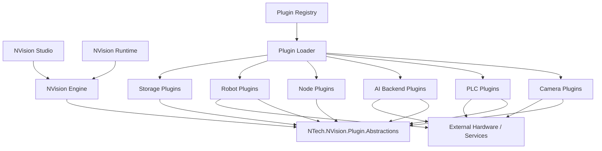
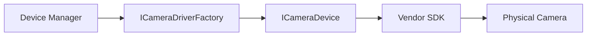
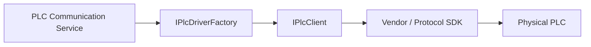
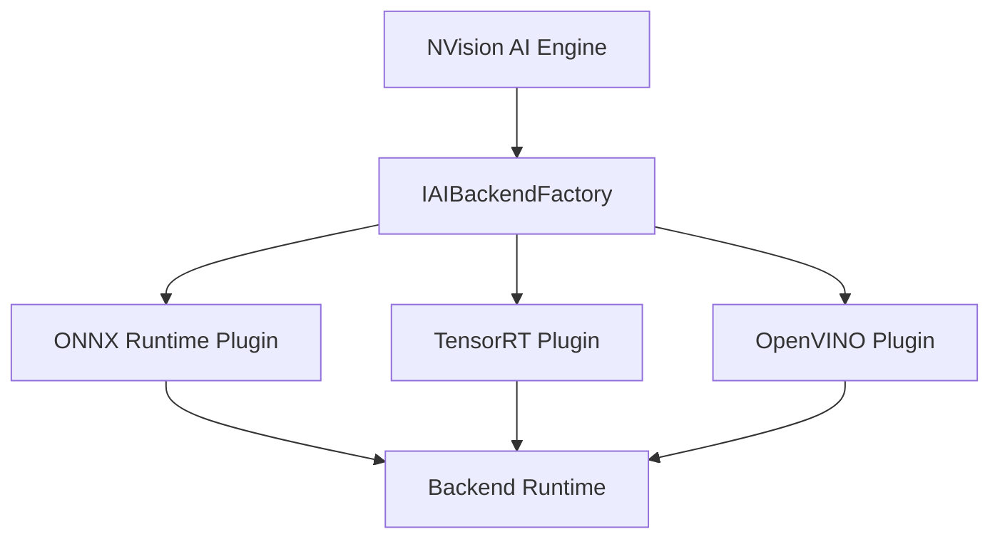
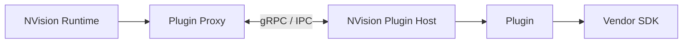
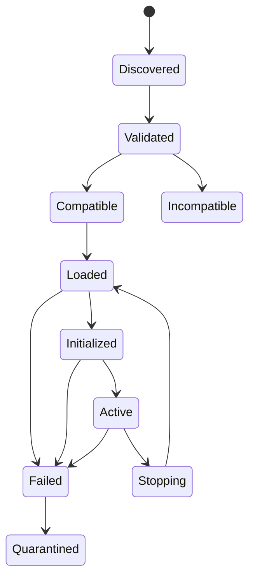
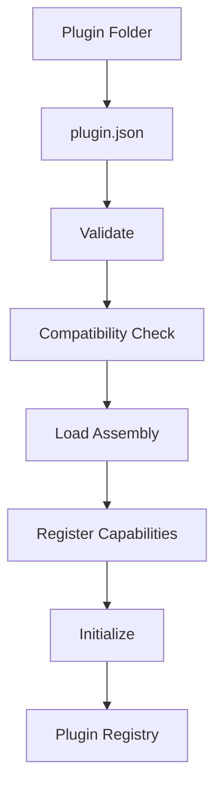
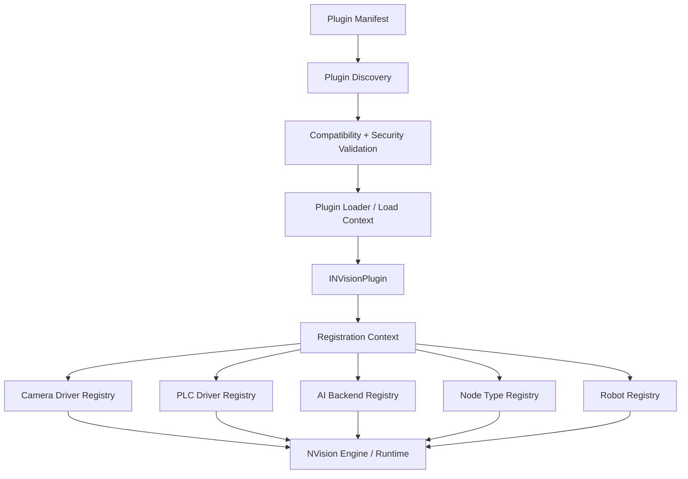

# 04 — NVision Plugin Architecture

**Product:** NTech NVision  
**Document Type:** Extension / Plugin Architecture  
**Status:** Foundation Architecture  
**Version:** 1.0  
**Date:** 2026-08-18  
**Parent Documents:**  
- `NVISION_PLATFORM_FOUNDATION.md`
- `01_PLATFORM_ARCHITECTURE.md`
- `02_DOMAIN_MODEL.md`
- `03_WORKFLOW_ENGINE_ARCHITECTURE.md`

---

# 1. Purpose

This document defines the architecture of the **NVision Plugin System**.

> **Implementation authority:** Camera, AI backend, and performance-sensitive Workflow
> node plugins use the versioned native C ABI from ADR-0005. Managed plugins are limited
> to non-hot-path business, exporter, reporting, and authoring extensions.

The Plugin System is the primary extension boundary that allows NVision to integrate new:

- Camera vendors
- PLC protocols
- Robot controllers
- Light controllers
- Digital I/O devices
- AI inference backends
- Vision tools
- Workflow nodes
- Storage providers
- Communication protocols
- Exporters
- Diagnostics providers

without modifying the NVision Core.

The plugin architecture must ensure that:

- NVision Core remains vendor-independent
- Plugins can evolve independently
- Plugins are discoverable and versioned
- Compatibility is validated before activation
- Broken plugins do not silently corrupt Runtime behavior
- Production deployment can lock plugin versions
- Third-party extensions can eventually be supported safely
- Native SDK dependencies remain isolated
- Out-of-process plugin hosting is possible where needed

The core rule is:

> **NVision defines contracts. Plugins implement integrations.**

---

# 2. Architecture Goals

The plugin system must provide:

## 2.1 Vendor Isolation

NVision Domain and Engine must not directly reference:

```text
Basler.Pylon
Hikrobot.MVS
Siemens SDK
Mitsubishi SDK
TensorRT native API
OpenVINO API
Robot vendor SDK
```

These dependencies belong in plugins/adapters.

---

## 2.2 Stable Contracts

Plugins must target a stable NVision-owned abstraction layer.

Example:

```text
ICameraDevice
IPlcClient
IAIBackend
INodeExecutor
IRobotAdapter
```

---

## 2.3 Independent Versioning

Plugin versions are independent from NVision product versions.

Example:

```text
NVision Runtime 1.4.0
Basler Camera Plugin 1.2.3
TensorRT Backend Plugin 2.1.0
```

---

## 2.4 Controlled Compatibility

Runtime must validate:

```text
Plugin API Version
Plugin Version
Runtime Version
Platform / OS
CPU Architecture
Native Dependencies
```

before activation.

---

## 2.5 Production Reproducibility

A deployment must be traceable to exact plugin versions.

Example:

```text
WireMarkerInspection 2.1.0
uses:
- ntech.camera.basler 1.3.2
- ntech.ai.onnxruntime 1.5.0
- ntech.plc.mitsubishi-mc 1.1.4
```

---

## 2.6 Testability

Core features must be testable using:

```text
FakeCameraPlugin
FakePlcPlugin
FakeAIBackend
TestNodePlugin
```

without physical hardware.

---

# 3. Position in NVision Architecture



---

# 4. Core Dependency Rule

Correct dependency:

```text
NVision Core
    ↓
Plugin Abstractions

Plugin Implementation
    ↓
Plugin Abstractions
    ↓
Vendor SDK
```

Incorrect:

```text
NVision Core
    ↓
Vendor SDK
```

Core must never directly reference plugin implementation assemblies.

---

# 5. Plugin Categories

Initial categories:

```text
Camera
PLC
Robot
Light
DigitalIO
AIBackend
VisionNode
WorkflowNode
Storage
Communication
Exporter
Diagnostics
```

Not all categories need to be public in MVP.

---

# 6. Plugin vs Adapter

Terminology:

## Plugin

Deployable extension package.

Example:

```text
NTech.NVision.Plugin.Camera.Basler
```

## Adapter

Implementation inside a plugin translating vendor-specific API to NVision contract.

Example:

```text
BaslerCameraAdapter : ICameraDevice
```

One plugin may contain multiple adapters.

---

# 7. Plugin Identity

Each plugin must have stable identity.

Recommended format:

```text
{publisher}.{category}.{name}
```

Examples:

```text
ntech.camera.basler
ntech.camera.hikrobot
ntech.plc.modbus-tcp
ntech.plc.mitsubishi-mc
ntech.ai.onnxruntime
ntech.ai.tensorrt
ntech.robot.nachi
ntech.robot.denso
```

Plugin ID is immutable.

Display name may change.

---

# 8. Plugin Manifest

Every plugin package contains a manifest.

Recommended:

```text
plugin.json
```

Conceptual structure:

```json
{
  "id": "ntech.camera.basler",
  "name": "Basler Camera Plugin",
  "publisher": "NTech",
  "version": "1.3.2",
  "apiVersion": "1.0",
  "minimumRuntimeVersion": "1.2.0",
  "category": "camera",
  "entryAssembly": "NTech.NVision.Plugin.Camera.Basler.dll",
  "entryPoint": "NTech.NVision.Plugin.Camera.Basler.BaslerPlugin",
  "platforms": [
    "win-x64"
  ],
  "capabilities": [
    "camera"
  ]
}
```

The exact schema is defined later.

---

# 9. Plugin Manifest Fields

Recommended fields:

```text
Id
Name
Publisher
Description
Version
ApiVersion
MinimumRuntimeVersion
MaximumRuntimeVersion
Category
EntryAssembly
EntryPoint
Platforms
Architectures
Capabilities
Dependencies
NativeDependencies
Permissions
Signature
Metadata
```

---

# 10. Plugin Version

Use semantic versioning:

```text
MAJOR.MINOR.PATCH
```

Example:

```text
1.4.2
```

Recommended semantics:

```text
MAJOR
breaking plugin behavior / config incompatibility

MINOR
backward-compatible features

PATCH
bug fixes
```

---

# 11. Plugin API Version

Separate from plugin version.

Example:

```text
Plugin Version: 2.4.1
Plugin API Version: 1.0
```

Multiple plugin releases may target same API.

Runtime uses API version to determine contract compatibility.

---

# 12. Compatibility Model

Compatibility axes:

```text
PluginVersion
PluginApiVersion
RuntimeVersion
OS
Architecture
NativeSDKVersion
HardwareGeneration
```

The Runtime must validate all relevant axes.

---

# 13. Runtime Compatibility Policy

Example:

```text
Plugin API 1.x
Runtime supports API 1.x
→ compatible

Plugin API 2.0
Runtime supports only 1.x
→ reject
```

Never load a plugin and hope it works.

---

# 14. Plugin Package

Future package extension:

```text
.nvplugin
```

Possible structure:

```text
plugin-package/
├── plugin.json
├── lib/
│   ├── NTech.NVision.Plugin.Camera.Basler.dll
│   └── dependencies...
├── native/
│   └── win-x64/
├── schemas/
├── assets/
├── docs/
└── signature/
```

MVP may deploy plugin folders directly.

---

# 15. Plugin Installation Directory

Windows example:

```text
C:\Program Files\NTech\NVision\plugins\
├── ntech.camera.basler\
├── ntech.ai.onnxruntime\
└── ntech.plc.modbus-tcp\
```

Linux example:

```text
/opt/ntech/nvision/plugins/
```

Each plugin should own its directory.

---

# 16. Plugin Data Directory

Writable data must not be stored in plugin installation folder.

Use:

```text
ProgramData / var/lib
```

Example:

```text
C:\ProgramData\NTech\NVision\plugins\
    ntech.camera.basler\
```

---

# 17. Plugin Discovery

Runtime discovers plugins from configured plugin roots.

Workflow:

```text
Scan Plugin Directories
        ↓
Read plugin.json
        ↓
Validate Manifest
        ↓
Check Compatibility
        ↓
Register Candidate
```

Do not load assemblies before basic manifest validation where possible.

---

# 18. Plugin Registry

Central component:

```text
IPluginRegistry
```

Responsibilities:

- List discovered plugins
- Track loaded plugins
- Resolve capabilities
- Track versions
- Expose diagnostics
- Detect duplicates
- Enforce policy
- Support deployment compatibility checks

---

# 19. Plugin Descriptor

Conceptual:

```text
PluginDescriptor
├── PluginId
├── Name
├── Version
├── ApiVersion
├── Publisher
├── Category
├── State
├── Capabilities
├── Path
├── Dependencies
└── Diagnostics
```

---

# 20. Plugin State

Suggested states:

```text
Discovered
Validated
Compatible
Loaded
Active
Disabled
Incompatible
Failed
Quarantined
```

---

# 21. Plugin Loader

Component:

```text
IPluginLoader
```

Responsibilities:

- Load plugin assembly
- Create plugin entry point
- Create isolated dependency context
- Initialize plugin
- Register plugin services
- Shutdown/unload where supported
- Convert failures into structured diagnostics

---

# 22. Plugin Entry Point

Conceptual:

```csharp
public interface INVisionPlugin
{
    PluginIdentity Identity { get; }

    void Configure(
        IPluginRegistrationContext context);

    ValueTask InitializeAsync(
        IPluginRuntimeContext context,
        CancellationToken cancellationToken);

    ValueTask ShutdownAsync(
        CancellationToken cancellationToken);
}
```

Exact API may evolve.

---

# 23. Registration Phase

Plugin registers capabilities.

Examples:

```text
RegisterCameraDriver
RegisterNodeType
RegisterAIBackend
RegisterPlcProtocol
RegisterRobotAdapter
```

Registration must happen before production execution.

---

# 24. Initialization Phase

Initialization may:

- Validate vendor SDK
- Validate native library
- Initialize global vendor runtime
- Prepare shared services

Initialization should not connect every configured device automatically unless contract requires it.

Device lifecycle remains Device Manager responsibility.

---

# 25. Shutdown Phase

Plugin must release:

```text
Vendor global runtime
Native handles
Threads
Background services
Temporary resources
```

Shutdown must be bounded by timeout.

---

# 26. Plugin Registration Context

Avoid exposing global DI container directly.

Preferred:

```text
IPluginRegistrationContext
```

with explicit methods.

Example:

```text
RegisterCameraDriver(...)
RegisterNodeType(...)
RegisterAIBackend(...)
```

This prevents arbitrary service replacement.

---

# 27. Plugin Runtime Context

Expose limited services:

```text
Logger
Configuration
Metrics
PluginDataPath
PlatformInfo
SecretResolver
```

Do not give plugins unrestricted internal Runtime access.

---

# 28. Plugin Capability Registry

Capabilities are open identifiers.

Examples:

```text
nvision.capability.camera
nvision.capability.plc
nvision.capability.ai-backend
nvision.capability.workflow-node
nvision.capability.robot
```

One plugin may provide multiple capabilities.

---

# 29. Camera Plugin Architecture



---

# 30. Camera Driver Factory

Conceptual:

```text
ICameraDriverFactory
```

Responsibilities:

- Enumerate compatible devices where supported
- Validate configuration
- Create `ICameraDevice`
- Report capabilities

---

# 31. Camera Plugin Contract

Main contract:

```text
ICameraDevice
```

Possible support interfaces:

```text
ICameraDiscovery
ICameraFeatureProvider
ICameraStream
ICameraTrigger
```

Keep base interface minimal.

Use capabilities for optional functionality.

---

# 32. Camera Capability Model

Examples:

```text
HardwareTrigger
SoftwareTrigger
ContinuousAcquisition
ExposureControl
GainControl
FrameRateControl
ROI
PixelFormat
PTP
ChunkData
StrobeOutput
```

Studio should build configuration UI from capabilities/schema.

---

# 33. Camera Configuration Schema

Plugin may expose parameter descriptors:

```text
ExposureUs
Gain
TriggerMode
PixelFormat
PacketSize
```

Each descriptor:

```text
Key
Type
Unit
Min
Max
AllowedValues
ReadOnly
RecipeOverridable
RequiresReconnect
```

---

# 34. Camera Plugin Example

```text
Plugin:
ntech.camera.basler

provides:
BaslerCameraDriverFactory

uses:
Basler Pylon SDK

implements:
ICameraDevice
```

NVision Engine never sees `Basler.Pylon.Camera`.

---

# 35. PLC Plugin Architecture



---

# 36. PLC Protocol Plugin

Examples:

```text
ntech.plc.modbus-tcp
ntech.plc.mitsubishi-mc
ntech.plc.siemens-s7
ntech.plc.omron-fins
```

---

# 37. PLC Contract

Conceptual:

```text
IPlcClient
```

Operations:

```text
Connect
Disconnect
Read
Write
BatchRead
BatchWrite
Health
```

Use NVision-owned types.

Do not leak vendor register objects.

---

# 38. Symbolic Mapping

Plugin sees resolved protocol address.

Application/workflow prefers symbolic signal:

```text
InspectionResult
```

mapping:

```text
InspectionResult → D110
```

Protocol plugin handles vendor-specific representation.

---

# 39. PLC Data Types

NVision common PLC data model may include:

```text
Bool
Int16
UInt16
Int32
UInt32
Float32
Float64
String
Bytes
```

Protocol plugin converts to vendor format.

---

# 40. Robot Plugin Architecture

```text
IRobotAdapter
```

Potential capabilities:

```text
ReadPose
ReadState
SendTargetPose
SendCommand
TriggerCapture
VisionOffset
```

Robot plugin must not assume all robots support same operations.

---

# 41. Robot Capability Model

Examples:

```text
PoseRead
DigitalIO
MotionCommand
VisionOffset
ProgramSelection
ToolFrame
UserFrame
```

---

# 42. Light Controller Plugin

Contract:

```text
ILightController
```

Capabilities:

```text
ChannelIntensity
EnableDisable
Strobe
Preset
TriggerDelay
```

---

# 43. Digital I/O Plugin

Contract:

```text
IDigitalIODevice
```

Capabilities:

```text
ReadInput
WriteOutput
EdgeEvent
PulseOutput
```

Hard real-time safety remains outside NVision.

---

# 44. AI Backend Plugin Architecture



---

# 45. AI Backend Contract

Conceptual:

```text
IAIBackend
IAIModelSession
IAIBackendFactory
```

Responsibilities:

- Report supported model formats
- Validate model compatibility
- Load model
- Warm-up
- Infer
- Release resources
- Report device/backend info

---

# 46. AI Backend Capabilities

Examples:

```text
Classification
Detection
Segmentation
DynamicBatch
FP16
INT8
GPU
CPU
DynamicShape
```

---

# 47. AI Backend Selection

AI Engine chooses backend based on:

```text
Model requirements
Recipe selection
Platform
Available plugin
Configuration
Optimization preference
```

Workflow node does not select low-level API directly.

---

# 48. Vision Node Plugins

Third-party or NTech extension may add new workflow nodes.

Example:

```text
ntech.vision.barcode
ntech.vision.advanced-pattern
partner.surface.inspector
```

These register `NodeTypeDefinition` and executor factory.

---

# 49. Node Plugin Registration

Plugin registers:

```text
NodeTypeId
Version
Ports
Parameters
Capabilities
ExecutorFactory
UI metadata
```

Runtime consumes execution metadata.

Studio consumes authoring metadata.

---

# 50. Node Plugin Boundary

Node executor may depend on plugin-private libraries.

But inputs/outputs crossing graph ports should use NVision data contracts where possible.

Avoid plugin-specific opaque types unless explicitly designed.

---

# 51. Custom Data Types

Third-party node plugins may eventually define custom data types.

This should be restricted.

Reasons:

- graph portability
- serialization
- Studio rendering
- compatibility

MVP recommendation:

> Plugin nodes should primarily use built-in NVision data types.

---

# 52. Storage Plugin

Possible future contract:

```text
IInspectionStorage
IImageStorage
IArchiveStorage
```

Examples:

```text
Local file
NAS
S3-compatible object storage
Azure Blob
```

Runtime local storage remains default.

---

# 53. Communication Plugin

Possible adapters:

```text
MQTT
OPC UA
REST
Custom TCP
```

Keep critical machine handshake separated from optional enterprise integration.

---

# 54. Exporter Plugin

Future:

```text
CSV Export
Excel Report
PDF Report
Customer MES Format
```

Export plugins consume stable domain DTOs/results.

---

# 55. Diagnostics Plugin

Possible integration:

```text
Prometheus
OpenTelemetry
Vendor diagnostics
```

Diagnostics must not become critical dependency for inspection.

---

# 56. Plugin Dependencies

Plugins may depend on:

```text
NVision Plugin API
Other plugin
Managed library
Native library
Vendor runtime
OS package
```

All required dependencies should be declared where practical.

---

# 57. Plugin-to-Plugin Dependency

Avoid excessive plugin coupling.

Allowed example:

```text
Advanced Basler Plugin
depends on
Common GenICam Plugin
```

But preference:

> Share common functionality through stable libraries or core abstractions, not plugin chains.

---

# 58. Dependency Manifest

Conceptual:

```json
{
  "dependencies": [
    {
      "pluginId": "ntech.common.genicam",
      "version": ">=1.2.0 <2.0.0"
    }
  ]
}
```

---

# 59. Native Dependencies

Manifest may declare:

```text
Pylon Runtime
CUDA
TensorRT
OpenVINO Runtime
Vendor Driver
```

Runtime can report missing prerequisite before plugin load.

---

# 60. Native Library Isolation

Native libraries often cause version conflicts.

Strategies:

```text
Plugin-local native directory
Explicit DLL search path
AssemblyLoadContext
Out-of-process host
```

Do not rely on global PATH when avoidable.

---

# 61. .NET Assembly Isolation

Use custom:

```text
AssemblyLoadContext
```

where practical.

Benefits:

- dependency version isolation
- controlled loading
- potential unloading

Limitations exist with native libraries.

---

# 62. Plugin Load Context

Concept:

```text
PluginLoadContext
```

loads:

```text
plugin assembly
private managed dependencies
```

Shared NVision contract assembly must resolve to host copy.

Do not load duplicate copies of Plugin Abstractions.

---

# 63. Shared Contract Assembly Rule

Critical:

```text
NTech.NVision.Plugin.Abstractions
```

must be shared between host and plugin.

Otherwise .NET type identity breaks.

---

# 64. Vendor SDK Assembly Rule

Vendor SDK assemblies should normally remain plugin-private.

Example:

```text
Basler.Pylon.dll
```

belongs to Basler plugin directory.

---

# 65. Native ABI Boundary

For C++ plugins, prefer a small stable ABI.

Possible pattern:

```text
NVision Native Adapter DLL
    ↓
C ABI
    ↓
Vendor C++ SDK
```

Then managed plugin uses P/Invoke.

---

# 66. C++/CLI Plugins

Allowed for Windows-specific complex SDK wrapping.

Constraints:

- Windows only
- deployment complexity
- runtime version matching

Prefer small boundary.

---

# 67. Out-of-Process Plugin Host

Some plugins should eventually run outside Runtime process.

Use cases:

- unstable vendor SDK
- incompatible native dependency versions
- GPU runtime conflicts
- crash isolation
- license runtime isolation

Architecture:



---

# 68. Plugin Hosting Modes

Plugin manifest may declare:

```text
InProcess
OutOfProcess
Either
```

MVP:

```text
InProcess
```

Future:

```text
OutOfProcess
```

for selected categories.

---

# 69. Out-of-Process Camera Host

Potential architecture:

```text
Runtime
   │ control IPC
   ▼
Camera Host
   │
Vendor SDK
   │
Camera
```

Frame transport:

```text
Shared Memory
```

preferred for high bandwidth.

Control transport:

```text
gRPC / named pipe / Unix socket
```

---

# 70. Out-of-Process AI Host

Useful if:

- TensorRT native runtime conflict
- Python inference backend
- GPU isolation

Frame/tensor transfer must be optimized.

Avoid JSON image transfer.

---

# 71. Plugin Failure Isolation

Plugin failure categories:

```text
Manifest Error
Compatibility Error
Load Error
Initialization Error
Runtime Error
Native Crash
Deadlock
Resource Leak
```

Host should expose them separately.

---

# 72. Plugin Error Model

```text
PluginError
├── PluginId
├── Version
├── Stage
├── Code
├── Message
├── Exception
├── Recoverable
└── Timestamp
```

Stages:

```text
Discovery
Validation
Load
Registration
Initialization
Execution
Shutdown
```

---

# 73. Plugin Health

Each active plugin may expose:

```text
PluginHealth
├── State
├── LastError
├── Diagnostics
├── DependencyStatus
└── UpdatedAt
```

---

# 74. Quarantine

If plugin repeatedly fails initialization or crashes host:

```text
Quarantined
```

Runtime should not keep retrying indefinitely.

Manual engineering intervention may be required.

---

# 75. Plugin Security

Plugins are executable code.

Therefore plugin installation is a privileged operation.

Security controls should include:

```text
Publisher identity
Package signature
Hash verification
Allowed directories
Permission model
Audit log
```

---

# 76. Signed Plugins

Future `.nvplugin` package should support signing.

Runtime verifies:

```text
Package hash
Signature
Publisher certificate / trusted key
```

Production policy may require trusted signatures.

---

# 77. Plugin Trust Levels

Possible future levels:

```text
NTechTrusted
PartnerTrusted
LocalDevelopment
Untrusted
```

Production Runtime may allow only trusted plugins.

---

# 78. Developer Mode

Studio can support:

```text
Developer Mode
```

allowing unsigned local plugins.

Runtime Production Mode should be stricter.

---

# 79. Plugin Permissions

Future manifest may declare permissions.

Examples:

```text
CameraAccess
NetworkAccess
FileAccess
NativeCode
GPUAccess
ExternalProcess
```

Initial .NET process cannot fully sandbox managed plugins.

Permissions are primarily policy/visibility unless out-of-process sandboxing is used.

---

# 80. Secrets

Plugins needing credentials use:

```text
ISecretResolver
```

with secret reference.

Bad:

```json
{
  "password": "123456"
}
```

in plugin/project config.

Preferred:

```text
CredentialRef = "plc-main"
```

---

# 81. File System Access

Plugin receives dedicated paths:

```text
PluginInstallPath
PluginDataPath
PluginCachePath
```

Avoid arbitrary writes into NVision core directories.

---

# 82. Network Policy

Plugin network requirements should be declared.

Example:

```text
Camera plugin → local device network
MES plugin → remote server
```

Future enterprise deployments may enforce firewall policy.

---

# 83. Plugin Configuration

Separate:

```text
Plugin Global Configuration
Device Instance Configuration
Node Instance Configuration
```

Example:

```text
Basler Plugin Global:
SDK options

Camera CAM_TOP:
SerialNumber
Exposure

CameraGrab Node:
DeviceId
Timeout
```

---

# 84. Global Plugin Configuration

Use sparingly.

Examples:

```text
SDK logging level
global transport option
license server
```

Do not store device-specific settings globally.

---

# 85. Configuration Schema

Plugin can expose JSON Schema-like metadata.

Used by Studio to generate settings UI.

Example parameter:

```text
Key: PacketSize
Type: Integer
Min: 576
Max: 9000
Unit: bytes
```

---

# 86. Plugin UI Extension

Avoid letting plugins inject arbitrary WPF UI into core Studio initially.

Preferred:

```text
Schema-driven configuration UI
```

Benefits:

- consistent UX
- fewer UI dependencies
- easier future cross-platform support

---

# 87. Custom Plugin UI

Future escape hatch may allow:

```text
IPluginSettingsViewProvider
```

but this couples plugin to UI framework.

Use only when schema-driven editor is insufficient.

---

# 88. Headless Compatibility

A plugin that is needed in Runtime must not require UI initialization.

Manifest may declare:

```text
HeadlessCompatible = true
```

Production plugins should generally be headless compatible.

---

# 89. Studio-Only Plugins

Possible category:

```text
AuthoringExtension
```

Examples:

- custom visual editor
- dataset import tool
- project wizard

These are not deployed to Runtime unless required.

---

# 90. Runtime-Only Plugins

Examples:

- hardware adapters
- optimized backend

Studio may still inspect metadata without fully loading hardware SDK if possible.

---

# 91. Metadata-Only Discovery

Studio should be able to show:

```text
plugin name
version
capability
node definitions
```

from manifest/static metadata where practical.

Avoid loading dangerous native SDK merely to populate toolbox.

---

# 92. Deployment Plugin Lock

Deployment package should include:

```text
plugins.lock
```

Example:

```json
{
  "plugins": [
    {
      "id": "ntech.camera.basler",
      "version": "1.3.2",
      "apiVersion": "1.0"
    }
  ]
}
```

---

# 93. Exact vs Range Lock

Production recommendation:

```text
Exact Version
```

for reproducibility.

Example:

```text
1.3.2
```

not:

```text
>=1.0
```

Runtime deployment validation can allow compatible replacement only by explicit policy.

---

# 94. Plugin Update Policy

Updating plugin on station is a controlled deployment action.

Flow:

```text
Install New Plugin
      ↓
Validate
      ↓
Keep Old Version
      ↓
Test Package
      ↓
Activate
      ↓
Rollback if needed
```

---

# 95. Side-by-Side Versions

Future Runtime may support:

```text
ntech.camera.basler/
├── 1.3.2/
└── 1.4.0/
```

This improves rollback.

MVP may support one active version per plugin ID.

---

# 96. Plugin Uninstall Policy

Do not uninstall plugin if:

- active deployment requires it
- station currently uses it
- package rollback depends on it

Use dependency check.

---

# 97. Plugin Configuration Migration

Plugin may evolve configuration schema.

Interface:

```text
IPluginConfigurationMigrator
```

Example:

```text
v1 config
→ v2 config
```

Migration should occur in Studio/maintenance path, not silently mid-inspection.

---

# 98. Node Configuration Migration

Node plugins may implement:

```text
INodeConfigurationMigrator
```

from:

```text
NodeTypeVersion 1
→ NodeTypeVersion 2
```

---

# 99. Device Configuration Migration

Camera/PLC plugin may migrate device config.

Example:

```text
IPAddress string
→ structured endpoint
```

Again, publish migrated version explicitly.

---

# 100. Plugin API Evolution

When Plugin API changes:

```text
1.0 → 1.1
```

backward compatible.

```text
1.x → 2.0
```

breaking.

Runtime may support multiple API generations temporarily through adapters.

---

# 101. Plugin API Compatibility Window

Recommended policy:

```text
Runtime 2.x
supports Plugin API:
1.x
2.x
```

for migration period where practical.

Avoid indefinite support.

---

# 102. Built-In Plugins

Even NTech-provided vendor integrations should use plugin architecture.

Examples:

```text
ntech.camera.basler
ntech.ai.onnxruntime
```

This prevents built-ins from becoming privileged coupling exceptions.

---

# 103. Core Built-In Nodes

Some minimal pure nodes may live in built-in node assembly.

Example:

```text
Crop
Compare
AND
Decision
```

Architecturally, they should still register through same Node Type Registry.

---

# 104. Plugin SDK

Future developer package:

```text
NVision Plugin SDK
```

Includes:

```text
Plugin Abstractions
Templates
Sample Plugins
Validation Tool
Packaging Tool
Documentation
```

---

# 105. Plugin Template

Example CLI:

```text
nvision plugin new camera MyCamera
```

generates:

```text
MyCompany.NVision.Plugin.Camera.MyCamera/
├── plugin.json
├── MyCameraPlugin.cs
├── MyCameraDriverFactory.cs
├── MyCameraDevice.cs
└── tests/
```

Future feature.

---

# 106. Plugin Validation Tool

CLI:

```text
nvision-plugin validate path/
```

checks:

- manifest
- API version
- assembly
- entry point
- duplicate IDs
- package contents
- signature
- native dependencies where possible

---

# 107. Plugin Packaging Tool

Future:

```text
nvision-plugin pack
```

creates:

```text
.nvplugin
```

---

# 108. Plugin Test Harness

NTech should provide contract tests.

Example:

```text
CameraPluginContractTests
PlcPluginContractTests
AIBackendContractTests
NodePluginContractTests
```

---

# 109. Camera Contract Tests

Test:

```text
Create device
Connect
Disconnect
Reconnect
Invalid config
Grab timeout
Cancellation
Dispose
Capability consistency
```

Hardware-independent tests use simulator where available.

---

# 110. PLC Contract Tests

Test:

```text
connect
read
write
batch
timeout
disconnect
reconnect
invalid address
```

---

# 111. AI Backend Contract Tests

Test:

```text
load model
infer
cancel
invalid model
unsupported shape
dispose
warm-up
repeat inference
```

---

# 112. Node Plugin Contract Tests

Test:

```text
registration
port definitions
parameter validation
execution
failure
cancellation
thread safety declaration
```

---

# 113. Plugin Soak Tests

Hardware plugins require long-running tests.

Examples:

```text
camera acquisition 24h
PLC reconnect loop
AI repeated inference
memory leak test
native handle leak
```

---

# 114. Plugin Certification Levels

Future NTech ecosystem:

```text
NTech Certified
Partner Verified
Community
Development Only
```

Certification can represent test coverage/support level.

---

# 115. Logging

Plugin logging uses host-provided logger.

Context:

```text
PluginId
PluginVersion
DeviceId
InspectionId
NodeId
```

Do not configure independent unrelated logging frameworks unless necessary.

---

# 116. Plugin Metrics

Plugin may publish metrics through host interface.

Examples:

Camera:

```text
FramesReceived
GrabTimeouts
DroppedFrames
ReconnectCount
```

AI:

```text
InferenceMs
GpuMemory
ModelLoadMs
```

PLC:

```text
ReadLatency
WriteLatency
ReconnectCount
```

---

# 117. Plugin Diagnostics

Plugin may expose:

```text
GetDiagnostics()
```

Examples:

```text
SDK version
Driver version
Connected device firmware
Transport layer
GPU runtime version
```

---

# 118. Version Traceability

Inspection result or execution package should allow recovery of plugin environment.

Recommended package/station metadata:

```text
PluginSetHash
```

computed from exact plugin IDs + versions.

---

# 119. PluginSet

Concept:

```text
PluginSet
├── Plugins
├── Hash
└── CreatedAt
```

Useful for audit.

---

# 120. Plugin Runtime Snapshot

At Runtime session start record:

```text
Active Plugin Set
Runtime Version
OS
Architecture
```

for diagnostics.

---

# 121. Plugin Conflict Detection

Detect:

```text
duplicate PluginId
duplicate NodeTypeId
multiple default drivers
incompatible dependency versions
native runtime conflict
```

Fail before production start.

---

# 122. Node Type Conflict

Two plugins cannot register same:

```text
NodeTypeId + Version
```

unless explicit override policy exists.

Default:

```text
Reject conflict
```

---

# 123. Driver Selection

Device configuration uses explicit:

```text
DriverId
```

No ambiguous automatic vendor selection in production.

Discovery UI may suggest a driver.

---

# 124. AI Backend Priority

AI Engine may choose from multiple compatible backends.

Configuration:

```text
PreferredBackend
FallbackBackends
```

Fallback must be explicit.

---

# 125. AI Backend Fallback

Example:

```text
TensorRT unavailable
→ ONNX Runtime CUDA
```

Only if model/recipe policy allows it.

Inspection trace must record actual backend used if this affects reproducibility.

---

# 126. Plugin State and Runtime Readiness

Runtime readiness includes:

```text
Required plugins loaded
Required drivers available
Required plugin health OK
```

Missing optional plugin generates warning.

Missing required plugin blocks `Ready`.

---

# 127. Required vs Optional Plugin

Deployment lock marks:

```text
Required = true/false
```

Example:

```text
Camera plugin = required
Debug exporter = optional
```

---

# 128. Runtime Start Validation

Before Runtime becomes `Ready`:

```text
1. Validate deployment package
2. Resolve plugin requirements
3. Validate versions
4. Load plugins
5. Initialize plugins
6. Resolve device drivers
7. Prepare models
8. Check health
```

---

# 129. Plugin Lifecycle State Machine



---

# 130. Device Adapter Lifecycle

Plugin lifecycle is not device lifecycle.

Example:

```text
Basler Plugin = Active

CAM_TOP device:
Offline → Connecting → Ready
```

Do not unload plugin because one device disconnects.

---

# 131. Plugin Hot Reload

Do not hot-reload production plugins while inspection runs.

Update requires controlled Runtime stop/restart or maintenance mode.

---

# 132. Development Hot Reload

Studio developer mode may support plugin reload where technically safe.

Never make it a production requirement.

---

# 133. Unloading Limitations

.NET assembly unloading may fail if plugin leaks:

- static references
- threads
- event handlers
- native libraries

Therefore process restart remains acceptable for plugin update.

---

# 134. Runtime Restart Policy

Installing/updating native plugins may require:

```text
NVision Runtime Service restart
```

This is acceptable in controlled maintenance.

---

# 135. Cross-Platform Plugin Manifest

Platform identifiers:

```text
win-x64
linux-x64
linux-arm64
```

Plugin may support multiple.

---

# 136. Platform-Specific Assets

Package layout:

```text
native/
├── win-x64/
├── linux-x64/
└── linux-arm64/
```

---

# 137. Jetson Plugin Example

```text
ntech.ai.tensorrt
Platforms:
- linux-arm64

Requirements:
- CUDA >= ...
- TensorRT >= ...
```

Exact versions controlled by compatibility manifest.

---

# 138. Windows Camera Plugin Example

```text
ntech.camera.basler
Platforms:
- win-x64

Native prerequisite:
- Pylon Runtime
```

Future Linux variant may use same PluginId if behavior/config compatible, or separate implementation package.

---

# 139. Plugin ID Across Platforms

Prefer same PluginId if it represents same logical integration.

Platform-specific binaries can differ.

Example:

```text
ntech.camera.basler
```

with separate assets for:

```text
win-x64
linux-x64
```

---

# 140. Licensing Dependencies

Vendor SDK may require license.

Plugin diagnostics should expose:

```text
LicenseStatus
```

without leaking secret/license content.

---

# 141. Third-Party License Tracking

Plugin package metadata should eventually record third-party licenses.

Useful for commercial distribution.

---

# 142. Plugin Marketplace

Future NVision ecosystem may provide a plugin catalog.

Not part of MVP.

Architecture should support:

```text
Plugin ID
Version
Publisher
Signature
Compatibility
```

needed for marketplace later.

---

# 143. Offline Installation

Industrial systems often lack Internet.

Plugin install must support offline package:

```text
.nvplugin
```

No cloud dependency.

---

# 144. Enterprise Plugin Policy

Future Hub may enforce:

```text
Approved Plugin List
Allowed Versions
Publisher Trust
Station Compatibility
```

Runtime still functions standalone.

---

# 145. Plugin Lock in Backup

NVision backup should include:

```text
plugins.lock
```

and optionally plugin packages if licensing permits.

---

# 146. Plugin Lock in Deployment

Deployment package references exact required plugin versions.

The package itself should generally not embed vendor SDK binaries automatically unless distribution rights allow it.

---

# 147. Vendor SDK Distribution

Some SDKs cannot legally be redistributed.

Plugin installer may require separate vendor runtime installation.

Manifest supports prerequisite detection.

---

# 148. Dependency Check Result

```text
PluginDependencyCheck
├── IsSatisfied
├── Missing
├── Incompatible
├── Warnings
└── Instructions
```

---

# 149. Plugin Installation Audit

Audit events:

```text
PluginInstalled
PluginUpdated
PluginRemoved
PluginEnabled
PluginDisabled
PluginQuarantined
```

---

# 150. Plugin Enable / Disable

Engineering can disable optional plugin.

Required active deployment plugin cannot be disabled without invalidating readiness.

---

# 151. Plugin Configuration Audit

Changes to:

```text
driver configuration
global plugin settings
```

should be auditable if production-relevant.

---

# 152. Plugin Exception Policy

Managed exception:

```text
catch at plugin boundary
→ structured PluginError
→ alarm/diagnostic
```

Do not allow unhandled plugin exceptions to propagate to UI thread.

---

# 153. Native Exception Policy

Fatal native exception may not be recoverable in-process.

Use:

```text
Out-of-process host
```

for high-risk plugins where necessary.

---

# 154. Threading Policy

Plugins must not create uncontrolled long-lived threads.

If background threads are required:

- document them
- support cancellation
- stop on shutdown
- report health

---

# 155. Async Policy

Prefer asynchronous APIs for I/O.

Examples:

```text
Camera grab
PLC read
Network robot query
```

If vendor API is blocking, plugin wraps it responsibly.

---

# 156. Timeout Policy

Plugin adapter methods should accept timeout/cancellation from Engine/Application.

Do not hide infinite vendor waits.

---

# 157. Cancellation Policy

Where vendor SDK cannot cancel:

- use finite vendor timeout
- isolate call
- potentially use out-of-process host

Plugin metadata may state limited cancellation support.

---

# 158. Reconnect Policy

Device plugin reports connection failure.

Device Manager owns generic reconnect policy.

Plugin may implement protocol-specific reconnect mechanics.

---

# 159. Retry Ownership

Avoid both Device Manager and plugin independently retrying indefinitely.

Define:

```text
Plugin performs low-level operation
Device Manager performs lifecycle retry
```

unless vendor requires internal retry.

---

# 160. Plugin Configuration Validation

Plugin provides:

```text
ValidateConfiguration(...)
```

before creating device/session.

Validation result uses NVision standard issues.

---

# 161. Validation Issue Example

```text
PluginId: ntech.camera.basler
Field: PacketSize
Code: CAMCFG-004
Message: Packet size exceeds interface MTU.
Severity: Error
```

---

# 162. Capability Discovery

Camera/robot plugin may discover hardware dynamically.

Discovery result:

```text
DiscoveredDevice
├── DriverId
├── HardwareId
├── DisplayName
├── Address
├── Metadata
└── Capabilities
```

Discovery is authoring/maintenance functionality.

---

# 163. Hardware Identity

Do not rely only on IP address.

Prefer stable identifier where available:

```text
Serial Number
MAC
Vendor Device ID
```

Device config can store fallback connection hint.

---

# 164. Device Replacement

Future feature:

```text
Replace physical camera
```

while preserving NVision `DeviceId`.

Process:

```text
same logical CAM_TOP
new serial number
revalidate
```

This keeps workflow references stable.

---

# 165. Plugin-Owned Diagnostics UI

Prefer generic key/value diagnostics initially.

Example:

```text
SDK Version: 7.5
Firmware: 1.2.3
Packet Resend: 0
```

Studio renders generic diagnostic panel.

---

# 166. Plugin Documentation Link

Manifest may include:

```text
HelpId
DocumentationUri
```

Offline docs preferred for industrial deployment.

---

# 167. Plugin Localization

Manifest stable fields:

```text
PluginId
ParameterKey
CapabilityId
```

Localized resources:

```text
Name
Description
Parameter Display Name
Error message
```

---

# 168. Error Code Namespace

Plugin error codes should include plugin/vendor namespace.

Examples:

```text
BAS-CAM-001
MEL-PLC-001
TRT-AI-001
```

Core maps them to common categories.

---

# 169. Common Error Category

Plugin-specific error still includes common category:

```text
DeviceDisconnected
Timeout
ConfigurationInvalid
ModelInvalid
ResourceUnavailable
PermissionDenied
Internal
```

---

# 170. Plugin Event Model

Plugins may emit:

```text
DeviceEvent
PluginEvent
DiagnosticEvent
```

Host routes through bounded channels.

Avoid arbitrary callbacks into UI.

---

# 171. High-Frequency Events

Examples:

```text
camera frame event
device telemetry
```

must be explicitly designed for throughput.

Do not route full frames through generic event bus.

---

# 172. Camera Frame Contract

Frame data goes through Acquisition Engine / camera stream contract.

Plugin event bus only carries state/diagnostics.

---

# 173. Memory Ownership

Plugin crossing large buffer boundary must define ownership.

For camera:

```text
Plugin-owned frame
→ transfer/lease to NVision
→ release callback/pool
```

Avoid hidden buffer lifetime.

---

# 174. Zero-Copy Camera Integration

Future optimization may support plugin-provided:

```text
IFrameBufferLease
```

with:

```text
Pointer
Length
PixelFormat
Stride
Release
```

NVision wraps as safe image handle.

---

# 175. GPU Memory Plugin Boundary

AI plugin may use GPU memory internally.

Do not expose raw CUDA pointers in general plugin API initially.

Future specialized performance interfaces may support GPU interop.

---

# 176. Plugin ABI Stability

Managed API can evolve through versioned interfaces.

Native ABI should be minimal.

Avoid exposing large C++ class hierarchy across plugin boundary.

---

# 177. Plugin Abstractions Assembly

Recommended project:

```text
NTech.NVision.Plugin.Abstractions
```

Contains only stable plugin contracts and shared value objects.

Should reference:

```text
NTech.NVision.Domain
NTech.NVision.Engine.Core
```

only where necessary.

Keep dependency surface small.

---

# 178. Suggested Plugin Abstractions Structure

```text
NTech.NVision.Plugin.Abstractions/
│
├── Core/
│   ├── INVisionPlugin.cs
│   ├── PluginIdentity.cs
│   ├── PluginVersion.cs
│   ├── PluginContext.cs
│   └── PluginCapabilities.cs
│
├── Cameras/
│   ├── ICameraDriverFactory.cs
│   ├── ICameraDevice.cs
│   ├── CameraCapabilities.cs
│   └── CameraConfigurationSchema.cs
│
├── Plc/
│   ├── IPlcDriverFactory.cs
│   ├── IPlcClient.cs
│   └── PlcDataValue.cs
│
├── Robot/
│   ├── IRobotDriverFactory.cs
│   └── IRobotAdapter.cs
│
├── AI/
│   ├── IAIBackendFactory.cs
│   ├── IAIBackend.cs
│   └── IAIModelSession.cs
│
├── Workflow/
│   ├── INodePlugin.cs
│   └── NodeRegistration.cs
│
├── Storage/
├── Diagnostics/
└── Configuration/
```

---

# 179. Plugin Host Projects

Potential:

```text
NTech.NVision.Plugin.Host
NTech.NVision.Plugin.Runtime
NTech.NVision.Plugin.Loader
```

MVP may combine these.

---

# 180. Built-In Plugin Repositories

Recommended:

```text
src/plugins/
├── camera/
│   ├── NTech.NVision.Plugin.Camera.Basler/
│   └── NTech.NVision.Plugin.Camera.Hikrobot/
│
├── plc/
│   ├── NTech.NVision.Plugin.Plc.ModbusTcp/
│   └── NTech.NVision.Plugin.Plc.MitsubishiMc/
│
├── ai/
│   ├── NTech.NVision.Plugin.AI.OnnxRuntime/
│   └── NTech.NVision.Plugin.AI.TensorRT/
│
└── robot/
```

---

# 181. Plugin Unit Testing

Every plugin project should include:

```text
tests/
```

Example:

```text
NTech.NVision.Plugin.Camera.Basler.Tests
```

---

# 182. Fake Plugin Package

Core repo should include:

```text
NTech.NVision.Plugin.Testing
```

with:

```text
FakeCamera
FakePLC
FakeAI
FakeRobot
TestNode
```

Useful for CI.

---

# 183. Simulation Camera Plugin

Useful built-in plugin:

```text
ntech.camera.file
```

Provides camera-like interface from:

```text
single image
folder
video
recorded sequence
```

This supports Studio and CI.

---

# 184. Simulator PLC Plugin

Built-in:

```text
ntech.plc.simulator
```

Allows:

```text
read/write symbolic memory
inject trigger
observe result
```

Excellent for testing Runtime without real PLC.

---

# 185. Mock Robot Plugin

Supports future Robot Vision development.

---

# 186. Plugin Development Rules

Plugin authors must:

- Never reference Studio UI unless authoring-only plugin
- Never mutate Domain objects outside contract
- Never swallow critical errors
- Respect cancellation
- Respect resource ownership
- Declare capabilities truthfully
- Avoid hidden global state
- Avoid unbounded background work
- Version configuration changes

---

# 187. Production Plugin Checklist

Before release:

```text
Manifest valid
API compatible
Configuration schema valid
Unit tests pass
Contract tests pass
No unmanaged leak
Reconnect tested
Timeout tested
Cancellation tested
Soak tested
Native dependencies documented
License reviewed
Version recorded
```

---

# 188. Camera Plugin Definition of Done

A camera plugin is production-ready when it can:

```text
Discover / identify device
Create device instance
Connect
Configure
Grab
Trigger
Timeout
Cancel where supported
Reconnect
Report health
Dispose cleanly
Run soak test
```

---

# 189. PLC Plugin Definition of Done

A PLC plugin is production-ready when it can:

```text
Connect
Read typed values
Write typed values
Batch where supported
Timeout
Reconnect
Validate address
Report health
Dispose
```

---

# 190. AI Plugin Definition of Done

An AI backend plugin is production-ready when it can:

```text
Validate model
Load model
Warm-up
Infer
Return NVision result types
Handle invalid input
Timeout/cancel where feasible
Dispose GPU/native resources
Report backend diagnostics
```

---

# 191. Node Plugin Definition of Done

A node plugin is production-ready when:

```text
NodeTypeId stable
Version explicit
Ports typed
Parameters described
Validation implemented
Executor deterministic where expected
Cancellation handled
Errors structured
Tests included
```

---

# 192. Plugin Loading Sequence

Detailed:

```text
1. Locate plugin folder
2. Read manifest
3. Validate manifest schema
4. Verify package hash/signature
5. Check platform
6. Check Runtime compatibility
7. Check Plugin API compatibility
8. Check dependencies
9. Create load context
10. Load entry assembly
11. Resolve entry point
12. Register capabilities
13. Initialize
14. Mark Active
```

---

# 193. Plugin Failure During Startup

If required plugin fails:

```text
Runtime → Fault / NotReady
```

If optional plugin fails:

```text
Runtime → Warning
```

with explicit alarm.

---

# 194. Plugin Failure During Inspection

Example camera plugin failure:

```text
Camera operation returns DeviceError
       ↓
Acquisition Engine
       ↓
Workflow node failure
       ↓
Inspection ERROR
```

Do not crash Runtime.

---

# 195. Plugin Crash Out-of-Process

Future:

```text
Plugin Host process dies
       ↓
Host supervisor detects
       ↓
Device/plugin state Fault
       ↓
Inspection ERROR
       ↓
optional host restart
```

---

# 196. Host Restart Policy

Out-of-process plugin host may restart.

But device/inspection recovery must be controlled.

No automatic continuation of partially completed inspection.

---

# 197. Plugin Process Grouping

Future options:

```text
One host per plugin
One host per category
One host per device
```

Trade-off:

- isolation
- memory
- complexity

Default for high-risk vendor plugin:

```text
one host per plugin
```

---

# 198. Camera Shared Memory Transport

Conceptual:

```text
Camera Host
    │
    ├── writes Frame N to shared buffer
    │
    └── sends descriptor
             ↓
Runtime
```

Descriptor:

```text
BufferId
Offset
Length
Width
Height
PixelFormat
FrameId
Timestamp
```

---

# 199. Shared Memory Safety

Need:

```text
buffer lease
reference count / ownership
timeout cleanup
host death cleanup
```

This belongs to future out-of-process transport specification.

---

# 200. Plugin Performance Requirements

Plugin overhead should be small relative to hardware operation.

Avoid:

- unnecessary serialization
- repeated device recreation
- repeated model load
- full image copy
- reflection in hot path

---

# 201. Plugin Telemetry

Standard telemetry envelope:

```text
PluginId
Operation
Duration
Success
ErrorCode
DeviceId
```

Useful for performance diagnostics.

---

# 202. Device Plugin Concurrency

Plugin must declare whether:

```text
multiple operations can run concurrently
```

Examples:

Camera:

```text
Grab while setting exposure
```

may not be safe.

Device Manager / adapter serializes as needed.

---

# 203. Exclusive Operation Contract

Potential capability:

```text
RequiresExclusiveAccess
```

for operations.

Workflow scheduler can coordinate through Device Manager.

---

# 204. Plugin Thread Affinity

Some SDK requires calls from same thread.

Plugin hides this internally.

NVision contract remains async.

Example:

```text
VendorSdkThreadDispatcher
```

inside plugin.

---

# 205. COM / STA Plugins

If Windows vendor SDK requires STA/COM:

plugin manages dedicated STA thread.

Core must not become STA-dependent.

---

# 206. USB Device Plugins

USB access may need OS permissions.

Manifest/diagnostics report missing permission.

---

# 207. Linux Device Permissions

Plugins may require:

```text
udev rules
group membership
device node permissions
```

Installer must document/apply where appropriate.

---

# 208. Jetson CUDA Compatibility

AI plugin should report:

```text
CUDA Version
TensorRT Version
Compute Capability
GPU Memory
```

before loading models.

---

# 209. Plugin Capability Query

Application may ask:

```text
Can plugin X support feature Y?
```

Use capability IDs/typed capability objects.

Do not infer by plugin name.

---

# 210. Graceful Degradation

Optional capability unavailable:

Example:

```text
Camera plugin lacks PTP
```

Studio disables PTP controls.

Project requiring PTP fails validation.

---

# 211. Project Validation Integration

Project publish validation checks:

```text
DriverId exists
NodeTypeId exists
Required plugin available
Required capability available
Configuration schema valid
```

---

# 212. Deployment Validation Integration

Runtime checks exact plugin requirements before package activation.

---

# 213. Plugin Requirement Extraction

Studio compiler/publisher derives plugin dependencies from:

```text
Device Driver IDs
Node Type Origins
AI Backend requirements
Storage/communication configuration
```

Writes `plugins.lock`.

---

# 214. Indirect Plugin Requirement

Example:

```text
AI Classify node
Model prefers TensorRT
```

Whether TensorRT plugin is required or optional depends on deployment policy.

Publisher records actual requirement explicitly.

---

# 215. Portable Project vs Deployment Package

Project may be portable:

```text
camera driver = generic GenICam
AI backend = auto
```

Deployment package resolves station-specific plugin versions.

This distinction can support future portability.

---

# 216. Station Capability Resolution

Future flow:

```text
Project requirements
      +
Station plugin inventory
      ↓
Deployment Resolver
      ↓
Compatible deployment
```

MVP may keep project/deployment more direct.

---

# 217. Plugin Naming Rules

Assemblies:

```text
NTech.NVision.Plugin.Camera.Basler
NTech.NVision.Plugin.Plc.ModbusTcp
NTech.NVision.Plugin.AI.OnnxRuntime
```

Plugin IDs:

```text
ntech.camera.basler
ntech.plc.modbus-tcp
ntech.ai.onnxruntime
```

---

# 218. Namespace Rules

Example:

```text
NTech.NVision.Plugin.Camera.Basler
```

Internal vendor wrappers:

```text
NTech.NVision.Plugin.Camera.Basler.Native
```

---

# 219. Version Assembly Rule

Assembly version strategy should not be the only plugin version source.

Manifest is authoritative for plugin product version.

---

# 220. Plugin Metadata Cache

Runtime may cache validated manifest metadata.

Invalidate when:

```text
file hash changes
version changes
plugin directory changes
```

---

# 221. File Watcher

Do not automatically reload production plugin when files change.

File watcher may only mark:

```text
RestartRequired
```

---

# 222. Plugin Integrity Hash

Hash package files.

Use for:

```text
tamper detection
deployment trace
cache invalidation
```

---

# 223. Signature Policy

Future:

```text
Production:
signature required

Engineering:
allow trusted local unsigned plugin
```

Configurable by system policy.

---

# 224. Plugin Revocation

Future enterprise security may maintain:

```text
Revoked Plugin Version
Revoked Publisher
```

Hub or offline policy package can distribute list.

---

# 225. Plugin Installation Permissions

Only Administrator / Service role may install/update plugin.

Operator cannot.

---

# 226. Plugin Maintenance Mode

Plugin update occurs in:

```text
Maintenance
```

Runtime not accepting inspections.

---

# 227. Backward Compatibility Test

Each plugin release should test existing known configurations.

Example:

```text
Basler plugin 1.3.0
must load config created by 1.2.x
```

unless major version explicitly breaks.

---

# 228. Plugin Configuration Snapshot

Inspection result does not need full plugin configuration.

Traceability can use:

```text
Deployment package hash
Plugin set hash
```

to reconstruct environment.

---

# 229. Plugin Support Bundle

Diagnostics export may include:

```text
plugin manifests
versions
health
logs
SDK versions
device firmware
configuration summary
```

Exclude secrets.

---

# 230. Plugin Documentation Requirements

Each production plugin should document:

```text
Supported hardware
Supported OS
Required vendor SDK
Supported features
Known limitations
Configuration
Troubleshooting
Version compatibility
```

---

# 231. Plugin Error Recovery Table

Example:

| Error | Owner | Action |
|---|---|---|
| Camera disconnected | Device Manager | reconnect |
| Plugin load failed | Runtime Supervisor | block readiness |
| AI model unsupported | AI Engine | reject session |
| PLC timeout | Communication Service | report/reconnect |
| Native host crash | Plugin Host Supervisor | fault + restart host |

---

# 232. MVP Plugin Scope

Phase 1 plugin system should implement only what is necessary:

```text
Plugin manifest
Plugin ID/version
Plugin discovery
In-process loading
Compatibility check
Node registration
Camera driver registration
PLC driver registration
AI backend registration
Plugin diagnostics
Exact plugin lock
```

Delay:

```text
Marketplace
Signature enforcement
Out-of-process host
Permission sandbox
Side-by-side complex dependency solver
Dynamic hot reload
Third-party public SDK
```

---

# 233. MVP Plugin Projects

Recommended minimum:

```text
NTech.NVision.Plugin.Abstractions
NTech.NVision.Plugin.Loader
NTech.NVision.Plugin.Testing

NTech.NVision.Plugin.Camera.File
NTech.NVision.Plugin.Camera.<FirstVendor>

NTech.NVision.Plugin.Plc.Simulator
NTech.NVision.Plugin.Plc.<FirstProtocol>

NTech.NVision.Plugin.AI.OnnxRuntime

NTech.NVision.Nodes.BuiltIn
```

---

# 234. MVP Plugin Discovery Flow



---

# 235. MVP Definition of Done

Plugin architecture is sufficiently implemented when NVision can:

```text
1. Start Runtime
2. Scan plugin directory
3. Discover Camera plugin
4. Discover PLC plugin
5. Discover AI plugin
6. Validate API versions
7. Reject incompatible plugin
8. Load compatible plugins
9. Register camera driver
10. Register workflow nodes
11. Register AI backend
12. Create a real camera device via plugin
13. Load ONNX model through AI plugin
14. Connect simulated/real PLC through plugin
15. Execute workflow
16. Produce result
17. Show exact plugin versions in diagnostics
18. Block package if required plugin missing
```

---

# 236. Example Phase 1 Plugin Set

```text
Plugin Set

ntech.camera.file
1.0.0

ntech.camera.basler
1.0.0

ntech.plc.simulator
1.0.0

ntech.plc.modbus-tcp
1.0.0

ntech.ai.onnxruntime
1.0.0

ntech.nodes.builtin
1.0.0
```

---

# 237. Example Wire Marker Deployment

```text
Wire Marker Project 1.0.0
│
├── ntech.camera.basler 1.0.0
├── ntech.ai.onnxruntime 1.0.0
├── ntech.plc.mitsubishi-mc 1.0.0
└── ntech.nodes.builtin 1.0.0
```

---

# 238. Example Edge Deployment

```text
NVision Edge / Jetson
│
├── ntech.camera.genicam 1.2.0
├── ntech.ai.tensorrt 2.0.0
├── ntech.plc.modbus-tcp 1.1.0
└── ntech.nodes.builtin 1.4.0
```

Same Project model can run with a different optimized backend if deployment policy supports it.

---

# 239. Architecture Decisions

## ADR-PLG-001 — Vendor Integrations Are Plugins

No vendor SDK dependency in NVision Core.

---

## ADR-PLG-002 — Stable Plugin ID

Plugin identity is independent of display name and assembly path.

---

## ADR-PLG-003 — Separate Plugin API Version

Plugin product version and API contract version are distinct.

---

## ADR-PLG-004 — Manifest Before Load

Validate manifest and compatibility before loading executable plugin code where possible.

---

## ADR-PLG-005 — In-Process First

MVP uses in-process plugins.

Architecture preserves future out-of-process hosting.

---

## ADR-PLG-006 — Exact Plugin Lock for Production

Deployment records exact plugin versions.

---

## ADR-PLG-007 — Schema-Driven Configuration UI

Prefer metadata/schema over arbitrary custom WPF views.

---

## ADR-PLG-008 — Built-In Integrations Use Same Plugin Contracts

NTech vendor integrations are not privileged exceptions.

---

# 240. Anti-Patterns

## 240.1 Core References Vendor SDK

Bad:

```text
NTech.NVision.Engine.Acquisition
→ Basler.Pylon.dll
```

---

## 240.2 Plugin Reaches into Runtime Internals

Bad:

```text
plugin gets IServiceProvider
and resolves arbitrary internal services
```

Use limited context.

---

## 240.3 Plugin UI Owns Business Logic

Bad:

```text
WPF plugin panel directly opens camera
```

Device Manager owns lifecycle.

---

## 240.4 Hidden Native DLL in Global PATH

Leads to conflicts.

Prefer plugin-local dependency strategy.

---

## 240.5 Plugin Changes Same Version in Place

Bad:

```text
1.0.0 binary silently replaced with different behavior
```

Every released content change must create a new version/build identity.

---

## 240.6 Plugin Silently Falls Back

Example:

```text
TensorRT fails
→ CPU backend silently used
```

Fallback must be explicit and traceable.

---

## 240.7 Plugin Stores Password in Config

Use secret references.

---

## 240.8 Device State Stored in Plugin Manifest

Manifest describes plugin, not live device state.

---

# 241. Suggested Implementation Sequence

## P0 — Abstractions

Implement:

```text
INVisionPlugin
PluginIdentity
PluginDescriptor
PluginManifest
PluginState
PluginError
```

---

## P1 — Registry / Discovery

Implement:

```text
PluginDirectoryScanner
ManifestParser
ManifestValidator
PluginRegistry
```

---

## P2 — Loader

Implement:

```text
PluginLoadContext
PluginLoader
EntryPoint resolution
Registration context
```

---

## P3 — Capability Registration

Implement:

```text
Camera driver registry
Node registry integration
AI backend registry
PLC driver registry
```

---

## P4 — Testing Plugins

Implement:

```text
File Camera
PLC Simulator
Fake AI
Test Node
```

---

## P5 — First Real Vendor

Implement one real:

```text
Camera vendor
PLC protocol
```

---

## P6 — Production Hardening

Add:

```text
diagnostics
plugin lock
load failure handling
compatibility reports
soak tests
```

---

# 242. Suggested C# Interfaces

Illustrative only:

```csharp
public interface INVisionPlugin
{
    PluginIdentity Identity { get; }

    void Register(IPluginRegistrationContext context);

    ValueTask InitializeAsync(
        IPluginRuntimeContext context,
        CancellationToken ct);

    ValueTask ShutdownAsync(CancellationToken ct);
}
```

---

# 243. Camera Factory Example

```csharp
public interface ICameraDriverFactory
{
    string DriverId { get; }

    CameraDriverDescriptor Descriptor { get; }

    ValueTask<IReadOnlyList<DiscoveredCamera>> DiscoverAsync(
        CancellationToken ct);

    ValueTask<ICameraDevice> CreateAsync(
        CameraDeviceConfiguration configuration,
        CancellationToken ct);
}
```

---

# 244. AI Backend Factory Example

```csharp
public interface IAIBackendFactory
{
    string BackendId { get; }

    AIBackendCapabilities Capabilities { get; }

    ValueTask<IAIModelSession> LoadAsync(
        AIModelPackage model,
        AIBackendOptions options,
        CancellationToken ct);
}
```

---

# 245. PLC Factory Example

```csharp
public interface IPlcDriverFactory
{
    string DriverId { get; }

    IPlcClient Create(PlcConnectionConfiguration configuration);
}
```

---

# 246. Registration Context Example

```csharp
public interface IPluginRegistrationContext
{
    void RegisterCameraDriver(ICameraDriverFactory factory);

    void RegisterPlcDriver(IPlcDriverFactory factory);

    void RegisterAIBackend(IAIBackendFactory factory);

    void RegisterNodeType(NodeTypeRegistration nodeType);
}
```

---

# 247. Plugin Manifest C# Model

Conceptual:

```csharp
public sealed record PluginManifest(
    string Id,
    string Name,
    SemanticVersion Version,
    PluginApiVersion ApiVersion,
    string EntryAssembly,
    string EntryPoint,
    IReadOnlyList<string> Platforms,
    IReadOnlyList<string> Capabilities);
```

---

# 248. Plugin Load Result

```text
PluginLoadResult
├── Status
├── Descriptor
├── Errors
├── Warnings
└── Diagnostics
```

---

# 249. Plugin Inventory API

Runtime should expose:

```text
GetInstalledPlugins
GetActivePlugins
GetPluginDiagnostics
```

Used by Runtime UI and future Hub.

---

# 250. Studio Plugin Manager

Future Studio screen:

```text
PLUGINS

Basler Camera      1.3.2    Ready
ONNX Runtime       1.5.0    Ready
TensorRT           2.0.0    Missing Dependency
Modbus TCP         1.1.0    Ready
```

Actions:

```text
Install
Update
Disable
Diagnostics
```

Operator Runtime UI should not expose plugin management.

---

# 251. Deployment Compatibility UI

Before publish/deploy:

```text
Required Plugin                 Station
------------------------------------------------
ntech.camera.basler 1.3.2       OK
ntech.ai.tensorrt 2.0.0         Missing
ntech.plc.modbus-tcp 1.1.0      OK
```

Deployment blocked until resolved.

---

# 252. Plugin API Surface Rule

Keep public plugin API small.

Every exposed type creates long-term compatibility cost.

Only expose what extension authors truly need.

---

# 253. Internal vs Public Plugin API

Initial NTech-only plugins can use:

```text
Internal Plugin API
```

Later public SDK should freeze a curated subset.

Do not prematurely promise all internal interfaces as stable public API.

---

# 254. Public SDK Evolution

Possible stages:

```text
Stage 1
NTech internal plugins only

Stage 2
Partner SDK

Stage 3
Public Plugin SDK
```

This reduces early compatibility burden.

---

# 255. Final Plugin Architecture



---

# 256. Core Rule Summary

The NVision Plugin System follows these rules:

```text
Core owns contracts.
Plugins own vendor integration.
Plugin IDs are stable.
Versions are explicit.
Compatibility is checked.
Production locks exact versions.
Configuration is validated.
Vendor types do not cross boundaries.
Plugins do not own Runtime.
Plugins respect cancellation/timeouts.
Errors are structured.
Native risk can move out-of-process.
Unsigned/untrusted code is controlled.
```

The central architectural statement is:

> **NVision must be able to add a new camera, PLC, robot, AI backend, or workflow capability by adding a plugin — not by modifying the platform core.**

---

# 257. Next Document

The recommended next document is:

> `05_PROJECT_FILE_FORMAT.md`

It should define the persistent representation of:

```text
.nvision Project
Jobs
Workflow graphs
Recipes
Device configurations
Model references
Calibration references
Authoring metadata
Schema version
Migration
Canonical serialization
Package references
Security / checksum
```

This is the next critical contract because Studio, Git/version control, deployment packaging, migration, and long-term compatibility all depend on a stable project file format.

---

**End of Document**
