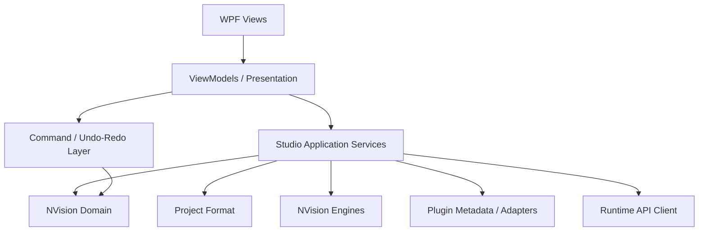
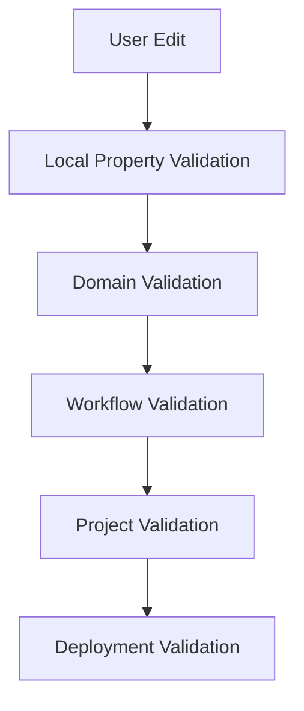
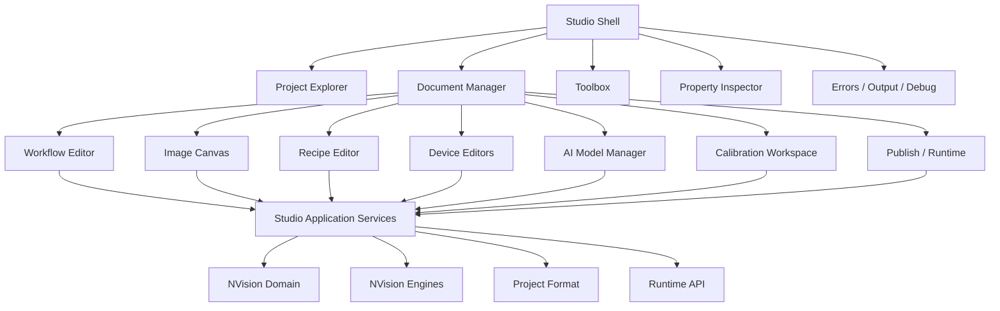

# 10 — NVision Studio UI Architecture

**Product:** NTech NVision  
**Document Type:** Engineering Workstation / UI Architecture  
**Primary Application:** `NTech.NVision.Studio`  
**Primary Technology Baseline:** `.NET + WPF + MVVM`  
**Status:** Foundation Architecture  
**Version:** 1.0  
**Date:** 2026-08-18  

**Parent Documents:**  
- `NVISION_PLATFORM_FOUNDATION.md`
- `01_PLATFORM_ARCHITECTURE.md`
- `02_DOMAIN_MODEL.md`
- `03_WORKFLOW_ENGINE_ARCHITECTURE.md`
- `04_PLUGIN_ARCHITECTURE.md`
- `05_PROJECT_FILE_FORMAT.md`
- `06_INSPECTION_RESULT_SCHEMA.md`
- `07_CAMERA_ABSTRACTION.md`
- `08_AI_ENGINE_ARCHITECTURE.md`
- `09_RUNTIME_ARCHITECTURE.md`

---

# 1. Purpose

This document defines the UI architecture of **NVision Studio**.

Studio remains C#/.NET 10 + WPF + MVVM. Its test, validation, compile, and publish flows
consume the same native C++ Engine through P/Invoke or the Engine Host gRPC contract.
Studio ViewModels and authoring DTOs are not an alternative execution engine.

NVision Studio is the primary engineering environment used to:

- Create and open NVision Projects
- Configure Jobs
- Build inspection Workflows
- Configure Recipes
- Configure Cameras and other Devices
- Import and validate AI Models
- Create and manage Calibration data
- Run offline tests
- Connect to live Cameras
- Execute inspection workflows in Test/Debug mode
- Inspect intermediate results
- Validate Project readiness
- Publish immutable `.nvpkg` deployment packages
- Connect to NVision Runtime for deployment, diagnostics, and engineering support

The Studio must support complex engineering work without becoming tightly coupled to the Runtime implementation.

The central UI architecture rule is:

> **Studio edits domain configuration and visualizes execution. It does not own production Runtime execution.**

---

# 2. Studio Product Role

NVision Studio is an **engineering workstation**, not an operator HMI.

Its primary user is:

```text
Vision Engineer
Automation Engineer
Service Engineer
System Integrator
Advanced Administrator
```

Operator-facing production control belongs mainly to:

```text
NVision Runtime UI
```

---

# 3. Studio Responsibilities

NVision Studio owns:

```text
Project Authoring
Workflow Authoring
Recipe Authoring
Device Configuration
Model Management
Calibration Authoring
Offline Test
Live Test
Debug Visualization
Project Validation
Deployment Publishing
Runtime Deployment Client
Engineering Diagnostics
```

---

# 4. Studio Does Not Own

NVision Studio must not directly own:

```text
Production trigger loop
Production PLC handshake
Production result persistence
Runtime watchdog
Production device recovery
Production session lifecycle
```

These belong to Runtime.

---

# 5. Overall Architecture



---

# 6. Layering Rule

Correct:

```text
View
  ↓
ViewModel
  ↓
Studio Application Service / Command
  ↓
Domain / Engine / ProjectFormat
```

Incorrect:

```text
View code-behind
  ↓
Basler SDK
```

or:

```text
ViewModel
  ↓
SQLite directly
```

---

# 7. Recommended Main UI Layout

```text
┌────────────────────────────────────────────────────────────────────────────┐
│ NVISION STUDIO                     Project: Wire Marker Inspection        │
├────────────────────────────────────────────────────────────────────────────┤
│ Menu / Toolbar / Command Bar / Runtime Connection                         │
├───────────────┬─────────────────────────────────────────────┬──────────────┤
│               │                                             │              │
│ PROJECT       │                                             │ PROPERTIES   │
│ EXPLORER      │            ACTIVE DOCUMENT                  │ INSPECTOR    │
│               │                                             │              │
│ Jobs          │   Workflow / Image / Recipe / Device /      │ Parameters   │
│ Recipes       │   Model / Calibration / History             │ Validation   │
│ Devices       │                                             │ Result       │
│ Models        │                                             │              │
│ Calibration   │                                             │              │
│               │                                             │              │
├───────────────┴─────────────────────────────────────────────┴──────────────┤
│ TOOLBOX / OUTPUT / ERRORS / DEBUG / LOG / TIMELINE                        │
└────────────────────────────────────────────────────────────────────────────┘
```

---

# 8. Studio Shell

Primary shell:

```text
StudioShell
```

Responsibilities:

- Main window
- Docking host
- Document tabs
- Global commands
- Workspace layout
- Project context
- Status bar
- Runtime connection indicator
- Notifications

---

# 9. Docking Model

Studio should support dockable panels similar to:

```text
Visual Studio
JetBrains Rider
industrial vision IDEs
```

Recommended panel types:

```text
Project Explorer
Toolbox
Properties
Output
Errors
Debug
Variables
Execution Timeline
Image Navigator
Device Diagnostics
```

---

# 10. Docking Requirements

Support:

```text
Dock left/right/bottom
Float
Auto-hide
Resize
Tab groups
Save layout
Reset layout
```

---

# 11. Docking Technology

For WPF, use a mature docking framework or implement a stable docking abstraction.

Do not let docking library types leak into application/domain layers.

---

# 12. Layout Persistence

Studio layout persistence is:

```text
user-local UI state
```

not Project execution state.

Store separately from `.nvision` source.

Example:

```text
%AppData%/NTech/NVision/Studio/layout.json
```

or project-local ignored file.

---

# 13. Shared vs Local Layout

Two different concepts:

## Studio Window Layout

Local:

```text
panel sizes
floating windows
tab arrangement
```

## Workflow Canvas Layout

Shared project authoring metadata:

```text
node positions
groups
comments
```

These may be version-controlled.

---

# 14. Main Navigation

Recommended Project navigation:

```text
PROJECT
├── Overview
├── Jobs
├── Recipes
├── Resources

DEVICES
├── Cameras
├── Lighting
├── PLC
├── Robot
├── I/O

VISION
├── Workflows
├── Calibration
├── AI Models
├── Reference Images

DATA
├── Test Results
├── Inspection History
├── Images
├── Reports

DEPLOY
├── Validation
├── Publish
├── Runtime
└── Packages

SYSTEM
├── Plugins
├── Logs
├── Diagnostics
└── Settings
```

---

# 15. Document-Centric Architecture

Studio should be document-centric.

Examples of open documents:

```text
Workflow Document
Recipe Document
Camera Document
PLC Mapping Document
Model Document
Calibration Document
Reference Image Document
Runtime Diagnostics Document
```

---

# 16. Document Interface

Conceptual:

```text
IStudioDocument
├── DocumentId
├── Title
├── IsDirty
├── CanSave
├── CanClose
├── SaveAsync
└── CloseAsync
```

---

# 17. Document Identity

Document identity is not display title.

Example:

```text
DocumentId:
workflow:90f01c10...

Title:
Marker Type Inspection
```

---

# 18. Open Document Registry

Studio maintains:

```text
DocumentManager
```

Responsibilities:

- Open document
- Reuse existing tab
- Close
- Dirty tracking
- Save all
- Navigation
- Activation

---

# 19. Dirty State

Modified documents show:

```text
Marker Type Inspection *
```

Dirty state must correspond to unsaved authoring changes.

---

# 20. Save All

Global command:

```text
Ctrl+Shift+S
```

or equivalent.

Saves all dirty project source documents atomically where practical.

---

# 21. Project Explorer

Core left-side tree.

Example:

```text
Wire Marker Inspection
│
├── Jobs
│   └── Marker Type Inspection
│
├── Recipes
│   ├── TYPE_01
│   ├── TYPE_02
│   ├── TYPE_03
│   └── TYPE_04
│
├── Devices
│   ├── CAM_TOP
│   └── PLC_MAIN
│
├── Models
│   └── Marker Classifier 1.3.2
│
├── Calibration
│
└── Resources
```

---

# 22. Project Explorer Responsibilities

- Browse project hierarchy
- Open documents
- Create entities
- Rename display/code where permitted
- Delete with dependency validation
- Duplicate
- Show errors/warnings badges
- Show unresolved references
- Show modified state

---

# 23. Project Explorer Does Not Own Domain

Explorer ViewModel references application/domain model.

Do not keep a separate shadow project graph that can diverge.

---

# 24. Explorer Tree Node Model

Conceptual:

```text
ExplorerItem
├── Id
├── Type
├── DisplayName
├── IconKey
├── ValidationState
├── IsDirty
├── Children
└── Commands
```

---

# 25. Validation Badges

Example:

```text
CAM_TOP        ✓
PLC_MAIN       !
TYPE_04        ✕
```

Meanings:

```text
Valid
Warning
Error
Unresolved
```

---

# 26. Global Search

Studio should provide quick search:

```text
Ctrl+P / Ctrl+T style
```

Search:

```text
Jobs
Recipes
Nodes
Devices
Models
Commands
Settings
```

---

# 27. Command Palette

Optional but valuable:

```text
Open Camera Diagnostics
Publish Project
Run Current Job
Validate Project
Activate TYPE_01
```

---

# 28. Toolbox

Workflow Toolbox lists registered node types.

Categories:

```text
Acquisition
Image
Vision
AI
Measurement
Logic
Data
Result
Output
Utility
```

---

# 29. Toolbox Source

Toolbox is populated from:

```text
NodeTypeRegistry
```

including plugin node metadata.

Not hardcoded entirely in UI.

---

# 30. Toolbox Item

```text
NodeTypeId
DisplayName
Category
IconKey
Description
Version
Plugin Origin
Search Keywords
```

---

# 31. Toolbox Search

Important for large node libraries.

Search examples:

```text
crop
OCR
compare
camera
blob
```

---

# 32. Drag and Drop

Engineer can drag Toolbox node onto Workflow Canvas.

This creates:

```text
WorkflowNode
```

through authoring command.

---

# 33. Workflow Editor

The Workflow Editor is one of the most important Studio surfaces.

Primary components:

```text
Node Canvas
Connections
Selection
Pan/Zoom
Mini-map
Groups
Comments
Debug State Overlay
Execution Highlight
```

---

# 34. Workflow Canvas Architecture

Recommended separation:

```text
WorkflowEditorView
    ↓
WorkflowEditorViewModel
    ↓
GraphInteractionController
    ↓
Authoring Commands
    ↓
WorkflowDefinition
```

---

# 35. Graph Canvas Must Not Execute Workflow

The editor visualizes and edits WorkflowDefinition.

Execution is performed by Workflow Engine.

---

# 36. Workflow Node ViewModel

Contains presentation state:

```text
NodeId
Position
Size
Selection
ValidationBadge
ExecutionVisualState
```

plus projected domain metadata.

It must not own the executor.

---

# 37. Node Visual Structure

Example:

```text
┌───────────────────────────┐
│ AI Classify               │
│ Marker Classifier         │
├───────────────────────────┤
│ ○ Image                   │
│                           │
│ Class        ○            │
│ Confidence   ○            │
└───────────────────────────┘
```

---

# 38. Port Visualization

Use typed port visuals.

Possible visual distinctions:

```text
Image
Number
Boolean
String
Detection
Decision
```

Color can help but must not be sole accessibility cue.

---

# 39. Connection Validation

When dragging connection:

```text
valid target
invalid target
convertible target
```

must be visible before drop.

---

# 40. Invalid Connection

Do not create invalid Domain connection then wait for save.

Prevent interactively when possible.

Still validate at Engine level.

---

# 41. Node Selection

Support:

```text
single select
multi-select
box select
select all
```

---

# 42. Node Movement

Moving nodes affects only:

```text
authoring layout
```

not execution semantics.

---

# 43. Alignment Tools

Useful:

```text
Align Left
Align Center
Distribute Horizontal
Distribute Vertical
Snap to Grid
```

---

# 44. Groups

Workflow can contain visual groups:

```text
Acquisition
OCR
Decision
```

Groups are authoring metadata unless future Subworkflow semantics explicitly differ.

---

# 45. Comments

Engineer comments can be attached to:

```text
canvas
node
group
```

Comments do not affect execution.

---

# 46. Mini-map

Useful for larger workflows.

Optional in MVP.

---

# 47. Zoom

Support:

```text
mouse wheel
Ctrl+wheel
zoom fit
100%
```

---

# 48. Workflow Breadcrumb

If future subworkflows:

```text
Main Workflow > Surface Inspection
```

---

# 49. Workflow Validation Panel

Validation result lists:

```text
Error Code
Node
Parameter
Message
Suggested Action
```

Click navigates to node/property.

---

# 50. Workflow Compile State

Studio can show:

```text
Valid
Invalid
Compiled
Needs Recompile
```

for test mode.

---

# 51. Workflow Execution Overlay

In Test/Debug:

```text
Pending
Running
Success
Warning
Failed
Skipped
```

overlay on nodes.

---

# 52. Execution Timing Overlay

Optional:

```text
AI Classify
18.7 ms
```

shown under node.

---

# 53. Node Output Preview

Select node to inspect output:

```text
Image
Mask
Detections
Text
Measurements
Boolean
```

---

# 54. Node Result Inspector

Properties/Debug panel can show:

```text
Inputs
Parameters
Outputs
Timing
Warnings
Errors
```

---

# 55. Image Canvas

The Image Canvas is another primary Studio surface.

Features:

```text
Zoom
Pan
Pixel inspection
ROI drawing
Overlay rendering
Crosshair
Measurement
Fit image
1:1
Histogram optional
Channel view
```

---

# 56. Image Canvas Architecture

Separate:

```text
Image Data
Overlay Data
Viewport State
Interaction Tools
```

---

# 57. Image Data

Use NVision image abstraction or presentation conversion.

Do not force Workflow/Engine to use `BitmapSource`.

---

# 58. Presentation Conversion

Boundary:

```text
NVision ImageHandle
    ↓
Studio Image Adapter
    ↓
WPF ImageSource
```

---

# 59. Large Image Handling

Industrial images may be large.

Avoid:

```text
copying full image on every zoom/pan
```

Use stable display buffer and transforms.

---

# 60. Image Viewer Modes

Possible:

```text
Source
Current Node Output
Annotated
Reference
Compare
Difference
```

---

# 61. Overlay Layer

Overlays:

```text
Bounding Boxes
Contours
Polygons
OCR Regions
Measurement Lines
Crosshair
ROI
Calibration Grid
Labels
```

---

# 62. Overlay Data Contract

Overlay rendering should consume semantic geometry.

Example:

```text
DetectionResult
MeasurementGeometry
ROI
```

not baked images only.

---

# 63. Coordinate Transform

Image Canvas owns transformation:

```text
Image Coordinates
    ↔
Screen Coordinates
```

---

# 64. ROI Editing

Engineer can:

```text
draw rectangle
move
resize
rotate future
polygon ROI future
```

ROI update creates authoring command.

---

# 65. ROI Property Sync

Dragging ROI updates Property Inspector.

Editing numeric X/Y/W/H updates canvas.

Both are bound to same authoring state.

---

# 66. Property Inspector

Right-side panel.

Shows selected object parameters.

Selection may be:

```text
Workflow Node
Camera
Recipe
Model
Calibration
Project
Job
ROI
```

---

# 67. Property Inspector Architecture

Schema-driven where possible.

Input metadata:

```text
Key
DisplayName
Type
Unit
Min
Max
Step
AllowedValues
EditorHint
ReadOnly
RecipeOverridable
```

---

# 68. Property Editors

Common editors:

```text
TextBox
NumericUpDown
ComboBox
CheckBox
Slider
Color picker
File/Resource picker
Device selector
Model selector
ROI editor
Expression editor
```

---

# 69. Property Validation

Validation must be immediate.

Example:

```text
Confidence = 1.5
```

shows error before save/publish.

---

# 70. Validation Levels

```text
Input validation
Node validation
Workflow validation
Project validation
Deployment validation
```

---

# 71. Recipe Override Indicator

Property Inspector should clearly indicate:

```text
Base Value
Recipe Override
Effective Value
```

Example:

```text
Confidence Threshold

Base:      0.90
TYPE_01:   0.92
Effective: 0.92
```

---

# 72. Recipe Context Selector

Studio toolbar may include:

```text
Recipe: TYPE_01 ▼
```

Changing selected authoring Recipe changes effective-value preview.

It does not alter base Workflow.

---

# 73. Base vs Effective Configuration

UI should make distinction explicit.

Possible display:

```text
Base
Override
Effective
```

to avoid engineer confusion.

---

# 74. Recipe Editor

Dedicated document for Recipe.

Sections:

```text
Identity
Product Mapping
Workflow Overrides
Device Overrides
Model Selections
Decision Parameters
Validation
```

---

# 75. Recipe Diff View

Useful:

```text
Only Overrides
```

showing what differs from base Project.

---

# 76. Recipe Parameter Table

Example:

```text
Target               Parameter              Base    Override
AI Classifier        confidenceThreshold    0.90    0.92
CAM_TOP              exposureUs             7500    8000
```

---

# 77. Recipe Model Mapping

Example:

```text
marker_classifier
→ MARKER_CLASSIFIER 1.3.2
```

with compatibility status.

---

# 78. Recipe Validation

Checks:

```text
override target exists
parameter recipe-overridable
type valid
device capability supports value
model exists
calibration compatible
```

---

# 79. Device Editor

Dedicated device document.

General sections:

```text
Identity
Driver
Connection
Parameters
Capabilities
Diagnostics
Recipe Overrides
```

---

# 80. Camera Editor

Camera-specific workspace:

```text
Live View
Single Grab
Exposure
Gain
Trigger
Pixel Format
Sensor ROI
Transport
Diagnostics
```

---

# 81. Camera Editor Layout

Recommended:

```text
┌──────────────────────────────────────────────────────────────┐
│ CAM_TOP — Basler ...                                       │
├───────────────────────────────────────┬──────────────────────┤
│                                       │ CONNECTION           │
│              LIVE IMAGE               │ Exposure             │
│                                       │ Gain                 │
│                                       │ Trigger              │
│                                       │ Pixel Format         │
│                                       │ ROI                  │
├───────────────────────────────────────┴──────────────────────┤
│ Histogram / Frame Stats / Transport / Errors                │
└──────────────────────────────────────────────────────────────┘
```

---

# 82. Camera Connect Actions

Studio engineering actions:

```text
Connect
Disconnect
Live
Stop Live
Single Grab
Software Trigger
Apply
Read From Camera
```

---

# 83. Camera Test Safety

Studio should clearly distinguish:

```text
Offline Project Configuration
```

vs:

```text
Live Connected Hardware
```

---

# 84. Device Configuration Staging

Engineer edits desired values.

Then:

```text
Apply to Camera
```

produces effective configuration/readback.

Avoid writing hardware continuously on every keystroke.

---

# 85. Live Parameter Tuning

Some fields can optionally have:

```text
Live Apply
```

mode.

Must be visually explicit.

---

# 86. Camera Readback

Show:

```text
Requested
Effective
```

when SDK quantizes value.

---

# 87. PLC Editor

Sections:

```text
Connection
Symbol Mapping
Connection Test
Signal Monitor
Manual Read/Write in Maintenance/Test
Handshake Simulation
```

---

# 88. PLC Symbol Table

Example:

```text
Symbol              Address    Type     Live Value
Trigger             D100       Bool     0
Busy                D101       Bool     0
Done                D102       Bool     0
InspectionResult    D110       Int16    1
```

---

# 89. Manual PLC Write

Must be restricted:

```text
Engineering / Maintenance
```

with confirmation where machine behavior can be affected.

---

# 90. Signal Watch

Poll or subscribe to selected symbols.

Do not poll entire PLC address space.

---

# 91. Robot Editor

Future sections:

```text
Connection
Pose
Frames
I/O
Vision Offset
Diagnostics
```

---

# 92. Light Controller Editor

```text
Channels
Intensity
Strobe
Presets
Live Test
```

---

# 93. AI Model Manager

Dedicated area:

```text
Models
Import
Validate
Test
Benchmark
Compare
Package
```

---

# 94. Model Manager List

Columns:

```text
Name
Code
Version
Task
Backend Compatibility
Status
Size
```

---

# 95. Model Detail

Sections:

```text
Overview
Input/Output
Classes
Preprocessing
Postprocessing
Backend Compatibility
Benchmark
Validation Samples
Traceability
```

---

# 96. Model Import Wizard

Flow:

```text
Select ONNX
    ↓
Inspect Inputs/Outputs
    ↓
Select Task
    ↓
Configure Preprocessing
    ↓
Configure Postprocessing
    ↓
Import Labels
    ↓
Run Test
    ↓
Create .nvmodel
```

---

# 97. Model Test

Engineer selects:

```text
Image
Backend
Precision
```

runs inference and views:

```text
Result
Overlay
Timing
Raw summary
```

---

# 98. Model Benchmark

Show:

```text
Load
Warm-up
Preprocess
Inference
Postprocess
Total
Memory
```

---

# 99. Backend Comparison

Possible:

```text
ONNX Runtime CPU
TensorRT FP16
```

compare same input.

---

# 100. Calibration Workspace

Dedicated calibration workflows.

Calibration types:

```text
Intrinsic
Distortion
Pixel-to-mm
Perspective
Hand-Eye
Camera-Robot
Stereo
Multi-Camera
```

---

# 101. Calibration UI Architecture

Calibration is not just a generic property page.

Use guided workflow:

```text
Prepare
Acquire
Detect Targets
Calculate
Review
Validate
Save
```

---

# 102. Calibration Wizard

Example pixel-to-mm:

```text
Select Camera
    ↓
Set Calibration Target
    ↓
Capture
    ↓
Detect Reference
    ↓
Calculate Scale
    ↓
Show Error
    ↓
Accept
```

---

# 103. Calibration Validation

Show:

```text
RMS error
Residual
Coverage
Date
Device
Camera config hash
```

---

# 104. Calibration Compatibility Warning

If camera resolution/ROI changed:

```text
Calibration may be invalid
```

must be prominent.

---

# 105. Project Overview

Dashboard for engineering.

Show:

```text
Project name/version
Jobs
Recipes
Devices
Models
Validation state
Last published version
Runtime target
```

---

# 106. Project Validation Workspace

Central validation panel.

Categories:

```text
Project
Workflow
Recipe
Devices
Models
Calibration
Plugins
Deployment
```

---

# 107. Validation Issue Model

```text
Code
Severity
Source
Location
Message
Suggested Action
```

Click navigates to source.

---

# 108. Publish Workspace

Publishing should be a guided operation.

Flow:

```text
Validate
    ↓
Review Changes
    ↓
Set Version
    ↓
Release Notes
    ↓
Resolve Target
    ↓
Build .nvpkg
    ↓
Verify
    ↓
Deploy / Export
```

---

# 109. Publish Change Summary

Example:

```text
1.3.0 → 1.4.0

Workflow:
+ OCR orientation node

TYPE_01:
Confidence 0.90 → 0.92

Model:
1.3.1 → 1.3.2
```

---

# 110. Publish Blocking Issues

If errors:

```text
Publish disabled
```

with clear issue list.

---

# 111. Runtime Connection

Studio can connect to Runtime through Runtime API.

Connection state:

```text
Disconnected
Connecting
Connected
ReadOnly
Incompatible
Fault
```

---

# 112. Runtime Connection Indicator

Global top bar:

```text
Runtime: WM01  ● READY
```

or:

```text
Runtime: Disconnected
```

---

# 113. Studio vs Runtime Data

Studio local Project and connected Runtime deployment may differ.

UI must show this clearly.

Example:

```text
Studio Project: 1.5.0-draft
Runtime Active: 1.4.0
```

---

# 114. Deployment Comparison

Studio can compare:

```text
Current authoring source
Published package
Runtime active package
```

---

# 115. Deploy to Runtime

Flow:

```text
Publish package
    ↓
Upload candidate
    ↓
Runtime validates
    ↓
Runtime prepares
    ↓
Runtime activation result
```

Studio does not force activation bypassing Runtime checks.

---

# 116. Runtime Readiness View

Studio can inspect:

```text
Devices
Models
Plugins
Storage
Alarms
Deployment
```

from Runtime.

---

# 117. Runtime Diagnostics Workspace

Engineering view:

```text
Runtime State
Active Session
Devices
AI
Plugins
Queues
Storage
Performance
Logs
Alarms
```

---

# 118. Runtime Control from Studio

Allowed engineering actions:

```text
Start/Stop Session
Activate Recipe
Enter Maintenance
Deploy Package
Run Self Test
```

subject to permissions.

---

# 119. Production Runtime UI Remains Separate

Studio can act as engineering client but should not replace dedicated Runtime Operator UI by default.

---

# 120. Test Mode

Studio must support executing Project workflows without publishing.

Modes:

```text
Offline Test
Live Device Test
Debug
Simulation
```

---

# 121. Offline Test

Input sources:

```text
Image File
Folder
Recorded sequence
File Camera
```

Uses same Workflow Engine.

---

# 122. Live Test

Uses real connected devices in engineering context.

Production safeguards apply.

---

# 123. Test Execution Architecture

```text
Studio
    ↓
Studio Test Application Service
    ↓
Workflow Compiler
    ↓
WorkflowRuntime
    ↓
Fake/Live Acquisition
    ↓
AI Engine
    ↓
Result
```

---

# 124. Same Engine Rule

Studio Test must use same:

```text
Workflow Engine
AI Engine
Vision Engine
Node Executors
```

as Runtime.

---

# 125. Debug Mode

Supports:

```text
Breakpoint
Pause
Resume
Step
Inspect Node
Inspect Input
Inspect Output
Execution Timeline
```

---

# 126. Debug Toolbar

Example:

```text
▶ Run
⏸ Pause
⏭ Step
■ Stop
↻ Reset
```

---

# 127. Breakpoint UI

Click node gutter/badge.

States:

```text
No Breakpoint
Breakpoint
Disabled Breakpoint
```

---

# 128. Breakpoint Scope

Breakpoints are:

```text
Studio debug metadata
```

not production workflow semantics.

---

# 129. Step Semantics

In debug step mode, execution may serialize otherwise parallel branches for predictable inspection.

Show that Debug timing may differ from Production.

---

# 130. Execution Timeline

Bottom panel can show:

```text
Camera Grab     0–8 ms
Crop            8–10 ms
AI              10–32 ms
Decision        32–33 ms
```

---

# 131. Timeline Benefits

Useful for:

```text
performance tuning
finding bottleneck
debugging branch order
```

---

# 132. Variables Panel

Shows current:

```text
Workflow Inputs
Runtime Variables
Recipe Effective Values
Node Outputs
```

in Debug/Test.

---

# 133. Output Panel

Structured logs from Studio test:

```text
Info
Warning
Error
```

with source and timestamp.

---

# 134. Errors Panel

Persistent validation/compile errors.

Separate from Output logs.

---

# 135. Test Result Panel

Show:

```text
Inspection Status
DecisionCode
Reasons
Measurements
Classification
Detections
OCR
Timing
```

using Inspection Result schema.

---

# 136. Image Compare Mode

Useful for:

```text
Reference vs Current
Before vs After
Model v1 vs v2
```

---

# 137. Difference View

Optional:

```text
absolute difference
overlay opacity slider
split view
```

---

# 138. Golden Image Test UI

Future:

```text
Test Set
Run All
Pass/Fail
Diff
```

integrated with CI fixtures.

---

# 139. Undo / Redo

Mandatory for engineering UX.

Use command-based authoring model.

---

# 140. Authoring Command

Conceptual:

```text
IUndoableCommand
├── Execute
├── Undo
├── Redo
├── Description
└── AffectedEntities
```

---

# 141. Command Examples

```text
AddNode
DeleteNode
MoveNode
ConnectPorts
ChangeNodeParameter
ChangeRecipeOverride
AddDevice
RenameRecipe
```

---

# 142. UI Gestures Map to Commands

Example:

```text
drag node
```

should ideally create one logical Move command when drag completes, not hundreds of undo entries.

---

# 143. Command Transactions

Grouped edit:

```text
Paste 10 nodes
```

should undo as one transaction.

---

# 144. Undo Scope

Recommended:

```text
per Project workspace
```

or per document with global coordination.

Need consistent cross-document entity changes.

---

# 145. Save Does Not Clear Undo Necessarily

Can preserve undo during session.

But dirty tracking compares current state to last saved state.

---

# 146. Selection Model

Central:

```text
SelectionService
```

coordinates:

```text
Workflow node
Project tree
Properties
Image ROI
```

---

# 147. Selection Scope

Selection is UI/session state.

Never serialize into production Project.

---

# 148. Clipboard

Workflow editor supports:

```text
Copy
Cut
Paste
Duplicate
```

---

# 149. Clipboard Serialization

Use NVision-specific internal JSON fragment.

Regenerate Node IDs on paste.

Update internal connections.

---

# 150. Copy Between Projects

When supported:

```text
validate node types/plugins/resources
```

Do not blindly copy unresolved references.

---

# 151. Keyboard Shortcuts

Recommended:

```text
Ctrl+S       Save
Ctrl+Shift+S Save All
Ctrl+Z       Undo
Ctrl+Y       Redo
Delete       Delete selected
Ctrl+C/V     Copy/Paste
F5           Run Test
Shift+F5     Stop
F9           Toggle Breakpoint
F10          Step
Ctrl+P       Quick Open
```

---

# 152. Context Menus

Node:

```text
Disable
Duplicate
Delete
Add Breakpoint
Inspect
Open Documentation
```

Recipe:

```text
Duplicate
Validate
Compare
Publish-related actions
```

---

# 153. Notifications

Use non-blocking notification center for:

```text
Project saved
Camera connected
Publish complete
Runtime deployment prepared
```

---

# 154. Modal Dialog Policy

Use modal only for:

```text
destructive action
critical confirmation
credential/security
migration
```

Avoid excessive modal dialogs.

---

# 155. Long-Running Operation UI

Operations:

```text
Model import
Project validation
Publish
Deployment upload
Camera discovery
```

need:

```text
progress
cancel
status
result
```

---

# 156. Cancellation

UI cancellation maps to application service CancellationToken.

Never fake cancel while backend continues uncontrolled.

---

# 157. Async UI

No long operation blocks WPF UI thread.

---

# 158. MVVM Boundary

Recommended:

```text
Views
    ↓ binding
ViewModels
    ↓
Application Services
    ↓
Domain / Engine / Infrastructure
```

---

# 159. View Responsibilities

View:

```text
visual tree
templates
interaction visuals
animations
input gestures
```

Minimal business logic.

---

# 160. ViewModel Responsibilities

ViewModel:

```text
presentation state
commands
selection projection
validation presentation
document state
```

---

# 161. ViewModel Must Not Own

```text
camera SDK
database connection
TensorRT session
workflow executor internals
```

---

# 162. Application Services

Examples:

```text
IProjectApplicationService
IWorkflowAuthoringService
IRecipeApplicationService
IDeviceApplicationService
IModelApplicationService
ICalibrationApplicationService
ITestExecutionService
IPublishApplicationService
IRuntimeConnectionService
```

---

# 163. Studio Workspace Context

Concept:

```text
StudioWorkspace
├── OpenProject
├── DocumentManager
├── SelectionService
├── CommandHistory
├── ValidationService
├── RuntimeConnection
└── UserState
```

---

# 164. One Project vs Multiple Projects

MVP recommendation:

```text
one open Project per Studio window
```

Simplifies context.

Multiple Studio windows can open different Projects.

Future multi-project workspace optional.

---

# 165. Project Open Sequence

```text
Select .nvision
    ↓
Project Loader
    ↓
Schema validation
    ↓
Migration check
    ↓
Plugin resolution
    ↓
Domain model
    ↓
Validation
    ↓
Open workspace
```

---

# 166. Migration UI

If migration required:

```text
Project schema 1.0
→ Current 2.0
```

show:

```text
changes
backup path
warnings
plugins affected
```

Engineer confirms.

---

# 167. Unsupported Newer Schema

Open:

```text
Read Only
```

where possible.

Do not allow destructive save.

---

# 168. Missing Plugin UI

Show unresolved entity.

Example:

```text
⚠ Missing plugin:
ntech.vision.special-pattern 2.0
```

Preserve raw config.

---

# 169. Unresolved Workflow Node

Render placeholder:

```text
┌────────────────────────────┐
│ ⚠ Missing Node Plugin      │
│ partner.foo.bar            │
│ v1.2                       │
└────────────────────────────┘
```

Do not delete it automatically.

---

# 170. Plugin Manager

Studio system area:

```text
Installed
Available
Disabled
Incompatible
Diagnostics
```

---

# 171. Plugin Management Permissions

Installation/update requires elevated engineering/admin role.

---

# 172. Plugin Manager Details

Show:

```text
PluginId
Name
Version
API Version
Publisher
Category
Status
Dependencies
Platform
```

---

# 173. Plugin Node Documentation

Toolbox/property inspector can link to plugin-provided HelpId/documentation.

---

# 174. Design System

Studio should have a formal Design System.

Primary qualities:

```text
Industrial
Dense but readable
Dark/neutral
High information hierarchy
Low distraction
Fast scanning
Clear status colors
```

---

# 175. Recommended Visual Direction

Professional engineering tool rather than consumer dashboard.

Use:

```text
dark charcoal surfaces
subtle borders
clear panel separation
high-contrast image viewport
compact property tables
monospace where data/code appropriate
```

---

# 176. Color Semantics

Use consistent semantic tokens:

```text
Success
Warning
Error
Info
Active
Selected
Disabled
```

Do not hardcode arbitrary colors across controls.

---

# 177. Status Colors

Typical semantics:

```text
Green   Ready / OK
Amber   Warning
Red     Fault / NG / Error
Blue    Active / Running
Gray    Disabled / Offline
```

Exact palette belongs to Design System document.

---

# 178. NG vs System Error

Visually distinguish:

```text
Product NG
```

from:

```text
System ERROR
```

even if both use red family.

Use icon/text/category differences.

---

# 179. Typography

Recommended:

```text
UI sans-serif
Monospace for:
IDs
addresses
logs
numeric diagnostic values
```

---

# 180. Density Modes

Engineering apps benefit from:

```text
Compact
Comfortable
```

optional later.

Default compact-professional.

---

# 181. Accessibility

Do not use color alone.

Also use:

```text
icons
labels
patterns
status text
```

---

# 182. High-DPI

Must support:

```text
100%
125%
150%
200%
```

important for industrial monitors and laptops.

---

# 183. Multi-Monitor

Docking/floating windows should work across multiple monitors.

---

# 184. Touch

Not primary requirement for Studio.

Runtime Operator UI may have stronger touch requirements.

---

# 185. Localization

Stable keys in core.

UI strings localizable.

Possible languages:

```text
English
Vietnamese
Japanese/Korean future
```

---

# 186. Technical Terms

Keep standardized technical terms consistent across locales:

```text
Job
Recipe
Workflow
Model
Calibration
Runtime
```

Translation policy should be controlled.

---

# 187. Units

Property editor displays unit next to numeric value.

Example:

```text
Exposure   7500 us
Length     10.25 mm
```

---

# 188. Numeric Input Culture

Display may follow locale.

Persistence remains invariant.

---

# 189. Error Message UX

Operator/engineer message layers:

```text
Short message
Stable error code
Source
Details
Suggested action
Technical detail expandable
```

---

# 190. Example Error UI

```text
CAM_TOP cannot connect.

Code:
CAMERA_NOT_FOUND

Check:
- Camera power
- Ethernet cable
- Camera serial binding

Technical details >
```

---

# 191. No Raw Stack Trace by Default

Stack traces belong in expandable engineering diagnostics/log.

---

# 192. Project Creation Wizard

Flow:

```text
Project Name
Project Code
Template
Location
Initial Job
Initial Recipe
```

---

# 193. Templates

Examples:

```text
Blank Vision Project
AI Classification
Object Detection
Measurement
Multi-Camera Inspection
```

Templates create normal domain objects.

---

# 194. New Job Wizard

Ask:

```text
Name
Code
Input model
Timeout
Template
```

---

# 195. New Recipe

Can:

```text
Blank
Duplicate Existing
```

---

# 196. Duplicate Recipe

New:

```text
RecipeId
Version reset
Code
Name
```

Base overrides copied.

---

# 197. Delete Safety

Before deleting:

```text
Model
Device
Recipe
Node
```

show dependency impact.

---

# 198. Dependency Inspector

Useful command:

```text
Find References
```

Example for model:

```text
Used by:
TYPE_01
TYPE_02
AI Classify Node
```

---

# 199. Rename

Changing display name safe.

Changing stable Code may require reference migration/validation.

ID unchanged.

---

# 200. Project Refactor Commands

Future:

```text
Rename Code
Move Job
Extract Subworkflow
Replace Model
Replace Device
```

---

# 201. Resource Browser

Manage:

```text
Reference Images
Templates
Masks
Sample Images
Lookup Tables
```

---

# 202. Reference Image Viewer

Supports:

```text
open
compare
set as test input
use as golden
```

---

# 203. Image Dataset Browser

Future Trainer integration.

Not core Studio MVP.

---

# 204. History Workspace

When connected to Runtime or local test repository:

```text
Inspection list
Filters
Detail
Images
Reasons
Measurements
Traceability
```

---

# 205. History Filters

```text
Date
Status
Recipe
DecisionCode
Serial
Product
```

---

# 206. History Detail

Show:

```text
Result summary
Reasons
Measurements
AI output
Images
Timing
Traceability
```

---

# 207. Traceability View

For one inspection:

```text
Project 1.4.0
Recipe TYPE_01 2.0.0
Model 1.3.2
Runtime 1.4.0
Plugin Set ...
Camera Config ...
Calibration ...
```

---

# 208. Log Viewer

Engineering log view:

```text
Time
Level
Source
InspectionId
Message
```

Filters.

---

# 209. Log Correlation

Click InspectionId opens inspection detail.

Click Device opens diagnostics.

---

# 210. Diagnostics Center

Unified:

```text
Runtime
Devices
AI
Plugins
Storage
Network
Performance
```

---

# 211. System Settings

Categories:

```text
General
Appearance
Paths
Runtime Connections
Plugins
Logging
Updates
Licensing
Security
```

---

# 212. Project Settings

Separate from global settings.

Examples:

```text
Default Job
Default Recipe
Project validation rules
Publish defaults
```

---

# 213. User Settings

Local:

```text
Theme
Layout
Recent Projects
Keyboard preferences
```

---

# 214. Recent Projects

Studio start page shows recent projects.

---

# 215. Start Page

Recommended:

```text
New Project
Open Project
Recent Projects
Documentation
Runtime Connections
```

---

# 216. Empty State UX

If no Project:

avoid showing irrelevant panels full of errors.

Use clear start page.

---

# 217. Command Enablement

Commands enabled based on state.

Example:

```text
Run Test
```

disabled when workflow invalid.

Tooltip explains reason.

---

# 218. Status Bar

Show:

```text
Project validation
Selected Recipe
Runtime connection
Execution state
Background tasks
```

---

# 219. Background Task Indicator

Examples:

```text
Model importing...
Publishing...
Camera discovery...
```

---

# 220. Notifications vs Alarms

Studio notification:

```text
Project saved
```

Runtime Alarm:

```text
CAMERA_DISCONNECTED
```

Do not mix.

---

# 221. Project Autosave

Use safe autosave copy.

UI can show recovery available.

---

# 222. Crash Recovery UI

After Studio crash:

```text
Recovered autosave found
```

options:

```text
Open Recovered
Open Saved
Compare
Discard Recovery
```

---

# 223. External File Changes

If Git changes file while Studio open:

```text
File changed externally
```

options:

```text
Reload
Compare
Keep Local
```

---

# 224. Source Control Integration

MVP need not embed full Git client.

But format and UI should support:

```text
dirty state
external change
path display
```

---

# 225. Future Git Integration

Could show:

```text
branch
changed files
diff
```

without making Git mandatory.

---

# 226. Studio Internal Events

Presentation/application events:

```text
ProjectOpened
DocumentActivated
SelectionChanged
ValidationUpdated
TestStarted
TestCompleted
RuntimeConnected
```

---

# 227. Event Bus

Use carefully.

Do not turn entire app into untraceable global event bus.

Prefer direct services for core workflows.

---

# 228. Navigation Service

Central:

```text
INavigationService
```

can navigate to:

```text
EntityId
NodeId
Validation Issue
InspectionId
DeviceId
```

---

# 229. Deep Navigation

Example:

```text
Validation Issue
→ Recipe TYPE_01
→ AI Classify Node
→ confidenceThreshold property
```

---

# 230. Entity Locator

Useful service:

```text
IProjectEntityLocator
```

for navigation/find references.

---

# 231. Performance of Studio

UI must remain responsive with:

```text
100+ nodes
large images
many recipes
large history
```

---

# 232. Virtualization

Use WPF virtualization for:

```text
history lists
logs
large property tables
```

---

# 233. Rendering Throttling

Live image and execution overlays should be throttled.

Do not update 60 UI properties per camera frame unnecessarily.

---

# 234. Preview Priority

Production/test engine should not wait for UI rendering.

---

# 235. Image Decode/Conversion Thread

Image conversion can run off UI thread.

Final `ImageSource` update marshaled safely.

---

# 236. Memory Management

Historical image tabs should unload large image buffers when closed.

---

# 237. Disposable Documents

Documents with live camera/test resources implement close/dispose lifecycle.

---

# 238. Camera Live View Document Close

Stops preview subscription.

Does not necessarily disconnect camera unless explicitly requested.

---

# 239. Test Session Lifecycle

Studio test session:

```text
Prepare
Run
Stop
Dispose
```

Resources cleaned on Project close.

---

# 240. Studio Service Scopes

Suggested:

```text
Application Singleton
Project Scope
Document Scope
Test Session Scope
```

---

# 241. Dependency Injection

Use DI for application services.

Avoid injecting giant root container into ViewModels.

---

# 242. Message/Dialog Services

Abstract:

```text
IDialogService
INotificationService
IFilePickerService
```

for testability.

---

# 243. File Picker

Returns paths/resources.

Project layer validates relative import/copy behavior.

---

# 244. Testable ViewModels

Core ViewModels should run unit tests without actual WPF window where practical.

---

# 245. Workflow Editor Testing

Separate graph interaction logic from visual rendering so commands can be tested.

---

# 246. UI Automation Testing

Critical paths:

```text
Open Project
Edit Node
Save
Run Test
Publish
Connect Runtime
```

can use UI automation later.

---

# 247. Snapshot/Visual Regression

Useful for Design System/components.

Not required initially.

---

# 248. Accessibility Testing

Keyboard navigation for major panels.

---

# 249. Error Boundary

Unexpected UI exception:

```text
log
show controlled error
keep Project recoverable
```

should not corrupt domain state.

---

# 250. Studio Crash Isolation

Live hardware access through abstractions reduces risk, but vendor SDK in-process can still crash Studio.

Future plugin host supports stronger isolation.

---

# 251. Hardware Test Safety Banner

When connected to real machine:

```text
LIVE HARDWARE
```

clearly visible.

---

# 252. Simulation Banner

When using simulator:

```text
SIMULATION
```

visible to avoid confusion.

---

# 253. Runtime Production Banner

When connected to RUNNING Runtime:

```text
PRODUCTION RUNNING
```

dangerous commands require controlled confirmation/permissions.

---

# 254. Read-Only Runtime Connection

Studio may connect in diagnostics-only mode.

---

# 255. Role-Based UI

Hide/disable actions based on permission.

Do not rely only on hiding; Runtime API still enforces authorization.

---

# 256. Audit-Relevant Actions

Studio should supply actor/context for:

```text
Deployment
Recipe activation
Maintenance mode
Device rebind
```

---

# 257. Studio-to-Runtime Compatibility

On connection:

```text
negotiate API version
Runtime version
Studio supported range
```

---

# 258. Incompatible Runtime

Show:

```text
Connected but incompatible
```

and limit unsafe commands.

---

# 259. Runtime Data Cache

Studio may cache:

```text
device list
latest results
diagnostics
```

but Runtime remains source of truth.

---

# 260. Connection Loss

UI marks data stale.

Do not continue showing old READY state as current without indicator.

---

# 261. Reconnect

Automatic bounded reconnect is acceptable for Studio client.

---

# 262. Multiple Runtime Connections

Future Studio may manage several stations.

MVP recommendation:

```text
one active Runtime connection
```

at a time.

---

# 263. Runtime Target Profile

Store saved connection profiles:

```text
WM01
192.168.1.50
```

with credential reference.

---

# 264. Deployment Target Selection

Publish workspace can target:

```text
Local Runtime
Remote Runtime
Export Package Only
```

---

# 265. Studio Offline Operation

All core Project authoring works without Runtime connection.

---

# 266. Studio Internet Independence

No mandatory cloud dependency.

---

# 267. Help System

Context help by:

```text
NodeType
Property
Device feature
Error code
```

---

# 268. Error Code Search

Engineer can search:

```text
CAMERA_TIMEOUT
```

and get troubleshooting guidance.

---

# 269. Documentation Integration

Offline docs packaged with Studio where practical.

---

# 270. UI Extension Policy

Plugin-provided arbitrary WPF controls are discouraged initially.

Prefer schema-driven editors.

---

# 271. Custom Editor Extension

Future interfaces may allow custom editor for complex plugin only.

Must isolate framework/version compatibility.

---

# 272. Node Custom Preview

Plugin node can expose generic preview data types.

Studio renders known types.

Avoid plugin injecting arbitrary canvas control.

---

# 273. Known Preview Types

```text
Image
Mask
Detections
Text
Measurements
Table
Scalar
Boolean
```

---

# 274. Unknown Preview Type

Show structured/raw summary.

Do not crash UI.

---

# 275. Studio Startup Performance

Do not load all vendor SDK plugins deeply on initial app launch if metadata-only discovery is possible.

---

# 276. Lazy Plugin Initialization

Load hardware plugin only when:

```text
Project requires
Device editor opened
Live test requested
```

where architecture permits.

---

# 277. Project Load Performance

Load:

```text
metadata/config
```

eagerly.

Load:

```text
model binaries
large images
history
```

lazily.

---

# 278. Model Thumbnail/Metadata Cache

Studio can cache generated info in `.nvision/cache`.

Disposable.

---

# 279. Design-Time Data

Use sample ViewModels for WPF designer/storybook-like component testing if useful.

Do not mix with Runtime mock logic.

---

# 280. UI Component Library

Recommended reusable controls:

```text
StatusBadge
PropertyRow
NumericEditor
UnitEditor
DeviceSelector
ModelSelector
ValidationBadge
NodeCard
PortControl
ImageViewport
OverlayCanvas
ResultBadge
AlarmBanner
TimingBar
EmptyState
```

---

# 281. Studio Design Tokens

Future `DESIGN_SYSTEM.md` should define:

```text
Spacing
Typography
Surfaces
Borders
Semantic colors
Control heights
Radius
Icons
Animation
```

---

# 282. Iconography

Use consistent industrial/simple icon set.

Avoid decorative icon overload.

---

# 283. Status Icons

Stable semantics:

```text
Ready
Running
Warning
Fault
Offline
Disabled
```

---

# 284. Animation

Use minimal functional animation.

Examples:

```text
running spinner
connection progress
panel transition
```

Avoid distracting motion in engineering workflow.

---

# 285. Image Canvas Background

Neutral/dark background to improve image contrast.

---

# 286. Workflow Canvas Background

Subtle grid optional.

Keep connection visibility high.

---

# 287. Node Density

Compact node body.

Show essential ports and status.

Detailed configuration stays in Property Inspector.

---

# 288. Advanced Node View

Optional expansion for:

```text
mini preview
primary parameter
timing
```

---

# 289. Node Quick Actions

Hover/select:

```text
Run From Here future
Disable
Breakpoint
Preview
```

---

# 290. Run Selected Node

Potential debug feature.

Requires upstream inputs already available.

Not MVP-critical.

---

# 291. Run to Node

Future debugger feature.

---

# 292. Workflow Test Input Panel

Set:

```text
Input Image
External Variables
Recipe
Simulation Device Values
```

---

# 293. Test Dataset Runner

Future:

```text
Folder of images
→ run workflow
→ aggregate pass/fail
```

---

# 294. Batch Test Result

Show:

```text
Total
Passed
Failed
Error
Average Cycle
Confusion Matrix where relevant
```

---

# 295. Wire Marker Studio Example

Project Explorer:

```text
Wire Marker Inspection
├── Job
│   └── Marker Type Inspection
├── Recipes
│   ├── TYPE_01
│   ├── TYPE_02
│   ├── TYPE_03
│   └── TYPE_04
├── CAM_TOP
├── PLC_MAIN
└── Marker Classifier
```

Workflow:

```text
Image Input
   ↓
Crop
   ↓
Normalize
   ↓
AI Classify
   ↓
Compare Expected Type
   ↓
Decision
```

---

# 296. Wire Marker Test UX

Engineer:

```text
Select TYPE_01
Select test image
Run
```

Studio shows:

```text
Detected TYPE_01
Confidence 98.2%
Decision OK
Cycle 52.7 ms
```

---

# 297. Wrong Type UX

```text
Expected TYPE_01
Detected TYPE_04
Confidence 97.1%
Result NG
Reason WRONG_TYPE
```

---

# 298. Gear Inspection Studio Example

Open:

```text
Top Inspection
Bottom Inspection
Side Inspection
```

with separate document tabs.

Result workspace can combine three views.

---

# 299. Multi-Camera Debug Layout

Potential:

```text
┌───────────────────┬───────────────────┐
│ TOP               │ BOTTOM            │
├───────────────────┼───────────────────┤
│ SIDE              │ RESULT / DETAILS  │
└───────────────────┴───────────────────┘
```

---

# 300. Window Presets

Useful workspace presets:

```text
Workflow
Camera Setup
AI Model
Calibration
Debug
Deployment
```

---

# 301. Reset Workspace

Command restores default docking layout.

---

# 302. Studio State Persistence

Persist local:

```text
last project
layout
recent files
last selected panel
runtime connection profile
```

Do not persist secrets unprotected.

---

# 303. Project Authoring Metadata

Persist shared:

```text
workflow node positions
groups
comments
```

in Project authoring files.

---

# 304. Local Project UI Metadata

Ignore in Git:

```text
zoom
last selected node
open tabs
```

unless collaboration use case changes.

---

# 305. Studio Telemetry

Product analytics, if ever enabled, must be opt-in/customer-policy aware.

Not required for core platform.

---

# 306. Performance Profiling UI

Future view:

```text
Workflow node p95
AI latency
Camera acquisition
Total cycle
```

from test/runtime metrics.

---

# 307. Memory Profiling

Engineering diagnostics can show:

```text
CPU memory
GPU memory
Image buffer usage
```

---

# 308. Queue Diagnostics

When connected Runtime:

```text
Preview Queue
Outbox
Image Save Queue
```

---

# 309. Storage Diagnostics

Show:

```text
Database size
Image usage
Free disk
Retention
```

---

# 310. Package Inspector

Studio can open `.nvpkg` read-only.

Show:

```text
Project Version
Recipes
Models
Plugins Lock
Integrity
CreatedAt
```

---

# 311. Compare Package vs Project

Useful before rollback/deployment.

---

# 312. Runtime Rollback UI

Studio requests Runtime rollback.

Runtime validates and executes.

Studio cannot manipulate active deployment files directly.

---

# 313. Backup UI

Engineering can trigger:

```text
Create backup
Restore backup
```

through safe application/runtime service.

---

# 314. Restore Confirmation

Must show impact.

---

# 315. Licensing UI

Future:

```text
License status
Features
Offline activation
Machine ID
```

---

# 316. System Update UI

Future update manager should separate:

```text
Studio
Runtime
Plugins
```

versions.

---

# 317. Error Recovery Principles

User should rarely need to restart Studio for normal validation errors.

Runtime/device errors should provide specific recovery command where safe.

---

# 318. Camera Reconnect Command

Engineer may trigger:

```text
Reconnect
```

through Camera Manager.

---

# 319. AI Reload Command

Maintenance/test:

```text
Reload Model
```

through AI Engine.

---

# 320. Validation Fix Action

Some errors can offer:

```text
Fix
```

Example:

```text
Update stale code hint
```

Only for deterministic safe fixes.

---

# 321. No Automatic Destructive Fix

Never auto-delete unresolved node/model/device.

---

# 322. Studio Command Result

All application commands return structured:

```text
Success
Warning
Failure
Issues
```

UI presents consistently.

---

# 323. Toast vs Panel

Use toast for transient success.

Use panel/dialog for actionable failure.

---

# 324. Keyboard-First Engineering

Many engineers prefer keyboard.

Ensure important actions are reachable without mouse.

---

# 325. Context-Sensitive F1 Help

Optional future.

---

# 326. Theme

Primary:

```text
Dark
```

Optional:

```text
Light
System
```

if product supports it.

---

# 327. Theme Does Not Change Semantic Meaning

Status colors remain accessible across themes.

---

# 328. Rendering Technology Rule

WPF is Presentation only.

Core architecture must remain usable if future UI moves to:

```text
WinUI
Avalonia
Web
```

---

# 329. Studio Service API Independence

Application services return platform-neutral DTO/domain models.

Avoid `DependencyObject` or WPF types outside Presentation.

---

# 330. WPF-Specific Projects

Recommended:

```text
NTech.NVision.Studio
NTech.NVision.Studio.Presentation
```

with WPF-only types.

---

# 331. ViewModel Project

Possible:

```text
NTech.NVision.Studio.Presentation
```

can still reference WPF command abstractions if desired, but avoid heavy control types.

---

# 332. Application Project

```text
NTech.NVision.Studio.Application
```

must be UI-framework-independent.

---

# 333. Suggested Project Structure

```text
apps/
└── nvision-studio/
    ├── NTech.NVision.Studio/
    │   ├── App.xaml
    │   ├── Shell/
    │   ├── Views/
    │   ├── Resources/
    │   └── Themes/
    │
    ├── NTech.NVision.Studio.Presentation/
    │   ├── Shell/
    │   ├── ProjectExplorer/
    │   ├── Workflow/
    │   ├── Image/
    │   ├── Properties/
    │   ├── Recipes/
    │   ├── Devices/
    │   ├── AI/
    │   ├── Calibration/
    │   ├── Debug/
    │   ├── Deployment/
    │   └── Runtime/
    │
    └── NTech.NVision.Studio.Application/
        ├── Projects/
        ├── Authoring/
        ├── Testing/
        ├── Publishing/
        ├── RuntimeClient/
        └── Validation/
```

---

# 334. Suggested Shell ViewModel

```text
StudioShellViewModel
├── ActiveProject
├── Documents
├── ActiveDocument
├── Panels
├── RuntimeConnection
├── GlobalCommands
└── Status
```

---

# 335. Suggested Workflow Editor Modules

```text
WorkflowEditorViewModel
GraphSelectionService
GraphCommandService
GraphLayoutService
ConnectionDragController
WorkflowValidationPresenter
WorkflowDebugPresenter
```

---

# 336. Suggested Image Modules

```text
ImageViewportViewModel
ImageSourcePresenter
OverlayLayerViewModel
ROIInteractionController
PixelInspector
```

---

# 337. Suggested Property Modules

```text
PropertyInspectorViewModel
PropertyDescriptorViewModel
PropertyEditorFactory
ValidationPresenter
RecipeOverridePresenter
```

---

# 338. Suggested Device Modules

```text
CameraEditorViewModel
PlcEditorViewModel
DeviceDiagnosticsViewModel
DeviceDiscoveryViewModel
```

---

# 339. Suggested AI Modules

```text
ModelManagerViewModel
ModelImportWizardViewModel
ModelTestViewModel
ModelBenchmarkViewModel
```

---

# 340. Suggested Calibration Modules

```text
CalibrationWorkspaceViewModel
CalibrationWizardViewModel
CalibrationResultViewModel
```

---

# 341. Suggested Debug Modules

```text
DebugSessionViewModel
ExecutionTimelineViewModel
VariablesViewModel
NodeExecutionDetailsViewModel
```

---

# 342. Suggested Deployment Modules

```text
PublishViewModel
ValidationSummaryViewModel
DeploymentCompareViewModel
RuntimeDeploymentViewModel
```

---

# 343. Studio Application Services

Recommended:

```text
IStudioProjectService
IWorkflowAuthoringService
IRecipeAuthoringService
IDeviceEngineeringService
IModelEngineeringService
ICalibrationEngineeringService
ITestRunService
IProjectValidationService
IPublishService
IRuntimeClientService
```

---

# 344. Studio Project Service

Responsibilities:

```text
New
Open
Save
Save All
Close
Migration
Recovery
Dirty state
```

---

# 345. Workflow Authoring Service

Responsibilities:

```text
Add/remove nodes
Connect/disconnect
Parameter changes
Validation
Find references
```

through commands.

---

# 346. Test Run Service

Responsibilities:

```text
prepare workflow
resolve Recipe
acquire/open input
execute
debug control
result projection
```

---

# 347. Publish Service

Responsibilities:

```text
validate
version
build package
integrity
output
```

---

# 348. Runtime Client Service

Responsibilities:

```text
connect
query
subscribe
send command
upload deployment
```

---

# 349. Background Work Coordinator

Studio needs central:

```text
IBackgroundOperationService
```

to expose running/cancelable operations.

---

# 350. Error Handling Strategy

Application service failures become structured Studio errors.

Do not scatter try/catch message boxes throughout ViewModels.

---

# 351. Validation Architecture



---

# 352. Incremental Validation

Do lightweight validation after edits.

Run full project/deployment validation on demand/publish.

---

# 353. Validation Performance

Avoid recompiling all workflows on every mouse move.

Debounce expensive validations.

---

# 354. Project Save Pipeline

```text
Authoring Command
    ↓
Domain State
    ↓
Dirty Mark
    ↓
Save
    ↓
ProjectFormat DTO
    ↓
Canonical JSON
```

---

# 355. Test Pipeline

```text
Current Unsaved Domain State
    ↓
Validate
    ↓
Compile
    ↓
Execute
```

Studio can test unsaved changes.

---

# 356. Publish Pipeline

```text
Current Domain State
    ↓
Require Save / Snapshot
    ↓
Full Validate
    ↓
Publish
```

---

# 357. Runtime Deployment Pipeline

```text
.nvpkg
    ↓
Runtime Client
    ↓
Upload Pending
    ↓
Runtime Validate
    ↓
Runtime Prepare
    ↓
Activate
```

---

# 358. Studio Definition of Done — Shell

MVP Studio shell is complete when it supports:

```text
1. Start page
2. Open one Project
3. Project Explorer
4. Docking panels
5. Documents
6. Properties
7. Output/Errors
8. Save/Save All
9. Dirty state
10. Layout persistence
```

---

# 359. Studio Definition of Done — Workflow

```text
11. Toolbox
12. Drag/drop node
13. Connect typed ports
14. Move/delete/copy nodes
15. Edit properties
16. Validate graph
17. Undo/Redo
18. Save .njob
19. Reload preserving graph/layout
```

---

# 360. Studio Definition of Done — Image/Test

```text
20. Open image
21. Zoom/pan
22. Draw ROI
23. Run Workflow
24. Show node execution states
25. Show AI classification/detection
26. Show final result
27. Show timing
```

---

# 361. Studio Definition of Done — Devices

```text
28. Discover File Camera
29. Discover first industrial camera
30. Connect
31. Live view
32. Single grab
33. Exposure/Gain
34. Apply/readback
35. Camera diagnostics
36. PLC simulator configuration
```

---

# 362. Studio Definition of Done — Recipe/AI

```text
37. Create Recipe
38. Override node parameter
39. Override camera exposure
40. Select model slot
41. Import .nvmodel
42. Validate model
43. Run model test
```

---

# 363. Studio Definition of Done — Publish/Runtime

```text
44. Full Project validation
45. Build .nvpkg
46. Connect to Runtime
47. Show Runtime readiness
48. Upload package
49. Activate candidate
50. Show active version
```

---

# 364. Recommended Implementation Phases

## ST0 — Shell

Implement:

```text
WPF shell
DI
navigation
docking
documents
theme
```

---

## ST1 — Project

Implement:

```text
open/save
Project Explorer
dirty tracking
validation list
```

---

## ST2 — Workflow Editor

Implement:

```text
canvas
nodes
ports
connections
properties
undo/redo
```

---

## ST3 — Image Canvas

Implement:

```text
image view
ROI
overlays
```

---

## ST4 — Test Execution

Integrate Workflow Engine and File Camera.

---

## ST5 — Recipe

Implement effective values and overrides.

---

## ST6 — Camera

Live industrial camera engineering.

---

## ST7 — AI Model Manager

Import/test `.nvmodel`.

---

## ST8 — Calibration

Initial pixel/mm or intrinsic workflow.

---

## ST9 — Publish

Build `.nvpkg`.

---

## ST10 — Runtime Client

Connect/deploy/diagnostics.

---

## ST11 — Hardening

Performance, recovery, localization, UX polish.

---

# 365. First Vertical Slice UI

Recommended first complete Studio workflow:

```text
Open WireMarker Project
      ↓
Open Workflow
      ↓
File Camera / Image Input
      ↓
Crop ROI
      ↓
AI Classify
      ↓
Compare TYPE_01
      ↓
Decision
      ↓
Run Test
      ↓
View OK / NG
      ↓
Publish .nvpkg
```

---

# 366. Second Vertical Slice UI

Add:

```text
Real Camera Editor
Live View
Exposure tuning
Single Grab
```

No change to workflow architecture.

---

# 367. Third Vertical Slice UI

Add:

```text
Runtime Connection
Deployment
Runtime readiness
Live result
```

---

# 368. Fourth Vertical Slice UI

Add:

```text
Calibration
Multi-camera
Advanced diagnostics
```

---

# 369. Architecture Decisions

## ADR-STD-001 — Engineering IDE, Not Operator HMI

Studio prioritizes authoring/debug/configuration.

---

## ADR-STD-002 — Document-Centric UI

Jobs, Recipes, Devices, Models, and Calibration open as documents.

---

## ADR-STD-003 — Dockable Workspace

Use professional engineering workstation layout.

---

## ADR-STD-004 — MVVM + Application Services

Views/ViewModels do not call hardware/vendor infrastructure directly.

---

## ADR-STD-005 — Same Engine for Studio Test and Runtime

No alternate Studio-only inspection implementation.

---

## ADR-STD-006 — Schema-Driven Property Editing

Node/device/plugin configuration uses metadata where practical.

---

## ADR-STD-007 — Command-Based Authoring

Undo/Redo is a first-class architecture concern.

---

## ADR-STD-008 — Studio Does Not Own Production Execution

Runtime Service remains production authority.

---

## ADR-STD-009 — UI State Is Separate from Execution State

Docking/selection/zoom never affect production behavior.

---

## ADR-STD-010 — Unresolved Plugin Data Is Preserved

Studio never destructively drops unknown configuration.

---

# 370. Anti-Patterns

## 370.1 Camera SDK in ViewModel

Forbidden.

---

## 370.2 Workflow Canvas Is Execution Engine

Forbidden.

---

## 370.3 Recipe Copies Entire Workflow

Recipe should override parameters, not duplicate graph.

---

## 370.4 Save WPF Objects into `.nvision`

Forbidden.

---

## 370.5 Node Position Affects Execution

Forbidden.

---

## 370.6 Test Mode Uses Different Algorithms

Creates Studio/Runtime mismatch.

---

## 370.7 UI Blocks on Inference

All long work must be async.

---

## 370.8 Custom Plugin Injects Arbitrary UI Everywhere

Prefer schema-driven extension.

---

## 370.9 One Giant ViewModel

Split shell/documents/features/services.

---

## 370.10 Production Runtime Stops When Studio Disconnects

Forbidden.

---

# 371. UX Principles

NVision Studio should feel:

```text
Fast
Predictable
Technical
Traceable
Consistent
Dense but not cluttered
```

The UI should answer immediately:

```text
What am I editing?
What Recipe is active?
Is this value base or overridden?
Is the workflow valid?
What node failed?
What image/result am I looking at?
Am I connected to real hardware?
Am I connected to production Runtime?
```

---

# 372. Recommended Default Workspace

```text
LEFT:
Project Explorer

CENTER:
Workflow / Image Document

RIGHT:
Properties

BOTTOM:
Errors / Output / Debug / Timeline

TOP:
Project / Recipe / Run / Publish / Runtime state
```

This should be the initial standard layout.

---

# 373. Final Studio Architecture



---

# 374. Core Rule Summary

The NVision Studio UI architecture follows these rules:

```text
Studio is an engineering IDE.
Runtime is production authority.
UI is document-centric.
Workspace is dockable.
Project Explorer owns navigation, not domain state.
Workflow Editor edits WorkflowDefinition.
Image Canvas renders semantic overlays.
Properties are schema-driven.
Recipes show base/override/effective values.
Devices are configured through abstractions.
AI models are imported/tested as .nvmodel.
Calibration uses guided engineering workflows.
Test mode uses the same Engine as Runtime.
Debugging is first-class.
Undo/Redo is command-based.
UI-local state is separated from Project source.
WPF types stay in Presentation.
Hardware SDKs never reach ViewModels.
Publishing creates immutable .nvpkg.
Studio deploys through Runtime API, never bypasses Runtime validation.
```

The central architecture statement is:

> **NVision Studio is the engineering authoring and diagnostic environment for the platform: it edits durable configuration, executes the same reusable engines in test mode, and controls production only through explicit Runtime contracts.**

---

# 375. Next Document

The recommended next document is:

> `11_DESIGN_SYSTEM.md`

It should define the concrete visual language used by both Studio and Runtime UI:

```text
Brand
Color tokens
Typography
Spacing
Grid
Panels
Surfaces
Borders
Status colors
Buttons
Inputs
Property rows
Tables
Tabs
Docking panels
Workflow nodes
Ports
Image overlays
Result badges
Alarm components
Icons
Charts
Dark theme
Light theme
Accessibility
Density
Motion
```

That document will translate this UI architecture into a consistent reusable visual component system.

---

**End of Document**
