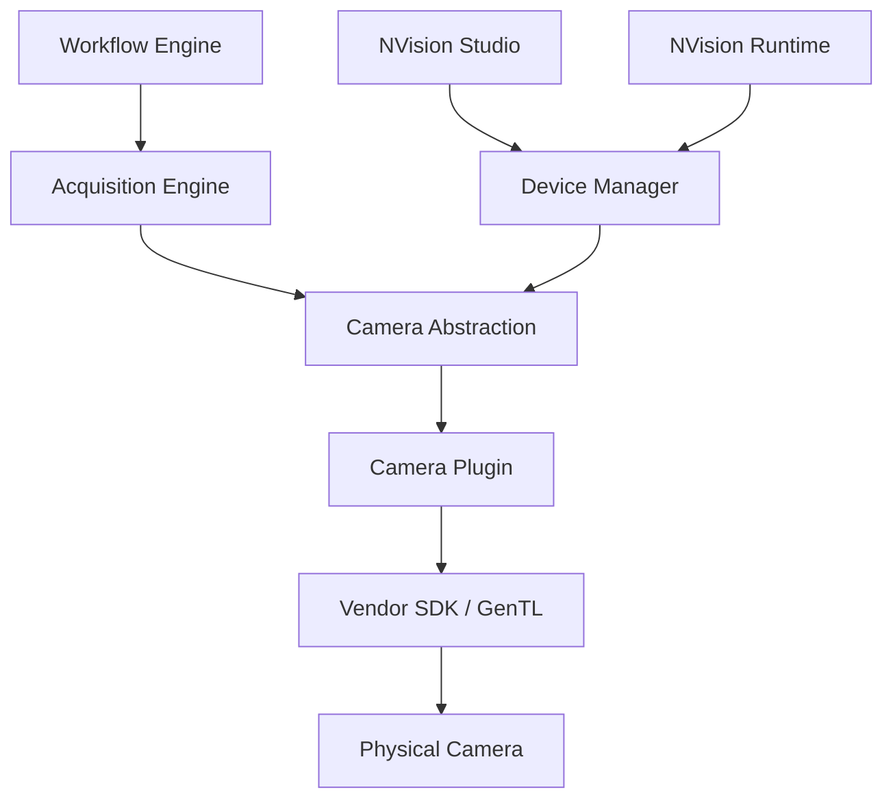
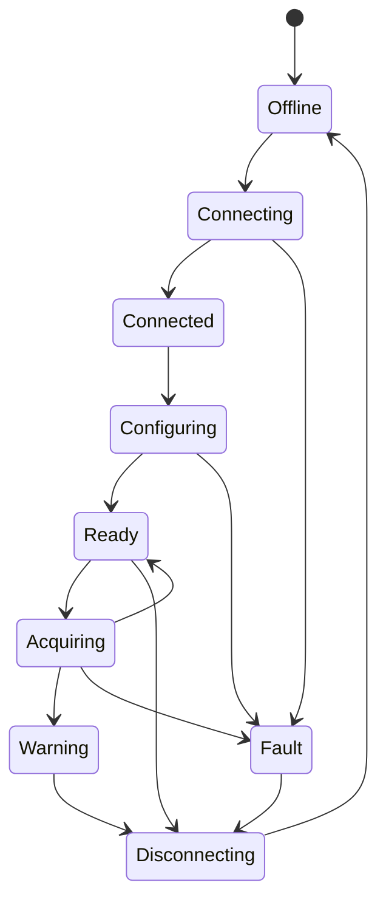
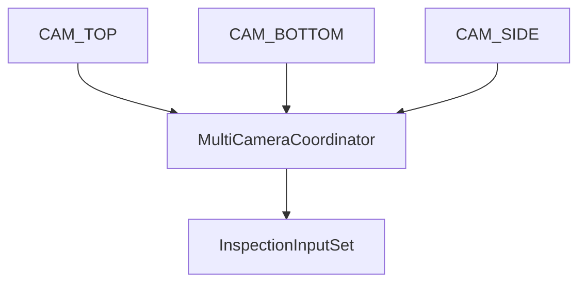
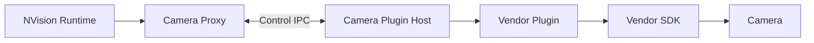
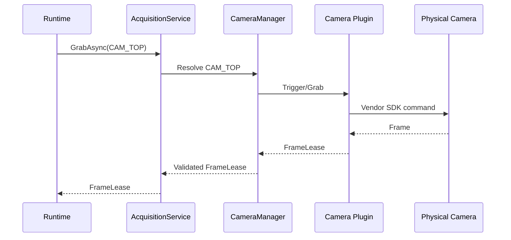
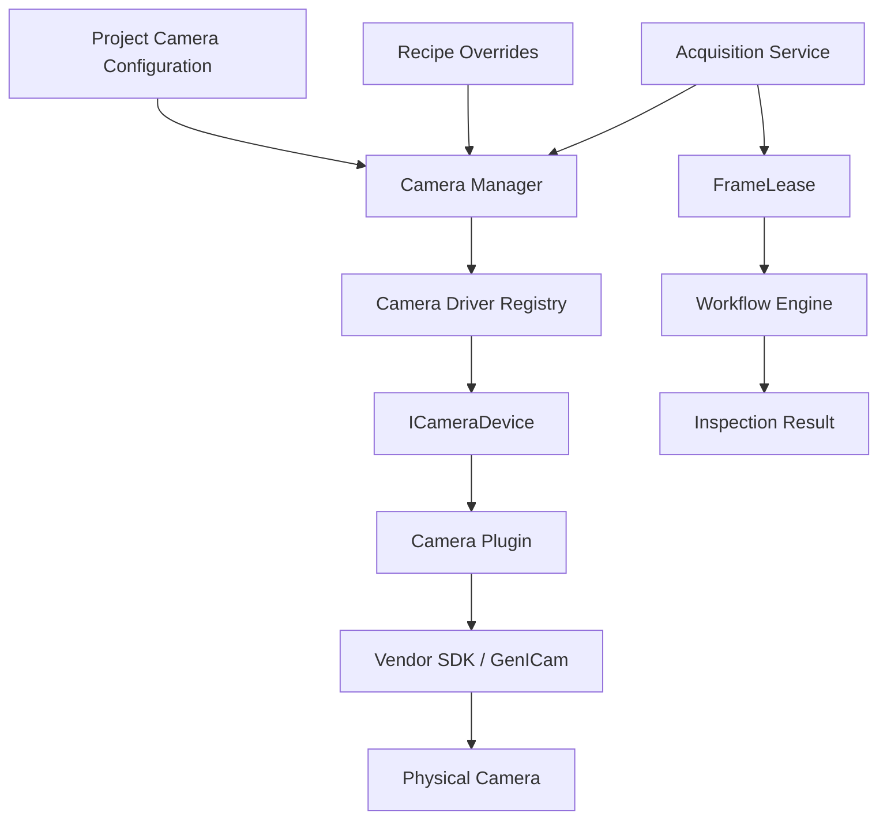

# 07 — NVision Camera Abstraction

**Product:** NTech NVision  
**Document Type:** Hardware Abstraction / Acquisition Contract  
**Primary Components:**  
- `NTech.NVision.Engine.Acquisition`
- `NTech.NVision.Plugin.Abstractions.Cameras`
- `NTech.NVision.Plugin.Camera.*`

**Status:** Foundation Architecture  
**Version:** 1.0  
**Date:** 2026-08-18  
**Parent Documents:**  
- `NVISION_PLATFORM_FOUNDATION.md`
- `01_PLATFORM_ARCHITECTURE.md`
- `02_DOMAIN_MODEL.md`
- `03_WORKFLOW_ENGINE_ARCHITECTURE.md`
- `04_PLUGIN_ARCHITECTURE.md`
- `05_PROJECT_FILE_FORMAT.md`
- `06_INSPECTION_RESULT_SCHEMA.md`

---

# 1. Purpose

This document defines the camera abstraction used by **NTech NVision**.

> **Implementation authority:** Acquisition, frame pools, leases, pixel buffers, and
> production camera plugins are C++20. Managed clients receive metadata, preview data,
> or opaque/shared-memory handles; they do not own the inspection hot-path buffer.

The Camera Abstraction is responsible for providing one stable NVision-owned interface over different camera vendors, transport technologies, and operating systems.

The abstraction must support:

- Industrial area-scan cameras
- GigE Vision cameras
- GenICam-compatible cameras
- USB3 Vision cameras
- Vendor SDK cameras
- USB/UVC cameras where appropriate
- File/image simulation sources
- Recorded sequence sources
- Future line-scan extensions
- Future depth/3D camera extensions

The abstraction must allow NVision to perform:

```text
Discover
Connect
Configure
Arm
Trigger
Acquire
Receive Frame
Validate
Timestamp
Release
Reconnect
Diagnose
```

without requiring Workflow, Domain, Studio, or Runtime code to understand a vendor SDK.

The central rule is:

> **NVision owns the camera contract. Vendor plugins translate that contract to the physical camera SDK.**

---

# 2. Architecture Goals

The camera subsystem must satisfy:

## 2.1 Vendor Independence

Core code must not depend directly on:

```text
Basler.Pylon
Hikrobot MVS SDK
FLIR Spinnaker
IDS peak
Daheng Galaxy
Allied Vision Vimba
Vendor GenTL producer APIs
```

These belong behind camera plugins.

---

## 2.2 Stable Image Contract

All cameras should produce an NVision-owned frame representation.

Example:

```text
Frame
├── FrameId
├── CameraId
├── Timestamp
├── Width
├── Height
├── PixelFormat
├── Buffer
└── Metadata
```

---

## 2.3 Explicit Buffer Ownership

Industrial camera frames can be large and frequent.

The abstraction must make clear:

- who owns the buffer,
- when it may be reused,
- when it must be released,
- whether it is copied,
- whether it is pinned/shared/native.

---

## 2.4 Trigger Correctness

The API must support:

```text
Free Run
Software Trigger
Hardware Trigger
External Line Trigger
Burst / Multi-shot
```

without hiding important differences.

---

## 2.5 Recoverability

Camera disconnect, timeout, packet loss, SDK failure, and reconnection must produce explicit states and errors.

---

## 2.6 Multi-Camera Support

The design must not assume one camera per project or one frame per inspection.

---

## 2.7 Headless Operation

Camera drivers must work in Runtime Service / Linux Edge deployments without UI dependencies.

---

# 3. Position in NVision Architecture



---

# 4. Main Components

Recommended structure:

```text
NTech.NVision.Engine.Acquisition
│
├── CameraManager
├── AcquisitionService
├── TriggerCoordinator
├── FrameValidator
├── FrameBufferPool
├── CameraHealthMonitor
└── MultiCameraCoordinator

NTech.NVision.Plugin.Abstractions.Cameras
│
├── ICameraDriverFactory
├── ICameraDevice
├── ICameraDiscovery
├── CameraCapabilities
├── CameraConfiguration
├── CameraFeatureDescriptor
├── GrabRequest
├── Frame
├── FrameBuffer
├── CameraError
└── CameraDiagnostics
```

---

# 5. Camera Domain Concepts

NVision distinguishes:

```text
Camera Device Configuration
Camera Driver
Physical Camera
Camera Runtime State
Frame
Acquisition Session
Trigger
```

These are separate concepts.

---

# 6. Logical Camera vs Physical Camera

A Project contains a logical camera:

```text
DeviceId: ...
DeviceCode: CAM_TOP
Name: Top Camera
```

The physical camera may be identified by:

```text
Serial Number
MAC Address
Vendor Device ID
USB path
GenTL device ID
```

This separation allows replacing physical hardware while preserving workflow references.

---

# 7. Camera Identity

Recommended identifiers:

```text
DeviceId
    NVision logical identity

DeviceCode
    CAM_TOP

DriverId
    ntech.camera.basler

HardwareId
    vendor-stable physical identity

ConnectionHint
    IP / interface / USB path
```

---

# 8. Hardware Identity Priority

When possible, prefer:

```text
Serial Number
```

over:

```text
IP Address
```

because IP may change.

For GigE cameras, useful identifiers include:

```text
Serial Number
MAC Address
Persistent IP
Current IP
```

---

# 9. Camera Discovery

Camera plugin may expose:

```text
ICameraDiscovery
```

Discovery returns:

```text
DiscoveredCamera
├── DriverId
├── HardwareId
├── Vendor
├── Model
├── SerialNumber
├── Transport
├── Address
├── Interface
├── FirmwareVersion
└── CapabilitiesSummary
```

---

# 10. Discovery Usage

Discovery is primarily used by:

```text
NVision Studio
Service / Maintenance Tools
```

Production Runtime should generally connect to explicitly configured camera identity.

---

# 11. Discovery Does Not Define Identity

Do not reference a camera in workflow by:

```text
"the first Basler camera found"
```

Production configuration must resolve to an explicit logical DeviceId + physical identity.

---

# 12. Camera Driver Factory

Conceptual contract:

```csharp
public interface ICameraDriverFactory
{
    string DriverId { get; }

    CameraDriverDescriptor Descriptor { get; }

    ValueTask<IReadOnlyList<DiscoveredCamera>> DiscoverAsync(
        CameraDiscoveryRequest request,
        CancellationToken cancellationToken);

    ValueTask<ICameraDevice> CreateAsync(
        CameraDeviceConfiguration configuration,
        CancellationToken cancellationToken);
}
```

Illustrative only.

---

# 13. Camera Driver Descriptor

```text
CameraDriverDescriptor
├── DriverId
├── Name
├── Vendor
├── PluginId
├── Version
├── SupportedTransports
├── SupportedPlatforms
└── Capabilities
```

---

# 14. Base Camera Device Contract

Conceptual:

```csharp
public interface ICameraDevice : IAsyncDisposable
{
    DeviceId DeviceId { get; }

    CameraRuntimeState State { get; }

    CameraCapabilities Capabilities { get; }

    ValueTask ConnectAsync(CancellationToken ct);

    ValueTask DisconnectAsync(CancellationToken ct);

    ValueTask ApplyConfigurationAsync(
        CameraConfiguration configuration,
        CancellationToken ct);

    ValueTask StartAcquisitionAsync(
        AcquisitionMode mode,
        CancellationToken ct);

    ValueTask StopAcquisitionAsync(CancellationToken ct);

    ValueTask<FrameLease> GrabAsync(
        GrabRequest request,
        CancellationToken ct);
}
```

Additional capabilities may use optional interfaces.

---

# 15. Interface Design Principle

Keep `ICameraDevice` minimal.

Optional features should use:

```text
Capabilities
```

and potentially specialized interfaces such as:

```text
IHardwareTriggerCamera
IStreamingCamera
IPtpCamera
IChunkDataCamera
```

rather than making every camera implement hundreds of meaningless methods.

---

# 16. Camera Runtime State

Suggested:

```text
Unknown
Offline
Connecting
Connected
Configuring
Ready
Acquiring
Busy
Warning
Fault
Disconnecting
Disabled
```

---

# 17. Camera State Machine



---

# 18. Camera Lifecycle

Recommended production lifecycle:

```text
Create Driver
    ↓
Connect
    ↓
Read Capabilities
    ↓
Apply Configuration
    ↓
Validate
    ↓
Start / Arm Acquisition
    ↓
Ready
    ↓
Grab repeatedly
    ↓
Stop
    ↓
Disconnect
    ↓
Dispose
```

---

# 19. Connection Responsibilities

Plugin should:

- open SDK device,
- validate physical identity,
- initialize vendor transport,
- read camera metadata,
- expose current feature state.

Device Manager owns higher-level reconnect policy.

---

# 20. Connection Timeout

Every connection attempt must have finite timeout.

Example:

```text
Connect timeout = 3 s
```

No infinite SDK wait.

---

# 21. Reconnect Ownership

Recommended separation:

```text
Camera Plugin
    performs one connect attempt

Camera Manager
    decides retry/reconnect schedule
```

This avoids nested infinite retry loops.

---

# 22. Reconnect Strategy

Possible:

```text
Immediate first retry
then bounded backoff
```

Example:

```text
0 s
1 s
2 s
5 s
10 s
```

until policy stops.

---

# 23. Reconnect State

During reconnect:

```text
Camera = Offline / Connecting
Runtime readiness may become Warning/Fault
```

If camera is required, inspection is blocked.

---

# 24. Camera Configuration

Common configuration:

```text
Exposure
Gain
TriggerMode
TriggerSource
FrameRate
PixelFormat
ROI
Binning
Decimation
WhiteBalance
PacketSize
InterPacketDelay
AcquisitionMode
```

Not all cameras support all features.

---

# 25. Camera Configuration Model

```text
CameraConfiguration
├── Common
├── DriverParameters
└── FeatureOverrides
```

Common fields are NVision-defined.

Vendor-specific fields remain plugin-owned.

---

# 26. Feature Model

A powerful abstraction is:

```text
CameraFeatureDescriptor
```

Example:

```text
Key: exposureUs
Type: Float
Unit: us
Min: 20
Max: 100000
Writable: true
RecipeOverridable: true
RequiresStop: false
```

---

# 27. Feature Descriptor

```text
CameraFeatureDescriptor
├── Key
├── DisplayName
├── DataType
├── Unit
├── Min
├── Max
├── Step
├── AllowedValues
├── Readable
├── Writable
├── RecipeOverridable
├── RequiresAcquisitionStop
├── RequiresReconnect
└── Category
```

---

# 28. Feature Categories

Suggested:

```text
Acquisition
ImageFormat
AnalogControl
Trigger
Transport
Color
Synchronization
Advanced
Diagnostics
```

---

# 29. Schema-Driven Camera UI

Studio should render camera properties from descriptors where practical.

This allows consistent UI across vendors.

Example:

```text
Exposure          [ 7500 us ]
Gain              [ 1.5 dB  ]
Trigger Mode      [ Software ]
Pixel Format      [ Mono8    ]
```

---

# 30. Vendor-Specific Feature Escape Hatch

Some cameras expose advanced features.

Plugin can expose:

```text
DriverParameters
```

with schema metadata.

Do not add every vendor feature to core API.

---

# 31. GenICam Mapping

For GenICam cameras, plugin may map standard SFNC features:

```text
ExposureTime
Gain
TriggerMode
TriggerSource
PixelFormat
Width
Height
OffsetX
OffsetY
AcquisitionFrameRate
```

to NVision common keys.

---

# 32. Acquisition Modes

Initial:

```text
SingleFrame
Continuous
Triggered
Burst
```

---

# 33. SingleFrame

One acquisition request returns one frame.

Suitable:

```text
offline/manual
simple software trigger
```

---

# 34. Continuous

Camera streams continuously.

Runtime consumes latest/queued frames.

Useful for:

```text
live preview
high-rate inspection
```

---

# 35. Triggered

Camera waits armed and captures upon trigger.

Trigger may be:

```text
software
hardware line
PLC-generated line
sensor
```

---

# 36. Burst

One trigger produces multiple frames.

Potential use:

```text
multiple lighting conditions
fast sequence
```

---

# 37. Trigger Modes

Canonical:

```text
FreeRun
Software
Hardware
External
```

The exact physical source is configured separately.

---

# 38. Trigger Source

Examples:

```text
Line0
Line1
Software
ActionCommand
Encoder
```

Vendor plugin maps to actual SDK enum.

---

# 39. Software Trigger Sequence

Recommended:

```text
Camera Ready
    ↓
Issue Software Trigger
    ↓
Wait Frame
    ↓
Validate Frame
    ↓
Return FrameLease
```

---

# 40. Hardware Trigger Sequence

```text
Camera Armed
    ↓
External Trigger Edge
    ↓
Camera Exposure
    ↓
Frame Transfer
    ↓
NVision receives frame
```

Runtime may not directly initiate trigger.

---

# 41. Trigger Correlation

Critical for hardware trigger.

Frame metadata should include where available:

```text
FrameId
TriggerId
CameraTimestamp
HostReceiveTimestamp
ChunkCounter
```

Runtime correlates trigger to inspection.

---

# 42. Trigger Request

Conceptual:

```text
TriggerRequest
├── TriggerId
├── RequestedAt
├── Timeout
├── ExpectedFrameCount
└── Metadata
```

---

# 43. Grab Request

```text
GrabRequest
├── TriggerPolicy
├── Timeout
├── ExpectedFrameCount
├── FrameSelection
└── ValidationPolicy
```

---

# 44. Frame Contract

Canonical:

```text
Frame
├── FrameId
├── CameraId
├── SequenceNumber
├── CapturedAt
├── ReceivedAt
├── CameraTimestamp
├── Width
├── Height
├── Stride
├── PixelFormat
├── Buffer
├── Status
└── Metadata
```

---

# 45. FrameId

Unique at least within camera session.

Can use:

```text
camera sequence counter
+
session ID
```

or UUID.

---

# 46. Sequence Number

Use camera/vendor frame counter where reliable.

Useful for detecting:

```text
Dropped frames
Duplicate frames
Out-of-order frames
```

---

# 47. CapturedAt vs ReceivedAt

Distinguish:

```text
CapturedAt
    estimated/actual exposure timestamp

ReceivedAt
    host receipt timestamp
```

For many cameras, `CapturedAt` comes from camera timestamp + synchronization.

---

# 48. Camera Timestamp

Raw camera clock value may be stored:

```text
ticks
nanoseconds
device timestamp units
```

with conversion metadata.

---

# 49. Timestamp Accuracy

Levels:

```text
HostOnly
CameraUnsynchronized
CameraSynchronized
PTPSynchronized
ExternalClock
```

Expose timestamp quality.

---

# 50. Timestamp Quality

Concept:

```text
FrameTimestampQuality
```

Useful for multi-camera correlation.

---

# 51. Frame Status

Possible:

```text
Complete
Incomplete
Corrupt
Dropped
Timeout
Cancelled
```

Only complete frames should normally enter Vision workflow.

---

# 52. Incomplete Frame

GigE cameras may produce incomplete frame due to network loss.

Plugin must not silently return it as valid.

Return explicit frame/error status.

---

# 53. Pixel Format

NVision-owned pixel format enum/value.

Initial:

```text
Mono8
Mono10
Mono12
Mono16
BayerRG8
BayerBG8
BayerGR8
BayerGB8
RGB8
BGR8
RGBA8
BGRA8
YUV422
Depth16
Float32
```

Not all required for MVP.

---

# 54. Packed Formats

Industrial cameras may use:

```text
Mono10Packed
Mono12Packed
```

Strategy:

- expose raw packed format if zero-copy needed,
- or plugin/acquisition service converts to standardized unpacked format.

Policy must be explicit.

---

# 55. Preferred Processing Formats

For early NVision:

```text
Mono8
Mono16
BGR8 / RGB8
```

cover many vision applications.

---

# 56. Color Conversion

Do not force every camera to output BGR.

Acquisition can preserve raw Bayer when beneficial.

A separate `ColorConvert` node/service may convert.

---

# 57. Pixel Format Metadata

Frame must describe exact format.

Never infer from channel count alone.

---

# 58. Stride

Frame includes:

```text
StrideBytes
```

because row padding may exist.

Image processing must not assume:

```text
stride = width * bytesPerPixel
```

---

# 59. Endianness

For 16-bit/special formats, define endianness or normalize to platform convention.

---

# 60. Frame Buffer

Conceptual:

```text
IFrameBuffer
├── MemoryType
├── Length
├── Pointer / Memory
├── IsReadOnly
└── Lifetime
```

---

# 61. Buffer Memory Types

Potential:

```text
Managed
PinnedManaged
Native
SharedMemory
Cuda
VendorOwned
```

MVP can start with:

```text
Managed / Native
```

while preserving abstraction.

---

# 62. FrameLease

Recommended ownership wrapper:

```text
FrameLease
```

Concept:

```text
FrameLease
├── Frame
└── Dispose / Release
```

Caller must release when done.

---

# 63. Why Lease

Vendor SDK often owns buffer pool.

If NVision keeps frame too long without release:

```text
camera acquisition stalls
buffer starvation occurs
```

Lease makes lifetime explicit.

---

# 64. Example Ownership

```text
Vendor buffer
    ↓ lease
NVision FrameLease
    ↓ used by workflow
Dispose
    ↓
Buffer returned to vendor pool
```

---

# 65. Copy vs Lease Policy

Two modes:

## Zero / Low Copy

Return vendor-owned buffer lease.

Pros:

- performance

Cons:

- stricter lifetime

## Copy

Copy into NVision pool.

Pros:

- simpler ownership

Cons:

- memory bandwidth cost

---

# 66. Recommended MVP Policy

For production clarity:

> Allow plugin to return a lease, but Acquisition Engine may copy into an NVision-owned pooled buffer when downstream lifetime exceeds vendor safety requirements.

This gives safe default and future performance options.

---

# 67. Immutable Frame Semantics

Consumers treat frame as read-only.

Image processing nodes produce derived images.

Do not mutate shared source frame.

---

# 68. Frame Buffer Pool

Acquisition Engine may use:

```text
IFrameBufferPool
```

to reduce GC allocations.

---

# 69. Buffer Pool Key

Potential:

```text
Width
Height
PixelFormat
MemoryType
```

---

# 70. Buffer Pool Limits

Must be bounded.

Avoid unbounded memory growth during trigger overload.

---

# 71. Frame Lifetime in Workflow

Typical:

```text
Acquire
  ↓
Workflow branches consume
  ↓
Last consumer completes
  ↓
Frame released
```

Workflow Engine may use reference-counted image handles.

---

# 72. Live Preview Lifetime

Preview should not hold production buffer indefinitely.

Create:

```text
throttled preview copy
```

or encoded thumbnail.

---

# 73. Acquisition Service

High-level interface used by Workflow/Inspection Engine.

Concept:

```text
IAcquisitionService
```

Operations:

```text
GetFrameAsync(DeviceId, request)
StartStream
StopStream
GetLatestFrame
```

The service hides plugin details.

---

# 74. Camera Manager

Responsibilities:

```text
Create camera devices
Connect
Configure
Maintain state
Reconnect
Expose health
Coordinate recipe changes
```

---

# 75. Device Manager vs Camera Manager

General:

```text
Device Manager
```

owns all device categories.

Camera-specific lifecycle can be delegated to:

```text
Camera Manager
```

---

# 76. Recipe Camera Overrides

Recipe may override:

```text
Exposure
Gain
Light-related timing
ROI
```

only if feature is marked:

```text
RecipeOverridable
```

---

# 77. Recipe Activation Camera Flow

```text
Stop accepting triggers
        ↓
Wait active inspection
        ↓
Stop acquisition if required
        ↓
Apply changed features
        ↓
Verify readback
        ↓
Restart / re-arm
        ↓
Ready
```

---

# 78. Readback Verification

For critical parameters:

```text
Set Exposure = 8000
Read Exposure
Verify within tolerance
```

Some SDKs quantize requested values.

Resulting effective value should be known.

---

# 79. Effective Configuration

Camera runtime should expose:

```text
Requested Configuration
Effective Configuration
```

Useful for traceability.

---

# 80. Camera Configuration Hash

Compute from execution-relevant effective config.

Inspection result may store:

```text
CameraConfigHash
```

rather than full config every time.

---

# 81. Exposure

Canonical unit:

```text
microseconds
```

Example:

```text
7500 us
```

Plugin converts vendor units.

---

# 82. Gain

Gain semantics differ by vendor.

Preferred:

- use vendor-independent numeric value where comparable,
- otherwise clearly mark unit such as dB or raw.

Do not pretend all gain values mean same thing.

---

# 83. Frame Rate

Canonical:

```text
frames per second
```

For triggered acquisition, frame rate limit may still matter.

---

# 84. Camera ROI

Two different concepts:

## Sensor ROI

Camera hardware ROI:

```text
Width / Height / Offset
```

Reduces transmitted pixels.

## Vision ROI

Workflow Crop node.

These must not be confused.

---

# 85. Sensor ROI

Camera feature:

```text
SensorRegion
```

May require alignment constraints:

```text
WidthIncrement
HeightIncrement
OffsetIncrement
```

Plugin exposes valid ranges/steps.

---

# 86. Hardware Binning

Capability optional.

Can reduce resolution / improve sensitivity.

Must be stored as camera configuration.

---

# 87. Hardware Decimation

Same principle.

---

# 88. White Balance

Relevant for color camera.

Possible modes:

```text
Off
AutoOnce
Continuous
Manual
```

Production inspection generally benefits from deterministic manual/once configuration.

---

# 89. Auto Exposure

Avoid continuous auto exposure in deterministic production unless specifically justified.

If enabled, inspection traceability becomes more complex.

---

# 90. Deterministic Imaging Principle

For inspection stations, prefer fixed:

```text
Exposure
Gain
White Balance
Lighting
ROI
```

per Recipe.

---

# 91. Camera Trigger Delay

Hardware trigger systems may require:

```text
TriggerDelayUs
```

Expose when supported.

---

# 92. Exposure Delay / Readout

Advanced timing metadata may be vendor-specific.

Do not force into core MVP.

---

# 93. Lighting Coordination

Camera abstraction should not own light controller.

Coordination belongs to:

```text
Inspection / Acquisition orchestration
```

Example:

```text
Set Light
→ wait settling
→ Trigger Camera
```

---

# 94. Camera Strobe Output

If camera exposes strobe output, it may be represented as camera capability.

Example:

```text
LineOutput / ExposureActive
```

Useful for light synchronization.

---

# 95. Multi-Camera Architecture



---

# 96. Multi-Camera Input Set

```text
FrameSet
├── SetId
├── TriggerId
├── FramesByRole
├── StartedAt
├── CompletedAt
└── SynchronizationQuality
```

---

# 97. Camera Role

Use logical role:

```text
top
bottom
side
left
right
brightfield
darkfield
```

rather than relying only on DeviceCode.

---

# 98. FrameSet

A physical part inspection may require:

```text
CAM_TOP frame
CAM_BOTTOM frame
CAM_SIDE frame
```

all correlated by same inspection/trigger.

---

# 99. Multi-Camera Synchronization Modes

```text
SoftwareSequential
SoftwareParallel
SharedHardwareTrigger
PTPActionCommand
ExternalTriggerDistributor
```

---

# 100. Software Sequential

```text
Trigger CAM_TOP
wait
Trigger CAM_BOTTOM
wait
Trigger CAM_SIDE
```

Simple but not simultaneous.

---

# 101. Software Parallel

Issue trigger calls concurrently.

Timing depends on:

```text
OS scheduling
network
SDK
```

Not true synchronization.

---

# 102. Shared Hardware Trigger

Best for tightly synchronized exposure.

Same electrical trigger goes to all cameras.

---

# 103. PTP

GigE Vision cameras may support IEEE 1588 / PTP.

Benefits:

- synchronized device clocks,
- scheduled action commands,
- better timestamp correlation.

---

# 104. PTP Capability

Plugin may expose:

```text
SupportsPtp
PtpState
ClockOffsetNs
ClockRole
```

---

# 105. PTP State

Possible:

```text
Disabled
Initializing
Master
Slave
Synchronized
Fault
```

Exact mapping depends on camera.

---

# 106. PTP Readiness

Project requiring synchronized capture may declare:

```text
PTP required
```

Runtime readiness blocks if synchronization not achieved.

---

# 107. Scheduled Action Commands

Future GigE multi-camera feature.

Can capture multiple cameras at a scheduled device time.

Plugin-specific capability behind common synchronization service.

---

# 108. Synchronization Quality

FrameSet may report:

```text
maxTimestampDeltaUs
```

and classification:

```text
Good
Warning
Invalid
```

---

# 109. Inspection Policy for Sync Error

If required cameras differ by too much:

```text
Inspection = ERROR
DecisionCode = CAMERA_SYNC_INVALID
```

not product NG.

---

# 110. GigE Vision Considerations

GigE cameras introduce network-specific concerns:

```text
MTU
Jumbo Frames
Packet Size
Inter-Packet Delay
Packet Resend
NIC selection
Bandwidth
Multiple Cameras
Switch capacity
```

---

# 111. NIC Binding

Camera config may specify:

```text
InterfaceId
```

not just target camera IP.

Important on industrial PCs with multiple NICs.

---

# 112. Interface Identity

Represent local interface by stable system identifier when possible.

Machine-specific binding belongs to deployment/station config, not portable Project when appropriate.

---

# 113. Jumbo Frames

Plugin diagnostics should report whether configured packet size exceeds actual NIC/network MTU.

---

# 114. Packet Size

Common feature:

```text
GevSCPSPacketSize
```

mapped to:

```text
packetSizeBytes
```

for GigE-compatible plugin UI.

---

# 115. Inter-Packet Delay

Useful for multi-camera congestion control.

Mapped to common transport setting where possible.

---

# 116. Bandwidth Planning

Multiple cameras can saturate NIC.

Approximate data rate:

```text
width × height × bytesPerPixel × fps
```

plus protocol overhead.

Studio diagnostics may estimate bandwidth.

---

# 117. GigE Bandwidth Example

Example:

```text
2448 × 2048 × 1 byte × 20 fps
≈ 100 MB/s
≈ 800 Mb/s
```

before overhead.

A single 1 GbE camera can already approach link capacity.

---

# 118. Multi-GigE

NVision should not assume:

```text
1 GbE
```

Future camera plugins may support:

```text
2.5 GbE
5 GbE
10 GbE
```

---

# 119. Packet Loss Diagnostics

Camera diagnostics may expose:

```text
IncompleteFrames
PacketResends
LostPackets
DroppedFrames
```

---

# 120. Transport Health

Concept:

```text
CameraTransportDiagnostics
```

for GigE/USB health.

---

# 121. USB3 Vision Considerations

Potential diagnostics:

```text
USB bus speed
link state
transfer errors
bandwidth
device path
```

---

# 122. UVC Camera

For non-industrial/test cameras:

```text
ntech.camera.uvc
```

may implement reduced capability set.

Useful for development, not necessarily production.

---

# 123. GenICam Abstraction

NVision may support a generic:

```text
ntech.camera.genicam
```

plugin using GenTL producer.

Benefits:

- vendor-neutral baseline,
- broad industrial compatibility.

Limitations:

- vendor-specific advanced features may still require dedicated plugin.

---

# 124. Dedicated Vendor Plugin vs Generic GenICam

Use generic plugin when:

```text
standard acquisition/features sufficient
```

Use vendor plugin when needing:

```text
advanced diagnostics
special trigger
camera-specific features
better performance
vendor support
```

---

# 125. Camera Capability Discovery

After connect, plugin should expose effective capabilities based on:

```text
camera model
firmware
transport
SDK
```

not only static plugin assumptions.

---

# 126. Capability Snapshot

Runtime session may record:

```text
CameraCapabilitiesHash
```

for diagnostics.

---

# 127. Firmware

Camera diagnostics should include:

```text
FirmwareVersion
```

because behavior may differ between firmware versions.

---

# 128. Driver / SDK Version

Also record:

```text
PluginVersion
VendorSdkVersion
TransportLayerVersion
```

in session diagnostics.

---

# 129. Frame Validation

Acquisition Engine validates:

```text
Frame complete
Expected dimensions
Expected pixel format
Sequence sanity
Timestamp sanity
Trigger correlation
```

---

# 130. Dimension Mismatch

If camera unexpectedly changes frame size:

```text
ERROR
```

unless Project explicitly allows dynamic size.

---

# 131. Pixel Format Mismatch

Same.

Do not let downstream nodes reinterpret bytes incorrectly.

---

# 132. Stale Frame Protection

Software-trigger system must avoid returning a frame captured before current trigger.

Use:

```text
FrameId
Timestamp
Trigger counter
```

where possible.

---

# 133. Frame Queue

Continuous acquisition may have a bounded queue.

Policies:

```text
LatestOnly
FIFO bounded
DropOldest
DropNewest
```

---

# 134. Preview Queue vs Inspection Queue

Separate:

```text
Preview stream
```

from:

```text
Inspection acquisition
```

Preview should not consume frames needed by inspection.

---

# 135. Continuous Stream Architecture

Possible:

```text
Camera Stream
    ↓
Frame Broker
   ├── Preview Subscriber
   └── Inspection Selector
```

Must use bounded buffers.

---

# 136. Frame Broker

Future component:

```text
IFrameBroker
```

handles multi-consumer leases.

---

# 137. Acquisition Timeout

Every Grab must have:

```text
timeout
```

Example:

```text
100 ms
```

Failure becomes:

```text
CAMERA_TIMEOUT
```

---

# 138. Timeout Source

Distinguish:

```text
Trigger timeout
Exposure timeout
Transfer timeout
Frame wait timeout
```

Plugin can map vendor errors to common code + detail.

---

# 139. Common Camera Error Codes

Suggested:

```text
CAMERA_NOT_FOUND
CAMERA_CONNECT_FAILED
CAMERA_DISCONNECTED
CAMERA_CONFIGURATION_INVALID
CAMERA_FEATURE_UNSUPPORTED
CAMERA_TRIGGER_FAILED
CAMERA_TIMEOUT
CAMERA_FRAME_INCOMPLETE
CAMERA_FRAME_CORRUPT
CAMERA_PIXEL_FORMAT_MISMATCH
CAMERA_SYNC_INVALID
CAMERA_BUFFER_EXHAUSTED
CAMERA_SDK_ERROR
```

---

# 140. Error Model

```text
CameraError
├── Code
├── DeviceId
├── DriverId
├── VendorCode
├── Message
├── Recoverable
├── Operation
└── Timestamp
```

---

# 141. Vendor Error Preservation

Map vendor error to common code but preserve:

```text
VendorCode
VendorMessage
```

for diagnostics.

---

# 142. Recoverability

Example:

```text
Timeout
→ maybe recoverable

Configuration invalid
→ engineering action required

Device not found
→ reconnect/replacement required
```

---

# 143. Alarm Integration

Persistent camera fault raises Alarm.

One failed grab may produce inspection error.

Repeated failure may transition camera to Fault.

---

# 144. Health Monitor

`CameraHealthMonitor` may check:

```text
state
last frame time
temperature
transport errors
reconnect count
frame counter progression
```

---

# 145. Camera Health

```text
CameraHealth
├── State
├── LastSuccessfulFrameAt
├── FrameRate
├── DroppedFrames
├── IncompleteFrames
├── Temperature
├── Transport
└── LastError
```

---

# 146. Health Polling

Do not poll expensive SDK features at very high rate.

Use reasonable:

```text
1 Hz
```

or event-driven where possible.

---

# 147. Temperature

Some industrial cameras expose sensor temperature.

May be useful for diagnostics but not required by core contract.

---

# 148. Camera Statistics

Useful counters:

```text
FramesReceived
FramesComplete
FramesIncomplete
FramesDropped
GrabTimeouts
TriggerCount
ReconnectCount
```

---

# 149. Performance Metrics

Measure:

```text
TriggerToFrameMs
TransferMs
QueueWaitMs
FrameCopyMs
ProcessingHandoffMs
```

---

# 150. Acquisition Timing

Result timing may include:

```text
acquisitionMs
```

Camera diagnostics can provide more detail.

---

# 151. Hardware Timestamp vs Host Timing

For exact trigger latency, use hardware timestamp if synchronized.

Host timing is sufficient for many standard inspection systems.

---

# 152. Camera Preview

Studio/Runtime preview needs:

```text
Live View
```

but must not affect production acquisition stability.

---

# 153. Preview Frame Rate

Throttle UI preview:

```text
5–15 fps
```

if full camera runs faster.

---

# 154. Preview Resolution

Use optional downscale.

Do not force workflow to process preview-resolution frame.

---

# 155. Preview Encoding

Remote UI may use:

```text
JPEG
WebP
video stream
```

separate from processing buffer.

---

# 156. Studio Live Camera Tool

Studio should support:

```text
Connect
Live
Single Grab
Software Trigger
Exposure tuning
Gain tuning
Pixel format
ROI
Histogram
Focus aid
Save image
```

all via camera abstraction.

---

# 157. Focus Metrics

Future Studio utility may calculate:

```text
Laplacian variance
edge score
```

This is Vision tooling, not camera driver responsibility.

---

# 158. Camera Calibration Integration

Calibration references `DeviceId`.

Calibration requires consistent:

```text
sensor ROI
resolution
binning
lens
```

---

# 159. Calibration Compatibility

If camera configuration changes:

```text
ROI
resolution
binning
lens
```

existing calibration may become invalid.

---

# 160. Calibration Dependency Policy

Calibration record may store:

```text
CameraConfigHash
```

Runtime verifies compatibility.

---

# 161. Lens Metadata

Camera configuration may optionally reference:

```text
LensId
```

for traceability/calibration.

Lens itself is not part of camera SDK.

---

# 162. Physical Camera Replacement

Process:

```text
Maintenance Mode
    ↓
Discover replacement
    ↓
Bind logical DeviceId to new HardwareId
    ↓
Apply config
    ↓
Validate image
    ↓
Recalibrate if required
    ↓
Return Ready
```

---

# 163. Replacement Audit

Record:

```text
old serial
new serial
timestamp
operator
calibration action
```

---

# 164. Camera Role in Project File

Example:

```json
{
  "id": "...",
  "code": "CAM_TOP",
  "type": "camera",
  "driver": "ntech.camera.basler",
  "role": "top",
  "connection": {
    "serialNumber": "40123456"
  }
}
```

---

# 165. Camera Project Configuration

Portable authoring data includes:

```text
Logical identity
Desired image parameters
Trigger mode
Role
Driver requirement
```

Machine-specific network interface binding may be deployment override.

---

# 166. Camera Local Override

Example:

```text
NIC interface ID
local GenTL path
vendor runtime path
```

belongs to Station config.

---

# 167. Driver Configuration Preservation

If camera plugin missing, Studio must preserve vendor configuration without destructive rewrite.

---

# 168. Runtime Readiness

Camera contributes blocking readiness issues:

```text
Required camera missing
Camera not connected
Configuration failed
Trigger unsupported
Pixel format unsupported
Calibration incompatible
PTP not synchronized
```

---

# 169. Camera Readiness Result

```text
CameraReadiness
├── IsReady
├── BlockingIssues
├── Warnings
└── EffectiveConfiguration
```

---

# 170. Camera Workflow Node

Possible node:

```text
nvision.acquisition.camera-grab
```

Parameters:

```text
DeviceId
Timeout
FrameRole
```

Output:

```text
Image
FrameMetadata
```

---

# 171. Pre-Acquired Frame Model

Alternative Runtime mode:

```text
Inspection Engine acquires frame
    ↓
Workflow Input: sourceImage
```

This may be preferable when machine handshake is centralized.

---

# 172. Recommended MVP Acquisition Architecture

For initial production:

> Prefer Inspection Engine / Acquisition Service to acquire required frames before invoking the core inspection workflow, unless a project clearly benefits from camera nodes inside the graph.

Reason:

- simpler trigger handshake,
- clearer error handling,
- easier multi-camera coordination,
- machine timing stays centralized.

---

# 173. Camera Nodes Still Useful

Useful for:

```text
Studio testing
special multi-shot sequences
flexible inspection jobs
```

Architecture supports both models.

---

# 174. Acquisition Plan

Future:

```text
AcquisitionPlan
```

defines:

```text
which cameras
which trigger order
frame roles
timeouts
lighting coordination
```

before Workflow.

---

# 175. Example Acquisition Plan

```text
FrameRole: top
Camera: CAM_TOP
Mode: SoftwareTrigger
Timeout: 100 ms

FrameRole: bottom
Camera: CAM_BOTTOM
Mode: SoftwareTrigger
Timeout: 100 ms
```

---

# 176. Multi-Shot Acquisition Plan

```text
Shot 1
Light Brightfield
CAM_TOP

Shot 2
Light Darkfield
CAM_TOP
```

Result:

```text
FrameSet
├── top-brightfield
└── top-darkfield
```

---

# 177. Line-Scan Future Extension

Line-scan differs significantly:

```text
Encoder trigger
continuous line stream
frame assembly
line rate
height accumulation
```

Do not force current area-scan API to pretend line-scan is identical.

Future separate capability:

```text
ILineScanCamera
```

or acquisition stream abstraction.

---

# 178. Depth Camera Future Extension

Depth/3D camera may produce:

```text
RGB
Depth
IR
Point Cloud
Confidence
```

Use multi-stream frame set.

Avoid overloading simple 2D frame.

---

# 179. Camera Stream Type

Future:

```text
StreamDescriptor
```

Examples:

```text
Color
Mono
Depth
Infrared
Confidence
```

---

# 180. Stereo Camera

May expose synchronized left/right frames through same physical device.

Logical handling may use:

```text
one DeviceId
multiple stream roles
```

---

# 181. Simulation Camera

Built-in plugin:

```text
ntech.camera.file
```

required for development and CI.

---

# 182. File Camera Sources

Support:

```text
Single image
Folder
Sequence
Video
Recorded NVision frames
```

---

# 183. File Camera Capabilities

Simulate:

```text
Single Grab
Software Trigger
Continuous
Frame Rate
Loop
```

No fake claim of hardware trigger/PTP.

---

# 184. Deterministic Simulation

For golden tests:

```text
same request
→ same frame sequence
```

unless randomized explicitly.

---

# 185. Recorded Frame Metadata

Recorded source may preserve:

```text
original frame ID
camera settings
timestamp
```

or generate simulated metadata.

---

# 186. Camera Simulator Use Cases

```text
CI
Studio offline engineering
training demos
debugging customer issue
replay production sequence
```

---

# 187. Camera Recording

Future acquisition recorder:

```text
Frame
+
Metadata
+
Camera config
```

to support exact replay.

---

# 188. Replay Package

Potential:

```text
.nvrecord
```

Not MVP.

---

# 189. Frame Serialization

Frames are not serialized into `.nvision`.

Only references/recordings.

---

# 190. Snapshot Capture

Studio can save:

```text
PNG/TIFF
+
metadata sidecar JSON
```

for engineering samples.

---

# 191. Pixel-to-mm Impact

Changing sensor ROI or binning may affect calibration.

Runtime should detect via calibration compatibility.

---

# 192. Camera Orientation

Physical mounting orientation belongs to Project/Calibration metadata.

Do not rely on driver to understand:

```text
camera mounted upside-down
```

A workflow Rotate/Transform node may normalize.

---

# 193. Image Flip Feature

Some camera hardware supports horizontal/vertical reverse.

If used, it becomes execution-relevant camera configuration and must be traceable.

---

# 194. Bayer Orientation

Hardware flip may alter effective Bayer pattern semantics on some cameras.

Vendor plugin must handle/report correctly.

---

# 195. Camera Clock Reset

Device timestamps may reset after reconnect.

Frame correlation logic must account for new session.

---

# 196. Camera Session ID

Useful:

```text
CameraSessionId
```

changes on each successful reconnect.

Frame metadata includes it.

---

# 197. Duplicate Frame Detection

Use:

```text
CameraSessionId + SequenceNumber
```

where sequence counter is reliable.

---

# 198. Camera Event Model

Events:

```text
Connected
Disconnected
StateChanged
FrameDropped
TransportWarning
TemperatureWarning
ConfigurationChanged
```

---

# 199. Event Transport

Use bounded async channel/event interface.

Do not invoke UI callbacks from vendor SDK thread.

---

# 200. Vendor SDK Callback Thread

Plugin should immediately decouple callback from heavy processing.

No Vision inference inside SDK callback.

---

# 201. Callback Frame Buffer

Be careful: vendor buffer may only be valid during callback.

Plugin must:

```text
lease/copy
```

before returning control if required by SDK.

---

# 202. Thread Affinity

Some SDKs require specific thread use.

Plugin hides this.

NVision camera API remains async/thread-agnostic.

---

# 203. Camera Dispose

Must:

```text
stop acquisition
release callbacks
release buffers
close device
release SDK handle
```

idempotently where practical.

---

# 204. Process Shutdown

Runtime Supervisor gives camera manager bounded shutdown time.

If plugin hangs, process isolation may eventually be required.

---

# 205. Native Crash Risk

Camera SDK can cause fatal native crash.

Future:

```text
Camera Plugin Host Process
```

as described in Plugin Architecture.

---

# 206. Out-of-Process Camera Architecture



Frames transferred via shared memory.

---

# 207. Shared Memory Frame Lease

Descriptor:

```text
BufferId
Generation
Offset
Length
Width
Height
Stride
PixelFormat
FrameId
Timestamp
```

Runtime releases lease via IPC.

---

# 208. Host Crash

If Camera Host dies:

```text
shared leases invalid
camera state Fault
active inspection ERROR
supervisor may restart host
```

No partially valid frame should survive silently.

---

# 209. Security

Camera configuration can contain:

```text
IP addresses
network details
```

but generally no secrets.

If camera uses credentials, use secret reference.

---

# 210. Camera Firmware Update

Not part of core acquisition API.

Treat as maintenance/vendor tool operation.

---

# 211. Camera Settings Import/Export

Studio may export camera config snapshot.

Use NVision schema, not raw vendor binary where possible.

---

# 212. User Roles

Operator:

```text
view camera state
```

Engineer:

```text
configure exposure/gain/trigger
```

Admin/service:

```text
bind/rebind hardware
advanced transport config
```

---

# 213. Runtime UI Camera Status

Show concise:

```text
CAM_TOP        READY
Exposure       7500 us
Frame          123456
FPS            10.0
```

Fault:

```text
CAM_TOP        OFFLINE
Last error     Device disconnected
```

---

# 214. Studio Diagnostics Camera Page

Detailed:

```text
Vendor
Model
Serial
Firmware
Driver
SDK
Transport
IP/MAC
Packet size
MTU
Frame counters
Incomplete frames
Temperature
PTP
```

---

# 215. Camera Metrics Naming

Suggested:

```text
camera.frames.received
camera.frames.incomplete
camera.frames.dropped
camera.grab.timeout
camera.reconnect.count
camera.grab.duration_ms
camera.copy.duration_ms
```

---

# 216. Metrics Labels

Avoid high-cardinality labels such as InspectionId.

Use:

```text
station
deviceCode
driverId
```

---

# 217. Logging Context

Every camera log includes:

```text
DeviceId
DeviceCode
DriverId
HardwareId
CameraSessionId
```

where available.

---

# 218. Camera Result Traceability

Inspection result may include:

```text
CameraId
FrameId
CameraConfigHash
CapturedAt
```

per image reference.

---

# 219. Exact Camera Settings Per Result

Only needed if configuration can vary dynamically.

For fixed Recipe/session config:

```text
config hash + deployment
```

is enough.

---

# 220. Camera Config Change Audit

Record:

```text
Exposure changed
Gain changed
Trigger mode changed
Physical camera replaced
```

with actor and timestamp.

---

# 221. Parameter Change Impact Classification

Feature descriptor may define:

```text
RuntimeSafe
RequiresAcquisitionStop
RequiresReconnect
InvalidatesCalibration
```

---

# 222. Example Feature Impact

```text
Exposure
RuntimeSafe between inspections

PixelFormat
Requires acquisition stop

IP address
Requires reconnect

Binning
Requires acquisition stop + may invalidate calibration
```

---

# 223. Feature Transaction

Applying recipe camera overrides should behave transactionally where possible.

```text
Validate all
    ↓
Apply
    ↓
Read back
    ↓
If failure:
rollback or mark camera Fault
```

---

# 224. Rollback Limitations

Some vendor settings cannot be perfectly rolled back.

If partial configuration occurs:

```text
camera state = Fault / ReconfigurationRequired
```

do not assume old config remains valid.

---

# 225. Feature Dependency

Some features depend on others.

Example:

```text
ExposureTime writable only when ExposureAuto = Off
```

Plugin schema can expose dependency or plugin handles internally.

---

# 226. Feature Order

Configuration apply order matters.

Plugin owns vendor-specific ordering.

Core sends desired configuration.

---

# 227. Configuration Snapshot

Plugin returns effective snapshot after apply.

This becomes source for readiness/hash.

---

# 228. Camera Capability Version

Capabilities may change with firmware/SDK.

Do not hardcode model capability solely in Studio.

Read from connected device.

---

# 229. Offline Project Editing

If camera absent, Studio uses plugin static configuration schema.

Live min/max may be unavailable.

Mark:

```text
not verified against hardware
```

---

# 230. Hardware Validation

Before publish/deployment test:

```text
connect actual camera
verify parameters
```

recommended but not always mandatory for authoring.

---

# 231. Deployment Validation

Runtime must always validate actual hardware capabilities.

---

# 232. Multiple Identical Cameras

Use explicit serial mapping.

Example:

```text
CAM_TOP    Serial 40123456
CAM_SIDE   Serial 40123457
```

---

# 233. IP Address Conflict

Discovery should report duplicate/unreachable network conditions where possible.

---

# 234. Persistent IP Configuration

Changing camera IP is maintenance operation.

Plugin may expose separate:

```text
ICameraNetworkConfigurator
```

not normal inspection config.

---

# 235. Camera Discovery Across Subnets

May require vendor discovery mechanism.

Plugin-specific.

Core only sees discovered devices.

---

# 236. Firewall

Diagnostics may report blocked discovery/connectivity.

Installer should document required network access.

---

# 237. GigE NIC Optimization

Potential service checklist:

```text
Jumbo frames
Receive buffers
Power saving off
Dedicated NIC
No default gateway on isolated camera NIC where appropriate
```

These are deployment guidance, not core camera API.

---

# 238. NIC Sharing

If camera NIC shares other traffic, bandwidth jitter may affect acquisition.

Runtime diagnostics should help identify.

---

# 239. Multiple Cameras One NIC

Bandwidth planner should warn if estimated load exceeds policy threshold.

---

# 240. USB Power Management

For USB cameras, OS power saving may cause disconnect.

Plugin diagnostics/docs should note.

---

# 241. Camera Driver Testing

Required unit/contract tests:

```text
Create
Connect
Disconnect
Configure
Grab
Timeout
Cancel
Reconnect
Dispose
Unsupported feature
Invalid config
```

---

# 242. Hardware Integration Tests

Real camera tests:

```text
1000 triggers
disconnect/reconnect
power cycle
network cable pull
packet loss
high frame rate
recipe change
long soak
```

---

# 243. Soak Test

Target:

```text
24 h minimum
72 h recommended
```

for production camera plugin.

Monitor:

```text
memory
handles
frame drops
SDK errors
temperature
reconnect
```

---

# 244. Trigger Stress Test

Send triggers near maximum supported rate.

Verify:

```text
no frame mismatch
no stale frame
no unbounded queue
clear busy behavior
```

---

# 245. Multi-Camera Stress Test

Verify:

```text
simultaneous acquisition
bandwidth
sync
frame role correctness
buffer lifetime
```

---

# 246. Frame Integrity Test

Use known image pattern to verify:

```text
width
height
stride
pixel order
bit depth
Bayer mapping
```

---

# 247. Pixel Conversion Test

Compare conversion against vendor reference for:

```text
Mono12
Bayer
RGB
```

---

# 248. Memory Leak Test

Repeat:

```text
Grab → Process → Release
```

millions of frames where feasible.

Check:

```text
managed memory
native memory
vendor buffers
handles
```

---

# 249. Reconnect Test

Automated:

```text
disconnect cable
wait Fault
reconnect cable
camera reconnects
configuration reapplied
Ready restored
```

---

# 250. Configuration Persistence Test

Restart Runtime and verify effective config identical.

---

# 251. Fake Camera Contract Tests

Use file camera for generic acquisition tests.

---

# 252. Camera Abstraction MVP Scope

Phase 1 must support:

```text
Discovery
Explicit device binding
Connect/disconnect
State
Capabilities
Exposure
Gain
Pixel format
Trigger mode
Software trigger
Single frame grab
Continuous preview
Timeout
Frame metadata
Frame lease
Reconnect
Diagnostics
File camera
First real industrial camera plugin
```

---

# 253. Delay for Later

Not required initially:

```text
Line scan
PTP action commands
Shared-memory remote camera host
CUDA zero-copy
Complex chunk data
Firmware updater
Camera marketplace
3D multi-stream
Advanced GenICam node browser
```

---

# 254. Recommended First Camera Plugins

Development:

```text
ntech.camera.file
```

Production:

```text
one vendor-specific industrial camera plugin
```

Potentially later:

```text
ntech.camera.genicam
```

---

# 255. Suggested Project Structure

```text
src/
├── engine/
│   └── NTech.NVision.Engine.Acquisition/
│       ├── CameraManager.cs
│       ├── AcquisitionService.cs
│       ├── MultiCameraCoordinator.cs
│       ├── FrameValidator.cs
│       ├── FrameBufferPool.cs
│       └── CameraHealthMonitor.cs
│
├── core/
│   └── NTech.NVision.Plugin.Abstractions/
│       └── Cameras/
│           ├── ICameraDriverFactory.cs
│           ├── ICameraDevice.cs
│           ├── CameraCapabilities.cs
│           ├── CameraConfiguration.cs
│           ├── CameraFeatureDescriptor.cs
│           ├── GrabRequest.cs
│           ├── Frame.cs
│           ├── FrameLease.cs
│           └── CameraError.cs
│
└── plugins/
    └── camera/
        ├── NTech.NVision.Plugin.Camera.File/
        └── NTech.NVision.Plugin.Camera.<Vendor>/
```

---

# 256. Suggested Camera Configuration DTO

Conceptual:

```csharp
public sealed record CameraConfiguration
{
    public double? ExposureUs { get; init; }

    public double? Gain { get; init; }

    public string? PixelFormat { get; init; }

    public CameraTriggerMode TriggerMode { get; init; }

    public SensorRegion? Region { get; init; }

    public IReadOnlyDictionary<string, JsonElement>
        DriverParameters { get; init; }
}
```

Illustrative only.

---

# 257. Suggested Frame Contract

Conceptual:

```csharp
public sealed class Frame
{
    public required FrameId Id { get; init; }

    public required DeviceId CameraId { get; init; }

    public required long SequenceNumber { get; init; }

    public required DateTimeOffset ReceivedAt { get; init; }

    public DateTimeOffset? CapturedAt { get; init; }

    public required int Width { get; init; }

    public required int Height { get; init; }

    public required int StrideBytes { get; init; }

    public required PixelFormat PixelFormat { get; init; }

    public required IFrameBuffer Buffer { get; init; }
}
```

---

# 258. Suggested FrameLease Contract

```csharp
public interface IFrameLease : IAsyncDisposable
{
    Frame Frame { get; }
}
```

Could be synchronous `IDisposable` depending implementation.

---

# 259. Camera Driver Factory Registration

Plugin registers:

```text
DriverId:
ntech.camera.basler
```

with:

```text
ICameraDriverFactory
```

Device configuration references `DriverId`.

---

# 260. Acquisition Service API

Conceptual:

```csharp
public interface IAcquisitionService
{
    ValueTask<IFrameLease> GrabAsync(
        DeviceId cameraId,
        GrabRequest request,
        CancellationToken ct);

    CameraRuntimeState GetState(DeviceId cameraId);

    CameraHealth GetHealth(DeviceId cameraId);
}
```

---

# 261. Multi-Camera API

Conceptual:

```csharp
public interface IMultiCameraAcquisitionService
{
    ValueTask<FrameSetLease> AcquireAsync(
        AcquisitionPlan plan,
        CancellationToken ct);
}
```

---

# 262. Camera Configuration Apply Result

```text
CameraConfigurationApplyResult
├── Success
├── EffectiveConfiguration
├── Warnings
├── Errors
├── RequiresReconnect
└── CalibrationImpact
```

---

# 263. Camera Diagnostics API

```text
GetDriverInfo
GetHardwareInfo
GetTransportDiagnostics
GetFrameStatistics
GetFeatureSnapshot
```

---

# 264. Camera Project File Example

```json
{
  "id": "aaaaaaaa-aaaa-aaaa-aaaa-aaaaaaaaaaaa",
  "code": "CAM_TOP",
  "name": "Top Camera",
  "type": "camera",
  "role": "top",
  "driver": "ntech.camera.basler",
  "required": true,
  "enabled": true,

  "connection": {
    "serialNumber": "40123456"
  },

  "parameters": {
    "exposureUs": 7500,
    "gain": 1.5,
    "pixelFormat": "Mono8",
    "triggerMode": "software"
  }
}
```

---

# 265. Recipe Override Example

```json
{
  "deviceOverrides": [
    {
      "deviceId": "aaaaaaaa-aaaa-aaaa-aaaa-aaaaaaaaaaaa",
      "parameters": {
        "exposureUs": 8000
      }
    }
  ]
}
```

---

# 266. Inspection Image Trace Example

```json
{
  "id": "img-001",
  "kind": "source",
  "role": "top",
  "cameraId": "aaaaaaaa-aaaa-aaaa-aaaa-aaaaaaaaaaaa",
  "frameId": "frame-123456",
  "capturedAt": "2026-08-18T16:00:00.123+07:00",
  "width": 2448,
  "height": 2048,
  "pixelFormat": "Mono8",
  "cameraConfigHash": "sha256:..."
}
```

---

# 267. Runtime Sequence Example



---

# 268. Software Trigger Inspection Example

```text
PLC Trigger
    ↓
Inspection Engine
    ↓
AcquisitionService
    ↓
CAM_TOP Software Trigger
    ↓
Frame
    ↓
Workflow
    ↓
Decision
```

---

# 269. Hardware Trigger Inspection Example

```text
Sensor / PLC output
    ↓
Camera hardware trigger
    ↓
Camera frame arrives
    ↓
AcquisitionService correlates TriggerId
    ↓
Inspection Engine
    ↓
Workflow
```

---

# 270. Camera Error to Inspection Result

```text
Camera Timeout
      ↓
CameraError
      ↓
Acquisition Error
      ↓
Workflow/Inspection fails
      ↓
InspectionStatus = ERROR
DecisionCode = CAMERA_TIMEOUT
```

Never:

```text
NG
```

by default.

---

# 271. Architecture Decisions

## ADR-CAM-001 — Vendor SDKs Stay in Plugins

No vendor SDK references in Domain/Workflow/Studio.

---

## ADR-CAM-002 — Logical Device Identity

Workflow references NVision `DeviceId`, not serial/IP directly.

---

## ADR-CAM-003 — Explicit Frame Lease

Frame buffer ownership/lifetime is explicit.

---

## ADR-CAM-004 — Read-Only Frame Semantics

Shared source frames are immutable to consumers.

---

## ADR-CAM-005 — Capabilities Drive Features

Do not assume all cameras support same features.

---

## ADR-CAM-006 — Trigger Mode Is Explicit

Free-run, software, and hardware trigger are distinct.

---

## ADR-CAM-007 — Timeouts Everywhere

Connect, trigger, grab, and configuration operations are bounded.

---

## ADR-CAM-008 — Reconnect Policy Owned by Camera Manager

Plugin performs low-level connection; host owns lifecycle policy.

---

## ADR-CAM-009 — Multi-Camera Is First-Class

Architecture does not assume one camera per inspection.

---

## ADR-CAM-010 — File Camera Is a Built-In Test Driver

Offline engineering and CI use same acquisition contracts.

---

# 272. Anti-Patterns

## 272.1 UI Owns Camera SDK

Bad:

```text
CameraViewModel
→ Basler.Pylon
```

---

## 272.2 Workflow Knows Serial Number

Bad:

```text
CameraGrabNode(serial="40123456")
```

Use DeviceId.

---

## 272.3 Return Raw Vendor Object

Bad:

```text
BaslerGrabResult
```

crosses core boundary.

---

## 272.4 Hidden Buffer Lifetime

Returning pointer without lease/release contract.

---

## 272.5 Infinite Grab Timeout

Never.

---

## 272.6 Continuous Preview Controls Production Stream Directly

Can cause instability.

---

## 272.7 Treat Incomplete Frame as Valid

Never.

---

## 272.8 Reconnect Inside Multiple Layers

Creates retry storms.

---

## 272.9 Assume Exposure Unit

Normalize to explicit units.

---

## 272.10 One Camera Global Singleton

Breaks multi-camera projects.

---

# 273. Implementation Phases

## C0 — Contracts

Implement:

```text
ICameraDriverFactory
ICameraDevice
Frame
FrameLease
Capabilities
Configuration
Errors
```

---

## C1 — File Camera

Implement deterministic offline camera.

---

## C2 — Camera Manager

Implement:

```text
device lifecycle
state
connect/disconnect
configuration
```

---

## C3 — Acquisition Service

Implement:

```text
single grab
timeout
frame validation
```

---

## C4 — Preview

Continuous stream + throttled preview.

---

## C5 — First Industrial Camera Plugin

Implement one real vendor.

---

## C6 — Reconnect / Diagnostics

Production hardening.

---

## C7 — Recipe Overrides

Apply/verify camera config transitions.

---

## C8 — Multi-Camera

Implement FrameSet + coordinated acquisition.

---

## C9 — GigE Diagnostics

Bandwidth/packet diagnostics.

---

## C10 — Advanced Sync

PTP / hardware synchronized capture later.

---

# 274. MVP Definition of Done

The camera subsystem is ready for Phase 1 when NVision can:

```text
1. Discover file camera and one real industrial camera
2. Bind physical camera to CAM_TOP
3. Connect
4. Read capabilities
5. Set exposure/gain/pixel format
6. Configure software trigger
7. Grab one frame
8. Return NVision FrameLease
9. Validate frame dimensions/format
10. Pass frame into Workflow
11. Release buffer correctly
12. Run live preview
13. Detect timeout
14. Detect disconnect
15. Raise explicit camera error
16. Reconnect
17. Reapply effective configuration
18. Return Ready
19. Save source frame with camera trace
20. Run same workflow with File Camera in CI
```

---

# 275. Test Matrix

| Area | Tests |
|---|---|
| Discovery | found/not found/duplicate |
| Identity | serial binding/replacement |
| Connect | success/failure/timeout |
| Config | valid/invalid/readback |
| Trigger | software/hardware capability |
| Grab | complete/incomplete/timeout |
| Buffer | lease/release/leak |
| Pixel Format | Mono8/Mono16/color |
| Reconnect | unplug/replug |
| Preview | no production interference |
| Multi-camera | role/correlation |
| Diagnostics | counters/errors |
| Project | serialize/recipe override |

---

# 276. Golden Camera Fixtures

Recommended:

```text
tests/fixtures/camera/
├── mono8-2448x2048.raw
├── rgb8-1920x1080.raw
├── incomplete-frame.json
├── frame-metadata.json
└── file-camera-sequence/
```

---

# 277. Camera Plugin Contract Test Suite

Provide reusable:

```text
CameraDriverContractTests
```

Plugin supplies test fixture/device.

Checks common behavior.

---

# 278. Performance Acceptance

For acquisition path:

- no per-frame large managed allocation where avoidable,
- bounded memory,
- no hidden copies unless configured,
- frame release deterministic,
- preview cannot block inspection.

---

# 279. Production Readiness Checklist

Before releasing camera plugin:

```text
Connect tested
Disconnect tested
Power cycle tested
Cable pull tested
Timeout tested
Reconnect tested
Trigger stress tested
24h soak tested
Pixel format verified
Frame counter verified
Memory leak checked
Vendor SDK documented
Firmware compatibility documented
Transport diagnostics available
```

---

# 280. Final Camera Architecture



---

# 281. Core Rule Summary

The NVision Camera Abstraction follows these rules:

```text
Logical camera identity is stable.
Physical binding is explicit.
Vendor SDK stays inside plugin.
Capabilities describe what hardware can do.
Configuration is validated and read back.
Trigger mode is explicit.
Acquisition timeout is bounded.
Frames carry exact metadata.
Pixel format is explicit.
Buffer ownership is explicit.
Source frames are read-only.
Preview is isolated from inspection.
Reconnect is controlled.
Incomplete frames are errors.
Multi-camera is first-class.
Synchronization quality is measurable.
Simulation uses same contract.
Camera traceability reaches InspectionResult.
```

The central architecture statement is:

> **A camera in NVision is not a vendor SDK object. It is a logical industrial image source with explicit identity, capabilities, configuration, acquisition semantics, timing, health, and buffer ownership.**

---

# 282. Next Document

The recommended next document is:

> `08_AI_ENGINE_ARCHITECTURE.md`

It should define:

```text
AI model package
Model registry
Model slot
Task abstraction
Preprocessing
Postprocessing
ONNX Runtime
TensorRT
OpenVINO
Backend selection
Model session lifecycle
GPU resource ownership
Warm-up
Batching
Dynamic shapes
Precision FP32/FP16/INT8
Result contracts
Model versioning
Optimization
Fallback
Jetson deployment
Diagnostics
Performance
Model traceability
```

The AI Engine is the next major execution subsystem because it must allow NVision Workflow nodes to use Deep Learning without coupling inspection logic to one framework or GPU runtime.

---

**End of Document**
