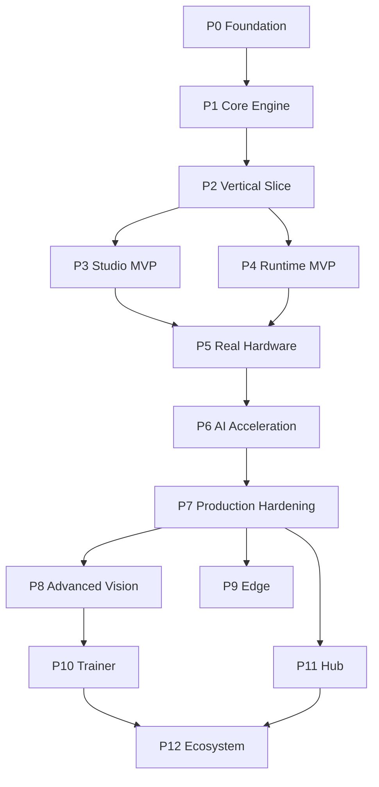
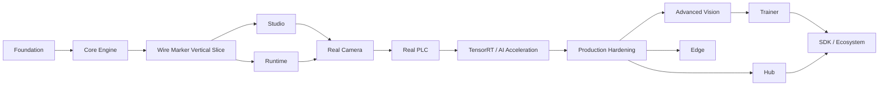

# 12 — NVision Product Roadmap

**Product:** NTech NVision  
**Document Type:** Product / Engineering Roadmap  
**Scope:** Platform Foundation → MVP → Production → Ecosystem  
**Status:** Foundation Roadmap  
**Version:** 1.0  
**Date:** 2026-08-18  

**Parent Documents:**  
- `NVISION_PLATFORM_FOUNDATION.md`
- `01_PLATFORM_ARCHITECTURE.md`
- `02_DOMAIN_MODEL.md`
- `03_WORKFLOW_ENGINE_ARCHITECTURE.md`
- `04_PLUGIN_ARCHITECTURE.md`
- `05_PROJECT_FILE_FORMAT.md`
- `06_INSPECTION_RESULT_SCHEMA.md`
- `07_CAMERA_ABSTRACTION.md`
- `08_AI_ENGINE_ARCHITECTURE.md`
- `09_RUNTIME_ARCHITECTURE.md`
- `10_STUDIO_UI_ARCHITECTURE.md`
- `11_DESIGN_SYSTEM.md`

---

# 1. Purpose

This document converts the NVision architecture into a practical implementation roadmap.

> **2026-08-20 rebaseline:** ADR-0005 inserts a native-foundation migration before P3
> Studio expansion. P0–P2 managed behavior is retained as a compatibility oracle while
> Core/Engine execution moves to C++20, C ABI/P/Invoke, and the production Engine Host.

The roadmap is designed to answer:

- What should be built first?
- What must exist before Studio can become useful?
- What is truly required for the MVP?
- Which components should remain simulated first?
- When should real Camera/PLC hardware be introduced?
- When should TensorRT/OpenVINO be introduced?
- What should be deliberately postponed?
- What are the release gates for each milestone?
- How do we avoid building a large framework before proving one real inspection?
- How do we preserve the long-term architecture while shipping vertically useful increments?

The central rule is:

> **Build NVision as a sequence of end-to-end vertical slices, not as a collection of isolated frameworks.**

---

# 2. Product Objective

NVision is:

> **NTech's reusable Industrial Vision Intelligence Platform for building, deploying, operating, and managing industrial Machine Vision inspection systems.**

The product should eventually support:

```text
Traditional Vision
AI Vision
OCR
Measurement
Classification
Detection
Segmentation
Anomaly Detection
Multi-Camera
PLC Integration
Robot Integration
MES Integration
Edge Deployment
Central Management
```

without becoming specific to one customer or one application.

---

# 3. Product Strategy

The implementation strategy follows five rules.

## 3.1 Platform Architecture, Application-First Validation

The architecture is reusable.

The first vertical slice is concrete:

```text
Wire Marker Inspection
```

This validates the platform against a real use case.

---

## 3.2 Simulators Before Hardware

First prove:

```text
Project
Workflow
Recipe
AI
Decision
Runtime
Result
Persistence
```

with:

```text
File Camera
PLC Simulator
ONNX Runtime
```

before introducing vendor SDK instability.

---

## 3.3 One Real Vendor at a Time

After the architecture works:

```text
File Camera
→ Real Camera Plugin
```

then:

```text
PLC Simulator
→ Real PLC Plugin
```

then:

```text
ONNX Runtime
→ TensorRT
```

Do not integrate five camera vendors before the first station works.

---

## 3.4 Same Core for Studio and Runtime

Studio Test and Runtime Production must share:

```text
Workflow Engine
AI Engine
Vision nodes
Decision model
Camera abstraction
Result contract
```

No separate "demo implementation."

---

## 3.5 Production Reliability Before Ecosystem Scale

Before Hub/Trainer/marketplace:

```text
Reconnect
Fault handling
Watchdog
Persistence
Traceability
Rollback
Soak testing
```

must be reliable.

---

# 4. Roadmap Overview

Recommended top-level phases:

```text
P0 — Repository & Foundation
P1 — Core Engine MVP
P2 — First Vertical Slice
P3 — Studio MVP
P4 — Runtime MVP
P5 — Real Hardware Integration
P6 — AI Acceleration
P7 — Production Hardening
P8 — Advanced Vision
P9 — Edge / Jetson
P10 — Trainer
P11 — Hub
P12 — Ecosystem / SDK
```

---

# 5. Dependency Overview



---

# 6. MVP Definition

The first NVision MVP is not:

```text
a complete commercial vision platform
```

The first MVP is:

> **A reusable NVision project can be authored, tested, published, executed headlessly, and produce traceable OK/NG/ERROR results for the Wire Marker application using the standard platform abstractions.**

---

# 7. MVP Vertical Slice

Target:

```text
Wire Marker Inspection
```

Flow:

```text
File Camera / Image
      ↓
Crop ROI
      ↓
AI Classification
      ↓
Compare Expected Type
      ↓
Decision
      ↓
OK / NG
      ↓
InspectionResult
      ↓
SQLite
      ↓
Runtime API/UI
```

---

# 8. MVP Recipe Model

Project:

```text
WireMarkerInspection
```

Job:

```text
MarkerTypeInspection
```

Recipes:

```text
TYPE_01
TYPE_02
TYPE_03
TYPE_04
```

---

# 9. MVP AI Model

Task:

```text
Classification
```

Classes:

```text
TYPE_01
TYPE_02
TYPE_03
TYPE_04
```

Backend:

```text
ONNX Runtime
```

---

# 10. MVP Devices

Initial:

```text
File Camera
PLC Simulator
```

Later replace with:

```text
Real Industrial Camera
Real PLC Plugin
```

---

# 11. MVP Persistence

Use:

```text
SQLite
+
Local File System
```

Persist:

```text
InspectionResult
NG images
selected OK images
logs
```

---

# 12. MVP Deployment

Studio:

```text
.nvision
    ↓ Publish
.nvpkg
```

Runtime:

```text
load .nvpkg
validate
prepare
execute
```

---

# 13. Phase P0 — Repository & Foundation

Goal:

> Create a clean solution structure capable of supporting the architecture before complex feature implementation begins.

---

# 14. P0 Repository Structure

Recommended:

```text
nvision/
├── apps/
├── src/
├── engine/
├── plugins/
├── sdk/
├── schemas/
├── tests/
├── samples/
├── tools/
└── docs/
```

---

# 15. P0 .NET Solution

Initial projects:

```text
NTech.NVision.Domain
NTech.NVision.Core
NTech.NVision.ProjectFormat
NTech.NVision.Plugin.Abstractions
NTech.NVision.Engine.Workflow
NTech.NVision.Engine.Inspection
NTech.NVision.Engine.Acquisition
NTech.NVision.Engine.AI
NTech.NVision.Contracts
```

---

# 16. P0 Engineering Infrastructure

Set up:

```text
Directory.Build.props
central package management
nullable enabled
warnings policy
code formatting
editorconfig
unit test framework
structured logging baseline
CI
```

---

# 17. P0 Coding Rules

Adopt:

```text
Nullable reference types
Async suffix
CancellationToken on long operations
Immutable domain objects where possible
Strong IDs
No vendor SDK in Core
No UI dependency in Engine
```

---

# 18. P0 Documentation Baseline

Keep architecture docs in:

```text
docs/architecture/
docs/product/
docs/design/
docs/decisions/
```

---

# 19. P0 ADR Process

Use lightweight Architecture Decision Records.

Example:

```text
ADR-0001 Modular Monolith
ADR-0002 WPF Studio
ADR-0003 Runtime Headless Service
ADR-0004 ONNX Interchange
```

---

# 20. P0 CI Baseline

CI should run:

```text
restore
build
unit tests
format/lint
schema tests
```

---

# 21. P0 Deliverables

Required:

```text
Solution builds
CI passes
Core project references correct
Architecture dependency rules documented
Sample test project runs
```

---

# 22. P0 Exit Gate

Do not proceed if:

```text
UI references vendor SDK
Domain references WPF
Engine references Studio
circular project references exist
```

---

# 23. Phase P1 — Core Domain & Engine MVP

Goal:

> Build the minimum platform primitives required to execute a typed Workflow.

---

# 24. P1 Domain Objects

Implement first:

```text
ProjectId
JobId
RecipeId
NodeId
DeviceId
ModelId
CalibrationId

Project
Job
WorkflowDefinition
Recipe
InspectionContext
InspectionResult
```

---

# 25. P1 Value Objects

Implement:

```text
SemanticVersion
Measurement
Confidence
BoundingBox
ImageSize
NodePortKey
DecisionCode
```

---

# 26. P1 Workflow Definition

Support:

```text
Nodes
Connections
Inputs
Outputs
Parameters
```

---

# 27. P1 Node Contracts

Implement:

```text
NodeTypeDescriptor
InputPortDescriptor
OutputPortDescriptor
ParameterDescriptor
INodeExecutor
INodeExecutorFactory
```

---

# 28. P1 Node Registry

Implement:

```text
INodeTypeRegistry
```

Built-in nodes register through same mechanism future plugins use.

---

# 29. P1 Workflow Validation

Support:

```text
duplicate IDs
unknown nodes
invalid ports
invalid connections
cycles
missing required inputs
parameter validation
```

---

# 30. P1 Workflow Compilation

Implement:

```text
WorkflowDefinition
    ↓
ExecutionPlan
```

Precompute:

```text
dependency graph
port slots
topological order
```

---

# 31. P1 Workflow Runtime

Initial scheduler:

```text
DAG
single inspection
bounded parallel-ready execution
```

MVP may start serial internally if API preserves future scheduling model.

---

# 32. P1 Data Model

Initial typed values:

```text
Image
Bool
Int
Float
String
ClassificationResult
Decision
```

---

# 33. P1 Image Model

Implement:

```text
ImageHandle
Frame metadata
PixelFormat
Width
Height
Stride
Buffer ownership
```

---

# 34. P1 Minimum Nodes

Implement:

```text
Input Image
Crop
Resize
Rotate
Compare
AND
OR
Decision
```

AI nodes added in P2.

---

# 35. P1 Decision Model

Implement:

```text
InspectionDecision
InspectionStatus
DecisionCode
Reason
```

---

# 36. P1 Unit Tests

Required:

```text
graph validation
compilation
execution order
typed port failure
node failure propagation
decision mapping
```

---

# 37. P1 Exit Gate

Required scenario:

```text
Input Number
    ↓
Compare
    ↓
Decision
```

can compile and execute with predictable result.

---

# 38. Phase P2 — First End-to-End Vertical Slice

Goal:

> Prove the architecture with one real inspection flow before building a large Studio.

---

# 39. P2 File Camera

Implement:

```text
ntech.camera.file
```

Capabilities:

```text
single image
folder sequence
software trigger
loop
```

---

# 40. P2 Acquisition Service

Implement:

```text
GrabAsync
timeout
frame validation
frame lease
```

---

# 41. P2 AI Model Package

Implement minimal:

```text
.nvmodel
manifest.json
model.onnx
classes.json
preprocess.json
postprocess.json
```

---

# 42. P2 ONNX Runtime Backend

Implement:

```text
ntech.ai.onnxruntime
```

Initial:

```text
CPU
FP32
```

GPU optional later.

---

# 43. P2 Classification Task

Implement:

```text
preprocess
inference
softmax/top-K
ClassificationResult
```

---

# 44. P2 AI Classify Node

Node:

```text
nvision.ai.classify
```

Parameters:

```text
ModelSlot
ConfidenceThreshold
TopK
```

---

# 45. P2 Recipe Model Slot

Recipe:

```text
TYPE_01
```

maps:

```text
marker_classifier
→ MARKER_CLASSIFIER v1.0.0
```

---

# 46. P2 Wire Marker Workflow

```text
Image Input
    ↓
Crop ROI
    ↓
AI Classify
    ↓
Compare ExpectedType
    ↓
Decision
```

---

# 47. P2 Inspection Engine

Implement:

```text
Generate InspectionId
Create InspectionContext
Execute Workflow
Build InspectionResult
```

---

# 48. P2 Result Persistence

SQLite:

```text
inspection summary
payload_json
```

Images:

```text
NG
sample OK
```

---

# 49. P2 CLI Test Harness

Before Studio UI exists, create:

```text
nvision-test
```

or integration test runner.

Example:

```text
nvision-test run WireMarker TYPE_01 type01.png
```

---

# 50. P2 Critical Exit Gate

The following must work end-to-end:

```text
TYPE_01 image
→ OK

TYPE_04 image
with TYPE_01 Recipe
→ NG WRONG_TYPE
```

---

# 51. P2 ERROR Gate

Also prove:

```text
missing image
→ ERROR / AI_INPUT_INVALID
```

or acquisition error.

---

# 52. P2 Traceability Gate

Result must include:

```text
Project
Job
Recipe
Model
Runtime/test version
InspectionId
Timing
```

---

# 53. P2 Why This Phase Matters

If P2 is unstable, do not build a large UI around it.

This phase proves:

```text
Domain
Workflow
AI
Recipe
Decision
Result
Persistence
```

all agree.

---

# 54. Phase P3 — Studio MVP

Goal:

> Build the minimum engineering UI required to author and test the proven vertical slice.

---

# 55. P3 Studio Shell

Implement:

```text
WPF app
dark theme
docking
documents
Project Explorer
Properties
Errors
Output
```

---

# 56. P3 Design System Baseline

Implement first tokens/components:

```text
Surfaces
Typography
Buttons
Inputs
Tabs
DataGrid
PropertyRow
StatusBadge
ResultBadge
ValidationBadge
```

---

# 57. P3 Project Open/Save

Support:

```text
.nvision
.njob
.nrecipe
devices.json
models.json
```

---

# 58. P3 Workflow Editor

Required:

```text
node canvas
typed ports
connections
drag/drop
selection
delete
move
properties
```

---

# 59. P3 Undo/Redo

Implement early.

Commands:

```text
AddNode
DeleteNode
Connect
Move
ChangeParameter
```

---

# 60. P3 Image Canvas

Implement:

```text
open image
zoom
pan
ROI
classification text/result
```

Detection overlays later if classification-only MVP.

---

# 61. P3 Test Execution

Studio can:

```text
Select image
Select Recipe
Run
View node states
View result
```

---

# 62. P3 Recipe Editor

Support:

```text
node parameter override
model selection
```

Camera overrides can appear once real camera introduced.

---

# 63. P3 Model Manager Minimal

Support:

```text
import existing .nvmodel
inspect metadata
test model
```

Full ONNX import wizard can come later.

---

# 64. P3 Validation

Studio shows:

```text
project errors
workflow errors
recipe errors
model errors
```

with navigation.

---

# 65. P3 Publish

Build:

```text
.nvpkg
```

with:

```text
manifest
project
jobs
recipes
model refs/artifacts
integrity
```

---

# 66. P3 Exit Gate

Engineer can:

```text
Open Project
Edit Workflow
Edit TYPE_01 Recipe
Run Test
See OK/NG
Save
Publish .nvpkg
```

without editing JSON manually.

---

# 67. Phase P4 — Runtime MVP

Goal:

> Execute the same published project in a headless production-style Runtime.

---

# 68. P4 Runtime Service

Implement:

```text
Generic Host
logging
config
DI
RuntimeSupervisor
```

---

# 69. P4 Runtime State

Implement:

```text
STARTING
INITIALIZING
NOT_READY
READY
RUNNING
STOPPING
FAULT
MAINTENANCE
```

---

# 70. P4 Deployment Loader

Runtime:

```text
load .nvpkg
validate
resolve files
verify hashes
```

---

# 71. P4 Runtime Context

Prepare:

```text
Project
Job
Recipe
WorkflowRuntime
AI session
File Camera
Storage
```

---

# 72. P4 AI Warm-Up

Before READY:

```text
load model
warm-up
validate outputs
```

---

# 73. P4 PLC Simulator

Implement plugin:

```text
ntech.plc.simulator
```

or Runtime test trigger adapter.

---

# 74. P4 Trigger Flow

```text
Trigger
→ Busy
→ Inspect
→ Result
→ Done
```

---

# 75. P4 Runtime API

Minimum:

```text
GetState
Start
Stop
GetLatestResult
GetReadiness
GetAlarms
SubscribeResults
```

---

# 76. P4 Runtime UI Minimal

Simple operator UI:

```text
State
Recipe
Last image
OK/NG/ERROR
Counters
Alarm
```

---

# 77. P4 Persistence

Runtime stores:

```text
SQLite results
images
logs
```

---

# 78. P4 Exit Gate

Full simulated production:

```text
Runtime starts
→ READY
→ PLC simulator trigger
→ File Camera
→ Workflow
→ AI
→ OK/NG
→ PLC result
→ SQLite
→ Runtime UI
```

---

# 79. P4 Failure Gate

Demonstrate:

```text
model missing
→ NOT_READY

File Camera source missing
→ ERROR

invalid deployment
→ NOT_READY
```

---

# 80. Phase P5 — Real Hardware Integration

Goal:

> Replace simulated external devices one at a time without changing Workflow/Inspection architecture.

---

# 81. P5 First Camera Vendor

Choose one production camera family actually needed by target project.

Implement:

```text
Camera discovery
serial binding
connect
exposure
gain
pixel format
software trigger
grab
timeout
reconnect
diagnostics
```

---

# 82. P5 Camera Contract Tests

Test:

```text
connect/disconnect
1000 triggers
cable pull
reconnect
frame completeness
memory
```

---

# 83. P5 Studio Camera Editor

Add:

```text
Discovery
Live View
Single Grab
Exposure/Gain
Apply/Readback
Diagnostics
```

---

# 84. P5 Wire Marker Real Camera Slice

Replace:

```text
File Camera
```

with:

```text
Real Camera
```

Everything after `Frame` remains unchanged.

---

# 85. P5 PLC Vendor

Choose first protocol based on actual deployment.

Potential:

```text
Mitsubishi MC
Siemens S7
Modbus TCP
Omron
```

Implement only one first.

---

# 86. P5 PLC Plugin Features

Minimum:

```text
Connect
Read
Write
Symbol mapping
Handshake
Reconnect
Timeout
Diagnostics
```

---

# 87. P5 PLC Real Handshake

Verify:

```text
Trigger
Busy
Done
Result
NGCode
Ack
```

with real PLC or PLC simulator/emulator before machine hookup.

---

# 88. P5 Machine Sequence Test

Run actual sequence:

```text
PLC trigger
→ camera
→ AI
→ decision
→ PLC result
```

---

# 89. P5 Lighting

If lighting controller required:

Implement minimal:

```text
light device abstraction
channel intensity
on/off
recipe override
```

or use static hardware if not software-controlled initially.

---

# 90. P5 Exit Gate

Wire Marker station can operate with:

```text
Real Camera
Real PLC
ONNX Runtime
Runtime Service
```

end-to-end.

---

# 91. Phase P6 — AI Acceleration

Goal:

> Improve inference performance while preserving task/model semantics.

---

# 92. P6 TensorRT Backend

Implement:

```text
ntech.ai.tensorrt
```

for:

```text
Windows NVIDIA GPU
Jetson NVIDIA GPU
```

where supported.

---

# 93. P6 TensorRT Scope

Initial:

```text
FP32
FP16
batch 1
fixed input shape
classification
detection
```

---

# 94. P6 Engine Build Tool

Provide:

```text
Model Optimizer / Engine Builder
```

outside hot Runtime path.

---

# 95. P6 Equivalence Tests

Compare:

```text
ONNX Runtime FP32
vs
TensorRT FP16
```

on validation dataset.

---

# 96. P6 Performance Gate

Target project-specific budget.

Example:

```text
p95 inference < target
```

not one universal number.

---

# 97. P6 Fallback Policy

Define:

```text
TensorRT required
```

or:

```text
TensorRT preferred → ONNX fallback
```

per deployment.

No silent fallback.

---

# 98. P6 OpenVINO

Only after actual Intel deployment need exists.

Do not implement merely for completeness.

---

# 99. P6 INT8

Only after:

```text
FP16 stable
quantization workflow exists
validation dataset exists
```

---

# 100. P6 Exit Gate

Same Workflow executes with:

```text
ONNX Runtime
TensorRT
```

without Workflow changes.

---

# 101. Phase P7 — Production Hardening

Goal:

> Move from "works" to "runs reliably on a factory station."

This phase is mandatory before broad customer deployment.

---

# 102. P7 Camera Recovery

Test:

```text
camera unplug
camera power cycle
network loss
timeout burst
```

Runtime:

```text
FAULT
reconnect
reapply config
revalidate
READY
```

---

# 103. P7 PLC Recovery

Test:

```text
PLC network loss
PLC restart
ACK timeout
sequence mismatch
```

---

# 104. P7 AI Recovery

Test:

```text
model load failure
GPU resource failure
inference error
backend unavailable
```

---

# 105. P7 Storage Reliability

Implement:

```text
WAL
transaction boundaries
disk monitor
backup
retention
outbox
```

---

# 106. P7 Disk Full

Test actual low-space behavior.

No silent image/result loss.

---

# 107. P7 Runtime Watchdog

Implement:

```text
inspection hard timeout
subsystem health
external service restart policy
```

---

# 108. P7 Crash Recovery

Test:

```text
kill Runtime process
reboot PC
power loss simulation
```

---

# 109. P7 Known-Good Deployment

Implement:

```text
Active
Previous
Pending
Rollback
```

---

# 110. P7 Atomic Recipe Switch

Candidate prepare → activate.

If candidate invalid:

```text
old recipe remains active
```

---

# 111. P7 Alarm System

Implement:

```text
raise
acknowledge
clear
persist important alarms
```

---

# 112. P7 Audit

Record:

```text
Start/Stop
Recipe changes
Deployment
Maintenance
Alarm ACK
Device rebind
Counter reset
```

---

# 113. P7 Logging

Structured logging with:

```text
InspectionId
Device
Node
Model
Recipe
```

---

# 114. P7 Metrics

Track:

```text
cycle time
camera grab
AI inference
error rate
queue depth
disk
uptime
```

---

# 115. P7 Retention

Configure:

```text
OK images
NG images
results
logs
diagnostics
```

---

# 116. P7 Service Installation

Windows:

```text
Windows Service
installer
ProgramData layout
```

Linux:

```text
systemd
```

for Edge later.

---

# 117. P7 Security

Minimum:

```text
roles
authenticated Runtime API
secrets separated
file permissions
audit
```

---

# 118. P7 Soak Test

Mandatory:

```text
24 h
72 h
```

before customer acceptance.

For mature release:

```text
7-day soak
```

recommended.

---

# 119. P7 Test Count

Run high number of trigger cycles.

Target depends on cycle speed.

Example:

```text
100k+ simulated inspections
```

for memory/queue stability.

---

# 120. P7 Exit Gate

No unresolved high-severity:

```text
memory leak
frame leak
deadlock
silent result loss
unbounded queue
deployment corruption
```

---

# 121. Phase P8 — Advanced Vision

Goal:

> Expand NVision beyond classification while keeping the same Workflow architecture.

---

# 122. P8 Traditional Vision Nodes

Implement selected:

```text
Threshold
Morphology
Blob
Contour
Edge
Line
Circle
Pattern Match
Color
Geometry
Measurement
```

Prioritize customer needs.

---

# 123. P8 Detection

If not already introduced:

```text
AI Detect
Bounding boxes
NMS
Overlay
Result persistence
```

---

# 124. P8 Segmentation

Add:

```text
semantic
instance
mask visualization
```

---

# 125. P8 OCR

Implement:

```text
OCR task
TextResult
orientation
character confidence
```

---

# 126. P8 Anomaly Detection

Support:

```text
score
threshold
anomaly map
```

---

# 127. P8 Multi-Camera

Implement:

```text
FrameSet
parallel/sequential acquisition
role mapping
```

---

# 128. P8 Calibration

Expand:

```text
intrinsic
perspective
pixel/mm
camera-robot
hand-eye
stereo
```

---

# 129. P8 Gear Inspection Vertical Slice

Second reference application:

```text
Top Camera
Bottom Camera
Side Camera
```

Jobs:

```text
TopInspection
BottomInspection
SideInspection
```

---

# 130. P8 Gear AI / Vision

Possible:

```text
Defect detection
Measurement
Presence
Geometry
```

---

# 131. P8 Why Gear Is Important

Gear Inspection validates:

```text
multi-camera
multiple Jobs
measurement
detection
more complex result schema
```

beyond Wire Marker classification.

---

# 132. P8 Exit Gate

NVision can support at least:

```text
one classification project
one multi-camera defect/measurement project
```

without project-specific engine hacks.

---

# 133. Phase P9 — Edge / Jetson

Goal:

> Run NVision Runtime reliably on embedded NVIDIA Edge hardware.

---

# 134. P9 Target

Initial:

```text
Jetson Orin Nano / Orin family
Linux ARM64
```

---

# 135. P9 Runtime Hosting

Use:

```text
systemd
headless Runtime
```

---

# 136. P9 AI

Primary:

```text
TensorRT
```

---

# 137. P9 Camera

Need Linux-compatible plugin.

Validate vendor SDK ARM64 support before selecting hardware.

---

# 138. P9 PLC

Network-based protocol recommended.

---

# 139. P9 Edge Resource Constraints

Address:

```text
RAM
shared GPU memory
NVMe/eMMC
thermals
power mode
```

---

# 140. P9 Storage

Use:

```text
NVMe preferred
```

for image-heavy deployments.

---

# 141. P9 Remote Management

Runtime remains operational offline.

Optional Studio connects over network.

---

# 142. P9 Deployment Package

Same `.nvpkg` concept with platform compatibility metadata.

---

# 143. P9 Model Artifacts

Model package may include:

```text
linux-arm64 TensorRT engine
```

---

# 144. P9 Performance Validation

Test under:

```text
actual Jetson power mode
actual thermal enclosure
actual sustained cycle
```

---

# 145. P9 Exit Gate

A published project can move from:

```text
Windows engineering machine
→ Jetson Runtime
```

without Workflow redesign.

---

# 146. Phase P10 — NVision Trainer

Goal:

> Add integrated dataset/model engineering after Runtime/Studio foundation is mature.

Trainer is intentionally later.

---

# 147. Trainer Scope

Eventually:

```text
Dataset Management
Annotation
Training
Evaluation
Export
Model Package Creation
```

---

# 148. P10 Dataset

Concepts:

```text
DatasetId
Version
Split
Labels
Annotations
Source inspections
```

---

# 149. P10 Data Import

From:

```text
Inspection Results
NG Images
Sampled OK Images
Folders
External datasets
```

---

# 150. P10 Annotation

Tasks:

```text
Classification
Bounding Box
Segmentation
OCR
```

---

# 151. P10 Training

Can use Python/backend-specific training environment.

This is separate from Runtime.

---

# 152. P10 Export

Output:

```text
.nvmodel
```

same format already supported by AI Engine.

---

# 153. P10 Model Validation

Include:

```text
metrics
confusion matrix
false reject
false accept
performance
```

---

# 154. P10 Exit Gate

Trainer can produce model package consumed by Studio/Runtime without manual format surgery.

---

# 155. Phase P11 — NVision Hub

Goal:

> Centralize management after standalone stations are proven reliable.

---

# 156. Hub Responsibilities

Future:

```text
Station Inventory
Deployment Management
Result Aggregation
Alarm Monitoring
Model Distribution
Recipe Distribution
User Management
Analytics
```

---

# 157. Hub Architecture Principle

Runtime remains autonomous.

Hub loss must not stop station unless customer explicitly requires central dependency.

---

# 158. P11 Station Registration

Runtime publishes:

```text
StationId
Version
Deployment
Health
```

---

# 159. P11 Result Sync

Use:

```text
InspectionId
```

for idempotent upload.

---

# 160. P11 Deployment Distribution

Hub:

```text
Upload .nvpkg
→ Runtime Pending
→ Runtime validates
→ controlled activation
```

---

# 161. P11 Alarm Dashboard

Central:

```text
Active alarms
station state
fault history
```

---

# 162. P11 Analytics

Examples:

```text
Yield
NG Pareto
Cycle Time
Error Rate
Model Version Performance
```

---

# 163. P11 Storage

Likely:

```text
PostgreSQL
+
Object Storage
```

---

# 164. P11 Exit Gate

Multiple Runtime stations can sync results/manage deployments without losing offline autonomy.

---

# 165. Phase P12 — SDK & Ecosystem

Goal:

> Turn internal extension mechanisms into supported third-party/product extension contracts.

---

# 166. SDK Areas

Potential:

```text
.NET SDK
C++ SDK
Python SDK
REST/gRPC API
Plugin SDK
```

---

# 167. Plugin SDK

Document/support:

```text
Workflow Node Plugin
Camera Plugin
AI Backend Plugin
PLC Plugin
Robot Plugin
Storage Plugin
Exporter Plugin
```

---

# 168. SDK Samples

Examples:

```text
Custom Measurement Node
Custom Camera Driver
Custom MES Exporter
```

---

# 169. Compatibility Program

Need:

```text
Plugin API versioning
contract tests
sample fixtures
certification guidance
```

---

# 170. Marketplace

Do not implement until:

```text
plugin API stable
signing stable
dependency isolation stable
```

---

# 171. Product Release Layers

Recommended product maturity labels:

```text
Internal Alpha
Engineering Preview
Pilot
Production 1.0
Production 1.x
Platform Expansion
```

---

# 172. Internal Alpha

Scope:

```text
P0–P2
```

Audience:

```text
internal developers
```

---

# 173. Engineering Preview

Scope:

```text
Studio MVP
Runtime simulated MVP
```

Audience:

```text
internal vision engineers
```

---

# 174. Pilot

Scope:

```text
real camera
real PLC
one customer/line
production hardening in progress
```

---

# 175. Production 1.0

Minimum:

```text
Wire Marker real station
Runtime reliability
rollback
traceability
service install
alarms
recovery
Studio publish/test
```

---

# 176. Production 1.0 Exclusions

Can exclude:

```text
Hub
Trainer
multi-vendor camera matrix
advanced 3D
marketplace
cloud dependency
```

---

# 177. Production 1.1+

Add based on real project pressure:

```text
more nodes
more camera vendors
more PLC protocols
TensorRT improvements
calibration
multi-camera
```

---

# 178. Development Workstreams

Organize implementation into workstreams.

---

# 179. Workstream A — Core Platform

Owns:

```text
Domain
ProjectFormat
Workflow
Inspection
Contracts
```

---

# 180. Workstream B — Vision / AI

Owns:

```text
Image model
Vision nodes
AI Engine
Model package
Backends
```

---

# 181. Workstream C — Devices

Owns:

```text
Camera
Light
PLC
Robot
I/O
```

---

# 182. Workstream D — Runtime

Owns:

```text
Service
Supervisor
Readiness
Alarm
Persistence
Handshake
Recovery
```

---

# 183. Workstream E — Studio

Owns:

```text
Shell
Workflow UI
Image UI
Properties
Recipes
Devices
Models
Calibration
Publish
```

---

# 184. Workstream F — Quality

Owns:

```text
CI
tests
golden fixtures
hardware tests
performance tests
soak tests
```

---

# 185. Workstream Dependency Rule

Core contracts should stabilize before multiple teams build against them.

Avoid simultaneous incompatible interface invention.

---

# 186. Recommended First Implementation Order

Detailed sequence:

```text
1. Strong IDs / Result<T>
2. Domain workflow objects
3. Node descriptors
4. Workflow validation
5. ExecutionPlan compiler
6. Workflow runtime
7. ImageHandle / buffer model
8. File Camera
9. AcquisitionService
10. InspectionResult
11. InspectionEngine
12. .nvmodel
13. ONNX backend
14. AI Classify node
15. Wire Marker integration tests
16. SQLite
17. ProjectFormat
18. .nvision loader/writer
19. Studio shell
20. Workflow editor
21. Image canvas
22. Recipe editor
23. Test runner
24. Publisher
25. Runtime Service
26. PLC Simulator
27. Runtime UI
28. Real Camera
29. Real PLC
30. Hardening
```

---

# 187. Why ProjectFormat Is Not Step 1

The Domain/Workflow semantics should stabilize enough before persistence format is encoded deeply.

However:

```text
schema DTOs
```

should be introduced early enough to avoid ad hoc serialization.

---

# 188. Why Studio Is Not Step 1

A polished editor around unstable execution contracts produces expensive rework.

The execution vertical slice should exist first.

---

# 189. Why Real Hardware Is Delayed

Vendor SDK issues can obscure platform architecture bugs.

Simulators isolate platform correctness first.

---

# 190. Why TensorRT Is Delayed

Correctness before optimization.

First establish:

```text
model semantics
preprocessing
postprocessing
result contracts
```

with reference backend.

---

# 191. Vertical Slice Strategy

Every major phase should end with a demonstrable user flow.

---

# 192. Vertical Slice VS1 — Pure Workflow

```text
Constant
→ Compare
→ Decision
```

Purpose:

```text
Workflow correctness
```

---

# 193. VS2 — Image Workflow

```text
File Image
→ Crop
→ Decision
```

Purpose:

```text
Image/buffer integration
```

---

# 194. VS3 — AI Classification

```text
Image
→ AI Classify
→ Result
```

Purpose:

```text
AI Engine
```

---

# 195. VS4 — Wire Marker

```text
Recipe
→ Classify
→ Compare
→ OK/NG
```

Purpose:

```text
Domain + Recipe + AI + Decision
```

---

# 196. VS5 — Persisted Inspection

```text
Trigger
→ Wire Marker
→ InspectionResult
→ SQLite
```

Purpose:

```text
Inspection lifecycle
```

---

# 197. VS6 — Studio Test

```text
Open Project
→ Run
→ Result
```

Purpose:

```text
Studio usability
```

---

# 198. VS7 — Published Runtime

```text
Studio Publish
→ Runtime Load
→ Trigger
→ Result
```

Purpose:

```text
Deployment contract
```

---

# 199. VS8 — Real Camera

```text
Camera
→ same Workflow
```

Purpose:

```text
Camera abstraction
```

---

# 200. VS9 — Real PLC

```text
PLC Trigger
→ Runtime
→ PLC Result
```

Purpose:

```text
automation integration
```

---

# 201. VS10 — TensorRT

```text
same Model Slot
→ TensorRT
```

Purpose:

```text
AI backend abstraction
```

---

# 202. Release Gate Philosophy

A phase is not complete because:

```text
classes exist
```

It is complete when:

```text
end-to-end behavior is tested
```

---

# 203. Gate Types

Each milestone should have:

```text
Functional Gate
Architecture Gate
Reliability Gate
Performance Gate
Traceability Gate
UX Gate
```

---

# 204. Functional Gate

Example:

```text
Wire Marker TYPE_01 → OK
Wrong TYPE → NG
```

---

# 205. Architecture Gate

Check:

```text
no vendor types leak
same Engine in Studio/Runtime
no Runtime dependency on UI
```

---

# 206. Reliability Gate

Check:

```text
timeout
disconnect
restart
```

---

# 207. Performance Gate

Project-specific cycle budget.

---

# 208. Traceability Gate

Every result resolves exact:

```text
Recipe
Model
Deployment
```

---

# 209. UX Gate

Engineer/operator can understand state without logs.

---

# 210. Testing Pyramid

Recommended:

```text
Unit
Contract
Integration
Golden
Hardware-in-loop
System
Soak
```

---

# 211. Unit Tests

Fast:

```text
Domain
Workflow validation
parameter resolution
decision
```

---

# 212. Contract Tests

Reusable for plugins:

```text
CameraDriverContractTests
AIBackendContractTests
PLCDriverContractTests
WorkflowNodeContractTests
```

---

# 213. Integration Tests

Examples:

```text
Workflow + AI
Inspection + SQLite
ProjectFormat + Domain
Runtime + Simulator
```

---

# 214. Golden Tests

Image/model expected behavior.

Example:

```text
TYPE_01 image → TYPE_01
```

---

# 215. Hardware-in-the-Loop

Test real:

```text
camera
PLC
light
```

---

# 216. System Tests

Start full Runtime process and execute external trigger.

---

# 217. Soak Tests

Long-duration memory/reliability.

---

# 218. Fault Injection

Inject:

```text
Camera timeout
Camera disconnect
AI error
PLC disconnect
Disk full
Invalid deployment
Invalid Recipe
```

---

# 219. Test Fixture Repository

Recommended:

```text
tests/fixtures/
├── projects/
├── workflows/
├── results/
├── images/
├── ai/
├── camera/
└── deployments/
```

---

# 220. Wire Marker Golden Dataset

Maintain curated:

```text
TYPE_01
TYPE_02
TYPE_03
TYPE_04
wrong orientation
poor image
ambiguous
```

cases.

---

# 221. Regression Gate

Every platform change runs Wire Marker golden tests.

This makes first application a permanent regression asset.

---

# 222. Gear Regression Dataset

Add once Gear reference app exists.

---

# 223. Performance Baseline

Keep benchmark history by:

```text
runtime version
backend
hardware
model
```

---

# 224. Quality Gate — No Silent Behavior Changes

If model/preprocess/postprocess changes:

```text
new model version
```

If Workflow behavior changes:

```text
new deployment/project version
```

---

# 225. Documentation Gate

Every stable public/internal contract should have:

```text
architecture doc
example
tests
```

before SDK exposure.

---

# 226. API Stability Stages

Classify:

```text
Internal
Experimental
Stable
Deprecated
```

---

# 227. Plugin API Stability

Do not call plugin API stable during early MVP.

Keep internal until at least:

```text
camera plugin
AI backend
PLC plugin
```

prove abstraction.

---

# 228. Schema Stability

Project/result schemas need versioning from first release even if internal.

---

# 229. Product File Compatibility

Before Production 1.0:

test:

```text
old Project opens in newer Studio
old Result readable
old deployment compatibility policy
```

---

# 230. Versioning Strategy

NVision product:

```text
SemVer-style
```

Example:

```text
1.0.0
1.1.0
2.0.0
```

---

# 231. Project Version

Independent from Runtime version.

---

# 232. Plugin Version

Independent.

---

# 233. Model Version

Independent and immutable.

---

# 234. Recipe Version

Independent and immutable after publish.

---

# 235. Release Artifacts

Production release may include:

```text
Studio installer
Runtime installer
Built-in plugins
Schemas
Documentation
Sample projects
```

---

# 236. Windows First

Recommended first supported platform:

```text
Windows x64
```

for Studio + Runtime.

---

# 237. Linux Runtime Later

Introduce with Edge phase.

Avoid requiring Studio cross-platform early.

---

# 238. Studio Platform

Initial:

```text
Windows only
```

is reasonable due to WPF.

---

# 239. Runtime Platform

Design cross-platform from start.

Do not use WPF/Windows-only types in Runtime core.

---

# 240. Native Dependency Strategy

Core and Engine execution are native-first. Keep OpenCV, camera, AI, GPU, and vendor
dependencies isolated behind native modules/plugins and the versioned C ABI. Managed
Studio and Runtime products must not load or expose vendor implementation types.

---

# 241. CI Matrix

Initial:

```text
Windows x64
```

Later:

```text
Linux x64
Linux ARM64
```

for Runtime core.

---

# 242. Hardware Certification Matrix

Do not claim support merely because SDK exists.

Track:

```text
Tested
Supported
Experimental
```

---

# 243. Camera Support Matrix

Example future:

```text
Basler           Supported
Hikrobot         Experimental
Generic GenICam  Experimental
File Camera      Supported
```

---

# 244. AI Backend Matrix

Example:

```text
ONNX Runtime CPU     Supported
TensorRT FP16        Supported
OpenVINO             Experimental
```

---

# 245. PLC Support Matrix

Same model.

---

# 246. Feature Prioritization Framework

Prioritize feature if it satisfies at least one:

```text
Required by reference app
Required for production reliability
Unlocks multiple customer apps
Removes vendor lock-in
Improves supportability
```

---

# 247. Deprioritize Feature If

It is:

```text
nice visual polish
premature ecosystem scale
cloud-only convenience
rare advanced capability
```

and blocks core delivery.

---

# 248. Explicit Non-Goals for MVP

Do not build:

```text
Microservices everywhere
Cloud dependency
Hub
Trainer
Marketplace
Full RBAC enterprise suite
10 camera vendors
10 PLC vendors
Line scan
3D vision
Distributed inference
Python scripting
Visual scripting language beyond Workflow
```

---

# 249. Technical Debt Policy

Allow temporary implementation simplifications only if:

```text
abstraction boundary remains correct
```

Example acceptable:

```text
serial workflow scheduler behind ExecutionPlan interface
```

Example unacceptable:

```text
Studio directly instantiates Basler SDK
```

---

# 250. Refactor Triggers

Refactor when:

```text
second vendor does not fit abstraction
second application needs duplicate customer-specific code
same workaround appears 3 times
performance measurement proves bottleneck
```

---

# 251. No Premature Optimization

Do not build:

```text
CUDA zero-copy
node fusion
multi-GPU scheduler
```

before profiling shows need.

---

# 252. Performance Optimization Order

Recommended:

```text
1 Correctness
2 Remove avoidable copies
3 Buffer pooling
4 Session reuse
5 Parallel scheduling
6 GPU preprocessing
7 Node fusion / advanced
```

---

# 253. Database Evolution

MVP:

```text
SQLite
```

Hub:

```text
PostgreSQL
```

Do not introduce PostgreSQL into every edge station without need.

---

# 254. Process Topology Evolution

MVP:

```text
Modular Monolith Runtime Service
```

Future:

```text
optional Plugin Host
optional AI Host
```

only for isolation/performance needs.

---

# 255. Security Evolution

MVP:

```text
local roles
authenticated API
secrets
audit
```

Later:

```text
enterprise identity
certificates
central policy
```

---

# 256. Deployment Evolution

MVP:

```text
local publish/upload
```

Later:

```text
Hub managed rollout
staged deployment
fleet management
```

---

# 257. Model Lifecycle Evolution

MVP:

```text
manual import .nvmodel
```

Later:

```text
Trainer
approval workflow
registry
Hub distribution
```

---

# 258. User Experience Evolution

MVP Studio:

```text
functional engineering UI
```

Production:

```text
polished workflow
diagnostics
recovery
```

Do not delay engine proof for pixel-perfect Studio.

---

# 259. Reference Applications Strategy

Use real applications to validate platform capabilities.

---

# 260. Reference App 1 — Wire Marker

Validates:

```text
Project
Job
Recipe
Classification
Orientation/OCR later
Decision
Single camera
PLC
Runtime
```

---

# 261. Reference App 2 — Gear Inspection

Validates:

```text
Multi-camera
Detection
Measurement
Multiple Jobs
Defect aggregation
```

---

# 262. Reference App 3 — PCB / Assembly

Possible future:

```text
Presence
OCR
Detection
Many ROIs
```

---

# 263. Reference App Rule

Do not fork platform architecture per application.

Customer/application differences live in:

```text
Project
Job
Recipe
Plugin only if reusable capability missing
```

---

# 264. Wire Marker Evolution

Initial:

```text
classification
```

Later:

```text
orientation normalization
OCR
multi-shot sample session
master confirmation
```

---

# 265. Master Sample Feature

Implement as:

```text
Project/Application workflow
```

not hard-coded Runtime behavior.

---

# 266. Gear Evolution

Initial:

```text
top image defect classification/detection
```

then:

```text
top/bottom/side
measurement
result aggregation
```

---

# 267. Product Milestones

Recommended named milestones:

```text
M0 Foundation Compiles
M1 Workflow Executes
M2 Wire Marker Headless
M3 Studio Authoring
M4 Runtime Simulation
M5 Real Camera
M6 Real PLC
M7 Production Pilot
M8 Production 1.0
M9 Advanced Vision
M10 Edge
M11 Trainer
M12 Hub
```

---

# 268. M0 — Foundation Compiles

Success:

```text
solution structure stable
CI green
dependency rules enforced
```

---

# 269. M1 — Workflow Executes

Success:

```text
typed graph compile/run
decision output
```

---

# 270. M2 — Wire Marker Headless

Success:

```text
image → AI → Recipe → OK/NG → result
```

without UI.

---

# 271. M3 — Studio Authoring

Success:

```text
engineer edits/runs/saves project
```

---

# 272. M4 — Runtime Simulation

Success:

```text
published package runs as headless service
```

---

# 273. M5 — Real Camera

Success:

```text
same Runtime with physical camera
```

---

# 274. M6 — Real PLC

Success:

```text
full machine handshake
```

---

# 275. M7 — Production Pilot

Success:

```text
one line/station
real products
traceability
operator use
```

---

# 276. M8 — Production 1.0

Success:

```text
hardening gates passed
installer
rollback
documentation
support diagnostics
```

---

# 277. M9 — Advanced Vision

Success:

```text
second application with more complex vision
```

---

# 278. M10 — Edge

Success:

```text
Jetson Runtime deployment
```

---

# 279. M11 — Trainer

Success:

```text
dataset → model → .nvmodel
```

---

# 280. M12 — Hub

Success:

```text
multi-station central management
```

---

# 281. Deliverables by Component

---

# 282. Domain Deliverables

By M2:

```text
Project
Job
Recipe
WorkflowDefinition
InspectionResult
Strong IDs
```

---

# 283. Workflow Deliverables

By M2:

```text
DAG validation
compile
execute
typed ports
failure propagation
```

---

# 284. Project Format Deliverables

By M3:

```text
.nvision
.njob
.nrecipe
canonical JSON
migration infrastructure
```

---

# 285. Plugin Deliverables

By M4:

```text
plugin registry
built-in node registration
File Camera
ONNX backend
PLC Simulator
```

---

# 286. Camera Deliverables

By M5:

```text
first vendor plugin
live view
reconnect
diagnostics
```

---

# 287. AI Deliverables

By M2:

```text
.nvmodel
ONNX Runtime classification
```

By M8:

```text
TensorRT
detection
production diagnostics
```

---

# 288. Runtime Deliverables

By M4:

```text
headless service
state machine
deployment
trigger
inspection
persistence
API
```

---

# 289. Studio Deliverables

By M3:

```text
shell
workflow
image
recipe
test
publish
```

---

# 290. Design System Deliverables

By M3:

```text
dark tokens
buttons
inputs
properties
workflow node
image overlays
result/status badges
```

---

# 291. Data Deliverables

By M4:

```text
SQLite
image storage
history query
```

By M8:

```text
retention
backup
outbox
integrity tooling
```

---

# 292. Communication Deliverables

By M4:

```text
PLC Simulator
```

By M6:

```text
first real PLC plugin
```

---

# 293. Quality Deliverables

By M2:

```text
Wire Marker golden test
```

By M8:

```text
HIL
fault injection
72h soak
```

---

# 294. Production 1.0 Mandatory Checklist

The following are mandatory.

---

# 295. Architecture

```text
No vendor SDK in Domain/Studio ViewModels
Runtime headless
Studio test uses same Engine
Plugins versioned
```

---

# 296. Project

```text
Save/load stable
Published package immutable
Schema versioned
```

---

# 297. Workflow

```text
Validation
Compiled plan
Timeout
Cancellation
Error propagation
```

---

# 298. Camera

```text
Real camera
Timeout
Incomplete frame detection
Reconnect
Config readback
```

---

# 299. AI

```text
Versioned model
Warm-up
Traceability
Explicit errors
Production backend validated
```

---

# 300. Runtime

```text
Readiness
Fault
Maintenance
Graceful stop
Crash recovery
Known-good deployment
```

---

# 301. PLC

```text
Handshake
Timeout
Sequence
Reconnect/fault
```

---

# 302. Result

```text
OK/NG/ERROR distinct
InspectionId
Reasons
Timing
Versions
```

---

# 303. Data

```text
SQLite
Images
Disk monitor
Retention
Backup
```

---

# 304. UI

Studio:

```text
author/test/publish
```

Runtime:

```text
state/result/recipe/alarm/counters
```

---

# 305. Security

```text
roles
API auth
secrets
audit
```

---

# 306. Testing

```text
unit
integration
golden
HIL
fault injection
soak
```

---

# 307. Documentation

```text
installation
operation
engineering
troubleshooting
release notes
```

---

# 308. Pilot Deployment Checklist

Before site pilot:

```text
hardware BOM frozen
camera/lens/light settings documented
PLC map frozen
model version frozen
Recipe frozen
backup created
rollback package available
remote support method established
```

---

# 309. Factory Acceptance Test

FAT should verify:

```text
Normal OK
Expected NG cases
Camera unplug
PLC disconnect
Runtime restart
Recipe switch
Power cycle
Disk warning
Result history
```

---

# 310. Site Acceptance Test

SAT additionally validates:

```text
actual machine timing
actual network
actual lighting/environment
operator workflow
production traceability
```

---

# 311. Model Acceptance

Use customer-agreed dataset.

Measure:

```text
False Accept
False Reject
Repeatability
Cycle Time
```

---

# 312. Repeatability Test

Same sample repeatedly:

```text
N captures
```

should remain stable within defined criteria.

---

# 313. Environmental Test

Where relevant:

```text
lighting variation
temperature
part position variation
camera vibration
```

---

# 314. Supportability Gate

Engineer should be able to diagnose issue from:

```text
InspectionId
Alarm code
Diagnostics bundle
Deployment version
Model version
```

---

# 315. Support Bundle Before 1.0

Recommended to implement at least a minimal support export.

Contains:

```text
runtime state
plugins
devices
active deployment
recent logs
selected result metadata
```

No secrets.

---

# 316. Release Management

Each Production release should include:

```text
Version
Date
Changes
Known Issues
Migration
Compatibility
Rollback Procedure
```

---

# 317. Breaking Change Policy

Breaking:

```text
Project schema
Plugin API
Runtime API
Result schema
```

requires explicit version/migration.

---

# 318. Deprecation

Avoid immediate removal.

Mark:

```text
Deprecated
Removal target
Replacement
```

---

# 319. Roadmap Risk Register

Important early risks:

```text
Vendor SDK instability
Workflow editor complexity
Buffer lifetime bugs
AI preprocess mismatch
PLC handshake ambiguity
Traceability gaps
Scope explosion
```

---

# 320. Risk — Vendor SDK

Mitigation:

```text
plugin boundary
contract tests
one vendor first
```

---

# 321. Risk — Workflow Editor

Mitigation:

```text
prove workflow headless first
simple canvas MVP
command architecture from start
```

---

# 322. Risk — Image Buffers

Mitigation:

```text
FrameLease
pooling
leak tests
```

---

# 323. Risk — AI Mismatch

Mitigation:

```text
model package
versioned preprocess/postprocess
golden tests
```

---

# 324. Risk — PLC Protocol

Mitigation:

```text
symbolic mapping
simulator
state machine
explicit ACK/timeout
```

---

# 325. Risk — Scope Explosion

Mitigation:

```text
reference app
MVP gates
defer Hub/Trainer
```

---

# 326. Risk — UI Overengineering

Mitigation:

```text
functional Studio first
shared design system
no custom control explosion
```

---

# 327. Risk — Architecture Overengineering

Mitigation:

```text
modular monolith
in-process plugins first
out-of-process only when justified
```

---

# 328. Risk — Premature Multi-Vendor Support

Mitigation:

```text
test abstraction with second vendor only after first production works
```

---

# 329. Risk — Missing Production Recovery

Mitigation:

Make P7 mandatory before 1.0.

---

# 330. Scope Control Rules

A feature enters current milestone only if:

```text
required for current vertical slice
required for production safety/reliability
required to avoid architectural dead end
```

---

# 331. Feature Parking Lot

Keep future ideas outside active sprint:

```text
Hub
Trainer
cloud
marketplace
3D
line scan
distributed AI
```

---

# 332. Engineering Decision Rule

When choosing between:

```text
generic framework
```

and:

```text
concrete vertical slice
```

prefer concrete slice if abstraction boundary remains reusable.

---

# 333. Example

Do not build:

```text
universal 100-feature camera panel
```

before first camera plugin.

Build:

```text
Exposure
Gain
Trigger
PixelFormat
Live
Grab
```

first.

---

# 334. Example

Do not build:

```text
full scripting engine
```

because a custom Compare node is missing.

Add reusable node instead.

---

# 335. Example

Do not build:

```text
Hub deployment fleet manager
```

before local rollback works.

---

# 336. Repository Milestone Tags

Possible tags:

```text
m0-foundation
m1-workflow
m2-wire-marker
m3-studio
m4-runtime
m5-camera
m6-plc
m7-pilot
v1.0.0
```

---

# 337. Branch Strategy

Recommended simple:

```text
main
feature/*
release/*
hotfix/*
```

with pull requests and tests.

---

# 338. Definition of Done Per Feature

Every feature should include:

```text
code
unit/integration test
logging/error mapping
docs if contract changes
UI state if user-facing
```

---

# 339. Feature Without Error Handling

Not done.

---

# 340. Feature Without Cancellation/Timeout

For external IO/long-running operations:

```text
not done
```

---

# 341. Feature Without Traceability

For execution-relevant model/recipe/device change:

```text
not done
```

---

# 342. Feature Without Validation

For authoring/configuration:

```text
not done
```

---

# 343. Product Roadmap Timeboxing

This document intentionally does not assign calendar deadlines.

Reason:

- team size may change,
- hardware availability may change,
- customer priorities may change.

Track progress by:

```text
capability milestones and exit gates
```

rather than arbitrary dates.

---

# 344. Suggested Sprint Planning Method

For each sprint, select one vertical outcome.

Example:

```text
"Run TYPE_01 from CLI and persist result"
```

rather than:

```text
"Implement 12 domain classes"
```

---

# 345. Demo-Driven Progress

Every milestone should have a live demonstration script.

---

# 346. M2 Demo

```text
Load type01.png
Run TYPE_01
Show OK

Load type04.png
Run TYPE_01
Show NG WRONG_TYPE
```

---

# 347. M3 Demo

```text
Open Studio
Change threshold
Run test
Save
Reopen
Run again
```

---

# 348. M4 Demo

```text
Publish
Start Runtime
Trigger simulator
See result in Runtime UI
```

---

# 349. M5 Demo

```text
Disconnect camera
See fault
Reconnect
Return Ready
```

---

# 350. M6 Demo

```text
PLC trigger
Busy
Result
Ack
```

---

# 351. M7 Pilot Demo

Run actual product sequence continuously.

---

# 352. M8 Production 1.0 Demo

Include:

```text
rollback
restart
recovery
history
support diagnostics
```

not just happy path.

---

# 353. Documentation Roadmap

After this foundation set, implementation-facing docs should include:

```text
13_IMPLEMENTATION_PLAN.md
14_REPOSITORY_STRUCTURE.md
15_CODING_STANDARDS.md
16_RUNTIME_API_CONTRACT.md
17_PLC_HANDSHAKE_SPEC.md
18_TEST_STRATEGY.md
19_DEPLOYMENT_GUIDE.md
20_WIRE_MARKER_REFERENCE_APP.md
```

---

# 354. Recommended Next Engineering Document

After Roadmap:

> `13_IMPLEMENTATION_PLAN.md`

This should turn phases P0–P4 into concrete repositories/projects/classes/issues.

---

# 355. Implementation Plan Scope

It should define:

```text
exact .NET projects
project references
NuGet packages
initial interfaces
first classes
first tests
first 20–40 tasks
dependency order
```

---

# 356. Suggested First 10 Engineering Tasks

1. Create solution/repository skeleton.
2. Add strong typed IDs.
3. Implement Domain `WorkflowDefinition`.
4. Implement node/port descriptors.
5. Implement Workflow validation.
6. Implement ExecutionPlan compiler.
7. Implement minimal runtime executor.
8. Implement ImageHandle/FrameLease.
9. Implement File Camera.
10. Implement first end-to-end Workflow integration test.

---

# 357. Suggested Tasks 11–20

11. Implement `InspectionStatus` / `InspectionResult`.
12. Implement `InspectionEngine`.
13. Implement `.nvmodel` manifest parser.
14. Implement ONNX Runtime backend.
15. Implement classification preprocessor.
16. Implement Classify node.
17. Implement Wire Marker test model/fixtures.
18. Implement TYPE_01 Recipe.
19. Implement SQLite result repository.
20. Demonstrate Wire Marker headless vertical slice.

---

# 358. Suggested Tasks 21–30

21. Implement ProjectFormat DTOs.
22. Implement `.nvision` loader.
23. Implement `.njob` / `.nrecipe`.
24. Implement canonical writer.
25. Build WPF Studio shell.
26. Build Project Explorer.
27. Build Property Inspector.
28. Build Workflow Canvas.
29. Build Image Canvas.
30. Run Wire Marker from Studio.

---

# 359. Suggested Tasks 31–40

31. Add Undo/Redo.
32. Add Recipe editor.
33. Add Model Manager basic view.
34. Implement publish `.nvpkg`.
35. Create Runtime Service.
36. Implement Runtime state/readiness.
37. Implement deployment loader.
38. Implement PLC Simulator.
39. Implement trigger→inspection pipeline.
40. Build minimal Runtime UI.

---

# 360. Suggested Tasks 41–50

41. Real camera plugin.
42. Camera Studio editor.
43. Camera reconnect.
44. Real PLC plugin.
45. PLC handshake.
46. Alarm Manager.
47. Disk monitoring.
48. Known-good rollback.
49. Runtime service installer.
50. 72-hour soak test.

---

# 361. Product Roadmap Success Criteria

NVision succeeds when adding a new application usually requires:

```text
New Project
New Jobs
New Recipes
New Models
Possibly reusable new nodes/plugins
```

not:

```text
forking the platform
```

---

# 362. Architecture Success Criteria

The architecture is working if:

```text
File Camera → Basler
ONNX → TensorRT
PLC Simulator → Mitsubishi
Wire Marker → Gear
```

can be changed independently.

---

# 363. Studio Success Criteria

A vision engineer can build/test Project without editing source code for common applications.

---

# 364. Runtime Success Criteria

A station can run unattended and recover from ordinary device/network failures.

---

# 365. AI Success Criteria

Models are portable, versioned, testable, and backend-independent at Workflow level.

---

# 366. Plugin Success Criteria

Second vendor integration does not require Core modification beyond genuinely new generic capability.

---

# 367. Data Success Criteria

An engineer can start from:

```text
InspectionId
```

and reconstruct:

```text
what happened
why
with which version/configuration
```

---

# 368. Product 1.0 Core Scope

Recommended locked scope:

```text
NVision Studio
NVision Runtime
Workflow Engine
Project/Recipe
Camera Abstraction
One industrial camera plugin
AI Classification + Detection foundation
ONNX Runtime
TensorRT if required by cycle
One PLC plugin
SQLite
Image retention
Alarm
Deployment/rollback
Wire Marker reference app
```

---

# 369. Product 1.0 Optional Scope

Only if time/project demands:

```text
OCR
measurement
second camera vendor
second PLC
basic calibration
```

---

# 370. Product 1.0 Excluded Scope

Explicitly:

```text
Hub
Trainer
Marketplace
3D
Line Scan
Distributed Runtime
Multi-tenant cloud
Scripting language
```

---

# 371. Product 1.0 Quality Bar

Better:

```text
10 features reliable
```

than:

```text
50 partially implemented features
```

---

# 372. Product 1.0 UX Bar

Studio can still be engineering-focused.

Runtime Operator UI must be simple and production-ready.

---

# 373. Product 1.0 Performance Bar

Meet actual customer cycle time with measured p95/p99.

No speculative global benchmark.

---

# 374. Product 1.0 Reliability Bar

No known critical:

```text
memory leak
result loss
reconnect deadlock
deployment corruption
```

---

# 375. Product 1.0 Support Bar

Provide:

```text
logs
diagnostics
alarm codes
support bundle
version traceability
```

---

# 376. Long-Term Platform Evolution

After 1.0:

```text
more nodes
more devices
more AI backends
multi-camera
calibration
Trainer
Hub
SDK
```

while preserving initial contracts where possible.

---

# 377. Long-Term Architecture Guardrail

Do not let growth produce:

```text
one giant Studio process controlling everything directly
```

Maintain:

```text
Domain
Engines
Plugins
Runtime Service
Contracts
```

boundaries.

---

# 378. Product Ecosystem Roadmap

```text
BUILD
├── NVision Studio
├── NVision Trainer
└── NVision AI

RUN
├── NVision Runtime
├── NVision Edge
└── NVision Engine

CONNECT / MANAGE
├── NVision Connect
├── NVision SDK
└── NVision Hub
```

---

# 379. Final Roadmap Diagram



---

# 380. Recommended Immediate Execution Path

Do not begin the next phase with:

```text
Hub
Trainer
full UI polish
many vendor integrations
```

Begin with:

```text
Repository
    ↓
Domain
    ↓
Workflow Engine
    ↓
File Camera
    ↓
ONNX Classification
    ↓
Wire Marker Headless
    ↓
SQLite
    ↓
Studio
    ↓
Runtime
    ↓
Real Camera
    ↓
Real PLC
    ↓
Production Hardening
```

---

# 381. Core Roadmap Rule Summary

The NVision roadmap follows these rules:

```text
Vertical slices before breadth.
Architecture boundaries from day one.
Simulators before vendor hardware.
Correctness before optimization.
ONNX reference backend before TensorRT optimization.
Headless execution before polished Runtime UI.
One real camera before multi-vendor support.
One real PLC before protocol matrix.
Production hardening before Hub/Trainer.
Reference applications remain regression assets.
Every milestone ends with an executable demo.
Every production capability has failure/recovery tests.
```

The central roadmap statement is:

> **Build the smallest complete NVision platform that can solve one real industrial inspection correctly and reliably, then expand capability without breaking the reusable architecture that made the first solution possible.**

---

# 382. Foundation Documentation Set Complete

The initial NVision foundation set is now:

```text
NVISION_PLATFORM_FOUNDATION.md

01_PLATFORM_ARCHITECTURE.md
02_DOMAIN_MODEL.md
03_WORKFLOW_ENGINE_ARCHITECTURE.md
04_PLUGIN_ARCHITECTURE.md
05_PROJECT_FILE_FORMAT.md
06_INSPECTION_RESULT_SCHEMA.md
07_CAMERA_ABSTRACTION.md
08_AI_ENGINE_ARCHITECTURE.md
09_RUNTIME_ARCHITECTURE.md
10_STUDIO_UI_ARCHITECTURE.md
11_DESIGN_SYSTEM.md
12_PRODUCT_ROADMAP.md
```

These documents collectively define:

```text
What NVision is
How NVision is structured
How workflows execute
How hardware extends
How projects persist
How results are traced
How cameras integrate
How AI executes
How Runtime operates
How Studio is built
How the UI looks
How the product should be implemented
```

---

# 383. Recommended Next Step

The architecture phase should now transition into implementation planning.

Recommended next document:

> `13_IMPLEMENTATION_PLAN.md`

This document should no longer remain abstract.

It should define the exact first implementation slice:

```text
Solution structure
Projects
Project references
NuGet dependencies
Namespaces
Core interfaces
Initial classes
Test projects
First Wire Marker fixtures
Initial SQLite schema
Initial Studio shell
First 40–50 engineering tasks
```

The goal should be:

> **After `13_IMPLEMENTATION_PLAN.md`, implementation can begin directly without another architecture round.**

---

**End of Document**
